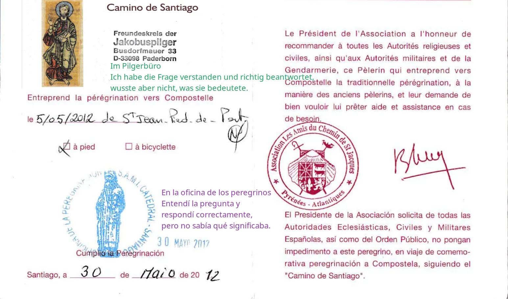

## Camino Francés  2012  

### Etapa-26: San Lázaro → Santiago de Compoetela  ( 2, 5 Km + x-Metros)
30 de Mai 2012

🇩🇪  –Ich kam sehr spät an und fragte dort nach–

#### Diese Verantwortung übergab ich meinen Händen

Am Abend davor **–checkte–** ich im Hotel San Lázaro ein, um in der Albergue Santo Santiago zu übernachten. Als ich fragte, wo ich meine Wäsche waschen könnte, bot man mir an: Wenn ich sie noch am selben Abend abgebe, bekäme ich sie am nächsten Tag zurück. Für nur 7 Euro erhielt ich meine gesamte Wanderkleidung frisch gewaschen, getrocknet und wunderbar gebügelt. Ich war gleichermaßen angenehm überrascht wie besorgt – jemand hatte meine Wäsche mit so viel Liebe behandelt, dass ich mich fragte, wie ich sie nun faltenfrei in meinen Rucksack packen sollte. Am Tag zuvor hatte ich meinen Füßen all meine Sorgen aufgebürdet; heute versprach ich ihnen Ruhe und übergab diese Verantwortung meinen Händen.

---

🇵🇹  –Cheguei muito tarde e perguntei lá–

#### Entreguei essa responsabilidade às minhas mãos

Na noite anterior, fiz o **–registo–** no Hotel San Lázaro para pernoitar no Albergue Santo Santiago. Quando perguntei onde poderia lavar a minha roupa, disseram-me que, se a entregasse nessa mesma noite, a receberia no dia seguinte. Por apenas 7 euros, devolveram-me toda a minha roupa de caminhada lavada, seca e maravilhosamente engomada. Fiquei tão surpreendido quanto preocupado – alguém tinha tratado a minha roupa com tanto carinho que me perguntei como a colocaria de volta na mochila sem a amarrotar. No dia anterior, tinha deixado os meus pés carregarem todas as minhas preocupações; hoje prometi-lhes descanso e entreguei essa responsabilidade às minhas mãos.

---

🇪🇸  –Llegué muy tarde y pregunté allí–

#### Esa responsabilidad la entregué a mis manos

La noche anterior, me **–registré–** en el Hotel San Lázaro para pasar la noche en el Albergue Santo Santiago. Cuando pregunté dónde podía lavar mi ropa, me dijeron que si la entregaba esa misma noche, la tendría al día siguiente. Por solo 7 euros, me devolvieron toda mi ropa de senderismo lavada, seca y maravillosamente planchada. Me quedé tan gratamente sorprendido como preocupado: alguien había tratado mi ropa con tanto amor que no sabía cómo guardarla en la mochila sin que se arrugara. El día anterior había dejado que mis pies cargaran con todas mis preocupaciones; hoy les prometí descanso y traspasé esa responsabilidad a mis manos.

---

🇬🇧 –I arrived very late and asked about it there–

#### I handed this responsibility over to my hands

The evening before, I **–checked–** in at Hotel San Lázaro to spend the night at the Albergue Santo Santiago. When I asked where I could do my laundry, they told me that if I handed it in that evening, I would get it back the next day. For just 7 euros, I received all my hiking clothes washed, dried, and beautifully ironed. I was both pleasantly surprised and worried—someone had treated my laundry with such care and love that I wondered how I was going to pack it back into my backpack without wrinkling it. The day before, I had let my feet carry all my worries; today, I promised them rest and transferred that responsibility to my hands.

---

#### En la Oficina del Peregrino

### 🇪🇸 Entendido, pero no comprendido

- **He entendido la pregunta y he respondido correctamente, pero no sabía qué significaba.** 

¿Dónde empezó todo esto? 

- **¿En Nájera, en León o quizás ya desde la planificación del viaje?**

En realidad, todo comienza en la fase de planificación con la incertidumbre del clima que nos espera, por lo que empacamos todo lo que consideramos necesario. Especialmente en el año 2012, muchos peregrinos, incluido yo, llevamos prendas para condiciones climáticas con las que, afortunadamente, nunca nos enfrentamos. Después de unas pocas etapas, uno se da cuenta de que, si no se deshace de unos cuantos kilos, se derrite literalmente bajo el calor de la Meseta y el peso de la mochila. Por eso, en Nájera envié unos kilos por correo postal. En un principio quería enviar el paquete directamente a Santiago, pero como allí el correo solo guardaba los paquetes durante tres semanas según la información disponible, opté por la oficina de correos de León, que está muy céntrica.

**Un consejo y sus consecuencias inesperadas** 

Poco antes de llegar a León, mientras descansaba y conversaba con otros peregrinos españoles sobre los albergues y las próximas etapas, les comenté que aún no sabía exactamente dónde pasaría la noche. Primero tenía que ir a la oficina de correos para reenviar mi paquete, ya que después disponía de tres semanas para recogerlo. Una monja, al percatarse de esto, se nos acercó y nos dijo que también era posible enviar los paquetes directamente a la "Oficina del Peregrino". Así fue como en León envié mi paquete directamente a la Oficina del Peregrino.

Cuando más tarde pregunté por mi envío en la "Oficina de Peregrino" de Santiago, una voz amable me preguntó si era miembro de los "Amigos de Santiago". Vacilé un momento y respondí que era miembro de la asociación alemana "Freundeskreis der Jakobuspilger Paderborn". Ella me dijo que, en ese caso, mi paquete ya debería estar en el alojamiento de los hospitaleros voluntarios. Como tenía que entrar a su turno, me llevó a paso ligero hacia el alojamiento de los hospitaleros, que creo que estaba muy cerca del _Café Tertulia_.

Al llegar, le pidió a un compañero estadounidense que se hiciera cargo de mí. Nos presentamos y el voluntario estadounidense, el hospitalero fue a mirar el paquete al punto de recogida situado a la entrada del salón-cocina, en la planta baja, en un rincón debajo de la escalera que da acceso a la planta superior.

**Me enseña una Bolsa de viaje amarilla que acababa de llegar.**

En ese momento me di cuenta de que había un malentendido. Le expliqué que era miembro de la asociación, pero no como voluntario activo, sino que pagaba una cuota anual y, a cambio, recibía material informativo sobre el Camino y eventos en Alemania.

Una vez aclarado todo, lo invité a una cerveza y me llevó a una cafetería en la esquina, justo al lado. Creo que era el _Café Tertulia_. Después de tantos años y tanto ajetreo, siempre queda alguna duda, pero al mirar esa esquina en Google Maps, me resulta muy familiar.

En ese momento tan agradable, le pregunté en mi rudimentario inglés cómo se había convertido en hospitalero. Me contó que, de alguna manera, esa vida nómada siempre había formado parte de él; estuvo en el ejército y siempre viajando de un lado a otro. Al hablar de las barreras lingüísticas y las dificultades para aprender un idioma, me enteré de que estuvo destinado mucho tiempo en Turquía y que el idioma turco, en cuanto a gramática, es muy fácil de aprender. Esto me sorprendió muchísimo, ya que desde 1986, he conocido a muchos compañeros de clase, compañeros de trabajo y conocidos turcos, pero no era consciente de este hecho (detalle).

>Una información y sus consecuencias inesperadas.
>
- Menos de 30 de los aproximadamente 3 millones de segundos del Camino Francés.
>Me había olvidado de ese pequeño detalle, pero cuando volví a repasar este día en Santiago —con pequeños malentendidos—, aquel momento, que se había quedado grabado en mi memoria, surgió de repente como un rayo salido de la nada. 

---
### 🇩🇪 Verstanden, aber nicht begriffen

- **Ich hatte die Frage zwar verstanden und richtig beantwortet, wusste aber nicht, was sie tatsächlich bedeutete.**

Wo nahm das alles eigentlich seinen Anfang? 

- **In Nájera, in León oder vielleicht schon bei der ersten Planung der Pilgerreise?***

Tatsächlich beginnt alles mit der Ungewissheit vor dem Start: Welches Wetter erwartet uns? Aus diesem Grund packen wir alles ein, was wir für notwendig halten. Besonders im Jahr 2012 nahmen viele Pilger – mich eingeschlossen – Kleidung für Wetterbedingungen mit, die glücklicherweise gar nicht eintraten. Nach den ersten Etappen wird einem jedoch schnell klar: Wenn man nicht ein paar Kilo loswird, schmilzt man unter der Hitze der Meseta und dem Gewicht des Rucksacks regelrecht dahin. Deshalb schickte ich bereits in Nájera einige Kilo per Post voraus. Eigentlich wollte ich das Paket direkt nach Santiago senden. Da die Post dort Sendungen laut Auskunft aber nur drei Wochen aufbewahrt und ich mehr Zeit brauchte, entschied ich mich für die zentral gelegene Postfiliale in León.

- **Ein Hinweis und seine unerwarteten Folgen.**

Kurz vor León legte ich eine Pause ein und tauschte mich mit spanischen Pilgern über die Herbergen und die nächsten Etappen aus. Ich erzählte ihnen, dass ich noch nicht wisse, wo ich als Nächstes übernachten würde. Zuerst musste ich zur Post, um mein Paket weiterzuleiten, da ich danach drei Wochen Zeit hatte, es abzuholen. Eine Nonne, die das Gespräch bemerkte, sprach uns an: Es sei auch möglich, Pakete direkt an die „Oficina del Peregrino“ zu schicken. So kam es, dass ich mein Paket in León direkt an das Pilgerbüro adressierte.

**- In der „Oficina de Peregrino“** 

Als ich später in der „Oficina de Peregrino“ in Santiago nach meiner Sendung fragte, erkundigte sich eine freundliche Stimme, ob ich Mitglied der „Amigos de Santiago“ sei. Ich zögerte kurz und antwortete, dass ich dem „Freundeskreis der Jakobuspilger Paderborn“ angehöre. Sie erklärte mir, dass mein Paket in diesem Fall bereits in der Unterkunft der ehrenamtlichen Hospitaleros liegen müsste. Da ihre Schicht ohnehin gerade begann, führte sie mich eiligen Schrittes dorthin – die Unterkunft lag, wenn ich mich recht erinnere, ganz in der Nähe des _Café Tertulia_.

Dort angekommen bat sie einen amerikanischen Kollegen, sich meiner anzunehmen. 

Wir stellten uns einander vor.  Dann suchte der amerikanische Hospitalero  die Sendung an der Sammelstelle am Eingang zum Wohn-/Küchenbereich im Erdgeschoss, in einer Ecke unter der Treppe, die zum Obergeschoss führt.

 - **Er zeigt mir einen Gelben Tasche, die vor kurz angekommen war.** 

In diesem Moment wurde mir klar, dass hier ein Missverständnis vorlag. Ich erklärte ihm, dass ich zwar Mitglied im Freundeskreis sei, allerdings kein aktiver Hospitalero, sondern ein passives Mitglied, das einen Jahresbeitrag zahlt und dafür Informationsmaterial und Einladungen zu Veranstaltungen in Deutschland erhält.

Nachdem wir das Missverständnis geklärt hatten, lud ich ihn als Dank auf ein Bier ein. Er führte mich in ein gemütliches Eckcafé direkt nebenan – ich bin mir fast sicher, dass es das _Café Tertulia_ war. Nach so vielen Jahren und all den Eindrücken bleibt ein kleiner Zweifel, aber wenn ich mir diese Ecke heute auf Google Maps anschaue, kommt sie mir sehr bekannt vor.

In diesem geselligen Moment fragte ich ihn in meinem rudimentären Englisch, wie er Hospitalero geworden sei. Er erzählte mir, dass dieses Leben in Bewegung schon immer zu ihm gehört habe; er war beim Militär und ständig an anderen Orten stationiert. Als das Gespräch auf Sprachbarrieren und die Schwierigkeiten beim Sprachenlernen kam, erzählte er, dass er lange Zeit in der Türkei stationiert gewesen sei und dass die türkische Sprache von der Grammatik her überraschend leicht zu lernen sei. Das verblüffte mich zutiefst. Seit 1986 habe ich viele türkische Schulkameraden, Arbeitskollegen und Bekannte kennengelernt – doch diese Tatsache war mir nicht bewusst.

>Eine Information und ihre unerwarteten Folgen.
>
- Weniger als 30 der rund 3 Millionen Sekunden des französischen Jakobswegs.
>Ich hatte diese kleine Information vergessen, doch als ich diesen Tag in Santiago – mit kleinen Missverständnissen – noch einmal Revue passieren ließ, tauchte dieser Moment, der sich in mein Gedächtnis eingebrannt hatte, plötzlich auf wie ein Blitz aus heiterem Himmel. 

---

### 🇵🇹 Compreendido, mas não entendido

- **Compreendi a pergunta e respondi corretamente, mas não sabia o que ela significava.** 

Onde terá começado tudo isto? 

 - **Em Nájera, em León ou talvez logo no planeamento da peregrinação?**

Na verdade, tudo começa na fase de planeamento e com a incerteza sobre o tempo que nos espera, razão pela qual levamos tudo o que consideramos necessário. Especialmente no ano de 2012, muitos peregrinos, incluindo eu, levaram agasalhos e roupas para condições meteorológicas com as quais, felizmente, nunca nos deparámos. Após algumas etapas, percebe-se que, se não nos livrarmos de alguns quilos, derretemos literalmente sob o calor da Meseta e o peso da mochila. Por isso, em Nájera, enviei alguns quilos por correio. Inicialmente, queria enviar o pacote diretamente para Santiago, mas como os correios de lá só guardavam as encomendas por três semanas, segundo as informações da época, optei pela estação de correios de León, que era central.

- **Um conselho e as suas consequências inesperadas** 

Pouco antes de chegar a León, enquanto fazia uma pausa e conversava com outros peregrinos espanhóis sobre os albergues e as próximas etapas, disse-lhes que ainda não sabia exatamente onde iria ficar. Primeiro precisava de ir aos correios para reencaminhar o meu pacote, pois depois teria três semanas para o levantar. Uma freira, ao notar a conversa, aproximou-se de nós e disse que também era possível enviar os pacotes diretamente para a "Oficina del Peregrino". Foi assim que, em León, enviei o meu pacote diretamente para o Gabinete do Peregrino.

- **Na "Oficina de Peregrino"** 

Quando mais tarde perguntei pela minha encomenda na "Oficina de Peregrino" em Santiago, uma voz simpática perguntou-me se eu era membro dos "Amigos de Santiago". Hesitei um pouco e respondi que era membro da associação alemã **"Freundeskreis der Jakobuspilger Paderborn".** Ela disse-me que, nesse caso, o meu pacote já deveria estar no alojamento dos hospitaleros voluntários. Como ela tinha de entrar ao serviço, levou-me a passo rápido até ao alojamento dos hospitaleros, que ficava, se bem me lembro, muito perto do _Café Tertulia_.

Ao chegarmos, ela pediu a um colega americano que tratasse do meu caso. 

Apresentámo-nos, e o hospitalero americano procurou a remessa no ponto de recolha situado na entrada da sala de estar/cozinha, no rés-do-chão, num canto debaixo da escada que dá acesso ao andar de cima.

- **Ele mostra-me um Saco de viagem amarelo que tinha chegado há pouco.**

 Nesse momento, percebi que havia um malentendido. Expliquei-lhe que era membro da associação, mas não como voluntário ativo; apenas pagava uma quota anual e, em troca, recebia material informativo sobre o Caminho e eventos na Alemanha.

Depois de esclarecermos tudo, convidei-o para uma cerveja e ele levou-me a um café de esquina, mesmo ao lado. Creio que era o _Café Tertulia_. Depois de tantos anos e de tanta azáfama, fica sempre alguma dúvida, mas quando olho para essa esquina no Google Maps, parece-me muito familiar.

Nesse momento de convívio, perguntei-lhe no meu inglês rudimentar como se tinha tornado hospitalero. Contou-me que, de certa forma, essa vida em movimento sempre fizera parte dele; estivera no exército e andava sempre de um lado para o outro. Quando falámos sobre as barreiras linguísticas e as dificuldades em aprender uma língua, soube que ele estivera destacado durante muito tempo na Turquia e que a língua turca, a nível gramatical, é muito fácil de aprender. Isso surpreendeu-me imenso, pois desde 1986, tive a oportunidade de conhecer muitos colegas de escola, colegas de trabalho e conhecidos turcos – mas não tinha consciência deste facto.

>Uma informação e as suas consequências inesperadas.
>
- Menos de 30 dos cerca de 3 milhões de segundos do Caminho Francês.
>Tinha-me esquecido dessa pequena informação, mas quando voltei a repassar este dia em Santiago – com pequenos mal-entendidos –, aquele momento, que tinha ficado gravado na minha memória, surgiu de repente como um relâmpago vindo do nada. 

---
### 🇬🇧 Understood, but not grasped

- ** I understood the question and answered it correctly, but I didn’t know what it meant.** 

Where did it all actually begin?

-  **In Nájera, in León, or perhaps as early as the planning stages of the pilgrimage?**

In truth, it all begins during the planning phase with the uncertainty of what weather awaits us, which is why we pack everything we think might be necessary. Especially back in 2012, many pilgrims—myself included—brought clothing for weather conditions that, fortunately, we never encountered. After a few stages, you quickly realize: if you don’t shed a few pounds, you will literally melt under the heat of the Meseta and the weight of your backpack. That is why I mailed a few kilos ahead while in Nájera. Originally, I wanted to send the package directly to Santiago, but according to the postal information available, they only held packages for three weeks. Since I needed more time, I chose the centrally located post office in León instead.

- **A Piece of Advice and Its Unexpected Consequences** 

Shortly before arriving in León, while taking a break and chatting with fellow Spanish pilgrims about the hostels and upcoming stages, I mentioned that I wasn’t sure where I would stay next. First, I had to go to the post office to forward my package, after which I would have three weeks to pick it up. A nun, noticing our conversation, approached us and said it was also possible to mail packages directly to the "Oficina del Peregrino." And so, in León, I addressed my package straight to the Pilgrim's Office.

- **At the "Oficina de Peregrino"** 

When I later inquired about my shipment at the "Oficina de Peregrino" in Santiago, a friendly voice asked if I was a member of the "Amigos de Santiago." I hesitated for a moment and replied that I belonged to the German association "Freundeskreis der Jakobuspilger Paderborn." She told me that, in that case, my package should already be at the volunteer hospitaleros' quarters. Since she was about to start her shift, she walked me briskly to the accommodation, which, if I remember correctly, was very close to _Café Tertulia_.

Once there, she asked an American colleague to take care of me. 

We introduced ourselves, and the American volunteer—the hospitalero—searched for the parcel at the collection point located at the entrance to the living room/kitchen on the ground floor, in a corner under the stairs leading to the upper floor. 

- **He shows me a yellow Travel bag  that had just arrived.**

At that moment, it dawned on me that there had been a misunderstanding. I explained to him that while I was indeed a member of the association, I was not an active volunteer, but rather a passive member who paid an annual fee and in return received information about the Camino and events in Germany.

Once everything was cleared up, I treated him to a beer as a thank you, and he led me to a cozy corner café right next door—I am almost certain it was _Café Tertulia_. After so many years and so many impressions, a little doubt always remains, but looking at that corner on Google Maps today, it looks very familiar.

During this friendly chat, I asked him in my rudimentary English how he had become a hospitalero. He told me that this life on the move had somehow always been a part of him; he had been in the military and was constantly stationed in different places. When our conversation turned to language barriers and the difficulties of learning a language, I learned that he had been stationed in Turkey for a long time and that the Turkish language, grammatically speaking, is surprisingly easy to learn. This completely astonished me. Since 1986, I have got to know many Turkish schoolmates, work colleagues and acquaintances – but I wasn’t aware of this fact.

---

> A piece of information and its unexpected consequences.
>
- Less than 30 of the roughly 3 million seconds of the French Way.
>
> I had forgotten that little detail, but when I looked back on that day in Santiago—with its minor misunderstandings—that moment, which had remained etched in my memory, suddenly came to me like a bolt of lightning out of nowhere. 

---

  

🇬🇧 🇪🇸 🇵🇹 🇩🇪

---

**↪** [Etapa-27_Seminario-Menor_Catedral-de-Santiago-de-Compostela](Etapa-27_Seminario-Menor_Catedral-de-Santiago-de-Compostela.md)

 🔁 [Camino-Frances_Etapas](Camino-Frances_Etapas.md)

 ...→