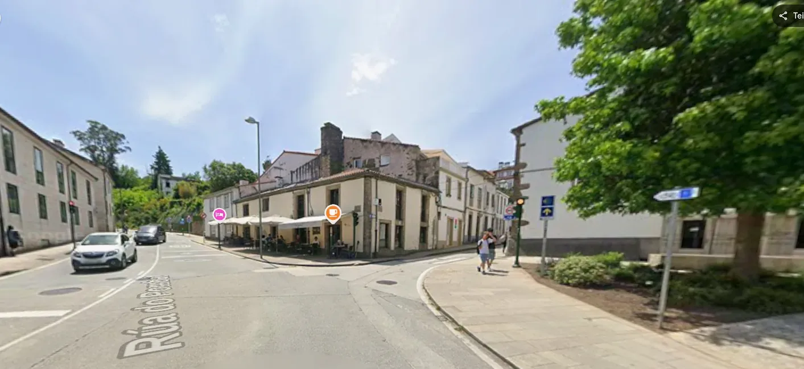

## Camino Francés  2012  

### Etapa-27: Seminario-Menor ←→ Catedral de Santiago de Compostela  ( ca. 1,3 + 1,3 Km)
31 de Mai 2012

**Café Tertulia**
### 🇬🇧 In a corner like this, right nearby
I could swear that I treated an American “hospitalero” to a beer in this very bar and that the lodging was right nearby.

---
- Information about the **Oficina del Peregrino**
- - **The former Oficina del Peregrino** was located at **Rúa do Vilar 1** in the historic center of Santiago de Compostela before it moved to the Casa do Deán.
- - **Current location:** In 2015, the Oficina del Peregrino moved to the newly built Centro Internacional de Acogida al Peregrino at **Rúa das Carretas 33**.

---
- Info: Packages addressed directly to the main post office near the Oficina del Peregrino in Santiago (on Rúa do Franco) are traditionally held by the postal service for pilgrims for up to 30 or even 45 days.
- Note (as of 2024): In San Sebastián, the post office asked me about the desired storage period, and I believe a small fee is now charged for this service.

---
### 🇩🇪 In einer Ecke wie dieser, ganz in der Nähe

 Ich könnte  schwören, dass ich in dieser Bar einen amerikanischen „Hospitalero“ auf ein Bier eingeladen habe und dass die Unterkunft ganz in der Nähe lag.

- Infos zur **Oficina del Peregrino**
- - **Die ehemalige Oficina del Peregrino** befand sich vor ihrem Umzug in der Casa do Deán in der **Rúa do Vilar 1** im historischen Zentrum von Santiago de Compostela.

- - **Heutiger Standort:** Im Jahr 2015 zog die Oficina del Peregrino in das neu errichtete Centro Internacional de Acogida al Peregrino in der **Rúa das Carretas 33** um.

---
- Info: Pakete, die direkt an **die zentrale Postfiliale** nahe der Oficina del Peregrino in Santiago **(in der Rúa do Franco)** adressiert werden, lagert die Post für Pilger traditionell bis zu 30 oder sogar 45 Tage ein.
- Hinweis (Stand 2024): In San Sebastián erkundigte sich die Post bei mir nach der gewünschten Aufbewahrungsfrist; für diesen Service fällt mittlerweile eine geringe Gebühr an.

---
#### 🇪🇸 En un rincón como este, muy cerca
Juraría que fue  en este bar donde invité a una cerveza a un «hospitalero» estadounidense y que el alojamiento estaba muy cerca.

- Información sobre la **Oficina del Peregrino**
- - **La antigua Oficina del Peregrino**, antes de su traslado, se encontraba en la Casa do Deán, en la **Rúa do Vilar, 1**, en el centro histórico de Santiago de Compostela.
- - **Ubicación actual:** En 2015, la Oficina del Peregrino se trasladó al recién inaugurado Centro Internacional de Acogida al Peregrino, en la **Rúa das Carretas, 33**.

---
- Información: Los paquetes dirigidos directamente a la oficina principal de correos cerca de la Oficina del Peregrino en Santiago (en la Rúa do Franco) son almacenados tradicionalmente por el servicio postal para los peregrinos hasta por 30 o incluso 45 días.
- Nota (año 2024): En San Sebastián, el personal de correos me preguntó por el periodo de almacenamiento y creo que ahora se cobra una pequeña tarifa por este servicio.**

---
#### 🇵🇹 Num canto como este, muito perto
Podia jurar que foi  neste bar que convidei um «hospitalero» americano para tomar uma cerveja e que o alojamento ficava mesmo ali perto.

- Informações sobre a **Oficina do Peregrino**
- - **A antiga Oficina do Peregrino**, antes de se mudar, situava-se na Casa do Deán, na **Rúa do Vilar, n.º 1**, no centro histórico de Santiago de Compostela.
- - **Localização atual:** Em 2015, a Oficina del Peregrino mudou-se para o recém-construído Centro Internacional de Acogida al Peregrino, na **Rúa das Carretas, n.º 33.**

---

- Informação: As encomendas enviadas diretamente para a estação central de correios perto da Oficina del Peregrino em Santiago (na Rúa do Franco) são tradicionalmente guardadas pelos correios para os peregrinos por até 30 ou 45 dias.
- Nota (ano 2024): Em San Sebastián, os correios perguntaram-me pelo prazo de armazenamento e creio que agora cobram uma pequena taxa por este serviço.

---

  

🇬🇧 🇪🇸 🇵🇹 🇩🇪

---

**↪** [Etapa-28_Seminario-Menor_Catedral-de-Santiago-de-Compostela](Etapa-28_Seminario-Menor_Catedral-de-Santiago-de-Compostela.md)

 🔁 [Camino-Frances_Etapas](Camino-Frances_Etapas.md)

 ...→