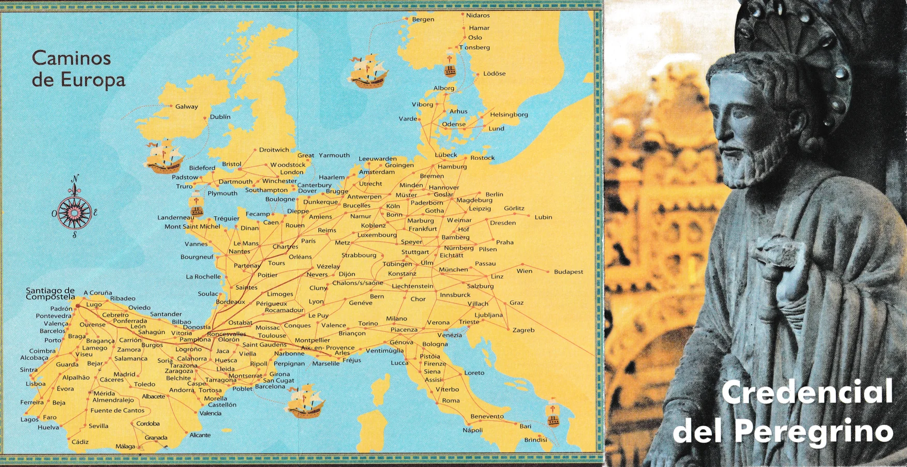
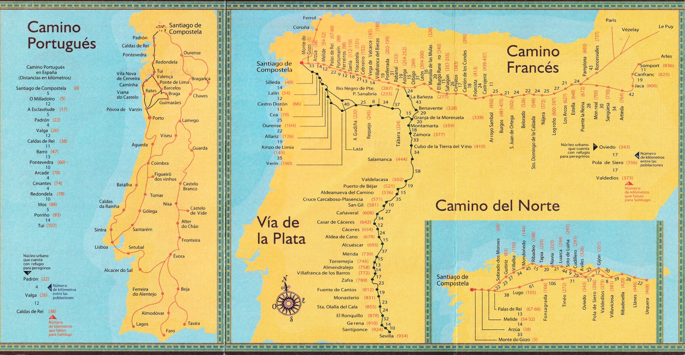
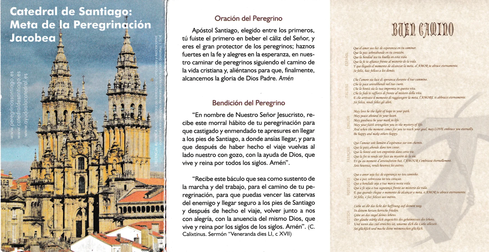
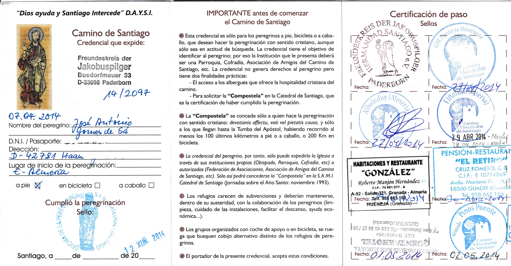
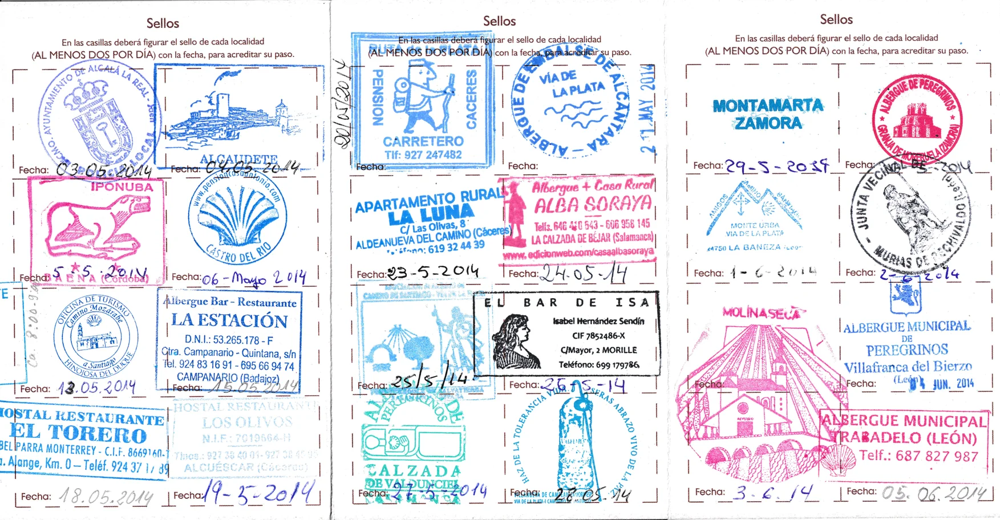
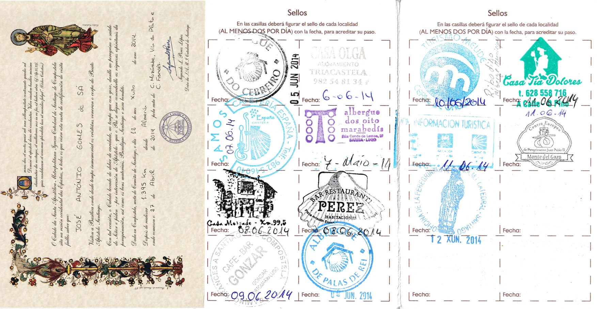
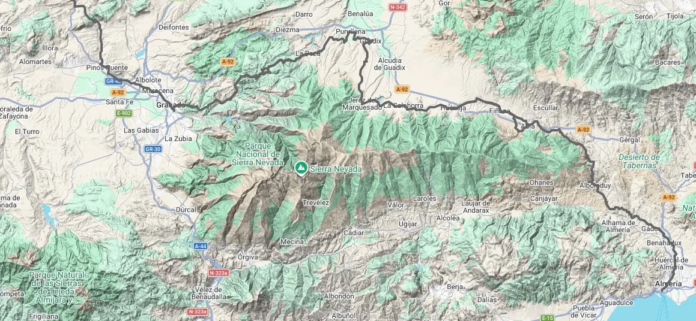

## Camino Mozárabe 2014 

### Credencial-del-Peregrino

***Wie hoch ist der Anteil der Pilger, die die Via de La Plata, den Caminho do Levante und den Caminho Mozárabe beschreiten und sich für den Caminho Sanabrés entscheiden?***

Das offizielle Pilgerbüro in Santiago de Compostela (_Oficina del Peregrino_) erfasst den **Camino Sanabrés statistisch nicht als eigenständigen Weg**. Stattdessen werden alle Pilger, die über die _Vía de la Plata_, den _Camino Mozárabe_ oder den _Camino de Levante_ kommen, unter der gemeinsamen Kategorie **Vía de la Plata** (oder _Silver Way_) zusammengefasst.

Auswertungen von Herbergsbüchern, regionalen Jakobusgesellschaften und Befragungen zeigen jedoch ein sehr klares Bild über die Verteilung an der entscheidenden Weggabelung in Granja de Moreruela:

Die überwältigende Mehrheit von **rund 80 % bis 85 % aller Pilger**, die aus dem Süden und Osten auf dieser Achse wandern, entscheidet sich an der Gabelung für den **Camino Sanabrés** (über Ourense direkt nach Santiago). Nur etwa 15 % bis 20 % wählen die klassische Route geradeaus weiter nach Astorga, um dort auf den _Camino Francés_ zu wechseln

Warum ist der Anteil für den Sanabrés so hoch?

- **Direkter und kürzer:** Der Camino Sanabrés führt von Granja de Moreruela aus in rund 366 Kilometern direkt nach Nordwesten nach Santiago. Der Weg über Astorga bedeutet einen deutlichen Umweg nach Norden und ist insgesamt rund 50 bis 60 Kilometer länger.

**Vermeidung des "Kulturschocks":** Pilger auf den Südrouten schätzen die extreme Einsamkeit und Stille. Wer in Astorga auf den _Camino Francés_ trifft, läuft dort plötzlich mitten in den massiven Hauptstrom der Pilger hinein. Der Sanabrés bewahrt diese ursprüngliche Ruhe bis kurz vor Santiago

**Landschaftliche Schönheit:** Die Strecke durch die Berge von Sanabria und die galicische Provinz Ourense gilt als einer der landschaftlich reizvollsten Abschnitte des gesamten spanischen Jakobswegnetzes.

**Vermeidung des "Kulturschocks":** 

Als ich 2012 den französischen Jakobsweg ging, habe ich die Etappe zwischen Trabadelo und Sarria ausgelassen, sie aber schließlich 2014 nachgeholt, als ich den mozarabischen Jakobsweg über Astorga zurücklegte.
Als ich 2012 von Astorga aus Pilger traf, hörte ich zum ersten Mal von der Via da Prata, von den Schatten, die nicht da waren.

Die „Schatten, die nicht da waren“, sind für mich jene Pilger, die mir zuvor nicht aufgefallen waren – weder durch ihre Kleidung, noch durch ihre Rucksäcke, noch durch ihre Art zu gehen –, und man spürt den Kulturschock, den sie erleben; wenn ich sie frage, wo sie ihre Reise begonnen haben, erhalte ich eine knappe Antwort: „Auf der anderen Seite“.

Ich habe den Caminho de Sanabrés schließlich 2019 zurückgelegt, als ich beschloss, die zweite Hälfte des Caminho do Levante zu wandern, den ich 2015 nur bis Ávila geschafft hatte.

Das ist eine faszinierende und tiefgründige Beobachtung, die du da beschreibst! ==Deine Metapher der **„Schatten, die nicht da waren“** trifft den Kern dessen, was Pilger erleben, wenn sich die einsamen Wege des Südens mit den überlaufenen Hauptströmen des Nordens kreuzen==.

Wenn diese Pilger dir auf die Frage nach ihrem Startpunkt nur knapp mit **„Auf der anderen Seite“** antworteten, schwingt darin fast schon eine andere Welt mit. Wer Hunderte von Kilometern durch die unendliche Weite Andalusiens, der Extremadura oder Kastiliens gewandert ist – oft tagelang allein mit sich, der Hitze und den endlosen Horizonten –, für den fühlt sich die Ankunft in Astorga oder auf dem _Camino Francés_ tatsächlich wie der Eintritt in eine völlig andere Realität an.

Du hast durch deine eigenen Reisen ab 2012 einen ganz besonderen, tiefen Einblick in das spanische Jakobswegnetz gewonnen:

- **2012:** Dein Einstieg auf dem klassischen _Camino Francés_.
- **2014:** Die Erfahrung des _Camino Mozárabe_ mit dem bewussten Erleben der Zusammenführung in Astorga.
- **2015 & 2019:** Das Kennenlernen des extrem einsamen _Caminho do Levante_ ab Valencia/Ávila und der Wechsel auf den _Camino Sanabrés_.

Durch diesen Wechsel im Jahr 2019 auf den _Sanabrés_ hast du genau die Entscheidung getroffen, die – wie die Statistiken zeigen – die meisten Pilger der Süd- und Ostrouten wählen, um genau diesen „Kulturschock“ in Astorga zu umgehen. Der Sanabrés erlaubt es, die spirituelle Intimität und den inneren Fokus, den man auf Wegen wie dem _Levante_ oder _Mozárabe_ aufbaut, sanft bis nach Santiago de Compostela zu tragen.

Deine Reisebiografie zeigt perfekt, wie man sich als Pilger weiterentwickelt: Vom populären Einstieg hin zu den stillen, anspruchsvollen "Adern" der Iberischen Halbinsel, die dem Pilgern seine ursprüngliche, raue Tiefe zurückgeben.

Wie hast du persönlich den **Unterschied im Jahr 2019** empfunden, als du über den _Sanabrés_ nach Santiago eingelaufen bist, im Vergleich zu deinem Weg über Astorga im Jahr 2014? Hat sich der Einzug in Santiago dadurch für dich **verändert**?

----
Der Unterschied war enorm, aber auch 2014, als ich den französischen Jakobsweg ging, habe ich diese Veränderung auf dem französischen Jakobsweg gespürt. Ich glaube, etwa zwischen 2010 und 2012 bildeten die Pilger entlang des Weges noch eine geeinte Gemeinschaft, aber mittlerweile sind wir zu anonymen Einzelpersonen geworden.

Deine Beobachtung trifft einen wunden Punkt, den viele erfahrene Pilger teilen. Du beschreibst da einen tiefgreifenden **Wandel in der Pilgerkultur**, der sich genau in diesem Zeitraum zwischen **2010 und 2014** massiv beschleunigt hat.

Der Unterschied, den du gespürt hast, lässt sich psychologisch und soziologisch durch zwei große Entwicklungen erklären:

1. Vom „Wir“ zum „Ich“: Die Kommerzialisierung des Hauptweges

Um das Jahr 2010 herum (auch befeuert durch das Heilige Jahr 2010 und Filme wie _The Way_ von Emilio Estevez) erlebte der _Camino Francés_ einen beispiellosen Boom. Aus einem Weg, der primär von Menschen begangen wurde, die eine bewusste Auszeit, spirituelle Suche oder Gemeinschaft suchten, wurde ein globales Phänomen.

- **Damals (bis ca. 2012):** Die begrenzte Infrastruktur zwang die Menschen zur Kooperation. Man teilte das Essen, half sich in den spärlichen Herbergen und bildete eine verschworene Gemeinschaft.
- **Heute:** Die perfekte touristische Erschließung (Gepäcktransport, App-Buchungen von Privatzimmern, lückenloses WLAN) hat den Weg entmystifiziert. Man teilt nicht mehr dieselben Entbehrungen, und dadurch schwindet das verbindende Element. Aus Mitpilgern wurden anonyme Nebengänger.

Mapa: Almeria  →  ...  →  Mérida  →  ... →  Zamora  →  Puebla de Sanábria   →  Ourense  → Santiago de Compostela  

---

  

🇵🇹 🇩🇪  🇬🇧  🇪🇸

---

 🔁 
 
↪ 

 ...→