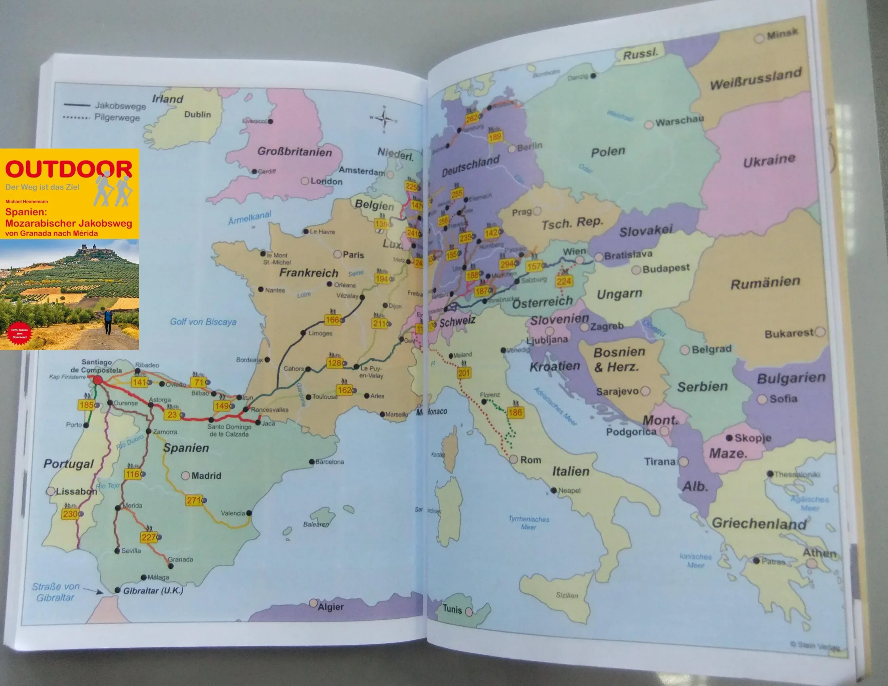
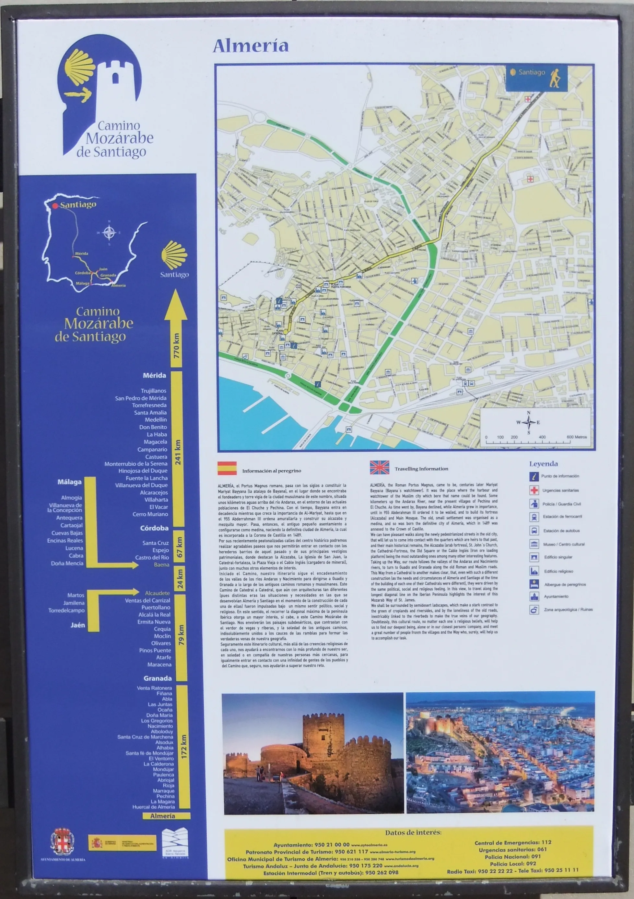
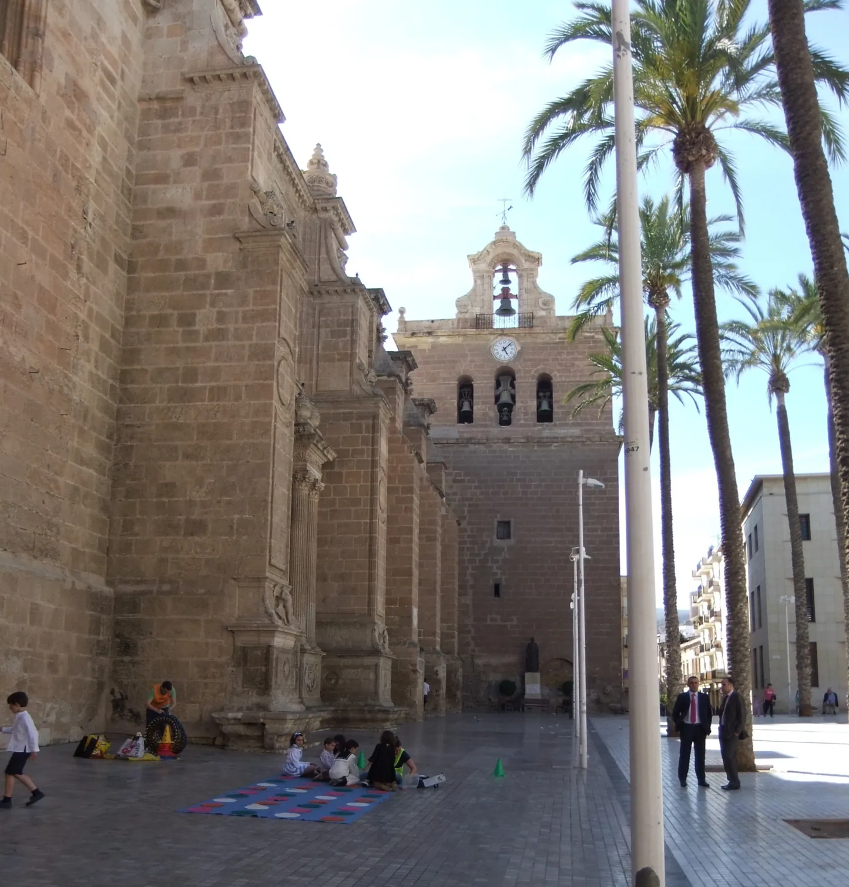
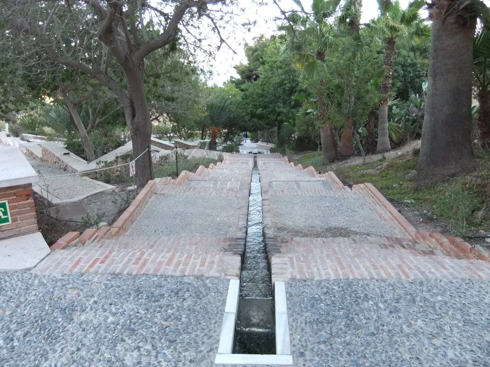
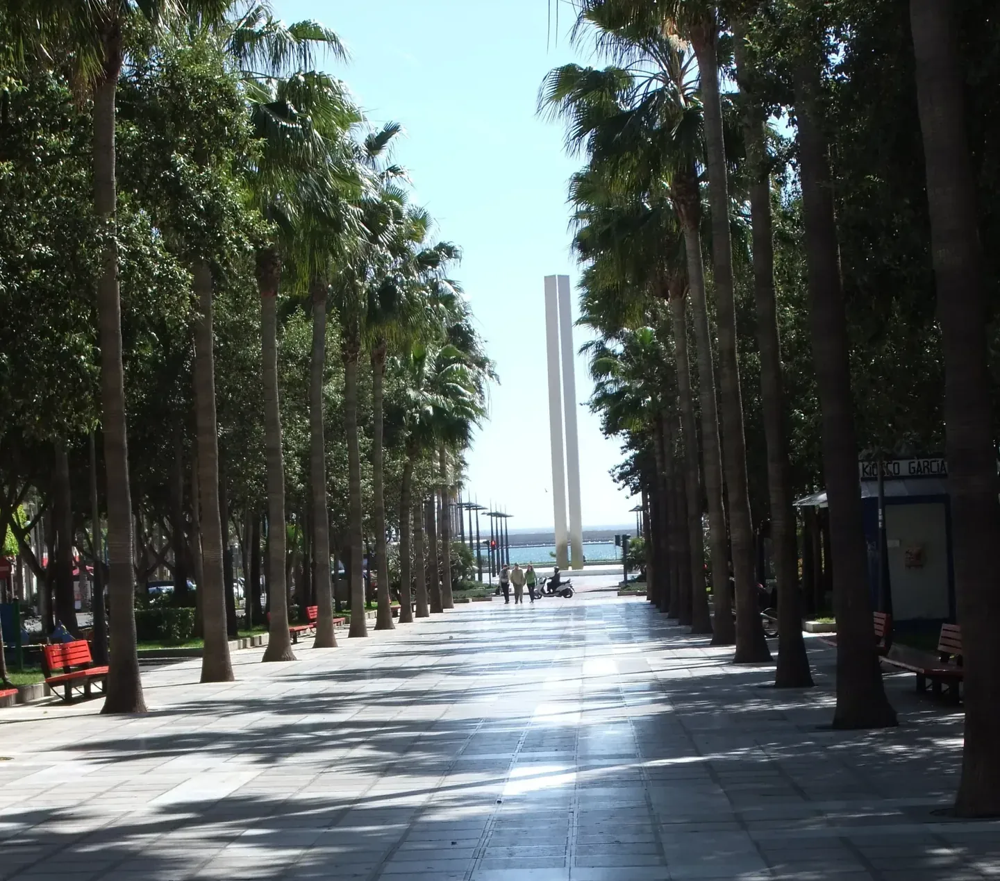

## Camino Mozárabe 2014 

### Die Reise : Wuppertal 🚆Düsseldor  ✈️  Malaga 🚌 Almeria (ca. 2500 Km)
26 Abril 2014

---
#### 🇵🇹 A minha primeira viagem de avião – como é que isto funciona?

Desde o início dos anos 90 que ouvia repetidamente: "Estás sozinho, és livre e podias voar para qualquer lado. Tu podes pagar isso!". Os conhecidos costumavam acrescentar: "Eu não posso pagar isso com a família inteira, por isso, nas férias, só viajamos de carro." Eu respondia sempre: Eu também não tenho dinheiro para um Mercedes ou um BMW – caso contrário, mal me restaria dinheiro para respirar. E, no entanto, os meus conhecidos com os seus carros de luxo pareciam dar-se lindamente.

Contudo

**Contudo**, importa dizer que isto só era possível porque as suas esposas faziam grandes sacrifícios. Cuidavam da casa e dos filhos e, mesmo assim, trabalhavam fora. Algumas recebiam ainda apoio dos pais, e o Estado ajudava um pouco com abonos de família e benefícios fiscais. Em contrapartida, os maridos estavam sempre disponíveis como motoristas para os filhos e as esposas. Reservavam a manhã de sábado para polir o carro e pô-lo a brilhar, para poderem levar a família a passear aos sábados à tarde, à missa aos domingos ou de férias. No entanto, só soube de muitos pormenores porque alguns familiares ligavam para o trabalho a pedir ao "motorista pessoal" para passar na padaria porque o pão tinha acabado, ou dizendo: "Podes vir buscar-me? O comboio acabou de passar e deixou-me aqui ao frio." Para mim, isso parecia uma vida de Mercedes e BMW bastante stressante.

**Uma pequena nota de rodapé:** alguns colegas com família que tinham o mesmo trabalho dependiam da assistência social. Acabavam por fazer o seu serviço social de motorista familiar num Fiat Panda.

Até esse dia, tinha feito 95% das minhas viagens de autocarro e comboio. No dia a dia, fazia quase tudo a pé. Tenho de admitir, com alguma ironia, que com o desgaste das solas dos meus sapatos poluía o meio ambiente quase tanto como os meus colegas com os pneus dos seus carros.

#### A preparação da minha viagem

Cerca de dois ou três meses antes desta longa peregrinação, informei-me sobre as várias formas de chegar a Almería. Descobri que voar para Málaga e depois apanhar um autocarro para Almería era mais barato do que fazer a viagem toda de autocarro a partir de Düsseldorf – e significativamente mais barato do que o comboio.

#### Mas como se voa, afinal?

Tudo o que eu sabia sobre voar vinha do meu tempo de escola primária na minha aldeia. Naquela altura, os carros de bois eram o meio de transporte por excelência para levar os poucos turistas que se perdiam por lá de um lugar para o outro. Lembrava-me especialmente da história daquele antigo grego – que, segundo diziam, era muito jovem – que construiu umas asas. Ao tentar conquistar o céu, aproximou-se demasiado do sol, caiu e partiu os ossos todos. Não eram propriamente memórias motivadoras para enfrentar o meu primeiro voo.

#### O desafio

Pode parecer ridículo hoje em dia, mas enfrentava um desafio enorme.  Só tinha estado num aeroporto duas vezes, quando fui buscar e levar alguém – no final de maio e início de junho de 1998, no Porto –, nada mais. 

Dark Run

Essa semana ficará bem gravada na memória dos transportes públicos, e na minha em particular, porque é o meu meio de transporte preferido e eu fazia parte daqueles que fizeram e fazem tudo o que está ao seu alcance para que isso não aconteça, mas aconteceu.

Como costuma acontecer, os colegas ajudavam mais com conselhos do que com ações. Mas, baseando-me na minha experiência atual, os conselhos foram bastante úteis: "Encomenda simplesmente pela internet!"

Como no final de 2011 me tinha modernizado um pouco para me aproximar da civilização, já tinha internet em casa. No entanto, quando chegou o momento de pagar, o sistema pediu-me um cartão de crédito. Perguntei-me: quem é que tem uma coisa dessas e para que é que isso serve? Será mais uma dessas coisas da internet? Como tudo me ultrapassava e ainda tinha de estudar a rota para o aeroporto de Düsseldorf, decidi ir diretamente lá perguntar. Eles saberiam certamente como funcionava tudo.

De repente, deparei-me com uma funcionária da companhia aérea muito simpática que falava várias línguas. Explicou-me tudo perfeitamente em português e reservou o voo para mim. Depois de ir ao meu banco e fazer a transferência, recebi pelo correio o primeiro bilhete de avião da minha vida.

Na manhã de sábado, 26 de abril de 2014, amanheceu aquele que seria um dos dias mais emocionantes da minha vida. Queria finalmente saber qual era a sensação de voar acima das nuvens e, ao mesmo tempo, estava prestes a começar uma peregrinação num dos Caminos de Santiago mais longos e exigentes de Espanha.

#### A deceção

Quando finalmente entrei no avião e me sentei, fui invadido por uma deceção. Tudo me parecia estranhamente familiar; já conhecia aquele ambiente dos meios de transporte terrestres. Pior ainda: calhou-me um lugar nas filas da frente sem janela. Embora estivesse acima das nuvens, não conseguia ver o céu. No autocarro isto não me teria acontecido.

Depois desta experiência, consegui um cartão de crédito. A instituição financeira mudou tanto de dono e de país ao longo do tempo que acabei por ter números de conta em países onde nunca tinha estado antes. Mas funcionou maravilhosamente: a notificação do levantamento do dinheiro chegava ao meu telemóvel mais rápido do que a companhia aérea demorava a confirmar-me a reserva do voo.

Graças a esse cartão, a partir daí pude reservar os meus voos online sem problemas e escolher o meu lugar. Desde então, tirei tantas fotografias acima das nuvens que poderia empapelar o céu inteiro com elas.

---
#### 🇩🇪 Mein erster Flug – wie geht das eigentlich?

Seit Anfang der 90er-Jahre hörte ich immer wieder: „Du bist allein und frei und könntest überall hinfliegen. Du kannst dir das doch leisten!“ Bekannte ergänzten dann meist noch: „Ich kann mir das mit der ganzen Familie nicht leisten, deshalb fahren wir im Urlaub nur mit dem Auto.“ Ich erwiderte daraufhin immer: Ich kann mir auch keinen Mercedes oder BMW leisten – sonst bliebe mir am Ende kaum mehr als Luft zum Atmen. Und dennoch schien es meinen Bekannten mit ihren Luxusautos blendend zu gehen.

Dazu muss man allerdings sagen

**Dazu muss man allerdings sagen:** Das war oft nur möglich, weil ihre Frauen große Opfer brachten. Sie kümmerten sich um den Haushalt und die Kinder und gingen trotzdem arbeiten. Einige erhielten zudem Unterstützung von den Eltern, und der Staat half ein wenig mit Kindergeld und Steuervergünstigungen. Im Gegenzug standen die Ehemänner den Kindern und Ehefrauen jederzeit als Chauffeure zur Verfügung. Der Samstagvormittag war dafür reserviert, das Auto auf Hochglanz zu polieren, um die Familie samstagnachmittags zu Ausflügen, sonntags zur Messe oder eben in den Urlaub zu fahren. Viele Details erfuhr ich jedoch nur, weil Familienmitglieder während der Arbeitszeit anriefen und den persönlichen Chauffeur baten: „Kannst du beim Bäcker vorbeifahren, das Brot ist alle?“ oder „Kannst du mich abholen? Der Zug ist gerade an mir vorbeigefahren und hat mich hier in der Kälte stehen lassen.“ Das klang für mich nach einem ziemlich stressigen Mercedes-BMW-Leben.

**Eine kleine Randnotiz:** Einige Kollegen mit Familie, die denselben Job hatten, waren sogar auf Sozialhilfe angewiesen. Sie leisteten ihren familiären Fahrdienst dann eben als Sozialdienst mit einem Fiat Panda.

Bis zu diesem Tag hatte ich 95 % meiner Reisen mit Bus und Bahn zurückgelegt. Im Alltag erledigte ich fast alles zu Fuß. Ich muss leider mit etwas Ironie zugeben, dass ich die Umwelt mit dem Abrieb meiner Schuhsohlen fast genauso stark belastete wie meine Kollegen mit den Reifen ihrer Autos.

#### Die Vorbereitung meiner Reise

Etwa zwei oder drei Monate vor dieser langen Pilgerreise informierte ich mich über die verschiedenen Möglichkeiten, nach Almería zu gelangen. Ich stellte fest, dass ein Flug nach Málaga und die anschließende Weiterfahrt mit dem Bus nach Almería günstiger waren als eine reine Busfahrt von Düsseldorf aus – und deutlich günstiger als der Zug.

#### Aber wie fliegt man eigentlich?

Alles, was ich über das Fliegen wusste, stammte aus meiner Grundschulzeit in meinem Dorf. Damals waren von Ochsen gezogene Karren noch das Hauptverkehrsmittel, um die wenigen Touristen, die sich dorthin verirrten, von einem Ort zum anderen zu bringen. Besonders im Gedächtnis geblieben war mir die Geschichte von dem alten Griechen – der, wie man sagt, noch sehr jung war –, der sich Flügel wachsen ließ. Beim Versuch, den Himmel zu erobern, kam er der Sonne zu nahe, stürzte ab und brach sich alle Knochen. Das waren nicht gerade motivierende Erinnerungen, um meinen ersten Flug in Angriff zu nehmen.

Wie hieß dieser alte Grieche noch mal? Es gab einfach zu viele…

### Ikurus – so sein Name

Die griechische Sage von Ikarus erzählt von Übermut und den Gefahren, menschliche Grenzen zu überschreiten

1. Vorgeschichte und Gefangenschaft

- **Der Erfinder:** Ikarus war der Sohn des genialen Baumeisters und Erfinders **Daidalos**.
- **Das Labyrinth:** Weil Daidalos König Minos von Kreta geholfen hatte (unter anderem durch den Bau des Labyrinths für den Minotaurus), hielt der König Vater und Sohn auf der Insel Kreta gefangen
2. Die Flucht mit den Wachsflügeln

- **Der Plan:** Daidalos baute für sich und Ikarus Flügel aus Vogelfedern, die mit Wachs und Garn zusammengehalten wurden.
- **Die Warnung:** Vor dem Abflug schärfte Daidalos seinem Sohn ein, einen **mittleren Kurs** zu steuern. Er durfte weder zu tief fliegen (damit die Feuchtigkeit des Meeres die Federn nicht beschwert) noch zu hoch (damit die Hitze der Sonne das Wachs nicht schmilzt)

1. Der Absturz

- **Der Übermut:** Vom berauschenden Gefühl des Fliegens mitgerissen, vergaß Ikarus die Warnung seines Vaters.
- **Das Ende:** Er stieg immer höher zur Sonne empor. Die Hitze schmolz das Wachs, die Federn lösten sich, und Ikarus stürzte ins Meer und ertrank. Das Gewässer, in das er fiel, trägt seither den Namen _Ikarisches Meer_

Bedeutung

Die Geschichte ist ein klassisches Beispiel für **Hybris** (göttlicher beziehungsweise menschlicher Übermut). Sie mahnt dazu, das rechte Maß zu wahren und Rat sowie Grenzen zu respektieren

#### Die Herausforderung

Es mag heute lächerlich klingen, aber ich stand vor einer enormen Herausforderung. Ich war bisher nur zweimal auf einem Flughafen gewesen, als ich jemanden abholte oder hinbrachte – Ende Mai und Anfang Juni 1998 in Porto –, mehr nicht. 

Dark Run

Diese Woche wird mir in Bezug auf den öffentlichen Nahverkehr besonders in Erinnerung bleiben – und mir ganz besonders, denn er ist mein bevorzugtes Verkehrsmittel, und ich gehörte zu denen, die alles in ihrer Macht Stehende getan haben und tun, damit so etwas nicht passiert, aber es ist doch passiert.

Wie so oft standen mir die Kollegen eher mit guten Ratschlägen als mit Taten zur Seite. Aus heutiger Sicht waren ihre Tipps aber durchaus nützlich: „Bestell doch einfach über das Internet!“

Da ich mich Ende 2011 technisch ein wenig auf den neuesten Stand gebracht hatte, um der Zivilisation ein Stück näherzukommen, besaß ich tatsächlich einen Internetanschluss. Als es dann so weit war, verlangte das System jedoch eine Kreditkarte. Ich fragte mich: Wer hat so etwas und wozu braucht man das? Ist das auch so ein Internet-Ding? Da mir alles über den Kopf wuchs und ich ohnehin den Weg zum Düsseldorfer Flughafen auskundschaften musste, beschloss ich, direkt vor Ort nachzufragen. Die mussten es ja ganz bestimmt wissen.

Plötzlich stand ich einer sehr freundlichen Mitarbeiterin der Fluggesellschaft gegenüber, die mehrere Sprachen sprach. Sie erklärte mir alles geduldig auf Portugiesisch und buchte den Flug für mich. Nachdem ich zu meiner Bank gegangen war und die Überweisung getätigt hatte, erhielt ich per Post das erste Flugticket meines Lebens.

Am frühen Morgen des Samstags, den 26. April 2014, stand mir einer der aufregendsten Tage meines Lebens bevor. Ich wollte endlich wissen, wie es sich anfühlt, über den Wolken zu fliegen. Gleichzeitig war es der Beginn einer Pilgerreise auf einem der längsten und anspruchsvollsten Jakobswege Spaniens.

#### Die Enttäuschung

Als ich schließlich das Flugzeug betrat und mich hinsetzte, machte sich Enttäuschung breit. Alles wirkte seltsam vertraut. Diese Atmosphäre kannte ich bereits aus den irdischen Verkehrsmitteln. Schlimmer noch: Ich saß in einer der vorderen Reihen auf einem Platz ohne Fenster. Obwohl ich mich über den Wolken befand, konnte ich den Himmel nicht sehen. Im Bus wäre mir so etwas nicht passiert.

Nach dieser Erfahrung besorgte ich mir eine Kreditkarte. Das dazugehörige Kreditinstitut wechselte im Laufe der Zeit so oft den Besitzer oder zog von einem Land ins andere, dass ich schließlich Kontonummern in Ländern besaß, in denen ich noch nie zuvor gewesen war. Aber es hat wunderbar funktioniert: Die Abhebung des Geldes wurde mir auf dem Handy angezeigt, noch bevor die Fluggesellschaft mir die eigentliche Flugbuchung bestätigt hatte.

Dank dieser Karte konnte ich fortan meine Flüge problemlos online buchen und meinen Sitzplatz selbst wählen. Seitdem habe ich so viele Fotos über den Wolken gemacht, dass ich damit den gesamten Himmel tapezieren könnte.

---
#### 🇪🇸 Mi primer vuelo: ¿cómo funciona esto?

Desde principios de los noventa escuchaba una y otra vez: "Estás solo, eres libre y podrías volar a cualquier parte. ¡Tú te lo puedes permitir!". Mis conocidos solían añadir: "Yo no me lo puedo permitir con toda la familia, por eso en vacaciones solo viajamos en coche". Yo les respondía siempre: Tampoco yo puedo permitirme un Mercedes o un BMW, ya que de lo contrario apenas me quedaría dinero para respirar. Y sin embargo, a mis conocidos con sus coches de lujo parecía irles de maravilla.

Hay que decir

**Hay que decir,** no obstante, que esto solo era posible porque sus esposas hacían grandes sacrificios. Se encargaban de la casa y de los niños y, aun así, trabajaban fuera. Algunas recibían además apoyo de sus padres, y el Estado ayudaba un poco con subsidios familiares y ventajas fiscales. A cambio, los maridos estaban siempre disponibles como chóferes para sus hijos y esposas. Reservaban la mañana del sábado para abrillantar el coche y poder llevar a la familia de excursión los sábados por la tarde, a misa los domingos o de vacaciones. Sin embargo, me enteraba de muchos detalles porque algunos llamaban al trabajo pidiendo al "chófer personal" que pasara por la panadería porque se había acabado el pan, o diciendo: "¿Puedes recogerme? El tren acaba de pasar de largo y me ha dejado aquí tirado en el frío". Para mí, eso sonaba a una vida de Mercedes y BMW bastante estresante.

**Una pequeña nota al margen:** algunos compañeros con familia que tenían el mismo trabajo dependían de la asistencia social. Ellos tenían que hacer su servicio social de chófer familiar en un Fiat Panda.

Hasta ese día, había realizado el 95% de mis viajes en autobús y tren. En el día a día, hacía casi todo a pie. Debo admitir, con cierta ironía, que con el desgaste de las suelas de mis zapatos contaminaba el medio ambiente casi tanto como mis colegas con los neumáticos de sus coches.

#### La preparación de mi viaje

Unos dos o tres meses antes de esta larga peregrinación, me informé sobre las diferentes opciones para llegar a Almería. Descubrí que volar a Málaga y luego tomar un autobús a Almería era más barato que hacer el viaje en autobús desde Düsseldorf, y notablemente más barato que ir en tren.

#### Pero, ¿cómo se vuela realmente?

Todo lo que sabía sobre volar procedía de mis tiempos de escuela primaria en mi pueblo. Por aquel entonces, los carros tirados por bueyes eran el medio de transporte por excelencia para llevar a los pocos turistas que se perdían por allí de un lugar a otro. Recordaba especialmente la historia de aquel antiguo griego —que, según decían, era muy joven— que construyó unas alas. Al intentar conquistar el cielo, se acercó demasiado al sol, se cayó y se rompió todos los huesos. No eran precisamente recuerdos motivadores para afrontar mi primer vuelo.

#### Un desafío 

Puede sonar ridículo hoy en día, pero me enfrentaba a un desafío enorme.  Solo había estado en un aeropuerto dos veces, cuando fui a recoger y a llevar a alguien. —a finales de mayo y principios de junio de 1998 en Oporto—, nada más. 

Dark Run

Esa semana quedará bien grabada en la memoria del transporte público, y en la mía en particular, porque es mi medio de transporte preferido y yo formaba parte de aquellos que hicieron y hacen todo lo que está en su mano para que eso no ocurra, pero ocurrió.

Como suele ocurrir, los compañeros ayudaban más con consejos que con acciones. Desde mi experiencia actual, sus consejos fueron bastante útiles: "¡Pídelo simplemente por internet!".

Como a finales de 2011 me había modernizado un poco para acercarme a la civilización, ya tenía internet en casa. Sin embargo, cuando llegó el momento de pagar, el sistema me pidió una tarjeta de crédito. Me pregunté: ¿quién tiene algo así y para qué se necesita? ¿Es otra de esas cosas de internet? Como todo me superaba y además tenía que estudiar la ruta hacia el aeropuerto de Düsseldorf, decidí ir directamente allí a preguntar. Ellos seguro que sabían cómo funcionaba todo.

De repente, me encontré ante una empleada de la aerolínea muy amable que hablaba varios idiomas. Me lo explicó todo perfectamente en portugués y me reservó el vuelo. Fui a mi banco, hice la transferencia y poco después recibí por correo el primer billete de avión de mi vida.

La mañana del sábado 26 de abril de 2014 amaneció como uno de los días más emocionantes de mi vida. Quería saber qué se sentía al volar por encima de las nubes y, al mismo tiempo, estaba a punto de comenzar una peregrinación en uno de los Caminos de Santiago más largos y exigentes de España.

#### La decepción

Cuando por fin subí al avión y me senté, me invadió la decepción. Todo me resultaba extrañamente familiar; ya conocía ese ambiente por los medios de transporte terrestres. Peor aún: me tocó un asiento en las filas delanteras sin ventana. Aunque estaba por encima de las nubes, no podía ver el cielo. En el autobús no me habría pasado esto.

Tras esta experiencia, conseguí una tarjeta de crédito. La entidad financiera cambió tanto de dueño y de país a lo largo del tiempo que acabé teniendo números de cuenta en países en los que nunca había estado. Pero funcionó de maravilla: la notificación de la retirada del dinero me llegaba al móvil más rápido de lo que la aerolínea tardaba en confirmarme la reserva del vuelo.

Gracias a esa tarjeta, a partir de entonces pude reservar mis vuelos online sin problemas y elegir mi asiento. Desde entonces, he hecho tantas fotos por encima de las nubes que podría empapelar el cielo entero con ellas.

---

#### 🇬🇧 My first flight – how does it actually work?

Since the early 90s, I kept hearing the same thing: "You are single, free, and could fly anywhere. You can easily afford it!" Acquaintances would then usually add: "I can't afford that with a whole family, which is why we only travel by car on holiday." I always replied: I can't afford a Mercedes or a BMW either – otherwise, I’d barely have enough money left to breathe. And yet, my acquaintances with their luxury cars seemed to be doing wonderfully.

However

**However**, it must be said that this was often only possible because their wives made great sacrifices. They took care of the household and the children, and still went to work. Some also received support from their parents, and the state helped a little with child benefits and tax breaks. In return, the husbands were always available as chauffeurs for their children and wives. Saturday morning was reserved for polishing the car to a high gloss, so they could take the family on outings on Saturday afternoons, to Mass on Sundays, or away on holiday. Yet, I only found out about many details because family members would call work, asking the "personal chauffeur" to stop by the bakery because they ran out of bread, or saying, "Can you pick me up? The train just passed me by and left me standing here in the cold." To me, that sounded like a rather stressful Mercedes-BMW life.

**A small side note:** some colleagues with families who had the same job depended on social welfare. They had to perform their family chauffeur duties as a form of social service in a Fiat Panda.

Until that day, I had travelled 95% of the time by bus and train. In everyday life, I did almost everything on foot. Ironically, I must admit that the wear and tear of my shoe soles probably polluted the environment almost as much as my colleagues' car tyres.

#### The preparation for my journey

About two or three months before this long pilgrimage, I looked into the various options for getting to Almería. I found out that flying to Málaga and then taking a bus to Almería was cheaper than taking a bus all the way from Düsseldorf – and significantly cheaper than the train.

#### But how do you actually fly?

Everything I knew about flying came from my primary school days in my village. Back then, ox carts were still the main mode of transport for taking the few tourists who got lost there from one place to another. I particularly remembered the story of the ancient Greek guy – who, they said, was still very young – who grew himself wings. In trying to conquer the sky, he flew too close to the sun, crashed, and broke every bone in his body. Those were not exactly motivating memories to tackle my first flight.

#### The challenge

It may sound ridiculous today, but I was facing a huge challenge. I’d only ever been to an airport twice, when I went to pick someone up and drop someone off – at the end of May and beginning of June 1998 in Porto – nothing more. 

Dark Run

That week will remain etched in the memory of public transport users – and in mine in particular – because it’s my favourite mode of transport and I was one of those who did, and still do, everything in their power to prevent this from happening, but it happened anyway.

As is so often the case, colleagues were quicker to offer advice than actual help. Looking back, however, their tips were quite useful: "Just order it online!"

Since I had modernised myself a bit at the end of 2011 to get closer to civilisation, I actually had an internet connection. However, when the time came to pay, the system required a credit card. I asked myself: who has such a thing, and why do you need it? Is that another one of those internet things? Since it was all getting too much for me, and I had to study the route to Düsseldorf Airport anyway, I decided to go straight there and ask. They were bound to know how it all worked.

Suddenly, I found myself face-to-face with a very friendly airline employee who spoke several languages. She explained everything perfectly to me in Portuguese and booked the flight for me. After I went to my bank and made the transfer, I received the first plane ticket of my life in the post.

Early in the morning on Saturday, 26 April 2014, I was facing one of the most exciting days of my life. I finally wanted to know what it felt like to fly above the clouds. At the same time, I was about to begin a pilgrimage on one of the longest and most demanding St. James' Ways in Spain.

#### The disappointment

When I finally boarded the plane and sat down, disappointment washed over me. Everything felt strangely familiar; I already knew this atmosphere from terrestrial public transport. Worse still, I was sitting in one of the front rows in a seat without a window. Even though I was above the clouds, I couldn't see the sky. That wouldn't have happened to me on a bus.

After this experience, I got myself a credit card. Over time, the financial institution changed owners or moved from country to country so much that I ended up with account numbers in countries I had never been to before. But it worked wonderfully: the notification of the money withdrawal reached my phone faster than the airline could confirm my flight booking.

Thanks to that card, I could easily book my flights online from then on and choose my own seat. Since then, I have taken so many photos above the clouds that I could wallpaper the entire sky with them.

#### Mein gelbes Pilgerbuch

 Wanderführer Spanien: Mozarabischer Jakobsweg – Fernwanderweg

ISBN: 978-3-86686-567-9

---

  

 🇬🇧 🇪🇸 🇵🇹 🇩🇪 🥾

---

↪ [Etappe-01_Almeria_Alboloduy](Etappe-01_Almeria_Alboloduy.md)

 🔁 [Camino_Mozarabe_Etapas](Camino_Mozarabe_Etapas.md)
 
 ...→

---
### Die  Dunkel-Fahrt

Dark Run

#### 🇩🇪 Neuling bei Dunkel-Fahrt

Dunkel-Fahrt

 Ich habe früher bei der Deutschen Bahn gearbeitet. Einmal hatte ich eine Gruppe von Mitarbeitern des Eisenbahn-Bundesamtes und andere technische Experten um mich herum, weil nachts eine sogenannte **„Dunkel-Fahrt“** stattgefunden hatte. Eine Dunkel-Fahrt liegt beispielsweise vor, wenn ein Zug einen Bahnübergang passiert, sich die Schranken jedoch nicht schließen – oft, ohne dass vorher ein Hinweis auf eine technische Störung zu sehen ist. Es war zwar nichts passiert, aber der Vorfall musste untersucht werden. Eine der elektronischen Steuerplatinen war Teil des technischen Überwachungssystems, und irgendwo in der Steuerungskette funktionierte eine Komponente nicht richtig. Ich muss zugeben: Obwohl mir mehrere Leute über die Schulter schauten, blieb ich absolut ruhig – wahrscheinlich, weil ich jeden Handgriff kannte und mit all den Sicherheits- und Arbeitsabläufen bestens vertraut war. 
 
 **Aber wie hätte ich wohl reagiert, wenn ich neu nach Lissabon gekommen wäre, um bei Carris zu arbeiten, und dort als Neuling einfach nur ein Seil hätte austauschen müssen?**

---
#### 🇵🇹 Recém-chegado numa circulação às escuras

Circulação às escuras

Trabalhei na Deutsche Bahn (os caminhos de ferro alemães). Certa vez, vi-me rodeado por uma equipa de inspetores da Autoridade Ferroviária Federal Alemã (EBA) e outros especialistas técnicos devido à ocorrência de uma chamada **"Dunkel-Fahrt" (circulação às escuras)** durante a noite. Uma "Dunkel-Fahrt" acontece, por exemplo, quando um comboio passa por uma passagem de nível e as barreiras não se fecham — muitas vezes sem que haja qualquer indício prévio de avaria técnica. Felizmente não aconteceu nada, mas o incidente teve de ser investigado. Uma das placas de circuito eletrónico fazia parte do sistema de monitorização técnica e um componente algures na cadeia de comando estava a falhar. Devo admitir que, apesar de ter várias pessoas a observar cada movimento meu, mantive a calma absoluta — provavelmente por conhecer todos os passos e estar totalmente familiarizado com os procedimentos de segurança e de trabalho. 

**Mas como teria eu reagido se tivesse ido para Lisboa trabalhar na Carris, sendo um recém-chegado que apenas precisava de substituir um cabo?**

---

#### 🇬🇧 Newcomer by "Dark Run"

Dark Run

> I used to work for Deutsche Bahn. Once, I found myself surrounded by a group of inspectors from the Federal Railway Authority (EBA) and other technical experts because a so-called **"Dunkel-Fahrt" (dark run)** had taken place during the night. A "Dunkel-Fahrt" occurs, for example, when a train passes a level crossing but the barriers fail to close — often without any prior indication of a technical malfunction. Although nothing happened, it had to be investigated. One of the electronic circuit boards was part of the technical monitoring system, and a component somewhere in the control chain was malfunctioning. I must admit that even with several people looking over my shoulder, I stayed completely calm — probably because I knew every single step and was deeply familiar with all the safety and operational procedures. 
 
**But how would I have reacted if I had gone to Lisbon to work for Carris, being a complete newcomer who just had to replace a cable?**

---

 #### 🇪🇸 Recién llegado en una "Circulación a Oscuras"

Circulación a Oscuras

> Trabajé en la Deutsche Bahn (los ferrocarriles alemanes). En una ocasión, me vi rodeado por un grupo de inspectores de la Autoridad Federal de Ferrocarriles (EBA) y otros expertos técnicos debido a que por la noche ocurrió lo que se conoce como una **"Dunkel-Fahrt" (circulación a oscuras)**. Una "Dunkel-Fahrt" se produce, por ejemplo, cuando un tren pasa por un paso a nivel y las barreras no se cierran, a menudo sin que aparezca ningún aviso previo de fallo técnico. No pasó nada, pero el incidente tenía que ser investigado. Una de las placas de circuito electrónico formaba parte del sistema de monitorización técnica y un componente en algún punto de la cadena de control estaba fallando. Debo admitir que, a pesar de tener a varias personas mirando por encima de mi hombro, mantuve la calma por completo, probablemente porque conocía cada paso y estaba muy familiarizado con todos los procedimientos de seguridad y de trabajo. 

**Pero, ¿cómo habría reaccionado si me hubiera ido a Lisboa a trabajar en Carris, siendo un recién llegado que solo tenía que cambiar un cable?**

### Pure stress and incredibly demotivating

Stress

🇩🇪 Könntest du bitte nachfragen? 

Ich habe früher in einem Instandhaltungswerk der Deutschen Bahn in der Elektronikabteilung gearbeitet. Wir waren für die Prüfung und Reparatur von Elektronikmodulen der Steuerungs-, Regelungs- und Leittechnik zuständig.
> 
> Wie oft musste ich bei einer Reparatur feststellen, dass das defekte Bauteil gar nicht mehr auf dem Markt existierte. Nach den Zeitvorgaben, die noch aus der Mehdorn-Ära stammten, sollte der Austausch eines solchen Teils – das alte ablöten, das neue holen, einlöten, testen und dokumentieren – eigentlich nur etwa 5 bis 10 Minuten dauern. (Nur für einzelne Bauteile)
> 
> Was also tun? Dank meiner Ausbildung und praktischen Erfahrung hatte ich das nötige Fachwissen, um aus hunderten ähnlicher und kompatibler Bauteile eine Alternative auszuwählen. Ich wusste genau, welche dieser Komponenten, die auch in der Sicherheitstechnik zum Einsatz kommen, exakt dieselbe Funktion erfüllen würden.
> 
> Doch sobald wir damals den Schulungsraum verließen und in die Praxis übergingen, wurde uns unmissverständlich klargemacht: Die Schulung ist die Theorie, in der alles wunderbar funktioniert. In der Realität sieht es anders aus: Man verbaut kein einziges Bauteil ohne offizielle Freigabe, und sei es noch so kompatibel.
> 
> Während der Ausbildung mussten wir Probleme noch eigenständig mit allen verfügbaren Komponenten lösen. In der Praxis hingegen muss man sich an den zuständigen Projektingenieur oder Techniker wenden. Wenn man Glück hat, bekommt man innerhalb von 5 bis 10 Tagen eine erste Rückmeldung.
> 
> Dieser muss nämlich erst alle technischen Spezifikationen prüfen, ein Angebot einholen und anschließend die Genehmigung der gesamten Dokumentation durch das Eisenbahn-Bundesamt erwirken. Alternativ muss er den jeweiligen Hersteller kontaktieren, um zu klären, ob ein zertifiziertes Ersatzteil existiert.
> 
> Aus den ursprünglichen 5 bis 10 Minuten wurden so schnell 5 bis 10 Monate. Ich habe mich zwar immer gefreut, wenn nach so langer Zeit endlich eine Lösung vorlag, aber viel zu oft musste ich eine Baugruppe letztlich unrepariert aussortieren – trotz der vielen Zeit, die ich schon investiert hatte. 
> 

Und dann  immer dieselbe Frage: Was ist mit dies oder das los? Ich weiß es nicht.
Könntest du bitte nachfragen?

> **Das war extrem stressig und absolut demotivierend.**

---

🇵🇹 Podias perguntar, por favor?

 Trabalhei numa oficina de manutenção da Deutsche Bahn, no departamento de eletrónica. Éramos responsáveis pela verificação e reparação de módulos eletrónicos de tecnologia de controlo, comando e sinalização.

> Quantas vezes, durante uma reparação, me deparei com o facto de a peça defeituosa já nem sequer existir no mercado. De acordo com os tempos padrão definidos há anos — ainda na era Mehdorn —, a substituição de uma peça destas (dessoldar a antiga, buscar a nova, soldar, testar e documentar) deveria demorar cerca de 5 a 10 minutos. (Apenas para uma peça)
> 
> O que fazer então? Graças à minha formação e experiência prática, eu tinha o conhecimento necessário para escolher uma alternativa entre centenas de componentes semelhantes e compatíveis à nossa disposição. Sabia perfeitamente que alguns desses componentes, também utilizados em sistemas de segurança, funcionariam exatamente da mesma forma.
> 
> No entanto, assim que saíamos da sala de formação e passávamos para a fase prática, deixavam-nos bem claro: a formação é a teoria, onde tudo funciona maravilhosamente, mas na prática as coisas são diferentes e não se utiliza nenhum componente sem aprovação oficial, por muito bem que ele funcione.
> 
> Enquanto na formação tínhamos de resolver os problemas com os recursos disponíveis, na prática somos obrigados a recorrer ao técnico responsável. Com sorte, obtém-se uma resposta clara num prazo de 5 a 10 dias.
> 
> Isto porque ele precisa primeiro de verificar todas as especificações técnicas da peça, solicitar um orçamento e, depois, obter a aprovação de toda a documentação junto da Autoridade Ferroviária Federal (EBA). Ou então, tem de contactar o fabricante do equipamento para saber se já existe outra peça de substituição homologada.
> 
> Assim, o que seriam 5 a 10 minutos transformava-se em 5 a 10 meses. Ficava sempre contente quando, após tanto tempo, se encontrava finalmente uma solução, mas na maioria das vezes era obrigado a descartar o módulo após ter investido demasiado tempo nele. 

E depois sempre a mesma pergunta: o que se passa com isto ou aquilo? Não sei.
Podias perguntar, por favor?

> **Isso era, por vezes, puro stress e muito desmotivador.**

---

🇪🇸 ¿Podrías preguntarlo, por favor? 

Trabajé en un taller de mantenimiento de la Deutsche Bahn, en el departamento de electrónica. Nos encargábamos de la revisión y reparación de módulos electrónicos de tecnología de control, regulación y señalización.
> 
> Cuántas veces, al hacer una reparación, me encontré con que la pieza defectuosa ya ni siquiera existía en el mercado. Según los tiempos estándar fijados hace años —en la era Mehdorn—, el cambio de una pieza así (desoldar la vieja, buscar la nueva, soldarla, probarla y documentarlo) debía llevar entre 5 und 10 minutos. (Solo para una pieza)
> 
> ¿Qué hacíamos entonces? Gracias a mi formación y experiencia práctica, tenía los conocimientos necesarios para elegir una alternativa entre los cientos de componentes similares y compatibles que teníamos a mano. Sabía perfectamente que algunos de esos componentes, que también se usan en sistemas de seguridad, funcionarían exactamente igual.
> 
> Sin embargo, en cuanto salíamos del aula y pasábamos a la fase práctica, nos dejaban muy claro que la formación es la teoría, donde todo funciona de maravilla, pero la realidad del taller es otra y no se instala ningún componente sin aprobación oficial, por muy bien que funcione.
> 
> Mientras que en la formación teníamos que resolver los problemas con lo que tuviéramos disponible, en la práctica hay que acudir al técnico responsable. Con suerte, se recibe una respuesta clara en un plazo de 5 a 10 días.
> 
> Esto se debe a que primero él tiene que comprobar todas las especificaciones técnicas de la pieza, solicitar un presupuesto y, después, obtener la aprobación de toda la documentación por parte de la Autoridad Federal de Ferrocarriles (EBA). O bien, debe ponerse en contacto con el fabricante correspondiente para ver si ya existe otro repuesto homologado.
> 
> De este modo, lo que debían ser 5 o 10 minutos se convertía en 5 o 10 meses. Siempre me alegraba cuando, después de tanto tiempo, por fin se encontraba una solución, pero la mayoría de las veces tenía que descartar el módulo tras haber invertido demasiado tiempo en él. 

Y luego siempre la misma pregunta: ¿qué pasa con esto o aquello? No lo sé.
¿Podrías preguntarlo, por favor?

> **Eso a veces era puro estrés y resultaba muy desmotivador.**

---

🇬🇧 Could you please ask? 

> I used to work in a Deutsche Bahn maintenance depot within the electronics department. We were responsible for testing and repairing electronic modules for control, regulation, and signaling technology.
> 
> How often did I find during a repair that the defective part no longer even existed on the market. According to the standard times established years ago — during the Mehdorn era — replacing such a part (desoldering the old one, fetching the new one, soldering it in, testing, and documenting) was supposed to take about 5 to 10 minutes. (For one piece only)
> 
> So what do you do? Thanks to both my training and practical experience, I had the technical know-how to select an alternative from hundreds of similar, compatible components available to us. I knew for a fact that some of these components, which are also used in safety-critical systems, would function exactly the same way.
> 
> However, as soon as we left the training room and moved on to the practical phase, it was made dynamic and unmistakably clear to us: training is the theory where everything works beautifully, but the shop floor is reality, and you do not install a component without official approval, no matter how well it works.
> 
> During training, we had to solve problems using any available components, but in practice, you have to contact the responsible engineer. If you are lucky, you get a clear answer within 5 to 10 days.
> 
> This is because they first have to check all the technical specifications of the part, request a quote, and then obtain approval for all the documentation from the Federal Railway Authority (EBA). Alternatively, they must contact the manufacturer to see if a certified replacement part is already available.
> 
> And just like that, what should have been 5 to 10 minutes turned into 5 to 10 months. I was always glad when a solution was finally found after such a long time, but more often than not, I had to scrap the component after investing way too much time in it. 

And then it’s always the same question: What’s the matter with this or that? I don’t know.
Could you please ask?

> **That was sometimes pure stress and incredibly demotivating.**

---

