## Camino Mozárabe 2014 

### Etappe-01 : Almeria  →  Albodoloduy (37,7Km)
27 Abril 2014
####  Almería despierta!
🥾 

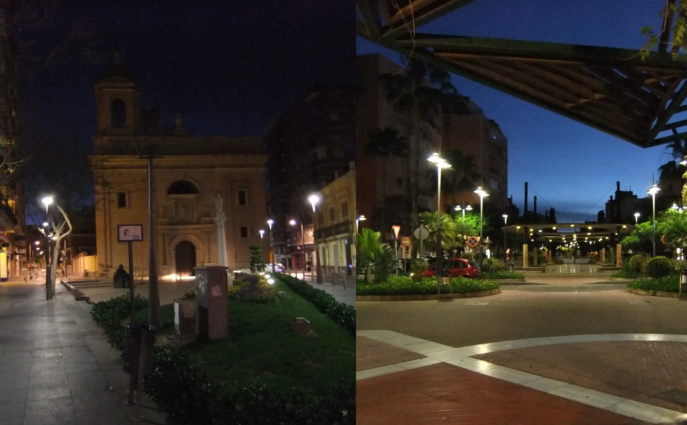
>🇪🇸 El momento mágico en el silencio del amanecer: – Una aventura… en mi camino.

>🇵🇹 O momento mágico no silêncio do amanhecer – Uma aventura ...  no meu caminho.

>🇬🇧 That magical moment in the stillness of dawn  –  An adventure ... on my own path.

>🇩🇪 Der magische Moment in der Stille der Morgendämmerung –Ein Abenteuer ... auf meinem eigenen Weg.

---

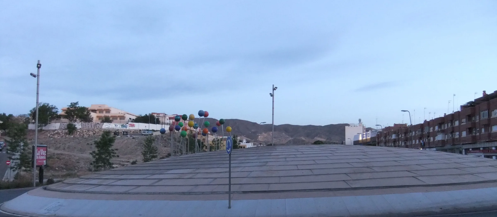

🇵🇹 **Algures por aqui, nas proximidades**

Obrigado aos polícias e aos militares por manterem este local bem vigiado de madrugada.
Ainda sinto o aroma que se elevava e depois provei o primeiro gole; foi um momento inesperado e maravilhoso.
Hoje pergunto-me se não terá sido este elixir que me permitiu percorrer os ca. 40 km no primeiro dia.  

🇪🇸 **Por aquí, en las proximidades**

Gracias a los policías y a los militares por mantener este lugar bien vigilado de madrugada.
Aún siento el aroma que se elevaba y luego probé el primer sorbo; fue un momento inesperado y maravilloso.
Hoy me pregunto si no habrá sido este elixir el que me permitió recorrer los ca. 40 km el primer día.

🇬🇧 **Somewhere round here, in the vicinity**

Thank you to the police and the military for keeping this area well patrolled in the early hours.
I can still smell the aroma that wafted up, and then I took my first sip; it was an unexpected and wonderful moment.
Today I wonder if it wasn’t this elixir that enabled me to cover the ca. 40 km on the first day.

🇩🇪 **Irgendwo hier in der Nähe**

Vielen Dank an die Polizisten und Soldaten, die diesen Ort in den frühen Morgenstunden gut bewacht haben.
Ich spüre noch immer den Duft, der in die Luft stieg, und dann nahm ich den ersten Schluck; es war ein unerwarteter und wunderbarer Moment.
Heute frage ich mich, ob es nicht vielleicht dieses Elixier war, das es mir ermöglichte, am ersten Tag die ca. 40 km zurückzulegen.

---

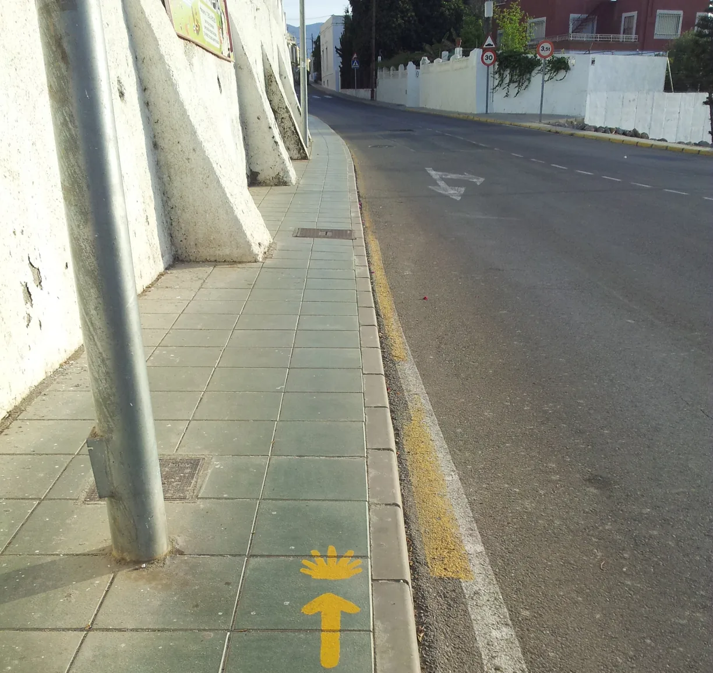

🇬🇧 It’s reassuring to know that you’re on the right track.

🇩🇪 Es ist beruhigend zu wissen, dass man auf dem richtigen Weg ist.

🇵🇹 É reconfortante saber que estamos no caminho certo.

🇪🇸  Es tranquilizador saber que uno va por el buen camino.

---
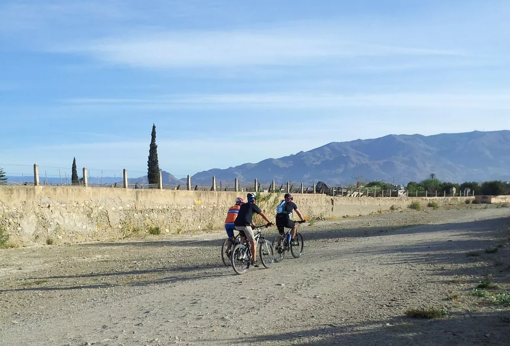

🇩🇪 Es ist toll, sich ungehindert fortbewegen zu können; aber ich hatte mir das anders vorgestellt. 

🇪🇸 Es estupendo poder circular sin obstáculos; pero me lo había imaginado de otra manera. 

🇵🇹 É fantástico poder circular sem obstáculos; mas tinha-me imaginado uma coisa diferente. 

🇬🇧  It’s brilliant to be able to get about without any obstacles; but I’d imagined it would be different. 

---
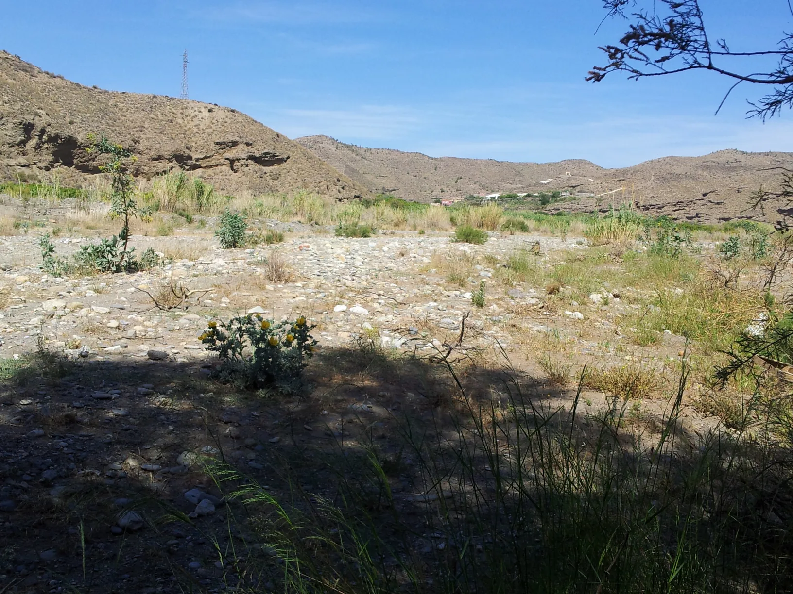

🇩🇪 Ich hatte davon geträumt, hier ein Bad zu nehmen, aber trotzdem ist es ein schöner Schattenplatz, um sich ein wenig auszuruhen. 

🇪🇸  Soñaba con darme un chapuzón aquí, pero, aun así, es un lugar agradable a la sombra para descansar un rato. 

🇬🇧 I’d been dreaming of having a swim here, but even so, it’s a lovely shadow to rest in for a while. 

🇵🇹 Sonhava em dar aqui um mergulho, mas, mesmo assim, é uma sombra agradável para descansar um pouco. 

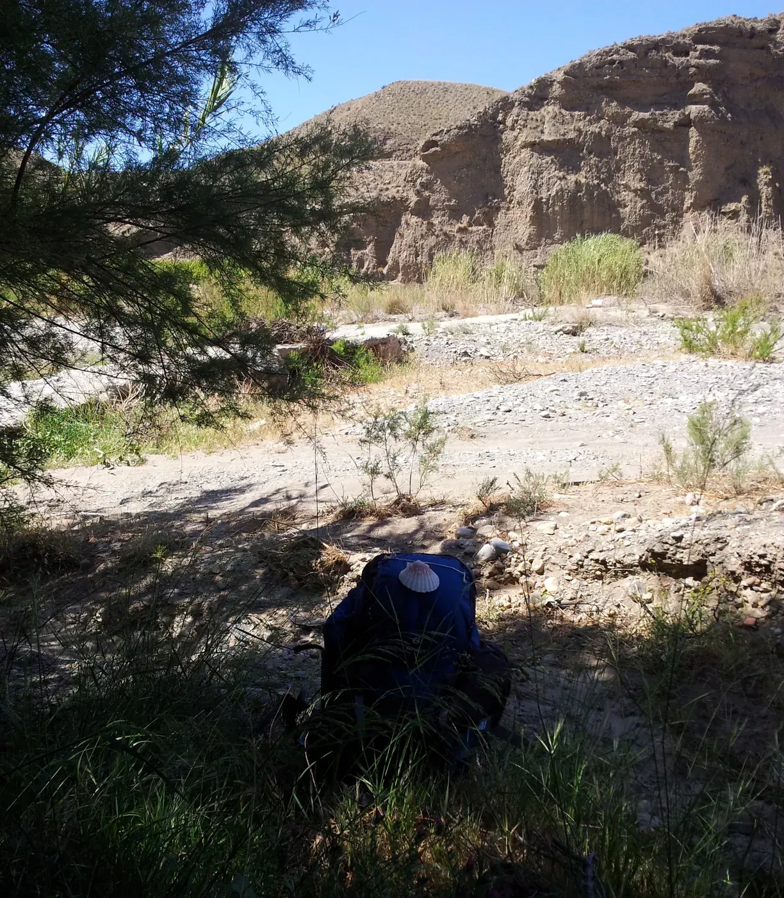

- **Der Traum** 

Ich träumte von sanftem, klarem Wasser, das dahinfloss, aber nicht von einer **„Gota fria“.**

- **O Sonho** 

Sonhei com águas calmas e límpidas a correr, mas não com uma **«Gota fria»**.

- **El sueño** 

Soñé con unas aguas tranquilas y cristalinas que fluían, pero no con una **«Gota fria».**

- **The Dream** 

I dreamed of gentle, clear water flowing by, but not of a **“Gota fria.**”

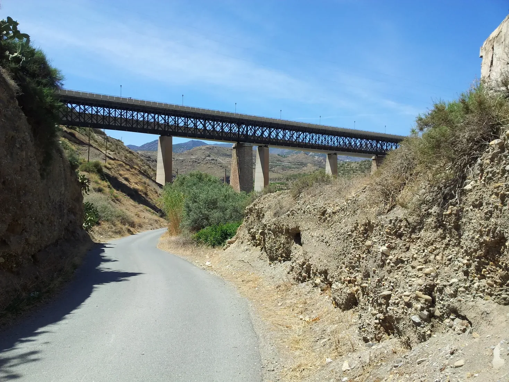

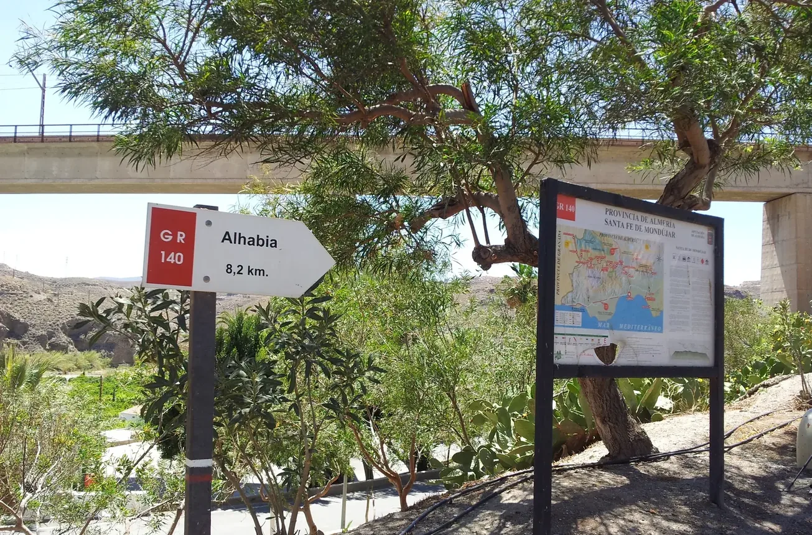

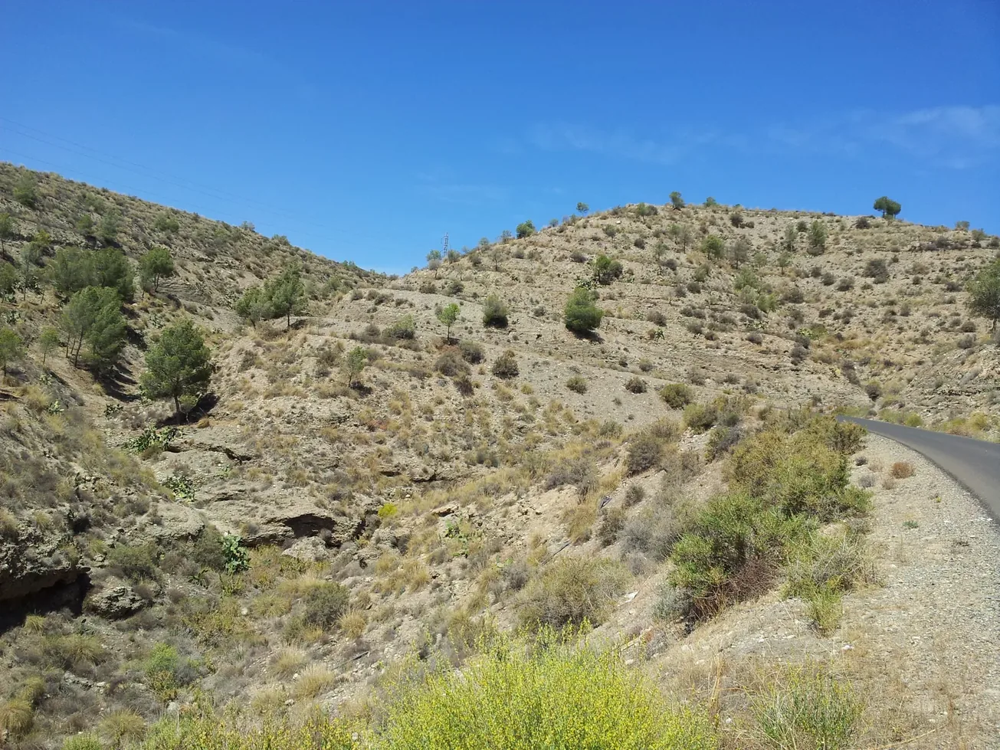

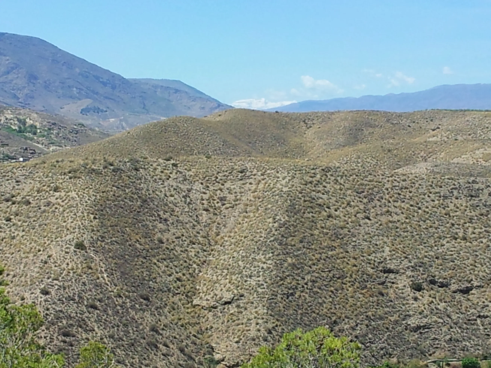

### Rio Andrax sem uma "⚠️ Gota Fría" 

[Der Traum](Der-Traum.md)

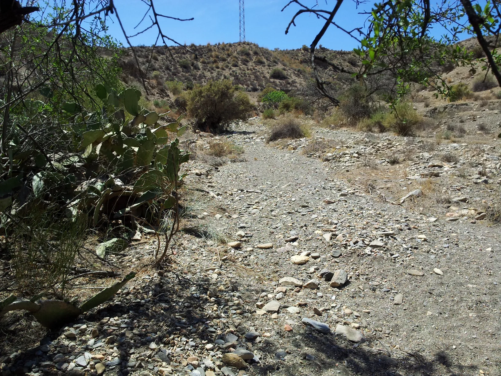

⚠️ "Gota Fría"

#### 🇵🇹**O perigo mortal: cheias repentinas (_Flash Floods_)**

> **«Gota Fría»**:  A razão pela qual o menciono aqui é que, quando o vi na televisão em 2019, não queria acreditar nem pensar nisso e, no entanto, vi-me lá. ..., ... .

##### **Em que mês é que o risco de um fenómeno deste tipo é maior?**

> ***Na província de Almería, no sudeste de Espanha, o risco de tempestades violentas e inundações é particularmente elevado em setembro e outubro.***

A razão: no final do verão e no outono, as águas ainda quentes do Mediterrâneo podem entrar em contacto com ar húmido e massas de ar mais frias. Isso pode dar origem a tempestades violentas acompanhadas de chuvas extremamente intensas. Estas condições meteorológicas são frequentemente designadas em Espanha por «DANA».

Setembro: início da fase particularmente perigosa; a tempestade grave de 2019 ocorreu nos dias 12 e 13 de setembro.

Outubro: risco igualmente elevado; estatisticamente, ocorrem muitos episódios de chuvas torrenciais extremas na costa mediterrânica espanhola.

Novembro: continuam a ser possíveis chuvas intensas e inundações.

⚠️ A minha conclusão: se quiseres saber qual o mês a que deves prestar especial atenção, outubro é um bom ponto de referência. No entanto, setembro e novembro também são relevantes. Não há garantia de tempo calmo em nenhum mês.

---

#### 🇩🇪 Die tödliche Gefahr: Sturzfluten (_Flash Floods_)

> **„Gota Fría“**: Der Grund, warum ich das hier erwähne, ist, dass ich, als ich es 2019 im Fernsehen sah, es nicht glauben und nicht darüber nachdenken wollte, und dennoch sah ich mich dort …, … .

##### **In welchem Monat ist die Gefahr eines solchen Ereignisses am größten?**

> ***In der Provinz Almería im Südosten Spaniens ist die Gefahr schwerer Unwetter und Überschwemmungen besonders im September und Oktober erhöht.***

**Der Grund:** Im Spätsommer und Herbst kann noch warmes Mittelmeerwasser auf feuchte Luft und kühlere Luftmassen treffen. Dadurch können sich heftige Gewitter mit extremem Starkregen entwickeln. Solche Wetterlagen werden in Spanien häufig als DANA bezeichnet.

**September:** Beginn der besonders gefährlichen Phase; das schwere Unwetter von 2019 ereignete sich am 12. und 13. September.

Oktober: Ebenfalls hohes Risiko, statistisch treten an der spanischen Mittelmeerküste besonders viele extreme Starkregenereignisse auf.

**November:** Auch weiterhin sind heftige Regenfälle und Überschwemmungen möglich.

⚠️ Mein Fazit: Wenn du wissen möchtest, welchen Monat du besonders im Blick behalten solltest, ist Oktober ein guter Anhaltspunkt. September und November sind aber ebenfalls relevant. Eine Garantie für ruhiges Wetter gibt es in keinem Monat.

---

#### 🇪🇸 El peligro mortal: las crecidas repentinas (_Flash Floods_)

> **«Gota Fría»**:  La razón por la que lo menciono aquí es que, cuando lo vi en la televisión en 2019, no quería creerlo ni pensar en ello y, sin embargo, me vi allí..., ... .

##### ¿En qué mes es mayor el riesgo de que se produzca un fenómeno de este tipo?

> ***En la provincia de Almería, en el sureste de España, el riesgo de tormentas intensas e inundaciones es especialmente elevado en septiembre y octubre.***

El motivo: a finales del verano y en otoño, las aguas aún cálidas del Mediterráneo pueden entrar en contacto con aire húmedo y masas de aire más frías. Esto puede dar lugar a fuertes tormentas con lluvias torrenciales. En España, estas situaciones meteorológicas se denominan a menudo «DANA».

Septiembre: comienzo de la fase especialmente peligrosa; las fuertes tormentas de 2019 se produjeron los días 12 y 13 de septiembre.

Octubre: también presenta un riesgo elevado; estadísticamente, en la costa mediterránea española se producen un número especialmente elevado de episodios de lluvias torrenciales extremas.

Noviembre: siguen siendo posibles las lluvias torrenciales y las inundaciones.

⚠️ Mi conclusión: si quieres saber a qué mes debes prestar especial atención, octubre es un buen punto de referencia. Sin embargo, septiembre y noviembre también son meses relevantes. No hay garantía de tiempo tranquilo en ningún mes.

---

#### 🇬🇧 The deadly danger: flash floods

> **‘Gota Fría’**:  The reason I’m mentioning it here is that, when I saw it on the telly in 2019, I didn’t want to believe it or even think about it, and yet there I was..., ... .

##### **In which month is the risk of such an event greatest?**

> ***In the province of Almería in south-eastern Spain, the risk of severe storms and flooding is particularly high in September and October.***

The reason: in late summer and autumn, warm Mediterranean water can still come into contact with moist air and cooler air masses. This can lead to violent thunderstorms with extremely heavy rain. Such weather conditions are often referred to as ‘DANA’ in Spain.

September: The start of the particularly dangerous period; the severe storm of 2019 occurred on 12 and 13 September.

October: Also a high risk; statistically, there are a particularly high number of extreme heavy rainfall events along the Spanish Mediterranean coast.

November: Heavy rainfall and flooding remain possible.

⚠️  My conclusion: If you want to know which month you should keep a close eye on, October is a good guide. However, September and November are also relevant. There is no guarantee of calm weather in any month.

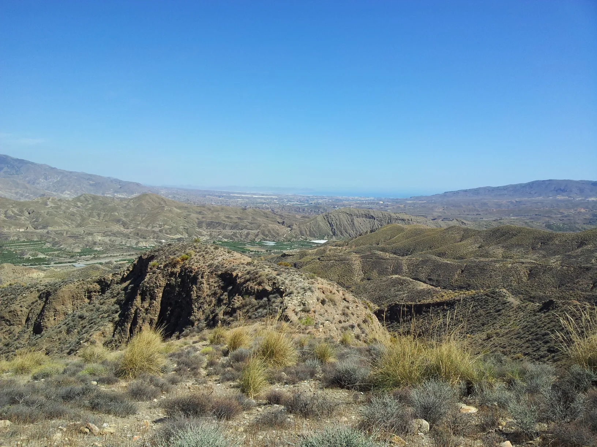

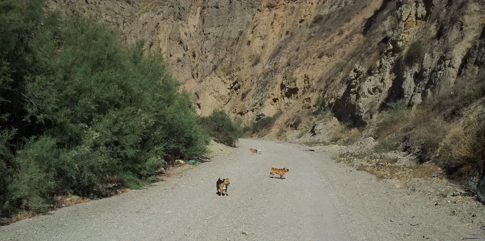

#### 🇩🇪 Auf staubigen Pfaden nach Alboloduy

In der drückenden Nachmittagshitze lief ich schon fast wie in Trance, als mich das laute Bellen von vier kleinen Kötern jäh aus meiner Versunkenheit riss. In diesem Moment hätte ich sie am liebsten in die Wüste geschickt. Ich war einfach erschöpft und wollte nur noch einen Ort finden, an dem ich meinen Durst stillen und mich ausruhen konnte – mehr nicht.

Eigentlich mag ich Hunde sehr und wünsche mir nichts sehnlicher als einen großen Vierbeiner, der mich auf all meinen Streifzügen begleitet. Aber diese vier lautstarken Kläffer, die wohl gerne Löwen wären, hätte ich mir mit dieser Erziehung nicht einmal im Traum an meine Seite gewünscht. Allein der Gedanke, dass sie von mir erwarteten, mit ihnen Gassi zu gehen, noch bevor wir überhaupt die Wüste durchquert hatten, war für mich völlig unvorstellbar.

---
#### 🇵🇹 Por caminhos empoeirados rumo a Alboloduy

Sob o calor sufocante da tarde, eu já caminhava quase em transe quando o latido estridente de quatro rafeiros me despertou abruptamente dos meus pensamentos. Naquele momento, a minha vontade era mandá-los dar uma curva no deserto. Eu estava exausto e só queria encontrar um lugar para matar a sede e descansar — nada mais.

Na verdade, adoro cães e o meu maior desejo seria ter um companheiro grande  para me acompanhar em todas as minhas andanças. Mas aqueles quatro bichos barulhentos, que se achavam leões, eu não os queria ao meu lado nem em sonhos com a educação que tinham. Só a ideia de que esperavam que eu os levasse a passear antes mesmo de cruzarmos o deserto era, para mim, totalmente impensável.

---
#### 🇪🇸 Por senderos polvorientos camino a Alboloduy

Bajo el sofocante calor de la tarde, ya caminaba casi en trance cuando los ladridos estridentes de cuatro chuchos me sacaron bruscamente de mis pensamientos. En ese momento, lo que más deseaba era mandarlos a paseo al desierto. Estaba exhausto y solo buscaba un lugar donde calmar la sed y descansar — nada más.

En realidad, me encantan los perros y nada me gustaría más que tener un compañero de gran tamaño que me acompañara en todas mis andanzas. Pero a esos cuatro escandalosos chuchos, que se creían leones, no los habría querido a mi lado ni en sueños con la educación que tenían. Solo pensar que esperaban que los sacara a pasear antes de haber cruzado el desierto me parecía una total locura.

---
#### 🇬🇧 On dusty paths on the way to Alboloduy

In the oppressive afternoon heat, I was walking almost in a trance when the loud barking of four little mutts abruptly snapped me out of my thoughts. At that moment, I would have loved nothing more than to send them packing into the desert. I was exhausted and just wanted to find a place to quench my thirst and rest — nothing else.

Truth be told, I really like dogs and wish for nothing more than a larger companion to join me on all my treks. But those four loudmouth mutts, who clearly fancied themselves lions, were the last thing I would have wanted by my side with that kind of upbringing. The mere thought that they expected me to take them for a walk before we had even crossed the desert was completely unacceptable to me.

---
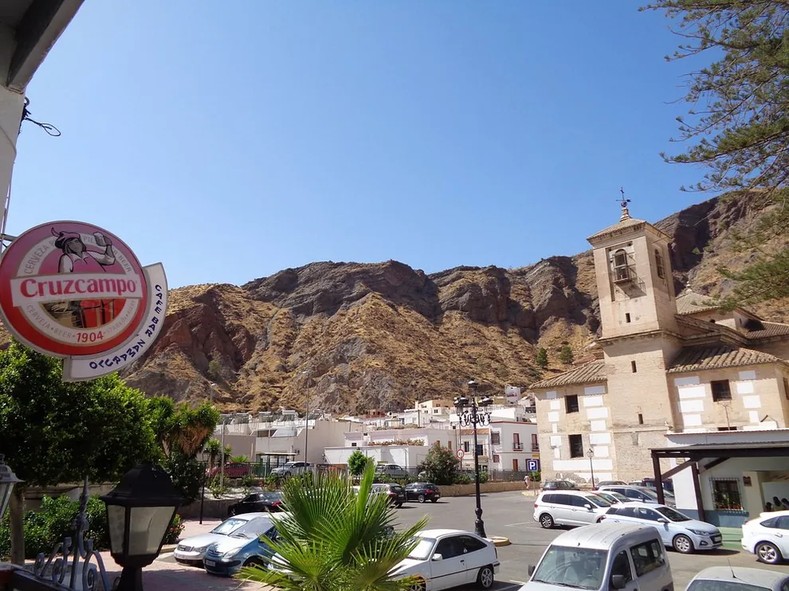
Foto von marialmeria63 (Tripadvisor)
#### Café Bar Zamarulo – Acá la Mari – Alboloduy

- 🇩🇪 Nach einer 40 Kilometer langen Wanderung durch die Hitze Andalusiens war ich erleichtert und glücklich, als ich endlich dieses Café entdeckte. Kaum hatte ich Platz genommen, fragte sie mich schon, was ich gerne hätte.

Sie bereitete mir ein köstliches „Pilgermenü“ zu und telefonierte sogar, um mir eine Übernachtungsmöglichkeit zu organisieren. Außerdem stellte sie ganz nach meinen Wünschen ein Proviantpaket für die nächste Etappe zusammen.

Für diese außergewöhnlich freundliche und herzliche Unterstützung bin ich sowohl ihr als auch dem Leiter der Herberge sehr dankbar. 

Die Gastfreundschaft, die mir dort entgegengebracht wurde, ist mir bis heute in bester Erinnerung. Ohne diese Hilfe hätte ich die nächste Etappe wohl kaum bewältigen können.

---
- 🇵🇹 Depois de uma caminhada de 40 quilómetros sob o calor intenso da Andaluzia, senti um enorme alívio e alegria quando finalmente avistei este café. Mal me sentei, ela perguntou logo o que eu gostaria de comer ou beber.

Preparou-me uma deliciosa «refeição do peregrino» e chegou mesmo a telefonar para me conseguir um lugar onde passar a noite. Além disso, preparou um pacote de mantimentos para a etapa seguinte, exatamente ao meu gosto.

Estou profundamente grato a ela e ao responsável pelo albergue pela simpatia, disponibilidade e ajuda que me ofereceram. 

Até hoje guardo uma recordação muito especial da hospitalidade com que fui recebido. Sem essa ajuda, dificilmente teria conseguido completar a etapa seguinte.

---
- 🇬🇧 After walking 40 kilometres in the scorching Andalusian heat, I felt an immense sense of relief when I finally spotted this café. As soon as I sat down, she asked me what I would like to have.

She prepared a delicious “pilgrim’s meal” for me and even made a phone call to help me find somewhere to spend the night. She also put together a food package for my next stage of the journey, tailored exactly to my wishes.

I am deeply grateful to her and to the person in charge of the hostel for their exceptional kindness and support. 

To this day, I remember their hospitality with heartfelt gratitude. Without their help, I would hardly have been able to complete the next stage of my journey.

---
- 🇪🇸  Después de recorrer 40 kilómetros a pie bajo el intenso calor andaluz, sentí un enorme alivio y alegría al divisar por fin este café. Apenas me senté, ella me preguntó qué me apetecía.

Me preparó una deliciosa «comida del peregrino» e incluso hizo una llamada para conseguirme un lugar donde pasar la noche. Además, preparó un paquete de provisiones para la siguiente etapa, adaptado exactamente a mis preferencias.

Estoy profundamente agradecido tanto a ella como al responsable del albergue por su amabilidad, cercanía y ayuda desinteresada. 

Todavía hoy recuerdo con enorme gratitud la hospitalidad con la que me acogieron. Sin su ayuda, difícilmente habría podido completar la siguiente etapa de mi camino.

 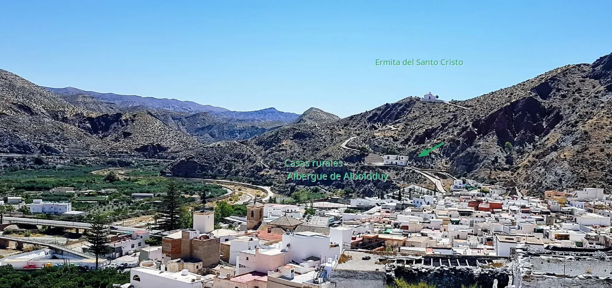
 - Google Maps-Foto von "Volkmar Hauf" (bearbeitet: GdSJA)   
#### Casas Rurales El Albergue de Alboloduy
  
🇩🇪 Als man mir die Schlüssel überreichte, fragte man mich, ob ich noch etwas benötigen würde. Ich äußerte den Wunsch, beim nächsten Mal ein Seil an der Rampe anzubringen, an dem ich mich beim Aufstieg mit den Händen hochziehen könnte, um meine Füße zu entlasten. Diese waren nach der langen Wanderung nämlich so erschöpft, dass kein weiterer Schritt mehr möglich war.

🇵🇹 Quando me entregaram as chaves, perguntaram-me se precisava de mais alguma coisa. Sugeri que, numa próxima ocasião, fosse colocada uma corda ao longo da rampa, para que eu pudesse puxar-me para cima com a ajuda das mãos e aliviar assim o esforço dos pés. Depois da longa caminhada, os meus pés estavam tão exaustos que já não conseguiam dar mais um passo.

🇬🇧 When I was handed the keys, I was asked if I needed anything else. I mentioned that, for next time, I would appreciate having a rope installed along the ramp so I could pull myself up with my hands and take some of the strain off my feet. After the long walk, my feet were so exhausted that I simply couldn’t take another step.

🇪🇸 Cuando me entregaron las llaves, me preguntaron si necesitaba algo más. Comenté que, para una próxima ocasión, me gustaría que se colocara una cuerda a lo largo de la rampa, para poder impulsarme hacia arriba con los brazos y aliviar así el esfuerzo de los pies. Después de la larga caminata, los tenía tan agotados que ya no podía dar ni un paso más.

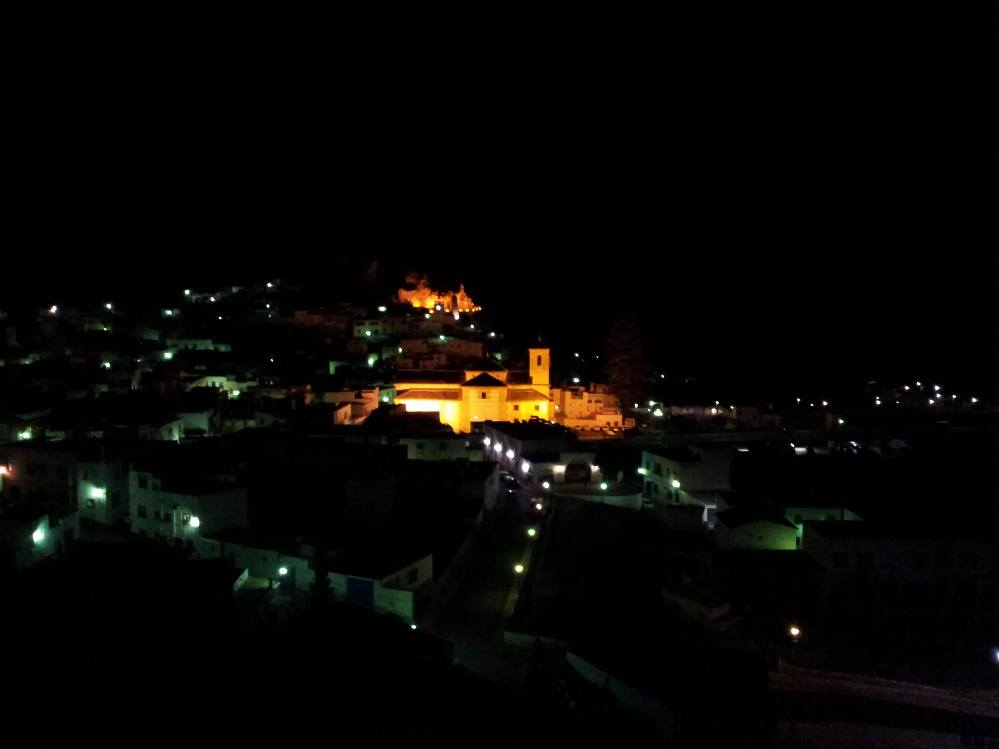
#### Alboloduy by night → 37,7 km
Mir kamen es eher wie 50 km vor, aber dank der Aufregung konnte ich diesen letzten Moment des Tages noch genießen.

A mí me parecieron 50 km, pero la emoción me permitió seguir disfrutando de este último momento del día.

It felt like 50 km to me, but the excitement allowed me to enjoy this final moment of the day all the more.

Pareceram-me 50 km, mas a emoção permitiu-me desfrutar ainda deste último momento do dia.

---

  

 🇬🇧 🇪🇸 🇵🇹 🇩🇪 🥾

---

↪ [Etappe-02_Alboloduy_Finana](Etappe-02_Alboloduy_Finana.md)

 🔁 [Camino_Mozarabe_Etapas](Camino_Mozarabe_Etapas.md)
 
 ...→