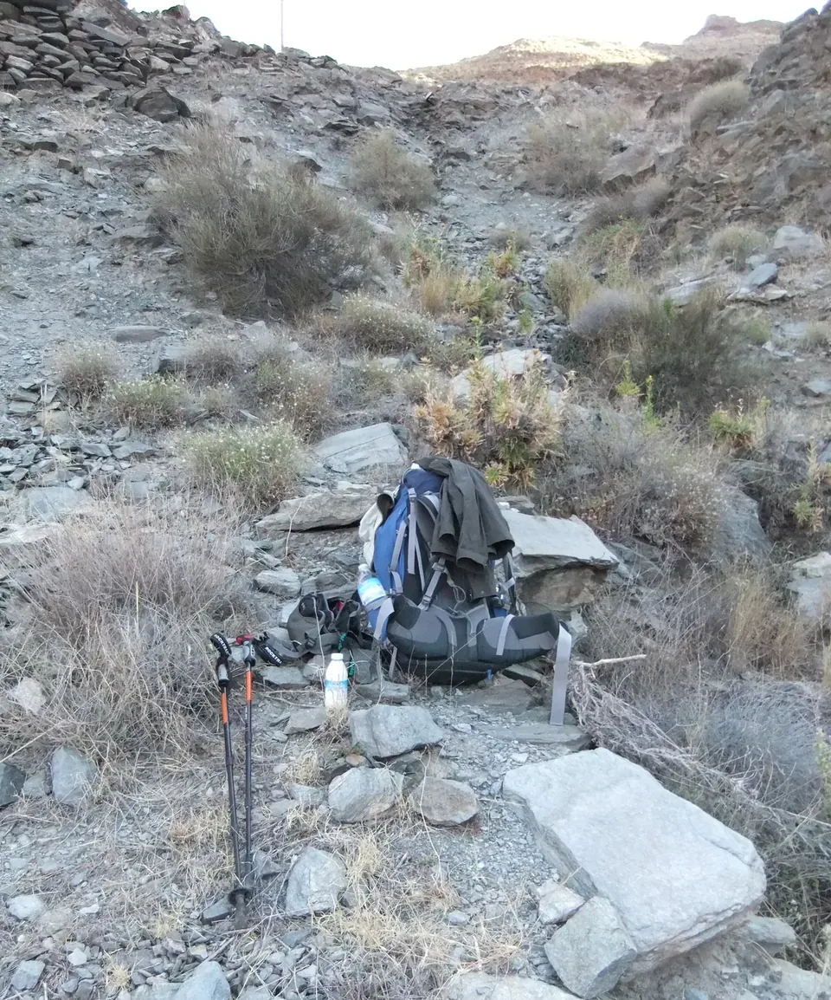

## Camino Mozárabe 2014 

### Etappe-02 : Alboloduy  →  Fiñana (36,1 Km)
28 Abril 2014 👣

Café Bar Zamarulo – Acá la Mari – Alboloduy

- 🇩🇪 Ich habe die ganze Zeit daran gedacht, aber dann habe ich mich hingesetzt, einen guten Kaffee genossen, die Sandwiches eingepackt und sie dennoch in meiner Hosentasche vergessen.
Entschuldigt bitte die Unannehmlichkeiten 

- 🇵🇹 Pensei nisso o tempo todo, mas depois sentei-me, saboreei um bom café, arrumei os lanches e, no entanto, esqueci-as no bolso das calças.
Desculpem pelo incómodo 

- 🇪🇸 Lo pensé todo el tiempo, pero luego me senté, disfruté de un buen café, preparé los bocadillos y, sin embargo, los olvidé en el bolsillo de los pantalones.
Perdón por las molestias 

- 🇬🇧 I’d been thinking about it the whole time, but then I sat down, enjoyed a nice cup of coffee, packed my snacks and, yet, left them in my trouser pocket.
Sorry for the trouble 

Kaum zu erkennen  ↑ Hardly recognizable ↑ Difícil de reconhecer ↑

-   
🇩🇪 Was für eine Überraschung.
So viel flüssiges Gold hätte ich nicht erwartet. Woher kommt denn all dieses Lebenselixier?
- 🇪🇸 Menuda sorpresa.
No me esperaba tanto oro líquido. ¿De dónde viene todo este elixir de vida?
- 🇵🇹 Que surpresa!
Não estava à espera de tanto ouro líquido. De onde vem todo este elixir da vida?

- 🇬🇧 What a surprise.
I wasn’t expecting quite so much liquid gold. Where on earth does all this elixir of life come from?

- 🇬🇧 It’s a bit steep going up.
I was glad I’d set off on this stage first thing in the morning rather than in the afternoon, when I’d already have been completely exhausted.

- 🇩🇪 Der Weg nach oben ist ein bisschen steil.
Ich war froh, diese Etappe schon früh am Morgen in Angriff genommen zu haben und nicht erst am Nachmittag, wenn ich bereits völlig erschöpft gewesen wäre.

- 🇪🇸 El camino hacia arriba es un poco empinado.
Me alegré de haber empezado esta etapa a primera hora de la mañana y no por la tarde, cuando ya estaría completamente agotado.

- 🇵🇹 O caminho até lá em cima  é um pouco íngreme.
Fiquei contente por ter iniciado esta etapa logo de manhã cedo e não à tarde, quando já estaria completamente exausto.

↑ Ein Blick zurück ↑ Alboloduy ist nicht mehr zu sehen. 

- ↑ Nach rechts abbiegen ↑ Der gelbe Pfeil befindet sich im toten Winkel
- ↑ Turn right ↑ The yellow arrow is in your blind spot.
- ↑ Girar a la derecha ↑ La flecha amarilla está en el ángulo muerto.

- ↑ Privat Grundstück , Der  Zugang war 2014 für Pilger erlaubt ↑
- ↑Terreno privado. En 2014 se permitía el acceso a los peregrinos↑
- ↑ Private property; access was permitted for pilgrims in 2014 ↑

- Allí arriba,  ↑ un guardián vela por el Camino ↑
- A Guardian up there watches over the Path
- Lá em cima, um Guardião vigia o Caminho
-  Dort oben wacht ein Wächter über den Weg

I could smell water in the ground

- Wer hätte gedacht, dass es hier einen Dschungel gibt.
- Quem diria que aqui havia uma selva.
- Quién iba a decir que aquí había una selva.
- Who would have thought there was a jungle here?

Excmo. Ayuntamiento de Nascimento

Bäcker verdienen eine Auszeichnung für ihren Einsatz für die Gemeinschaft. Sie leisten viel mehr, als nur Brot zu backen.

Os padeiros merecem um reconhecimento pelo seu empenho em prol da comunidade. Fazem muito mais do que apenas cozer pão.

Los panaderos se merecen un reconocimiento por su compromiso con la comunidad. Hacen mucho más que simplemente hornear pan.

Bakers deserve recognition for their commitment to the community. They do so much more than just bake bread.

- Ich habe die Schlüssel hier in der Bar abgegeben, und der Bäcker hat sich darum gekümmert, sie zurückzugeben. Vielen Dank.
- He dejado las llaves aquí, en el bar, y el panadero se ha encargado de devolverlas. Muchas gracias. 
-  I left the keys here at the bar, and the baker has been kind enough to return them. Thank you very much.

- Brunnen und öffentlichen Waschbecken zum Wäschewaschen.
Ein kühler Ort zum Ausruhen.
- Fontes e os lavatórios públicos para lavar roupa.
Um local fresco para descansar.

- 🇩🇪 Bis jetzt war es ein Spaziergang gewesen, aber jetzt kommen die härtesten Kilometer des Tages.
- 🇵🇹 Até agora tinha sido um passeio, mas agora vêm os quilómetros mais duros do dia.
- 🇪🇸 Hasta ahora había sido un paseo, pero ahora vienen los kilómetros más duros del día.
- 🇬🇧 Up until now it had been a gentle ride, but now come the toughest kilometres of the day.

### Ein großes Dankeschön an Fiñana

#### 🇩🇪 Herzlichen Dank an alle!  
– An das Team der „Café Bar Castillo“ für die köstlichen Leckereien  
– An die örtliche Polizei für den Anruf  
– An das Ehepaar der Casa Rural „Las Paratas del Faz“

Ich weiß ehrlich gesagt nicht, ob ich es überhaupt bis zur Unterkunft geschafft hätte, wenn der Herr des Hauses (dessen Namen ich vor lauter Erschöpfung leider vergessen habe – bitte entschuldigt!) mich nicht abgeholt hätte. Ich hatte mich in der Bar bei einem kühlen Bier und einer leckeren Kleinigkeit so gut eingelebt und entspannt, dass meine Füße sich danach schlichtweg geweigert haben, auch nur einen einzigen Schritt weiterzugehen.

---
#### 🇪🇸 ¡Muchísimas gracias a todos!  
– Al equipo del „Café Bar Castillo“ por sus delicias  
– A la policía local por la llamada  
– A los dueños de la Casa Rural „Las Paratas del Faz“

Sinceramente, no sé si habría logrado llegar a la casa rural si el señor (cuyo nombre he olvidado con el cansancio, ¡mil disculpas!) no hubiera ido a recogerme. Disfruté tanto en el bar con una buena cerveza y algo rico de comer, y me sentía tan a gusto, que mis pies se negaron por completo a continuar la caminata.

---
#### 🇵🇹 Muito obrigado(a) a todos!  
– À equipa do „Café Bar Castillo“ pelas delícias  
– À polícia local pelo telefonema  
– Ao casal da Casa Rural „Las Paratas del Faz“

Sinceramente, não sei se teria conseguido chegar à casa rural se o senhor (cujo nome esqueci com o cansaço, peço imensas desculpas!) não me tivesse ido buscar. Estava a desfrutar tanto no bar com uma boa cerveja e algo saboroso para comer, e sentia-me tão bem, que os meus pés simplesmente se recusaram a continuar a caminhada.

---
#### 🇬🇧 A huge thank you to everyone!  
– To the team at „Café Bar Castillo“ for the delicious treats  
– To the local police for the phone call  
– To the couple from the „Las Paratas del Faz“ country house

To be honest, I don't know if I would have made it to the Casa Rural at all if the gentleman (whose name I have completely forgotten due to exhaustion – please forgive me!) hadn't come to pick me up. I had been enjoying a cold beer and some delicious food at the bar, feeling so comfortable that my feet simply refused to take another step.

---

  

 🇬🇧 🇪🇸 🇵🇹 🇩🇪 🥾

typ: tagebuch
ort: Fiñana
unterkunft: Las Paratas del Faz
tags: [pilgern, dankbarkeit, geschichten]
---

### Ein großes Dankeschön an Fiñana / A big thank you!
Veröffentlichung via GitHub

Da du dein Repository öffentlich machst, gibt es zwei großartige Möglichkeiten, wie andere Pilger oder die Helfer vor Ort das lesen können:

1. **GitHub Pages:** Wenn du dein Obsidian-Vault über Tools wie _Quartz_ oder _Obsidian Publish_ (oder ein einfaches Jekyll/Hugo-Theme) als Website exportierst, wird daraus ein wunderschöner, lesbarer Blog.

2. **Der „Social Media“-Effekt:** Da du den Text extra auf Spanisch übersetzt hast, könntest du den Link zu genau dieser Markdown-Datei auf GitHub (oder deiner GitHub-Page) später auch in lokalen Pilger-Foren oder als Dankeschön per WhatsApp an die Unterkunft schicken. Die Gastgeber der _Casa Rural_ werden sich riesig über die spanische Version freuen!

### 🗺️ Fiñana: Ein großes Dankeschön | ¡Muchísimas gracias!

> [!TIP]
> **Ort:** Fiñana (Andalusien)  
> **Route:** Camino de Santiago / Pilgerweg  
> **Unterkunft:** Casa Rural „Las Paratas del Faz“  
> **Sprachen / Idiomas:** 🇩🇪 Deutsch | 🇪🇸 Español | 🇵🇹 Português | 🇬🇧 English

---

### 🇩🇪 Herzlichen Dank an alle!
- An das Team der **„Café Bar Castillo“** für die köstlichen Leckereien
- An die **örtliche Polizei** für den Anruf
- An das **Ehepaar** der Casa Rural „Las Paratas del Faz“

Ich weiß ehrlich gesagt nicht, ob ich es überhaupt bis zur Unterkunft geschafft hätte, wenn der Herr des Hauses (dessen Namen ich vor lauter Erschöpfung leider vergessen habe – bitte entschuldigt!) mich nicht abgeholt hätte. Ich hatte mich in der Bar bei einem kühlen Bier und einer leckeren Kleinigkeit so gut eingelebt und entspannt, dass meine Füße sich danach schlichtweg geweigert haben, auch nur einen einzigen Schritt weiterzugehen.

---

### 🇪🇸 ¡Muchísimas gracias a todos!
- Al equipo del **„Café Bar Castillo“** por sus delicias
- A la **policía local** por la llamada
- A los **dueños** de la Casa Rural „Las Paratas del Faz“

Sinceramente, no sé si habría logrado llegar a la casa rural si el señor (cuyo nombre he olvidado con el cansancio, ¡mil disculpas!) no hubiera ido a recogerme. Disfruté tanto en el bar con una buena cerveza y algo rico de comer, y me sentía tan a gusto, que mis pies se negaron por completo a continuar la caminata.

---

### 🇵🇹 Muito obrigado(a) a todos!
- À equipa do **„Café Bar Castillo“** pelas delícias
- À **polícia local** pelo telefonema
- Ao **casal** da Casa Rural „Las Paratas del Faz“

Sinceramente, não sei se teria conseguido chegar à casa rural se o senhor (cujo nome esqueci com o cansaço, peço imensas desculpas!) não me tivesse ido buscar. Estava a desfrutar tanto no bar com uma boa cerveja e algo saboroso para comer, e sentia-me tão bem, que os meus pés simplesmente se recusaram a continuar a caminhada.

---

### 🇬🇧 A huge thank you to everyone!
- To the team at **„Café Bar Castillo“** for the delicious treats
- To the **local police** for the phone call
- To the **couple** from the „Las Paratas del Faz“ country house

To be honest, I don't know if I would have made it to the Casa Rural at all if the gentleman (whose name I have completely forgotten due to exhaustion – please forgive me!) hadn't come to pick me up. I had been enjoying a cold beer and some delicious food at the bar, feeling so comfortable that my feet simply refused to take another step.

---

↪ [Etappe-03_Finana_Hueneja](Etappe-03_Finana_Hueneja.md)

 🔁 [Camino_Mozarabe_Etapas](Camino_Mozarabe_Etapas.md)
 
 ...→