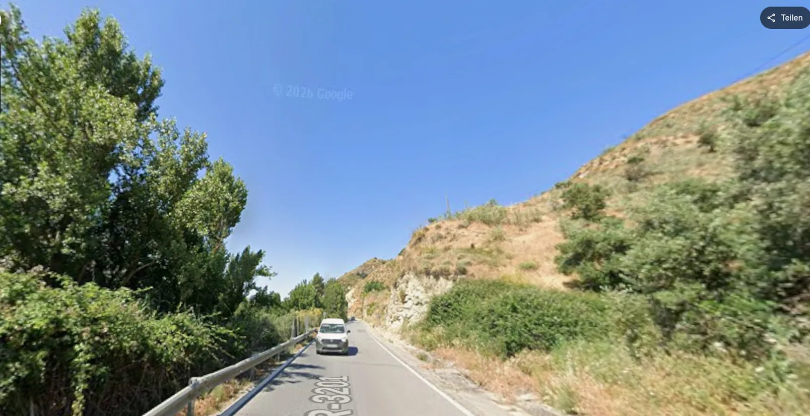
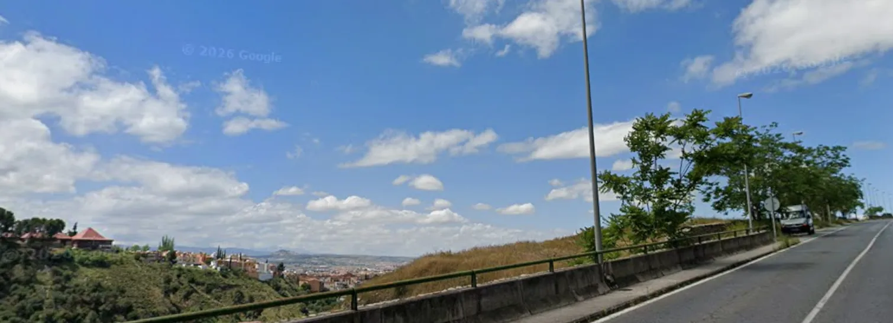

## Camino Mozárabe 2014 

### Etappe-06 : Quéntar  →  Pinos Puente ( ca. 34 Km )
02 de Maio 2014

Google maps Foto

- **_Ist der Fotoordner verschwunden? Waren die Bilder auf dem alten Laptop oder Netbook?_**

🇩🇪 Das stimmt – und ist zugleich eine absolute Lüge.

#### Auf der GR-3201

Ich brach früh am Morgen, noch im Dunkeln und mit einer Taschenlampe ausgerüstet, auf. Dabei folgte ich nicht dem offiziellen Pilgerweg, der in Dúdar nach rechts abzweigt und an den Ruinen der Hacienda Jesús del Valle sowie an der Abtei von Sacramento vorbeiführt. Stattdessen entschied ich mich für die GR-3201.

Je näher ich Granada kam, desto dichter wurde der Berufsverkehr. Auf dem Abschnitt zwischen dem Fluss und den Felsen blieb kaum Platz für Pilger und entgegenkommende Autos. Ich war erleichtert, dass ich den größten Teil der Strecke bereits hinter mir hatte.

⚠️ Wer sich für die GR-3201 entscheidet, sollte möglichst früh am Morgen und mit einer Taschenlampe unterwegs sein, um für die Autofahrer gut sichtbar zu sein und sie auf sich aufmerksam zu machen. Die Leitplanken können dabei als Orientierung dienen. Auf dieser kurvenreichen Straße ist besondere Vorsicht geboten.

### Bilder sagen mehr als tausend Worte

**Das stimmt – und ist zugleich eine absolute Lüge.**

Als ich mitten im dichten Berufsverkehr die ersten Häuser von Granada erblickte, bog ich nach rechts in Richtung Alhambra ab. Die Straße führte bergauf, und etwa auf halber Strecke lag ein Aussichtspunkt, der mich an den Mirador Peña de las Mulas vor La Peza erinnerte.

Granada-Google Maps-Foto

Ich machte einige Fotos von dort und spazierte anschließend durch die Außenanlagen der Alhambra. Auch hier hielt ich die Umgebung mit meiner Kamera fest. Besonders beeindruckte mich ein kleiner Regenbogen, der sich über dem Nebel der Bewässerungsanlagen gebildet hatte.

Kurz vor Pinos Puente machte ich schließlich noch die letzten  Aufnahmen der Sierra Nevada, deren Gipfel sich am Horizont abzeichneten.

Zurück in Deutschland fragten mich einige Leute, ob ich auch die Alhambra besucht hätte. Ich antwortete mit Ja – allerdings nur ihre Außenanlagen.

Dann zeigte ich ihnen einige Fotos, die ich kurz vor Pinos Puente aufgenommen hatte. Alle waren begeistert, insbesondere von der Sierra Nevada mit ihren schneebedeckten Gipfeln am Horizont.

Doch die Wirklichkeit hinter den Bildern sah ganz anders aus.

Am Aussichtspunkt war der Verkehr hinter mir so dicht, dass ich das Panorama kaum genießen konnte. Die Fotos von der Alhambra hingegen vermittelten tatsächlich jene Ruhe, die ich in den frühen Morgenstunden erlebt hatte, bevor die Touristen eintrafen.

Und dann waren da noch die Bilder der Sierra Nevada mit ihren schneebedeckten Gipfeln am Horizont: Ich war in ein kleines Waldstück gegangen und hatte das Foto zwischen zwei Bäumen aufgenommen. Direkt daneben wurde jedoch an der Straße gebaut. Überall herrschten Staub und Lärm, verursacht von den Baumaschinen.

**So können Fotos eine Wirklichkeit zeigen, die es in diesem Moment eigentlich gar nicht gab – zumindest nicht so, wie sie später auf den Betrachter wirkt.**

---

- **_A pasta das fotografias desapareceu? Estariam as imagens no antigo portátil ou netbook?_**

🇵🇹 É verdade — mas também é uma mentira absoluta.

#### GR-3201

Parti de manhã cedo, ainda de noite, levando uma lanterna. Não segui o caminho oficial dos peregrinos, que vira à direita em Dúdar e passa pelas ruínas da Hacienda Jesús del Valle e pela Abadia de Sacramento. Em vez disso, optei pela GR-3201.

À medida que me aproximava de Granada, o trânsito da hora de ponta tornava-se cada vez mais intenso. Naquele troço, entre o rio e as rochas, mal havia espaço para os peregrinos e para dois carros que se cruzassem. Senti-me aliviado por já ter percorrido a maior parte do caminho.

⚠️  Quem decidir seguir pela GR-3201 deverá partir muito cedo e levar uma lanterna, tanto para se orientar como para se tornar visível aos automobilistas. Os rails de proteção podem servir de referência, mas é preciso ter muito cuidado: trata-se de uma estrada sinuosa e potencialmente perigosa.

### Uma imagem vale mais do que mil palavras

**É verdade — mas também é uma mentira absoluta.**

Quando avistei as primeiras casas de Granada, em plena hora de ponta, virei à direita, na direção da Alhambra. A estrada subia e, a meio do percurso, encontrei um miradouro semelhante ao Mirador Peña de las Mulas, antes de La Peza.

Granada-Google Maps-Foto

Tirei algumas fotografias desse local e depois passeiei pelas áreas exteriores da Alhambra. Também fotografei os arredores e consegui captar um pequeno arco-íris que se formara sobre a névoa dos sistemas de rega.

Já perto de Pinos Puente, tirei ainda as últimas fotografias da Sierra Nevada, cujos picos se recortavam no horizonte.

Quando regressei à Alemanha, algumas pessoas perguntaram-me se também tinha visitado a Alhambra. Respondi que sim, embora apenas tivesse percorrido as áreas exteriores.

Depois, mostrei-lhes algumas fotografias tiradas pouco antes de chegar a Pinos Puente. Todos ficaram encantados, sobretudo com a Sierra Nevada e os seus cumes cobertos de neve ao longe.

Mas a realidade por detrás das fotografias era bem diferente.

No miradouro, o trânsito atrás de mim era tão intenso que mal consegui apreciar a paisagem. Pelo contrário, as fotografias da Alhambra transmitiam realmente a tranquilidade que sentira naquelas primeiras horas da manhã, antes da chegada dos turistas.

E havia ainda as imagens da Sierra Nevada, com os seus picos nevados no horizonte. Entrei num pequeno bosque e tirei a fotografia entre duas árvores. No entanto, mesmo ao lado, a estrada estava em obras. Havia poeira por todo o lado e o ruído das máquinas de construção era constante.

Às vezes, uma fotografia consegue mostrar uma realidade que, naquele preciso momento, quase não existia — pelo menos não da forma como mais tarde é percebida por quem a observa.

---

- **_¿Ha desaparecido la carpeta de fotografías? ¿Estarían las imágenes en el antiguo portátil o netbook?_**

 🇪🇸 Es cierto, pero también es una mentira absoluta

#### GR-3201

Salí temprano por la mañana, todavía de noche, provisto de una linterna. No seguí el camino oficial de los peregrinos, que gira a la derecha en Dúdar y pasa por las ruinas de la Hacienda Jesús del Valle y la Abadía de Sacramento. En su lugar, opté por la GR-3201.

A medida que me acercaba a Granada, el tráfico de la hora punta se volvía cada vez más intenso. En aquel tramo, entre el río y las rocas, apenas había espacio para los peregrinos y para dos coches que se cruzaran. Sentí alivio al comprobar que ya había recorrido la mayor parte del trayecto.

⚠️  Quienes decidan seguir la GR-3201 deberían salir muy temprano y llevar una linterna, tanto para orientarse como para hacerse visibles a los conductores. Los quitamiedos pueden servir de referencia, pero hay que extremar las precauciones: es una carretera sinuosa y potencialmente peligrosa.

### Una imagen vale más que mil palabras

**Es cierto, pero también es una mentira absoluta.**

Cuando divisé las primeras casas de Granada, en plena hora punta, giré a la derecha en dirección a la Alhambra. La carretera ascendía y, aproximadamente a mitad de camino, encontré un mirador que me recordó al Mirador Peña de las Mulas, antes de llegar a La Peza.

Granada-Google Maps-Foto

Hice algunas fotografías desde allí y después paseé por los espacios exteriores de la Alhambra. También fotografié los alrededores y conseguí captar un pequeño arcoíris que se había formado sobre la niebla de los sistemas de riego.

Poco antes de llegar a Pinos Puente, tomé las últimas fotografías de Sierra Nevada, cuyos picos se dibujaban en el horizonte.

Cuando regresé a Alemania, algunas personas me preguntaron si también había visitado la Alhambra. Les respondí que sí, aunque solo había recorrido sus espacios exteriores.

Después les enseñé algunas fotografías que había tomado poco antes de llegar a Pinos Puente. A todos les encantaron, especialmente las de Sierra Nevada, con sus cumbres nevadas en el horizonte.

Sin embargo, la realidad que había detrás de aquellas imágenes era muy distinta.

En el mirador, el tráfico a mis espaldas era tan intenso que apenas pude disfrutar del paisaje. En cambio, las fotografías de la Alhambra transmitían realmente la tranquilidad que había sentido durante aquellas primeras horas de la mañana, antes de que llegaran los turistas.

Y luego estaban las imágenes de Sierra Nevada, con sus cumbres cubiertas de nieve al fondo. Me adentré en un pequeño bosque y tomé la fotografía entre dos árboles. Pero justo al lado estaban realizando obras en la carretera. Había polvo por todas partes y el ruido de la maquinaria de construcción era constante.

A veces, una fotografía puede mostrar una realidad que, en aquel preciso instante, casi no existía; al menos, no de la manera en que después la percibe quien la contempla.

---

- **_Has the photo folder disappeared? Were the pictures on the old laptop or netbook?_**

🇬🇧 That is true — and yet it is also an absolute lie

#### GR-3201

I set off early in the morning, while it was still dark, carrying a flashlight. I did not follow the official pilgrims’ route, which turns left at Dúdar and passes the ruins of Hacienda Jesús del Valle and the Abbey of Sacramento. Instead, I took the GR-3201.

As I approached Granada, rush-hour traffic grew heavier and heavier. Along that stretch, between the river and the rocky slopes, there was barely enough room for pilgrims and two cars passing each other. I was relieved that I had already covered most of the distance.

⚠️  Anyone choosing to follow the GR-3201 should set off very early and carry a flashlight, both to find their way and to make themselves visible to drivers. The guardrails can serve as a guide, but extreme caution is essential: this is a winding and potentially dangerous road.

### A picture is worth a thousand words

That is true — and yet it is also an absolute lie.

Just as I caught sight of the first houses of Granada in the middle of rush hour, I turned right towards the Alhambra. The road climbed uphill, and about halfway along, I came across a viewpoint that reminded me of the Mirador Peña de las Mulas, before La Peza.

Granada-Google Maps-Foto

I took a few photographs from there and then walked around the Alhambra’s exterior grounds. I photographed the surroundings as well and managed to capture a small rainbow that had formed above the mist from the irrigation systems.

Shortly before reaching Pinos Puente, I took my final photographs of the Sierra Nevada, its peaks outlined against the horizon.

When I returned to Germany, several people asked me whether I had visited the Alhambra as well. I said yes — but only its exterior grounds.

Then I showed them some photographs I had taken shortly before reaching Pinos Puente. Everyone was impressed, especially by the Sierra Nevada, with its snow-covered peaks in the distance.

Yet the reality behind those photographs was quite different.

At the viewpoint, the traffic behind me was so heavy that I could barely enjoy the panorama. The photographs of the Alhambra, on the other hand, genuinely conveyed the sense of peace I had experienced in the early hours of the morning, before the tourists arrived.

And then there were the pictures of the Sierra Nevada, its snow-capped peaks visible on the horizon. I walked into a small wooded area and took the photograph between two trees. But right next to it, roadworks were underway. Dust was everywhere, and the noise of the construction machinery was relentless.

Sometimes a photograph can capture a reality that barely existed at that very moment — at least, not in the way it is later perceived by those who look at it.

---

  

 🇬🇧 🇪🇸 🇵🇹 🇩🇪 🥾

---

↪ [Etappe-07_Pinos-Puente_Alcala-la-Real](Etappe-07_Pinos-Puente_Alcala-la-Real.md)

 🔁  [Camino_Mozarabe_Etapas](Camino_Mozarabe_Etapas.md)
 
 ...→