## Camino Mozárabe 2014 

### Etappe-0 : Pinos Puente  →  Alcalá la Real  ( 38, 6 Km )
03 de Maio 2014

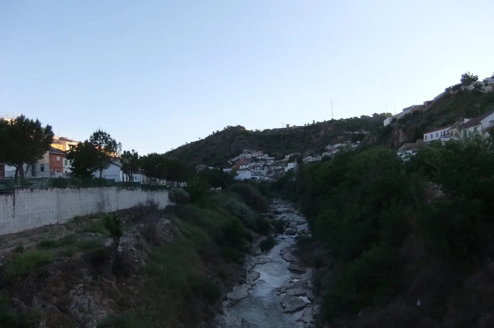

- Tag 1 im Königreich der Olivenhaine
- Primer día en el Reino de los Olivares
- Day 1 in the Kingdom of the Olive Groves
- 1.º dia no Reino dos Olivais

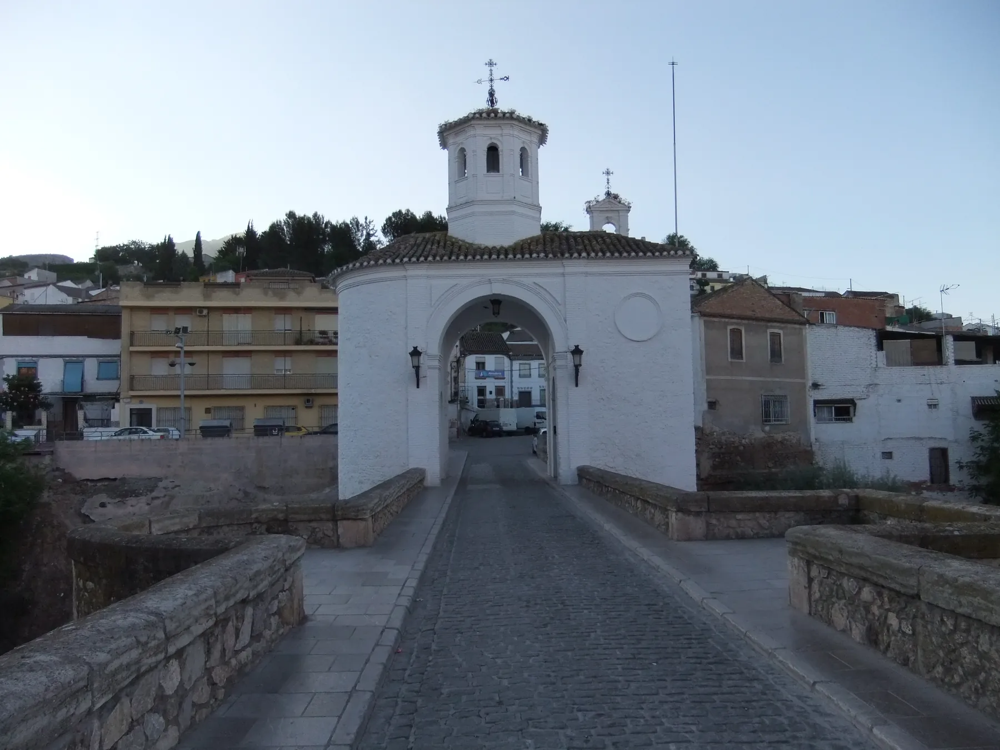

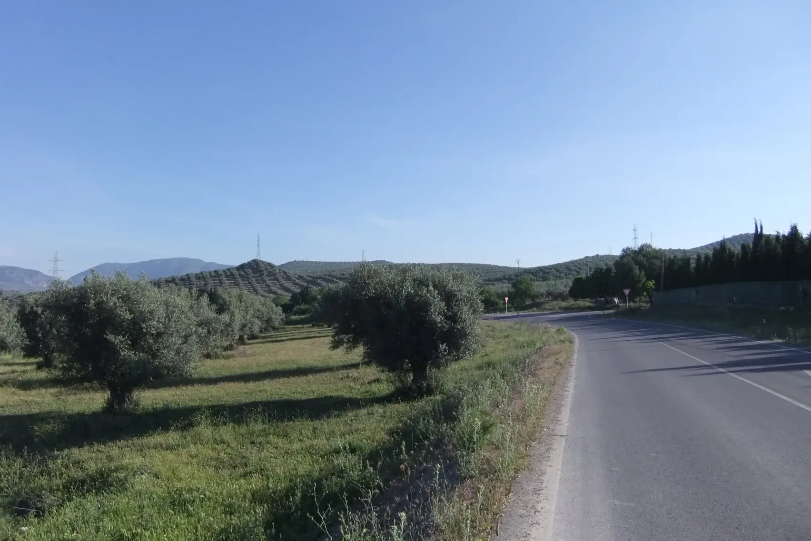

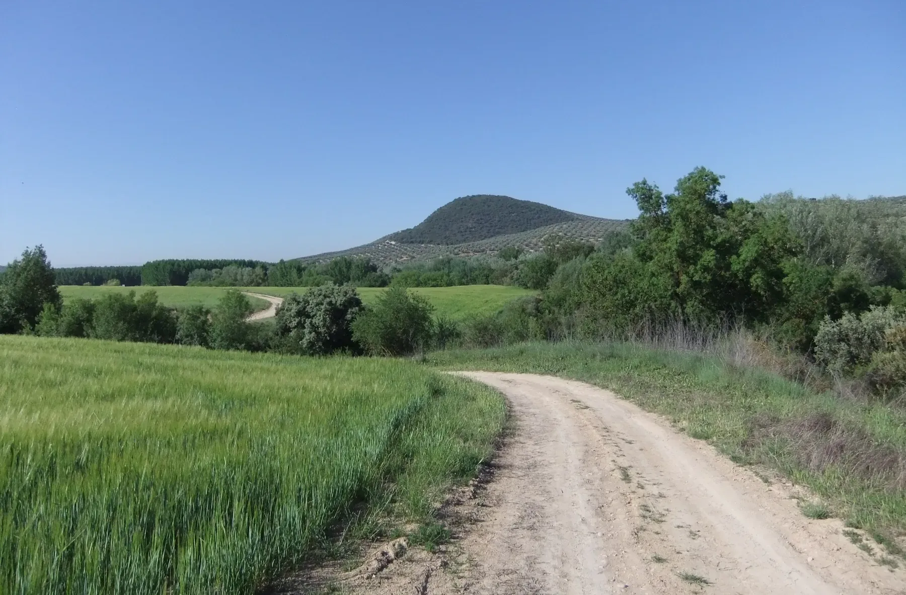

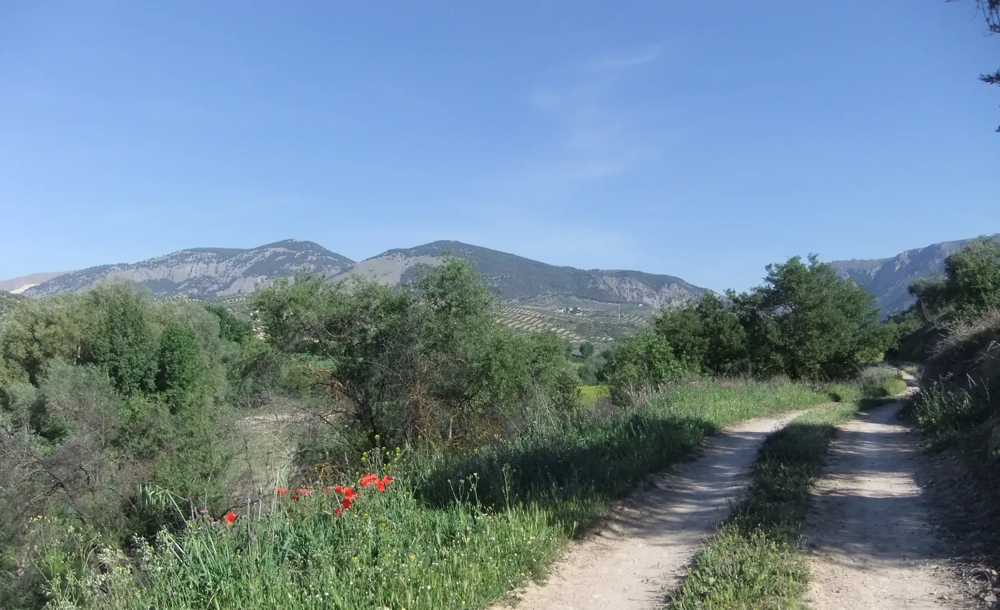

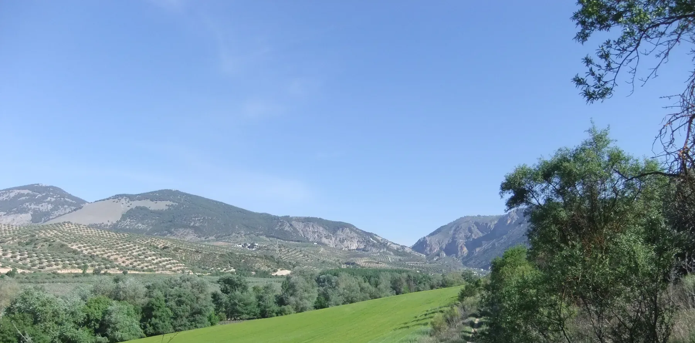

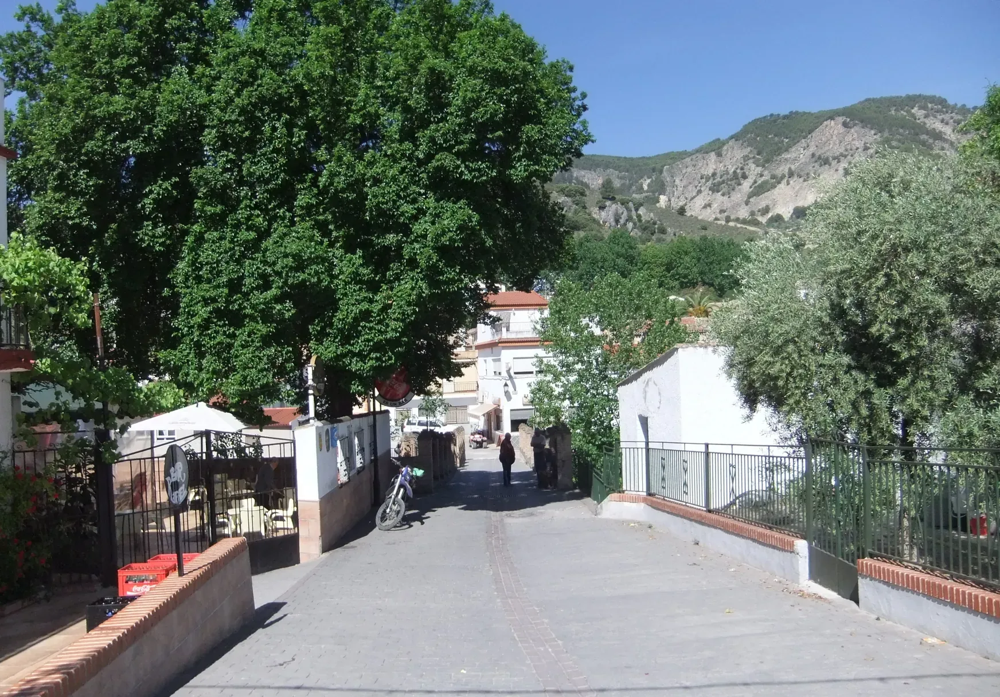

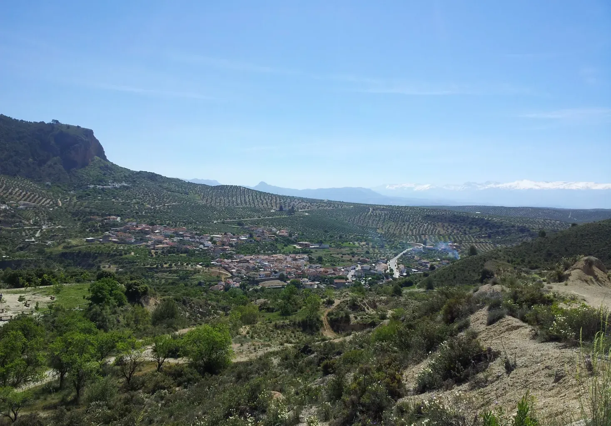

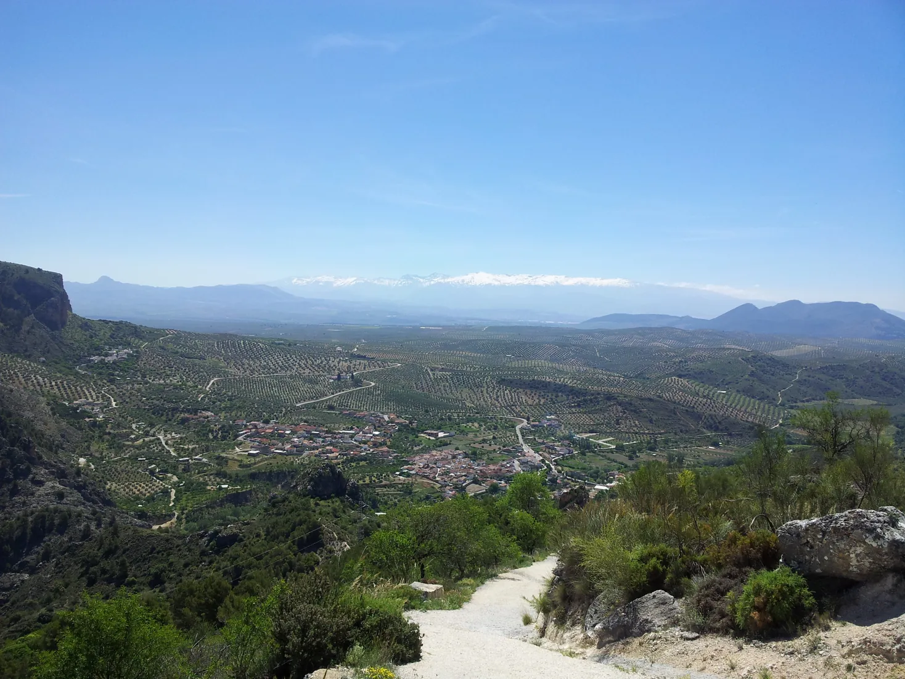

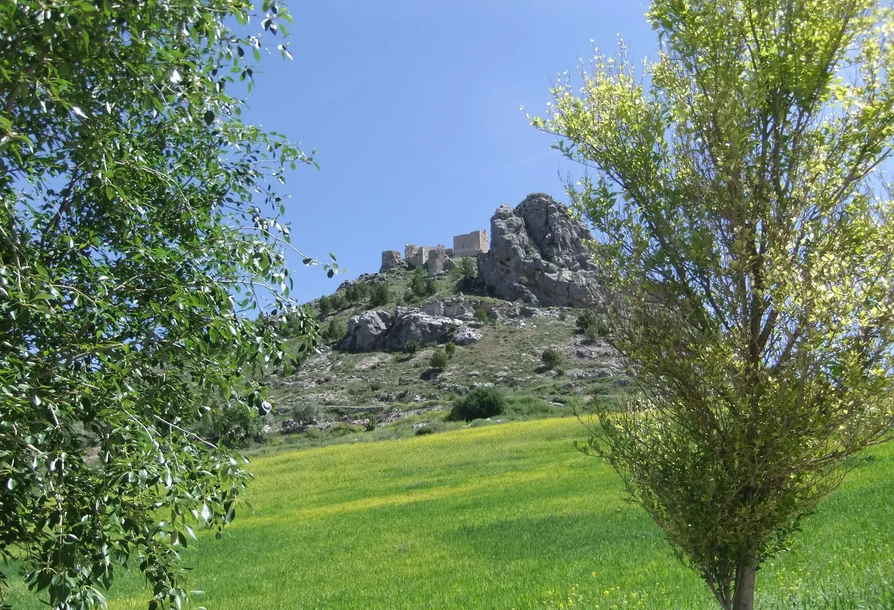

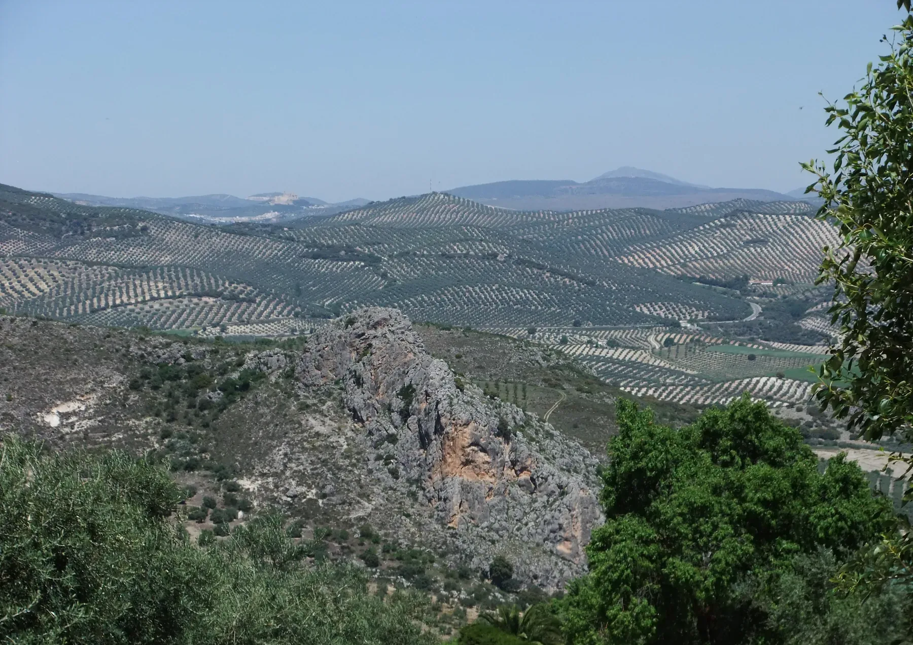

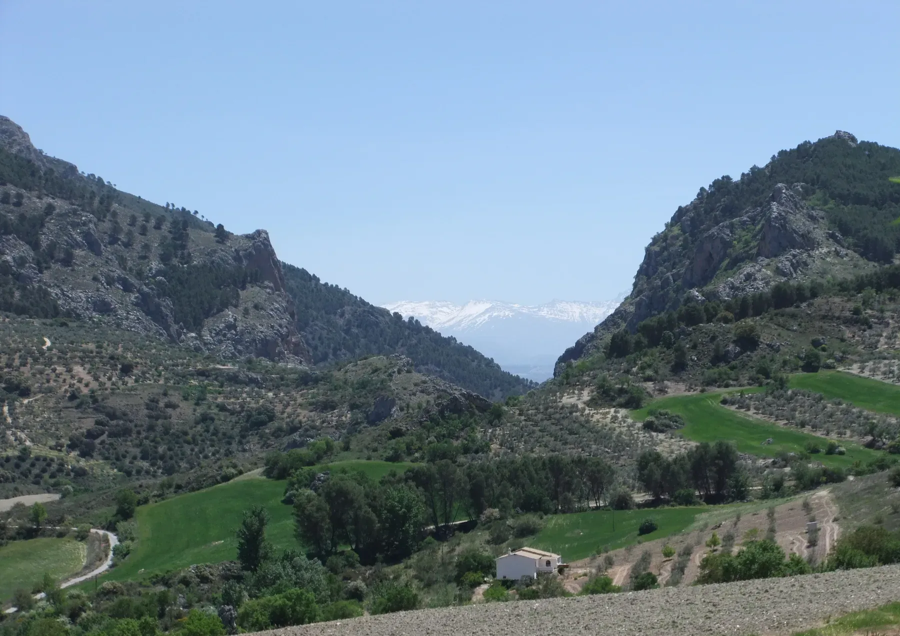

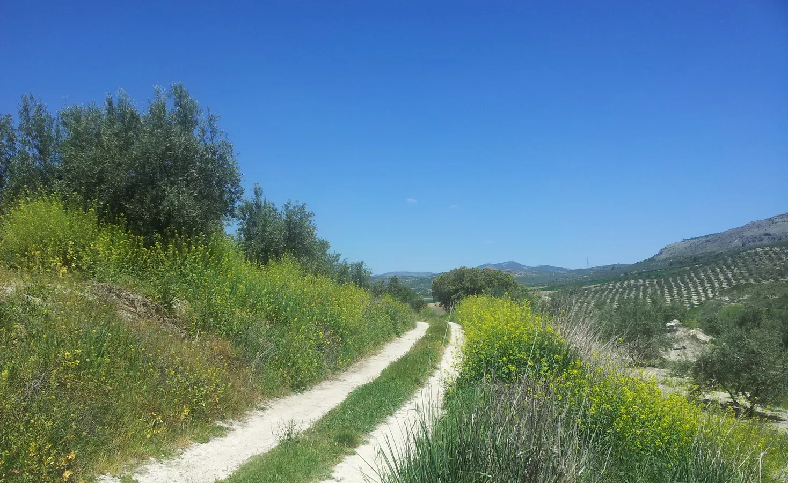

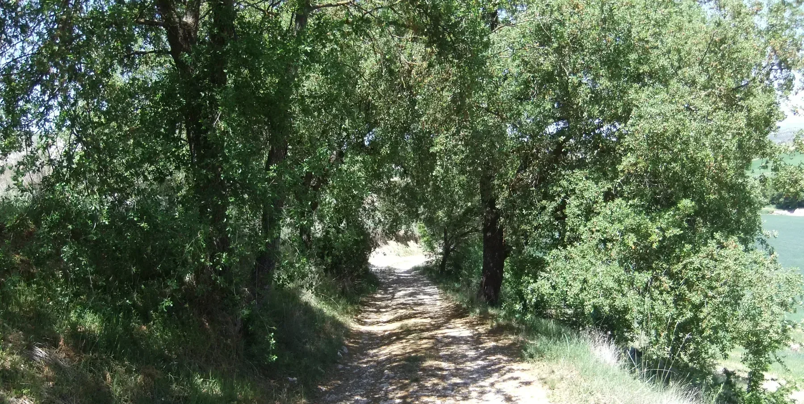

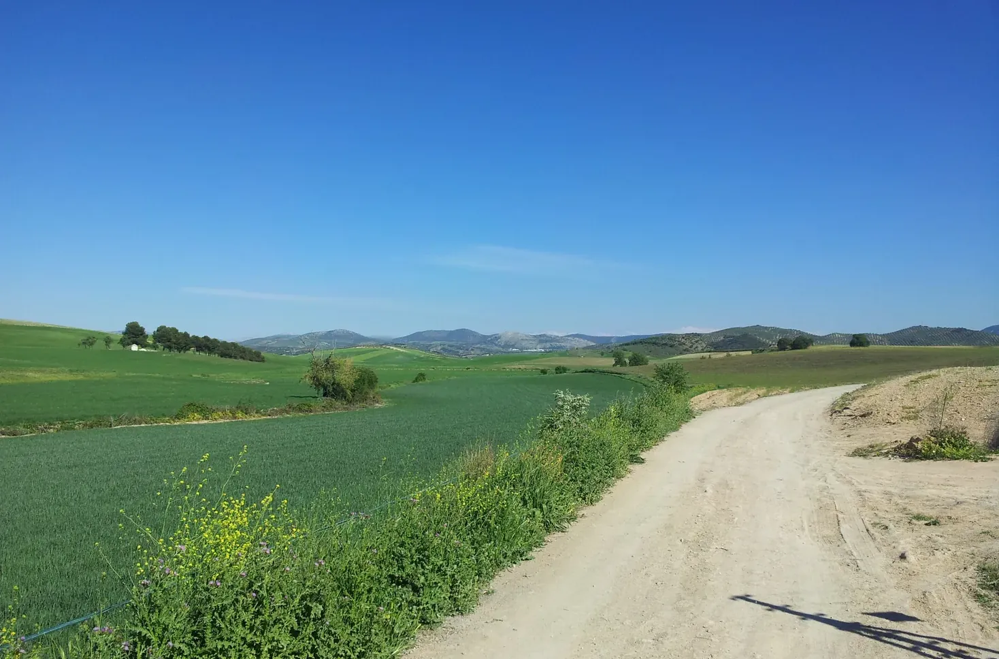

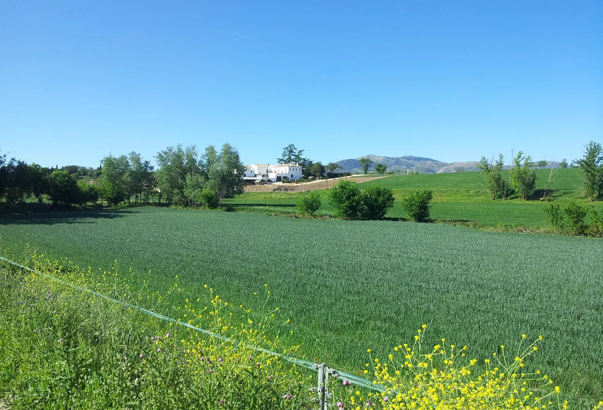

---

  

 🇬🇧 🇪🇸 🇵🇹 🇩🇪 🥾

---

↪ [Etappe-08_Alcala-la-Real_Alcaudete](Etappe-08_Alcala-la-Real_Alcaudete.md)

 🔁  [Camino_Mozarabe_Etapas](Camino_Mozarabe_Etapas.md)
 
 ...→