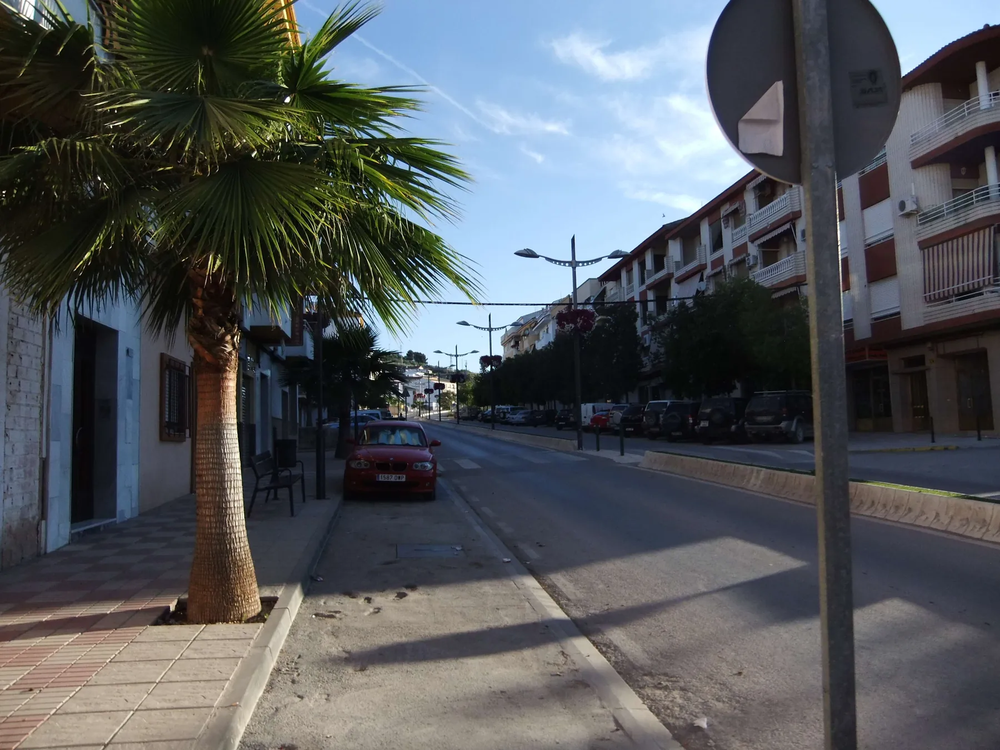
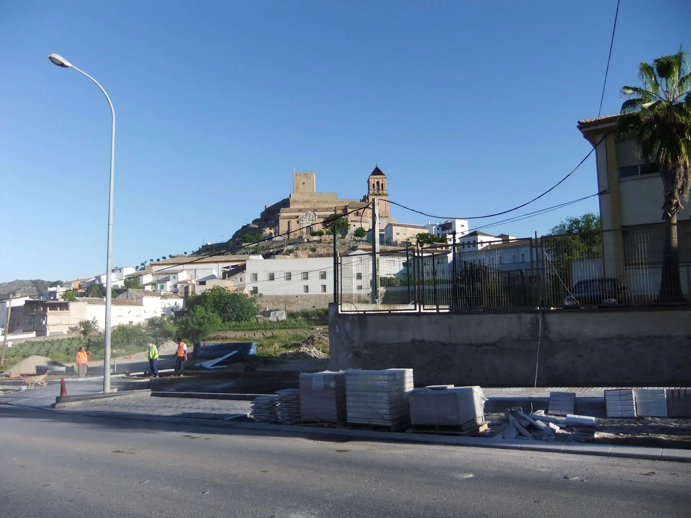
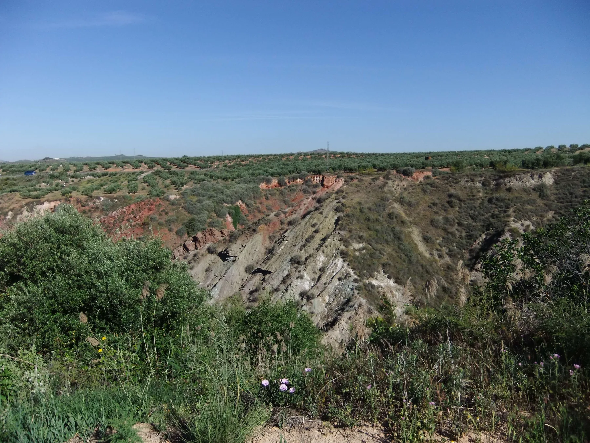
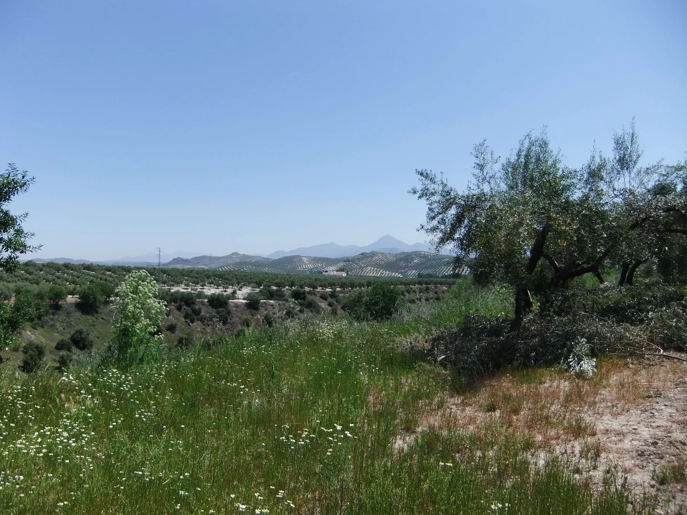
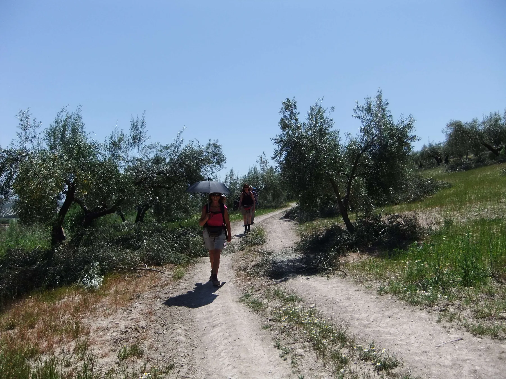
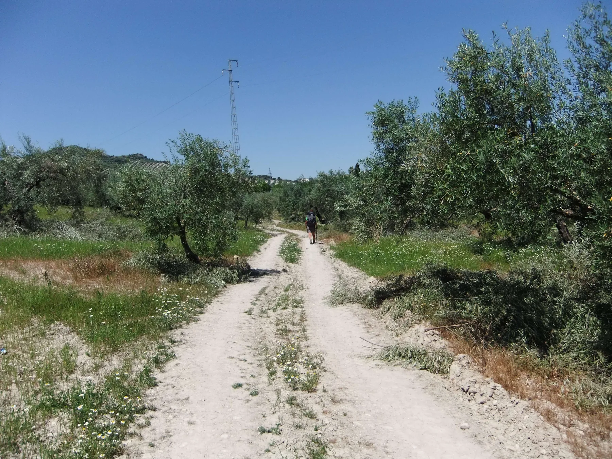
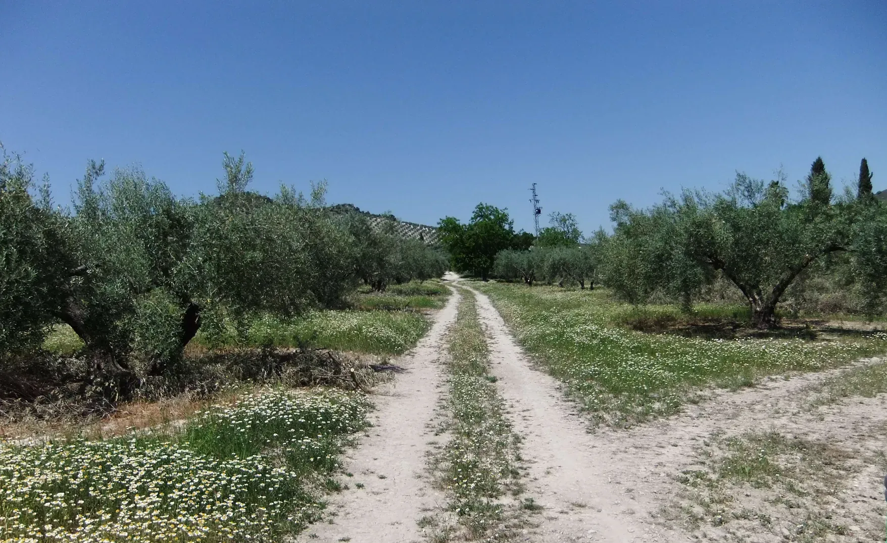

## Camino Mozárabe 2014 

### Etappe-09 : Alcaudete  →  Baena ( 26,6 Km)
05 de Maio 2014

**Baena:** Uma das capitais do azeite espanhol de alta qualidade.

**Baena:** Una de las capitales del aceite de oliva español de alta gama.

**Baena:** Hauptstadt des Königreichs der Olivenbäume und des Olivenöls

**Baena:** **Eine der Hauptstädte des spanischen Premium-Olivenöls**

Baena nimmt bei der Olivenproduktion eine ==absolute Spitzenposition== ein – nicht primär über die reine Gesamtmenge wie die gesamte Provinz Jaén, sondern vor allem als weltweites **Qualitätszentrum** und durch historische Meilensteine:

- **Älteste geschützte Herkunftsbezeichnung:** Baena beheimatet die _Denominación de Origen Baena_ (D.O. Baena), welche die **älteste anerkannte Herkunftsbezeichnung für Olivenöl** in Spanien ist (reguliert seit 1981).

- **Internationaler Spitzenplatz für Premium-Öle:** Die Öle aus der Region Baena belegen regelmäßig die **vordersten Plätze im weltweiten Qualitätsranking** (_World's Best Olive Oils_). Marken und Traditionsmühlen aus Baena (wie _Núñez de Prado_ oder _Cortijo de Suerte Alta_) wurden bereits mehrfach als die weltweit besten Bio-Olivenöle ausgezeichnet. 

- **Flächenmäßig ein Schwergewicht:** Das kontrollierte Anbaugebiet der D.O. Baena umfasst über **60.000 Hektar** Olivenhaine und erstreckt sich neben Baena über mehrere Nachbargemeinden der Provinz Córdoba. In Spitzenjahren werden hier über **250 Millionen Kilogramm Oliven** zu mehr als 50 Millionen Kilo Olivenöl gepresst.

Während Jaén das Zentrum der weltweiten Massenproduktion ist, gilt Baena somit als eine der renommiertesten **Hauptstädte des spanischen Premium-Olivenöls**. Die Region zeichnet sich besonders durch den Anbau der seltenen und geschmacksintensiven Olivensorte **Picuda** aus.

---

  

 🇬🇧 🇪🇸 🇵🇹 🇩🇪 🥾

---

↪ [Etappe-10_Baena_Castro-del-Rio](Etappe-10_Baena_Castro-del-Rio.md)

 🔁  [Camino_Mozarabe_Etapas](Camino_Mozarabe_Etapas.md)
 
 ...→