## Camino Mozárabe 2014 

### Etappe-10 : Baena  →  Castro del Rio ( 20, 4 Km)
06 de Maio 2014

#### Capital do Reino das Oliveiras e do Azeite

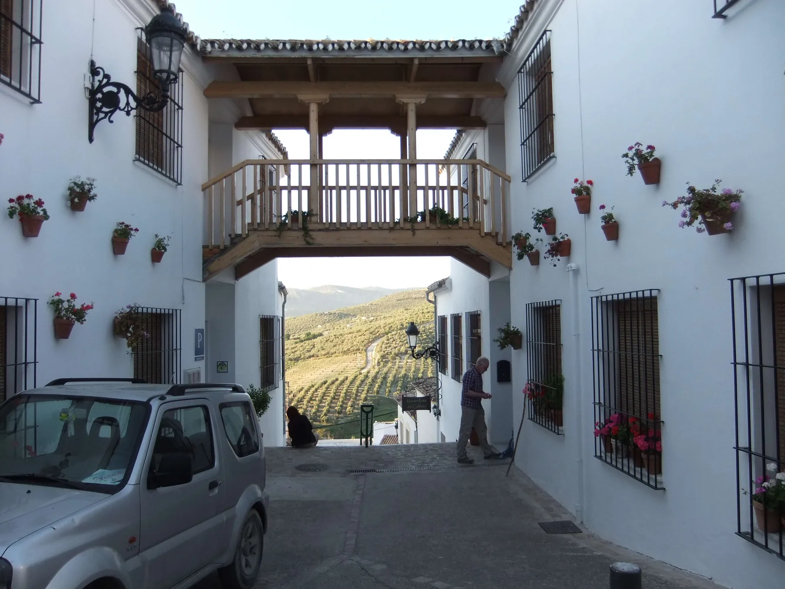

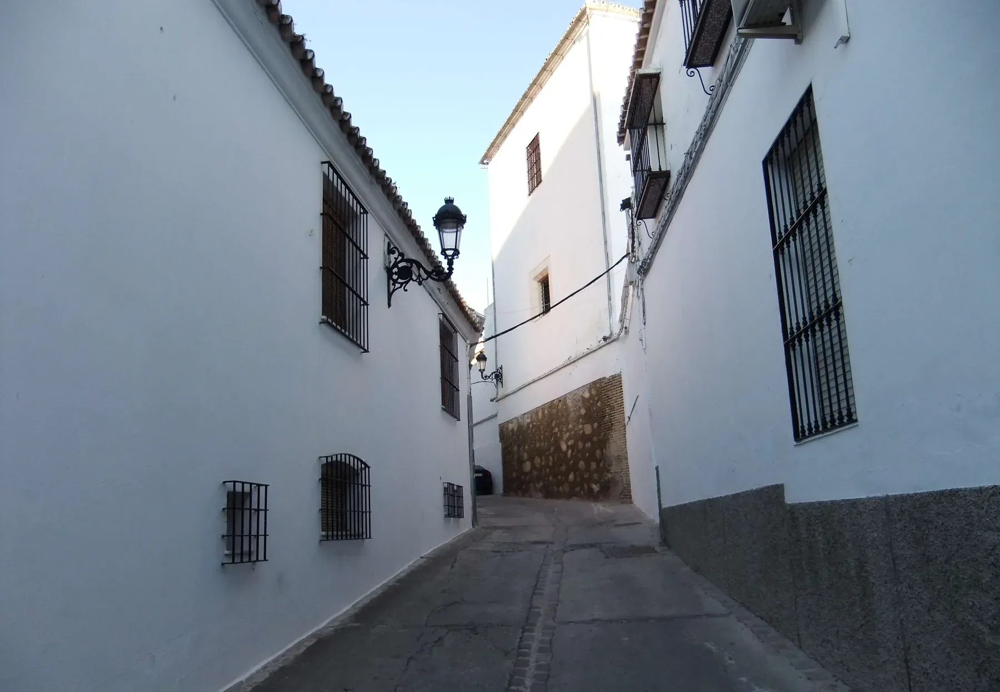

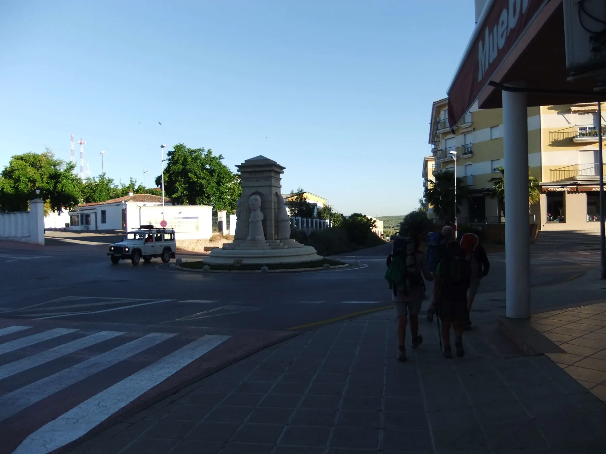

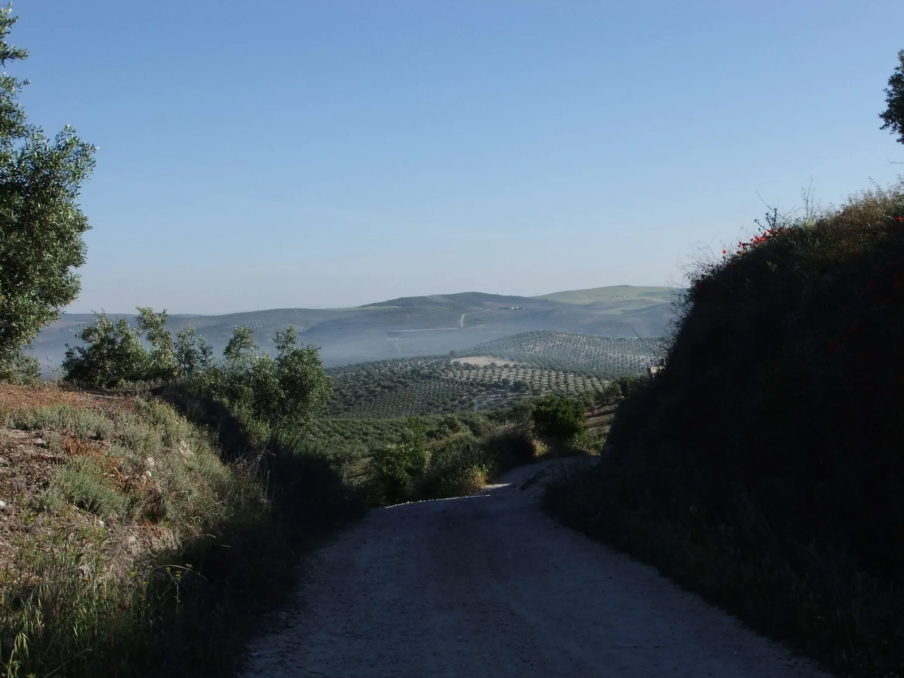

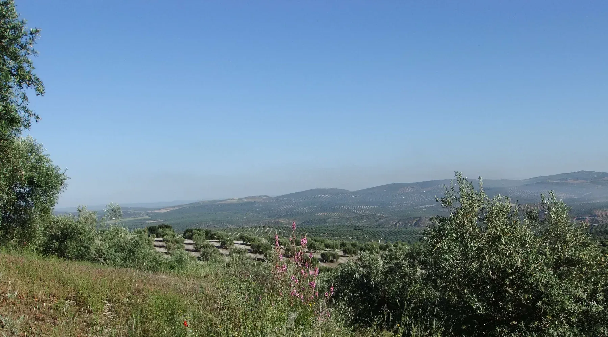

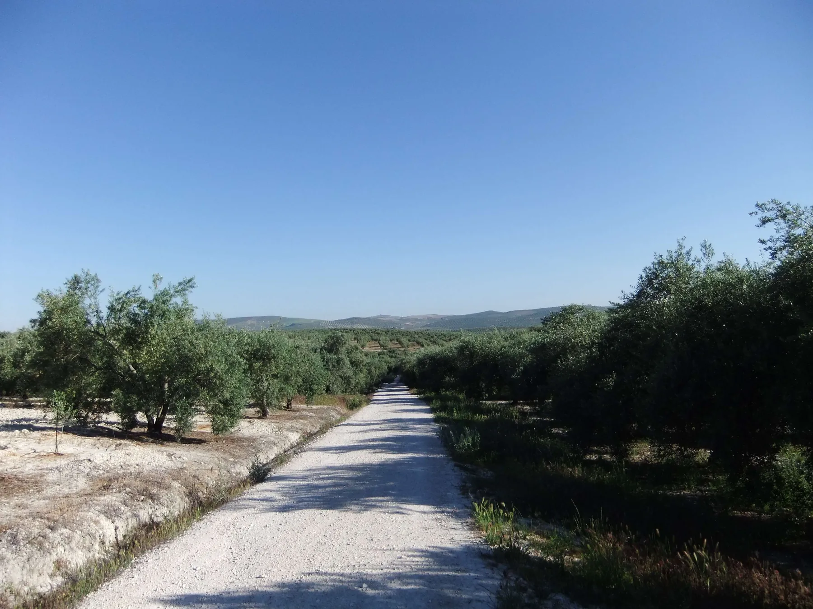

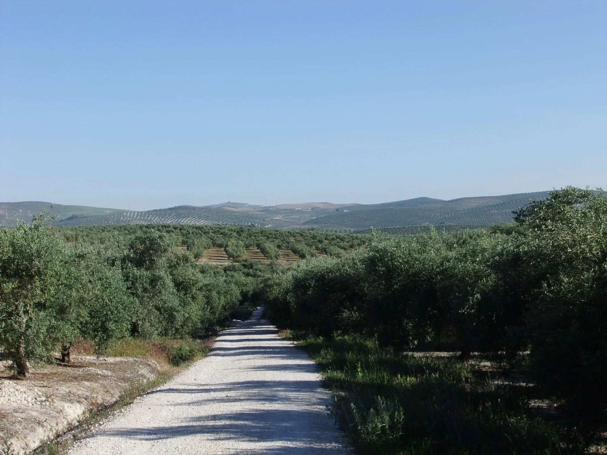

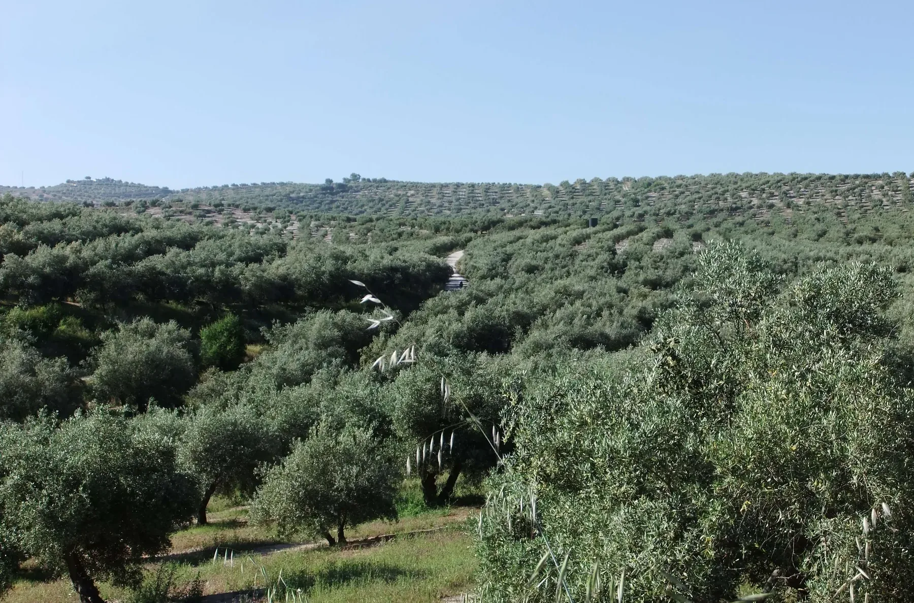

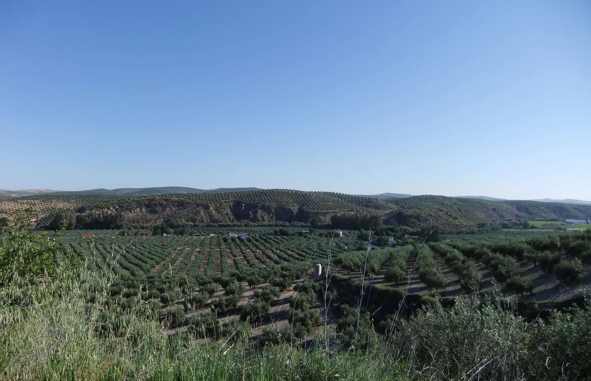

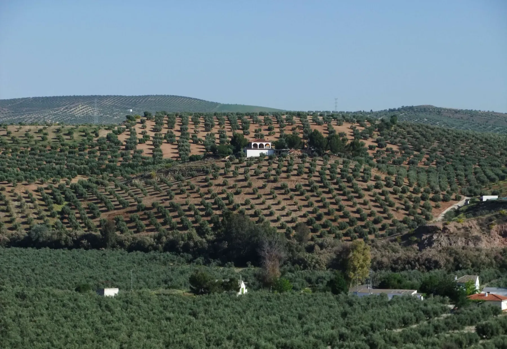

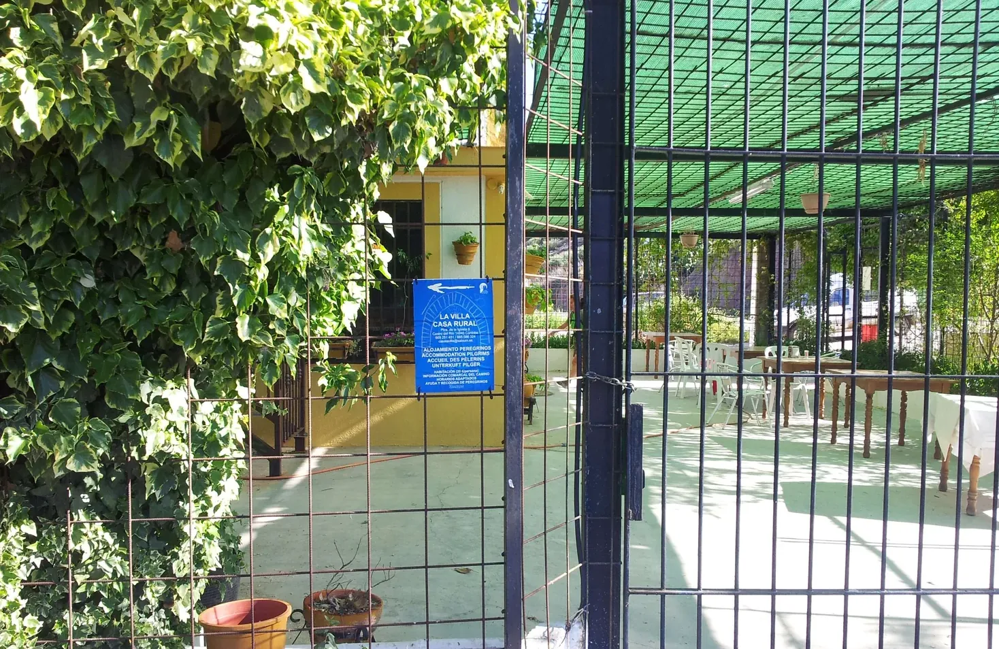

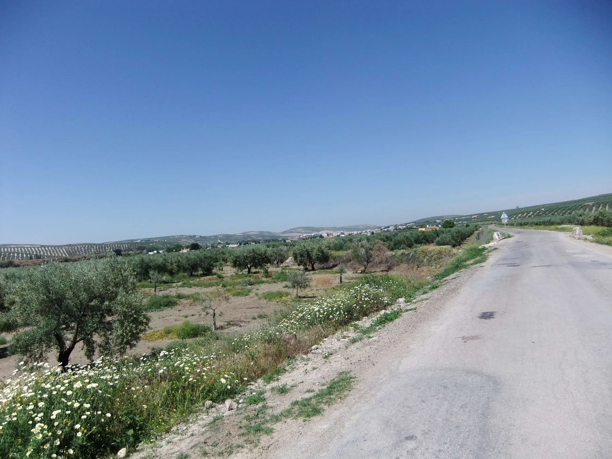

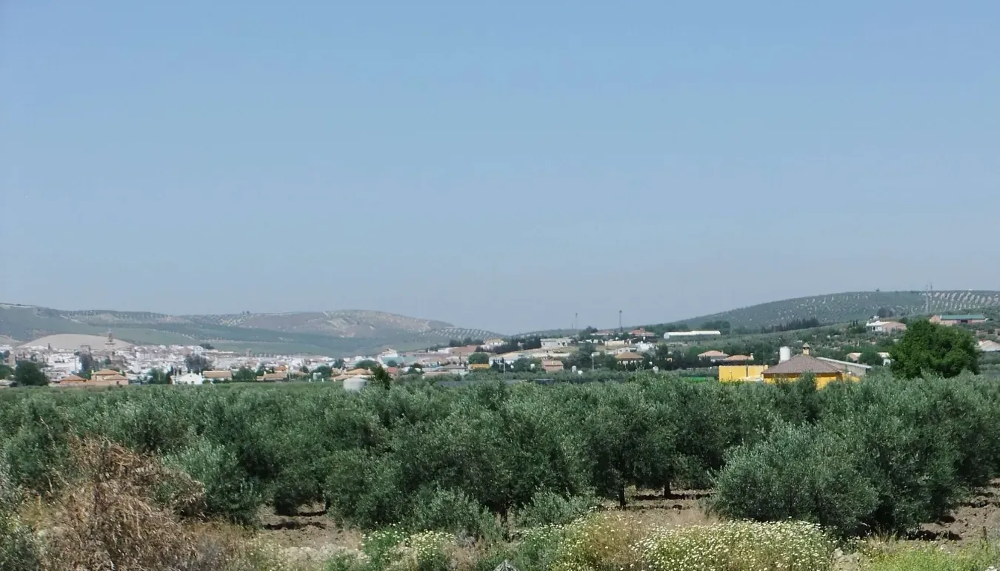

---

  

 🇬🇧 🇪🇸 🇵🇹 🇩🇪 🥾

---

↪ [Etappe-11_Castro-del-Rio_Santa-Cruz](Etappe-11_Castro-del-Rio_Santa-Cruz.md)

 🔁  [Camino_Mozarabe_Etapas](Camino_Mozarabe_Etapas.md)
 
 ...→