## Camino Mozárabe 2014 

### Etappe-11 : Castro del Rio → Santa-Cruz  ( 23 Km)
07 de Maio 2014 👣

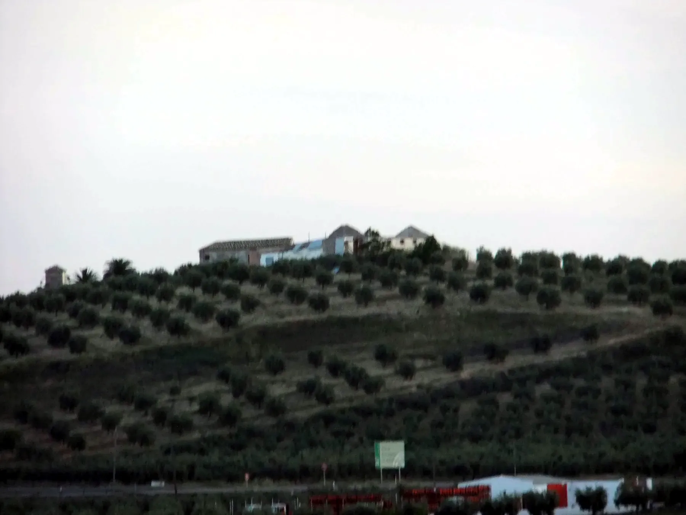

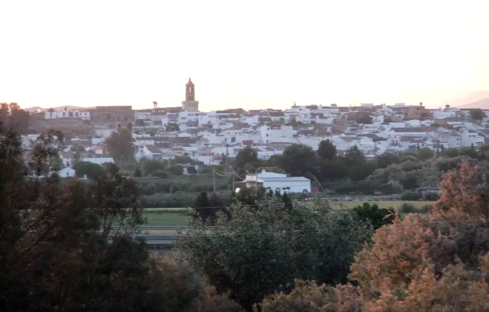

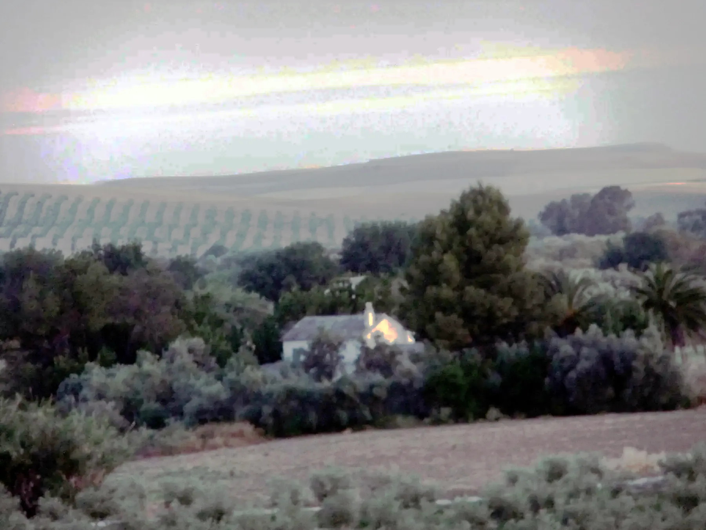

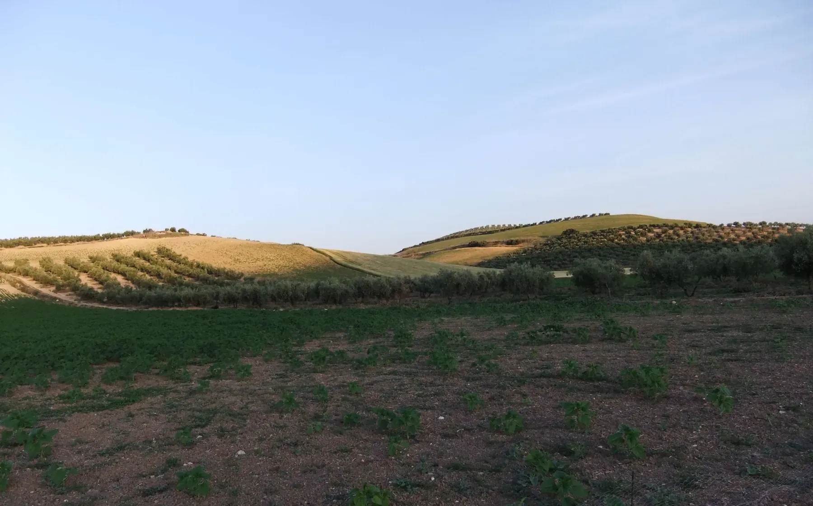

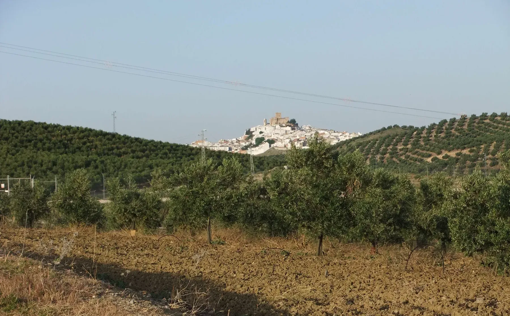

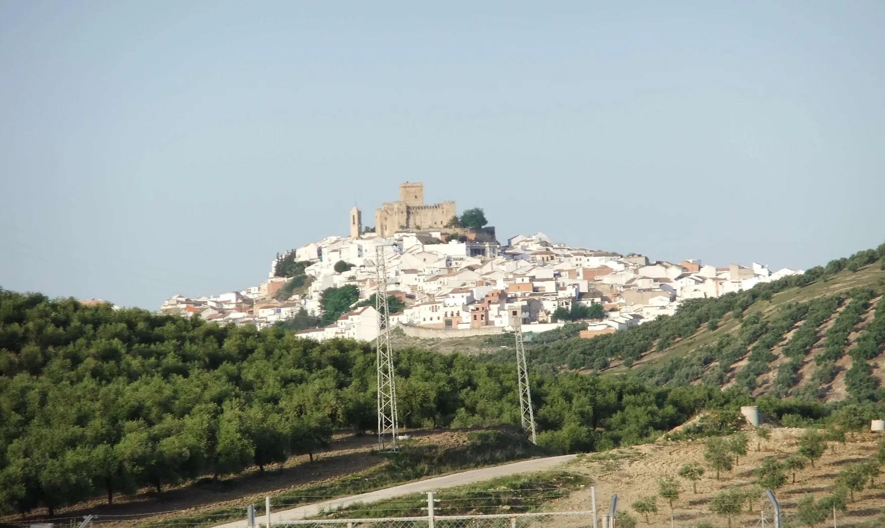

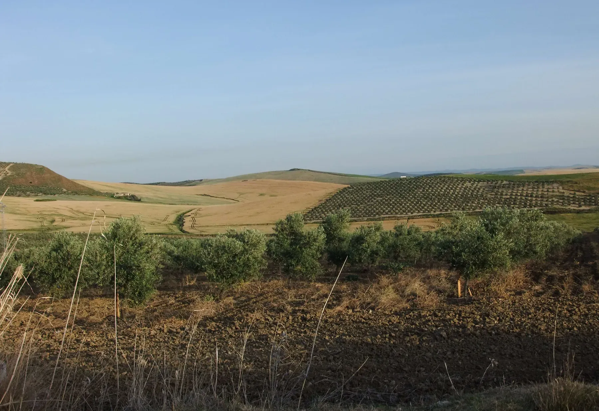

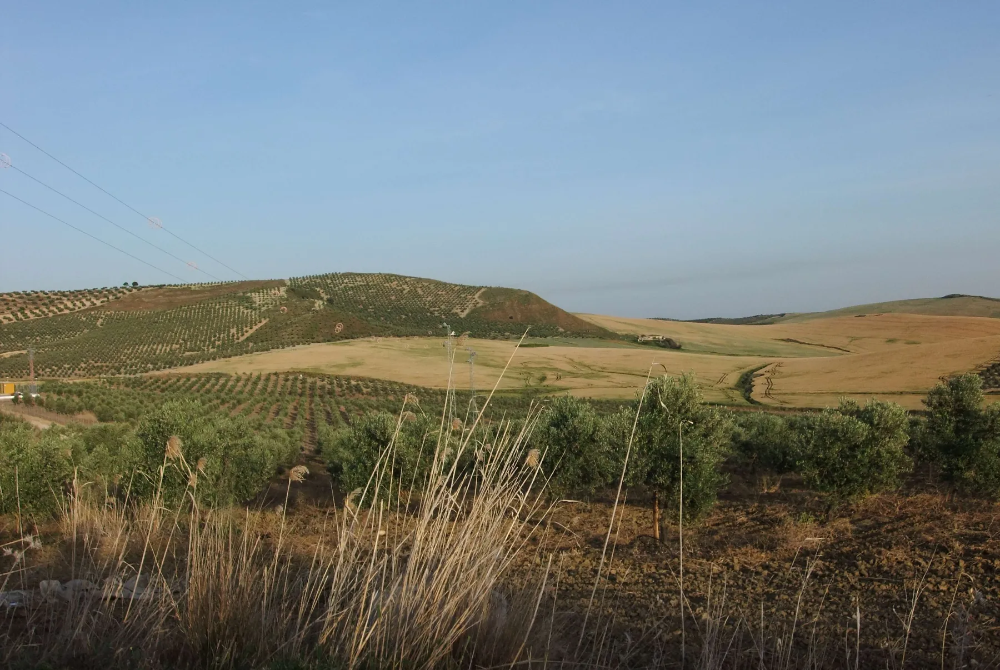

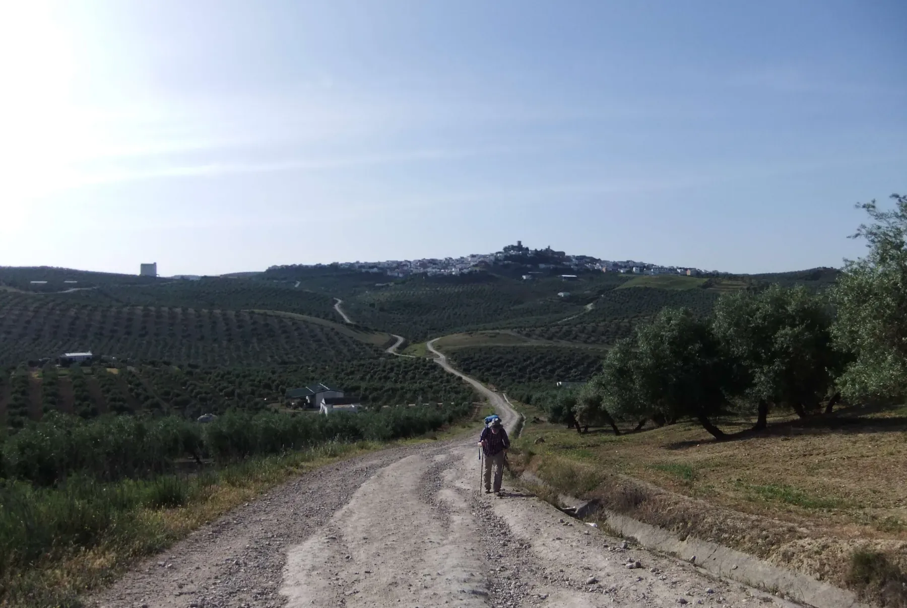

- 🇩🇪 Reinhard hatte ein Solarpanel mit Akku dabei, aber ich glaube, dass ihm das aufgrund des Gewichts und des Platzbedarfs mehr Nachteile als Vorteile gebracht hat.

- 🇬🇧  Reinhard had brought a solar panel with a battery, but I think that, because of the weight and the space it took up, it did him more harm than good.

- 🇵🇹 O Reinhard tinha levado um painel solar com um acumulador, mas acho que, devido ao peso e ao espaço que ocupava, isso lhe trouxe mais desvantagens do que vantagens.

- 🇪🇸 Reinhard se había llevado un panel solar con una batería, pero creo que, debido al peso y al espacio que ocupaba, eso le supuso más inconvenientes que ventajas.

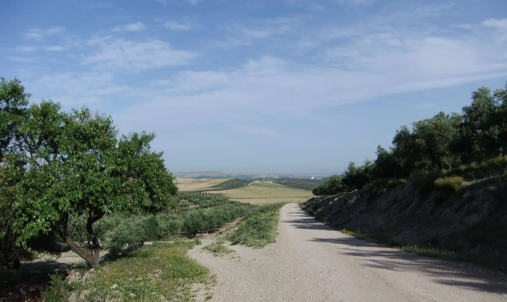

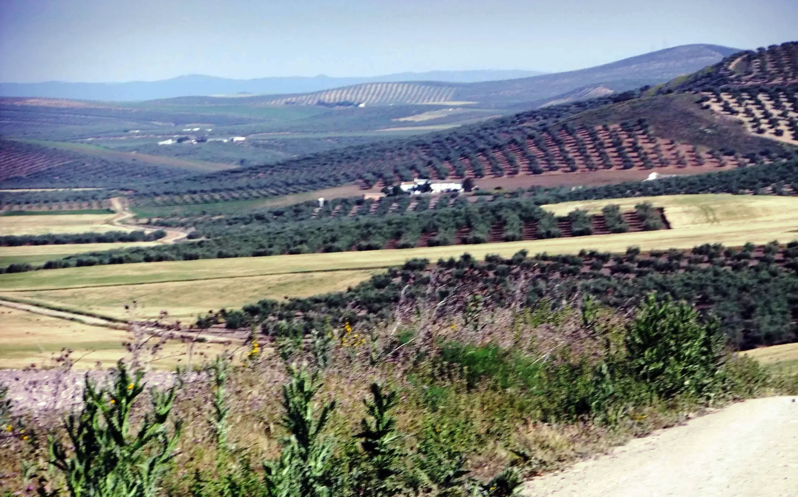

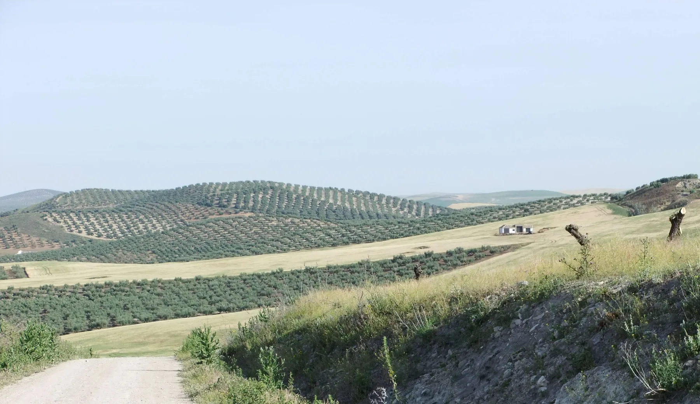

---

  

 🇬🇧 🇪🇸 🇵🇹 🇩🇪 🥾

---

↪ [Etappe-12_Santa-Cruz_Cordoba](Etappe-12_Santa-Cruz_Cordoba.md)

 🔁  [Camino_Mozarabe_Etapas](Camino_Mozarabe_Etapas.md)
 
 ...→