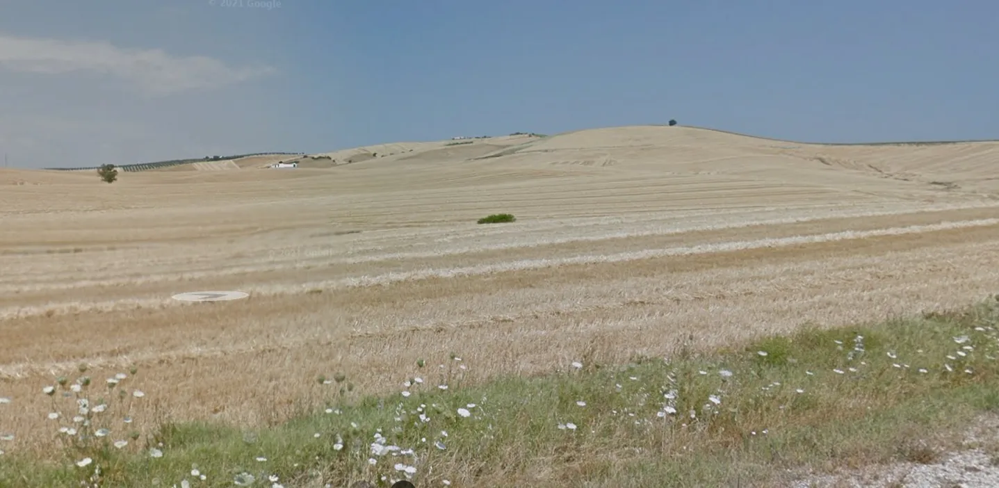
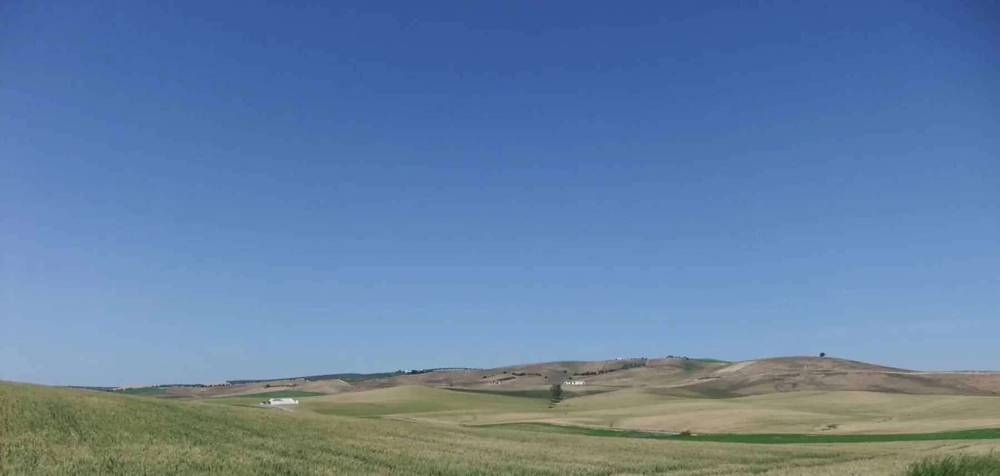
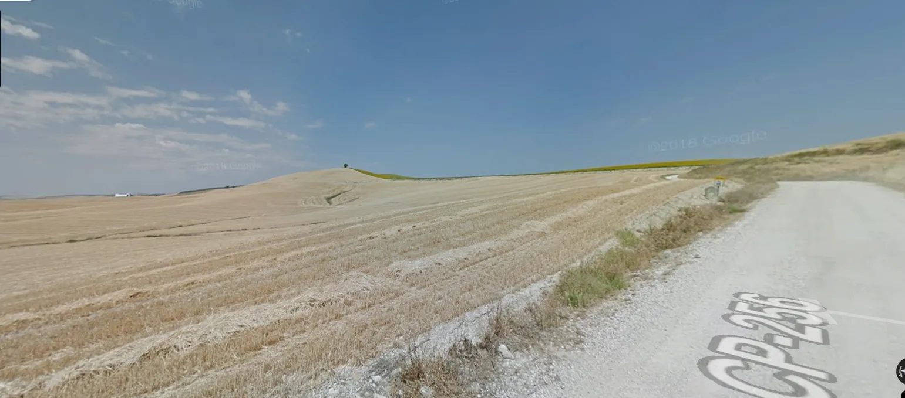
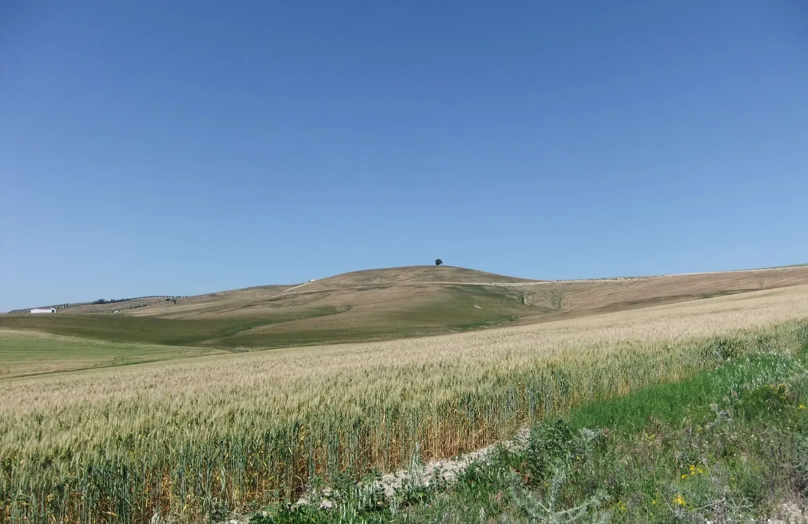
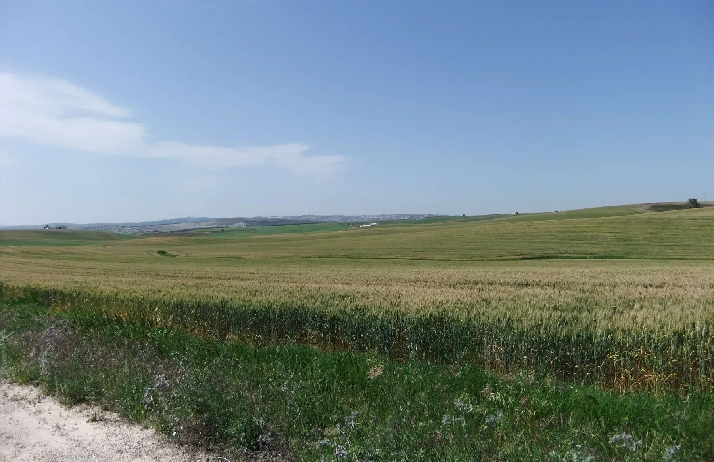
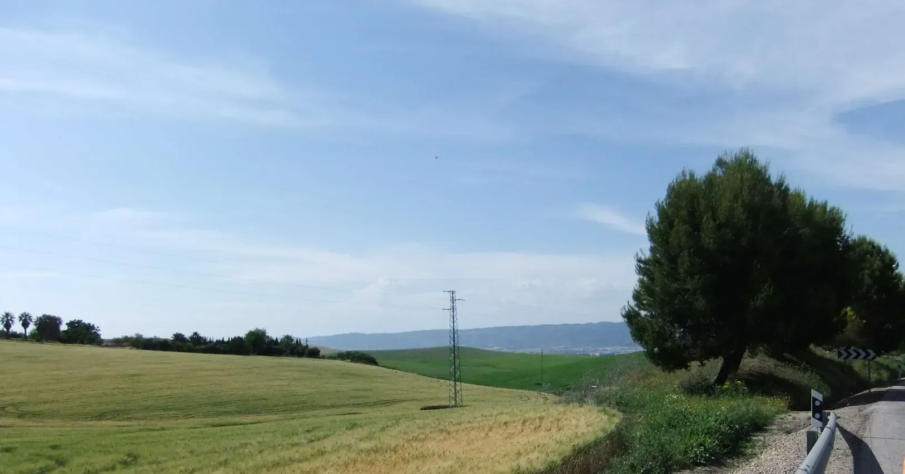
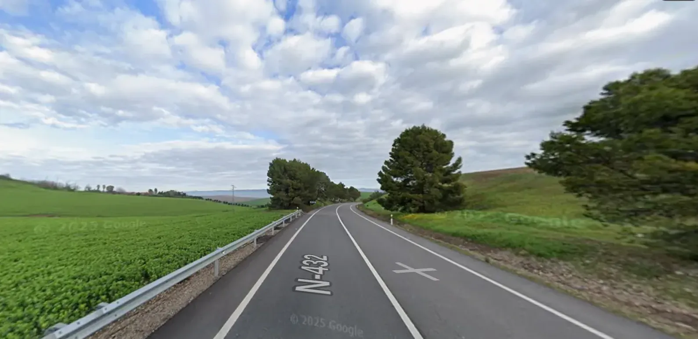
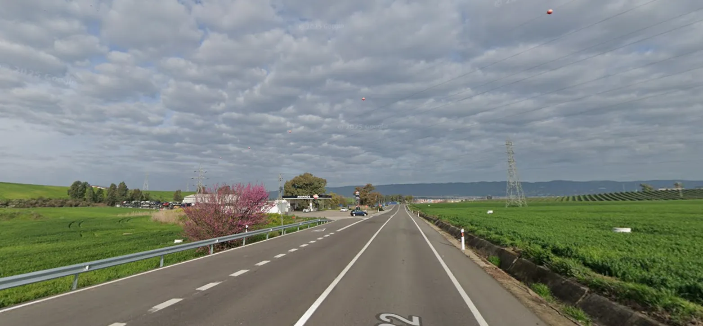

## Camino Mozárabe 2014 

### Etappe-12: Santa Cruz →  Córdoba ( 25, 7 Km)
08 de Maio 2014 👣

### 🇵🇹  De Santa Cruz a Córdoba

- Reinhard partiu um pouco mais cedo.
- Uma aventura por rios e campos de cereais.

#### A direito através dos campos

Quando coloquei a mochila às costas, pronto para a próxima etapa, não consegui ver as setas amarelas. Liguei o telemóvel e tentei determinar a minha localização para perceber onde me encontrava. Mas, como se tratava de um GPS de primeira geração, podia demorar algum tempo até conseguir estabelecer contacto com um satélite em órbita terrestre, a **20 200 quilómetros de altitude**. E agora?

No mapa offline do Google Maps, vi que, se recuasse cerca de 1,5 km, chegaria ao estrada rural CO-3203, que se ligava ao caminho CB-226. Foi exatamente isso que fiz. O caminho seguia na direção de Córdoba, mas eu não tinha analisado o percurso completo com atenção e pensei que, mais cedo ou mais tarde, acabaria por desembocar na N-432 ou noutro caminho rural. Por isso, pus-me a caminho.

Quando o satélite terminou o seu «banho de sol» para recarregar as energias e voltou a funcionar, recebi a informação sobre a minha localização e percebi exatamente onde estava. Foi então que me dei conta de que aquele caminho não me levaria ao destino pretendido e que voltar para trás significaria fazer um desvio demasiado grande.

Nesse momento, lembrei-me de um peregrino espanhol que tinha conhecido no Caminho Francês. Também ele tinha procurado instintivamente o seu próprio caminho pela paisagem e, mais tarde, nos tinha avisado de que o GPS podia indicar um beco sem saída.

Naquela altura, tudo tinha corrido bem. Porque não haveria de correr bem desta vez? Foi o que pensei: **todos os caminhos vão dar a Santiago de Compostela e, se atravessarmos os campos, acabaremos por chegar a Córdoba.**

O caminho fez uma curva à direita e não conduziu à N-432. Só havia uma maneira de regressar à estrada: atravessar os campos de cereais, seguir ao longo do ribeiro "riacho" e, em alguns troços, caminhar dentro do próprio riacho.

Depois, tirei as botas para atravessar o rio Guadajoz num ponto onde a água era menos profunda. Era uma alternativa interessante ao asfalto da N-432, mas só a recomendo para distâncias curtas e, de preferência, ao fim da tarde, quando os pés cansados agradecem um tratamento refrescante ao estilo Kneipp.

Mas não foi tão simples como no Caminho Francês. Pior ainda: a erva seca picava e entrava pelas costuras das botas de caminhada. Apesar disso, os pés agradeceram o banho refrescante.

Embora tenha sido cansativo, não me arrependi completamente da aventura. Caso contrário, limitamo-nos a seguir cegamente as setas amarelas e, no final, nem sabemos verdadeiramente o que vivemos pelo caminho.

Ainda assim, o perigo era real: a travessia pelos campos de cereais ameaçava abrir as costuras das botas, o que poderia fazer com que se desfizessem antes mesmo de chegar a Santiago de Compostela.

**Por isso, não aconselho ninguém a fazer este tipo de atalho.**

E esta não foi a minha primeira aventura a atravessar rios e campos fora dos caminhos habituais. Pouco antes de San Pedro de Mérida, aconteceu-me algo semelhante — mas, dessa vez, tive a sorte de encontrar um agricultor que me avisou do que me esperava.

### 🇪🇸 De Santa Cruz a Córdoba

- Reinhard salió un poco antes.
- Una aventura entre ríos y campos de cereales.
#### Campo a través

Cuando me eché la mochila a la espalda, listo para afrontar la siguiente etapa, no conseguí ver las flechas amarillas. Encendí el móvil e intenté determinar mi posición para saber dónde me encontraba. Pero, como se trataba de un GPS de primera generación, podía tardar un rato en establecer contacto con un satélite situado en órbita terrestre, a **20.200 kilómetros de altura**. ¿Y ahora qué?

En el mapa sin conexión de Google Maps vi que, si retrocedía aproximadamente 1,5 km, llegaría al camino rural CO-3203, que conectaba con la CB-226. Y eso fue exactamente lo que hice. El camino iba en dirección a Córdoba, pero no había examinado todo el recorrido con detenimiento y pensé que, tarde o temprano, acabaría desembocando en la N-432 o en algún otro camino rural. Así que me puse en marcha.

Cuando el satélite terminó su «baño de sol» para recargar energías y volvió a estar operativo, recibí la información sobre mi ubicación y supe exactamente dónde me encontraba. Fue entonces cuando me di cuenta de que aquel camino no me llevaría adonde quería ir y de que dar media vuelta supondría un desvío demasiado grande.

En ese momento recordé a un peregrino español que había conocido en el Camino Francés. Él también había buscado instintivamente su propio camino a través del paisaje y, más tarde, nos había advertido de que el GPS podía indicar un callejón sin salida.

En aquella ocasión todo había salido bien. ¿Por qué no iba a salir bien esta vez? Eso fue lo que pensé: **todos los caminos llevan a Santiago de Compostela y, si cruzas los campos a través, acabarás llegando a Córdoba.**

El camino giró a la derecha y no conducía a la N-432. Solo había una forma de regresar a la carretera: atravesar los campos de cereales, avanzar junto al arroyo y, en algunos tramos, caminar incluso por el propio cauce.

Después me quité las botas para cruzar el río Guadajoz por un punto menos profundo. Era una alternativa interesante al asfalto de la N-432, pero solo la recomiendo para distancias cortas y, preferiblemente, a última hora de la tarde, cuando los pies cansados agradecen un tratamiento refrescante al estilo Kneipp.

Pero no fue tan sencillo como en el Camino Francés. Peor aún: la hierba seca pinchaba y se metía por las costuras de las botas de senderismo. Aun así, los pies agradecieron el baño refrescante.

Aunque fue agotador, no me arrepentí del todo de la aventura. De lo contrario, uno se limita a seguir a ciegas las flechas amarillas y, al final, ni siquiera sabe realmente qué ha vivido durante el camino.

Sin embargo, el peligro era real: al atravesar los campos de cereales, las costuras de las botas amenazaban con abrirse, lo que podía hacer que se deshicieran antes incluso de llegar a Santiago de Compostela.

**Por eso, no recomendaría tomar un atajo de este tipo.**

Y esta no fue mi primera aventura atravesando ríos y campos fuera de los caminos habituales. Poco antes de San Pedro de Mérida me esperaba algo parecido, aunque aquella vez tuve la suerte de encontrarme con un agricultor que me advirtió de lo que me esperaba.

---
### 🇬🇧 From Santa Cruz to Córdoba

- Reinhard had set off a little earlier.
- A remarkable adventure through rivers and grain fields.

####  Cutting across the fields

As I swung my backpack onto my shoulders, ready for the next stage, I couldn't see the yellow arrows. I switched on my phone and tried to determine my location so I could work out where I was. But since this was a first-generation GPS device, it could take a while to establish contact with a satellite orbiting the Earth at an altitude of **20,200 kilometres**. So, what now?

Looking at the offline map in Google Maps, I saw that if I went back about 1.5 km, I would reach the CO-3203 country road, which connected with the CB-226. And that's exactly what I did. The road headed towards Córdoba, but I hadn't examined the entire route carefully. I assumed that sooner or later it would lead to the N-432 or another country road. So off I went.

Once the satellite had finished its little «sunbathing session» to recharge its energy and became operational again, I received my location data and knew exactly where I was. That's when I realised that the road wasn't taking me where I wanted to go, and turning back would mean making a much longer detour.

At that moment, I remembered a Spanish pilgrim I'd met on the French Way. He, too, had instinctively found his own way through the countryside and later warned us that the GPS might lead us into a dead end.

Everything had worked out fine back then, so why shouldn't it work out this time? That's what I told myself: **all roads lead to Santiago de Compostela, and if you cut straight across the fields, you'll eventually reach Córdoba.**

The road curved to the right and didn't lead to the N-432. There was only one way to get back to the main road: crossing the grain fields, following the stream and, in some places, walking right through the stream itself.

Then I took off my boots to cross the Guadajoz River at a shallower point. It was an interesting alternative to the asphalt of the N-432, but I'd only recommend it for short stretches, preferably in the late afternoon, when tired feet are grateful for a refreshing Kneipp-style treatment.

But it wasn't as straightforward as it had been on the French Way. Worse still, the dry grass pricked my skin and worked its way into the seams of my hiking boots. Even so, my feet appreciated the refreshing dip.

Although it was exhausting, I didn't entirely regret the adventure. Otherwise, you simply follow the yellow arrows blindly and, in the end, never really discover what you might have experienced along the way.

Still, there was a real risk: crossing the grain fields put so much strain on the seams of my boots that they threatened to split open. That could have left my boots falling apart before I even reached Santiago de Compostela.

**For that reason, I wouldn't recommend taking a shortcut like this.**

And this wasn't my first adventure involving rivers and cross-country detours. Just before San Pedro de Mérida, something similar awaited me — but that time, I was lucky enough to meet a farmer who warned me about what lay ahead.

---
### 🇩🇪 Von Santa Cruz nach Córdoba

- Reinhard war etwas früher aufgebrochen.
- Eine großartige Abenteueretappe durch Flüsse und Getreidefelder.

#### Querfeldein

Als ich mir den Rucksack auf den Rücken schwang, bereit für die nächste Etappe, konnte ich die gelben Pfeile nicht sehen. Ich schaltete mein Handy ein und versuchte, meinen Standort zu bestimmen, um herauszufinden, wo ich mich befand. Doch da es sich um ein GPS der ersten Generation handelte, konnte es eine Weile dauern, bis die Verbindung zu einem Satelliten in **20.200 Kilometern Höhe** hergestellt war. Und jetzt?

Auf der Offline-Karte von Google Maps sah ich, dass ich, wenn ich etwa 1,5 km zurückging, den Feldweg CO-3203 erreichen würde, der mit der CB-226 verbunden war. Genau das tat ich. Der Weg führte in Richtung Córdoba, aber ich hatte mir die gesamte Strecke nicht genauer angesehen. Ich dachte, dass er früher oder später auf die N-432 oder einen anderen Feldweg treffen würde. Also machte ich mich auf den Weg.

Als der Satellit sein «Sonnenbad» zum Aufladen seiner Energie beendet hatte und wieder einsatzbereit war, erhielt ich meine Standortdaten und wusste genau, wo ich mich befand. Da wurde mir klar, dass dieser Weg nicht dorthin führte, wo ich hinwollte, und dass eine Kehrtwende einen viel zu großen Umweg bedeuten würde.

In diesem Moment erinnerte ich mich an jenen spanischen Pilger, den ich auf dem Französischen Weg kennengelernt hatte. Auch er hatte sich instinktiv seinen eigenen Weg durch die Landschaft gesucht und uns später darauf hingewiesen, dass das GPS einen in eine Sackgasse führen könnte.

Damals war alles gut gegangen. Warum sollte es diesmal nicht auch klappen? Das dachte ich mir: **Alle Wege führen nach Santiago de Compostela, und wer quer durch die Felder geht, gelangt irgendwann auch nach Córdoba.**

Der Weg machte eine Rechtskurve und führte nicht zur N-432. Es gab nur eine Möglichkeit, zur Straße zurückzukehren: durch die Getreidefelder, entlang des Baches und an einigen Stellen sogar direkt durch das Bachbett.

Dann zog ich die Stiefel aus, um den Fluss Guadajoz an einer flacheren Stelle zu durchqueren. Das war eine interessante Alternative zum Asphalt der N-432, allerdings empfehle ich sie nur für kurze Strecken und vorzugsweise am späten Nachmittag, wenn sich müde Füße über eine erfrischende Kneipp-Kur freuen.

Doch so einfach wie auf dem Französischen Jakobsweg war es diesmal nicht. Schlimmer noch: Das trockene Gras stach und drang in die Nähte meiner Wanderstiefel ein. Trotzdem genossen meine Füße das erfrischende Bad.

Auch wenn die Tour anstrengend war, bereute ich das Abenteuer nicht völlig. Schließlich folgt man sonst nur blind den gelben Pfeilen und weiß am Ende gar nicht, was man unterwegs eigentlich erlebt hat.

Allerdings bestand eine echte Gefahr: Beim Durchqueren der Getreidefelder drohten die Nähte meiner Wanderstiefel aufzuplatzen. Im schlimmsten Fall hätten sie auseinanderfallen können, noch bevor ich Santiago de Compostela erreicht hätte.

**Deshalb würde ich davon abraten, eine solche Abkürzung zu nehmen.**

Und es war nicht mein erstes Abenteuer durch Flüsse und querfeldein. Kurz vor San Pedro de Mérida erwartete mich etwas Ähnliches – diesmal hatte ich allerdings Glück und traf auf einen Landwirt, der mich vorwarnte.

---

↑ Google Maps-Foto↑

↑ Google Maps-Foto↑

N-432- 6 km → Cordoba
####  🇵🇹  Córdoba à vista

«Olha, ali ao fundo, no vale, já consigo ver algumas casas!»
É bem possível que exista um Monte do Gozo em Córdoba. Mas, quando não seguimos as setas amarelas e, em vez disso, abrimos caminho pelos campos de trigo, não devemos admirar-nos se esta bela cidade permanecer escondida no vale.

- Faltavam ainda 6 km para Córdoba e 4 km até à próxima estação de serviço. Foi realmente simpático da parte deles terem também garrafas de cerveja de um litro à venda.

---
#### 🇩🇪 Córdoba in Sicht

«Schau mal, dort drüben im Tal! Ich kann schon die ersten Häuser sehen.»

Es mag durchaus sein, dass es in Córdoba einen Monte do Gozo gibt. Doch wer nicht den gelben Pfeilen folgt, sondern sich stattdessen seinen eigenen Weg durch die Weizenfelder bahnt, sollte sich nicht wundern, wenn sich diese wunderschöne Stadt im Tal versteckt.

- Es waren noch 6 km bis Córdoba und 4 km bis zur nächsten Tankstelle. Wirklich nett von ihnen, dass sie dort auch Bier in Ein-Liter-Flaschen im Angebot hatten.

---
#### 🇬🇧 Córdoba in sight

«Look over there! I can already see some houses down in the valley.»

There may well be a Monte do Gozo in Córdoba. But when you ignore the yellow arrows and instead make your own way through the wheat fields, you shouldn't be surprised if this beautiful city remains hidden in the valley.

- There were still 6 km to go to Córdoba and 4 km to the next petrol station. It was really thoughtful of them to stock one-litre bottles of beer as well.

---
#### 🇪🇸  Córdoba a la vista

«¡Mira, allí al fondo, en el valle, ya veo algunas casas!»

Es posible que en Córdoba exista un Monte do Gozo. Pero, cuando uno no sigue las flechas amarillas y, en su lugar, se abre paso entre los campos de trigo, no debería sorprenderse si esta hermosa ciudad permanece oculta en el valle.

Todavía quedaban 6 km hasta Córdoba y 4 km hasta la siguiente gasolinera. La verdad es que fue todo un detalle por su parte ofrecer también botellas de cerveza de un litro.

---
#### 🇪🇸  Córdoba a la vista

«¡Mira, allí al fondo, en el valle, ya veo algunas casas!»

Es posible que en Córdoba exista un Monte do Gozo. Pero, cuando uno no sigue las flechas amarillas y, en su lugar, se abre paso entre los campos de trigo, no debería sorprenderse si esta hermosa ciudad permanece oculta en el valle.

Todavía quedaban 6 km hasta Córdoba y 4 km hasta la siguiente gasolinera. La verdad es que fue todo un detalle por su parte ofrecer también botellas de cerveza de un litro.

---
 **↓ Google Maps-Foto ↓

Google Maps Foto: ↓ Estação de serviço ↓  petrol station 

---

  

 🇬🇧 🇪🇸 🇵🇹 🇩🇪 🥾

---

↪ [Etappe-13_Cordoba_Los-Patios-de-Cordoba](Etappe-13_Cordoba_Los-Patios-de-Cordoba.md)

 🔁  [Camino_Mozarabe_Etapas](Camino_Mozarabe_Etapas.md)
 
 ...→