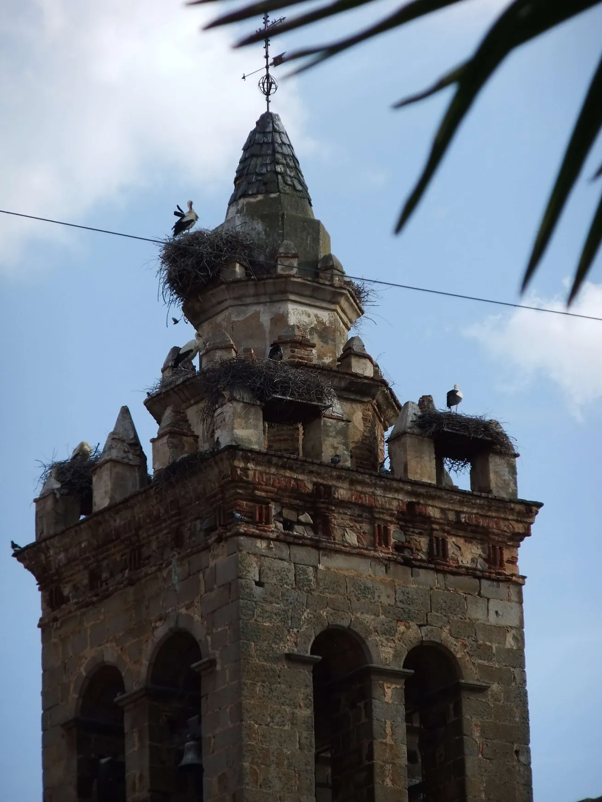
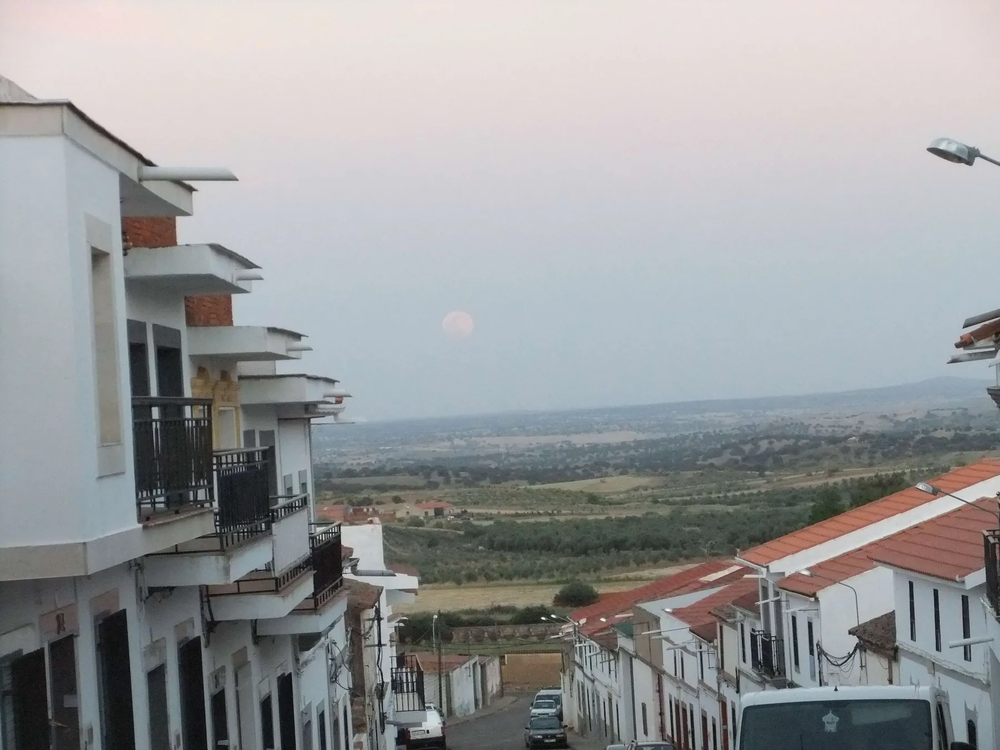

## Camino Mozárabe 2014 

### Etappe-18:  →  ( Km)
14 de Maio 2014

**Dia/Día de descanso**

**Day off/Rest day**

- **A haven of peace**

A peaceful village where you can gaze at and listen to the twinkling of the stars. 

**Nothing disturbs the silence of the night.**

- **Um refúgio de paz**

Uma aldeia tranquila onde se pode contemplar e ouvir o cintilar das estrelas. 

**Nada perturba o silêncio da noite.**

**Un remanso de paz**

Un pueblo tranquilo donde se puede contemplar y escuchar el centelleo de las estrellas. 

**Nada perturba el silencio de la noche.**

- **Eine Oase der Ruhe**

Ein ruhiges Dorf, in dem man das Funkeln der Sterne betrachten und hören kann. 

**Nichts stört die Stille der Nacht.**

---

  

 🇬🇧 🇪🇸 🇵🇹 🇩🇪 🥾

---

↪ [Etappe-19_Monterrubio-de-la-Serena_Campanario](Etappe-19_Monterrubio-de-la-Serena_Campanario.md)

 🔁  [Camino_Mozarabe_Etapas](Camino_Mozarabe_Etapas.md)
 
 ...→