## Camino Mozárabe 2014 

### Etappe-21: Don Benito → San Pedro de Mérida ( 28,8 "35,4" Km)
17 de Maio 2014 👣

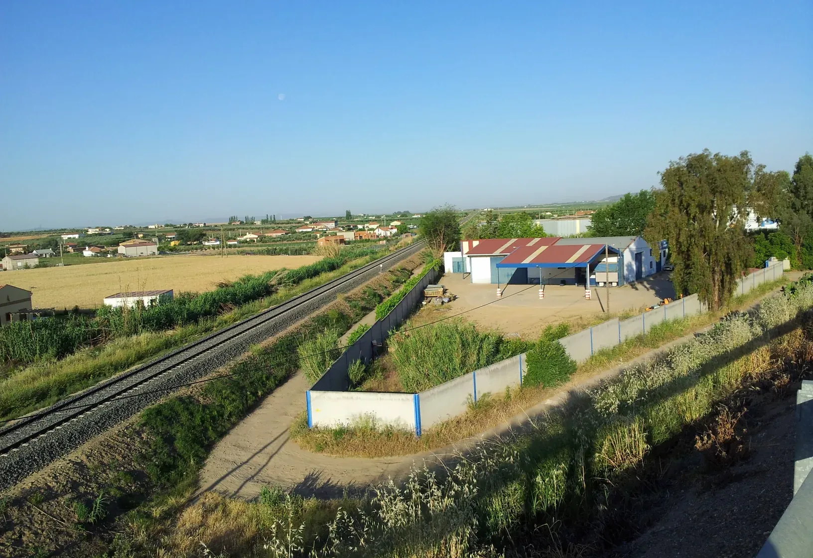

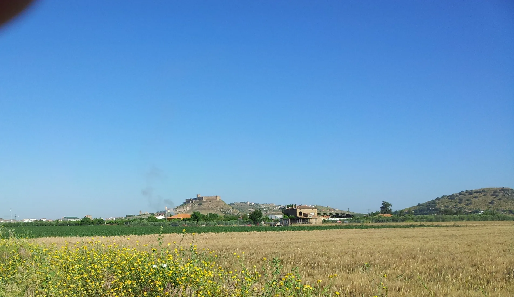

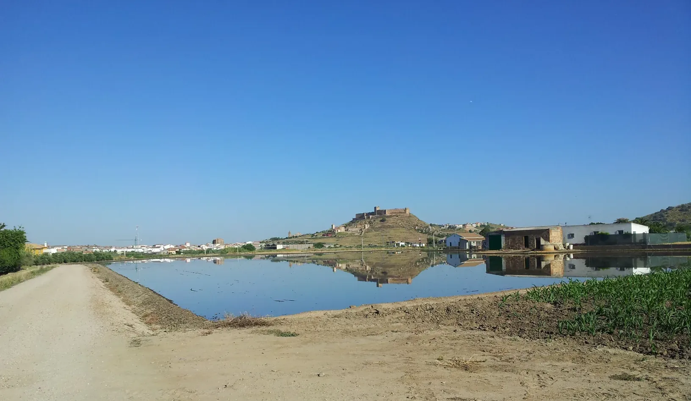

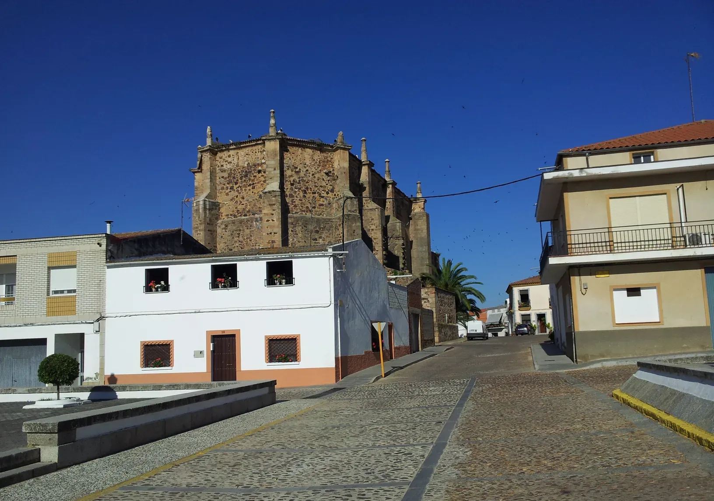

### Medellín 

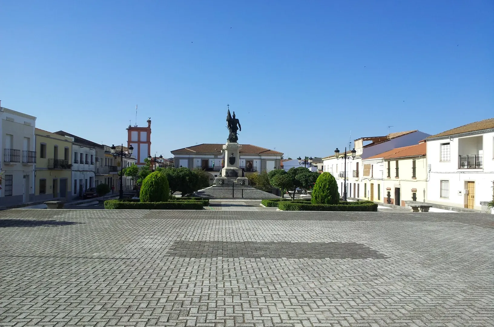

🇩🇪  Hernán Cortés und "Ich" 

### Hernán Cortés und "Ich" 

Hernán Cortés war einer der bekanntesten und gleichzeitig umstrittensten spanischen Konquistadoren (Eroberer) des 16. Jahrhunderts.
Dass Sie auf Ihrer Pilgerreise auf dem Camino Mozárabe auf der Etappe nach Don Benito auf seinen Namen gestoßen sind, liegt an seiner Herkunft: Er stammte direkt aus der unmittelbaren Nachbarschaft.
Hier ist das Wichtigste, was Sie über ihn wissen müssen:

1. Herkunft aus der Region

Cortés wurde 1485 in Medellín geboren, der historischen Nachbarstadt von Don Benito. 
Wenn man auf dem Camino Mozárabe von Campanario nach Don Benito pilgert, durchquert man genau diese geschichtsträchtige Landschaft der Extremadura, die als „Wiege der Konquistadoren“ gilt.

2. Die Eroberung des Aztokenreiches

Cortés ist historisch vor allem dafür bekannt, dass er zwischen 1519 und 1521 mit nur wenigen hundert spanischen Soldaten das mächtige Reich der Azteken im heutigen Mexiko stürzte.
• Die Strategie: Er nutzte die Unzufriedenheit anderer indigener Völker aus, die von den Azteken unterdrückt wurden, und schmiedete Allianzen mit ihnen.
• Das Ende: Er nahm den aztekischen Herrscher Montezuma II. gefangen und zerstörte die schwimmende Hauptstadt Tenochtitlan. Auf deren Trümmern gründete er Mexiko-Stadt.

3. Generalgouverneur von "Neuspanien"

Nach seinem Sieg ernannte ihn der spanische König Karl V. zum Generalgouverneur von Neuspanien (Mexiko). Cortés brachte enorme Mengen an Gold und Silber nach Europa, führte aber auch neue Nutzpflanzen wie die Kakao-Bohne (Schokolade) in Europa ein.

4. Historisches Erbe

Heute wird Cortés sehr zwiespältig betrachtet:
• In der westlichen Geschichte wurde er lange Zeit für sein militärisches Geschick und seinen Entdeckergeist bewundert.
• Aus moderner und indigener Sicht ist sein Name jedoch untrennbar mit der Zerstörung einer Hochkultur, Grausamkeit, Plünderungen und dem Tod von Millionen Einheimischen durch eingeschleppte Krankheiten verbunden.
Cortés kehrte später nach Spanien zurück und starb 1547 verarmt und verbittert in der Nähe von Sevilla. Seine Gebeine wurden jedoch nach Mexiko-Stadt zurückgebracht, wo sie bis heute in einer Kirche ruhen.

---

🇩🇪 Hätte ich ihn damals begleitet?

### Hernán Cortés

Dies ist vielmehr eine Reflexion über eine Begegnung auf dem Mozarabischen Weg.

Immer wenn wir auf Namen dieser Art stoßen, neigen wir dazu, diese symbolträchtigen Persönlichkeiten in den Vordergrund zu stellen. Dabei vergessen wir leicht, dass es sich um einen schrittweisen, historischen Prozess handelt, der weit über das Leben eines einzelnen Menschen hinausreicht und letztlich nur aus einer Gemeinschaft heraus entstehen kann.

> **Als Portugiese möchte ich hier meine Sicht auf die Rolle von Hernán Cortés in der Weltgeschichte teilen.**

Hernán Cortés ist wohl eine der am stärksten Kontrovers besetzten Figuren der Weltgeschichte, da sein Name sinnbildlich für den Untergang zahlreicher indigener Kulturen steht. Dennoch war er nur einer von Millionen, die ihr Glück auf den neuen Kontinenten suchten. Genau diese Nachkommen jener Millionen Abenteurer –von Süd- bis Nordeuropa "und später..."–, die die indigene Bevölkerung später in Reservate drängten, belehren uns heute über die Gräueltaten von Hernán Cortés und seinen Gefährten.

- Es gibt einen Satz, den ich von Menschen aus Mittel- und Nordeuropa immer wieder gehört und hassen gelernt habe: „Die Portugiesen sind sympathischer als die Spanier.“ 

- **Die Wahrheit ist:** Der spanische Torero tötet den Stier direkt in der Arena, während die Zuschauer am liebsten ein Lagerfeuer entzünden, Flamenco tanzen und ein Steak am Spieß genießen würden. 

- Der portugiesische Stierkämpfer hingegen, ein eleganter Reiter zu Pferd, weicht dem Stier aus, versetzt ihm einige Harpunen, und sobald das Tier erschöpft ist, treten die „Forcados“ auf und packen es mutig an den Hörnern. Am Ende treibt man einige Kühe in die Arena, um den Stier hinter die Kulissen und aus dem Blickfeld des Publikums zu locken. Doch hinter dieser Mauer wird der Stier genauso zu Steaks verarbeitet, damit die Zuschauer ihn am Abend in einem guten Restaurant genießen können. Pünktlich vor der Heimreise schwärmen sie dann von dem schönen Nachmittag, loben die Eleganz des Reiters und feiern die Heldentaten der Forcados.

> **"Wir alle auf diesem Planeten sind in der Tat ein Volk mit zivilisierten Sitten."**

Die Spanier, ein Chilene und ich

#### **Die Spanier, ein Chilene und ich**  

In den 90er Jahren verkehrte ich fast ausschließlich mit Spaniern. An einem Wochenende fand in Königswinter ein Seminar mit Übernachtung in einer Bildungseinrichtung statt, bei dem es um die Pressefreiheit in Osteuropa ging. Ich war von ihnen eingeladen worden. Am Abend gerieten wir in eine hitzige, aber humorvolle Diskussion, in der ich versuchte, sie davon zu überzeugen, wie großzügig wir Portugiesen doch waren, den Planeten mit ihnen zu teilen. Wir hätten ihnen ja sogar erlaubt, die Kanarischen Inseln zu nutzen, um ihre Schiffe auf dem Weg nach Südamerika zwischenzulanden. Nachdem es mir nicht gelungen war, sie von unserer grenzenlosen Güte zu überzeugen, beendeten wir die Debatte. 

Kurz darauf fragte mich ein Chilene – wir beide waren die einzigen Nicht-Spanier in der großen Runde –, ob ich denn keine Angst gehabt hätte. Ich verstand erst gar nicht, was er meinte, und fragte ihn nach dem Grund. 

Später am Abend gab es "baile" und eine Party mit Getränken, die gefühlt von Gorbatschow („Wodka“) und Fidel Castro („Rum“) gesponsert worden waren. 

> *Die Verkostung von Spirituosen ist nicht so ganz mein Welt, auch wenn ich mich hin und wieder, um anzustoßen, davon mitreißen lasse.*

**Es war ein unvergessliches Wochenende.**

Ich weiß nur, dass Jonny mich geweckt hat und sagte, wir müssten aufstehen, damit der Konferenzraum nicht leer bliebe. Meine ersten Worte waren nicht „Buenos días“, sondern „Ich werde nie wieder trinken oder rauchen“. So haben mich die Spanier überzeugt. Wäre ich nüchtern gewesen, wäre ich pünktlich vor allen anderen aufgewacht.

Heute frage ich mich manchmal: Was wäre wohl mit einem Spanier passiert, wenn die Rollen vertauscht gewesen wären – wenn eine Gruppe von Portugiesen zusammengesessen hätte und er es gewagt hätte, so ein dreister Spanier zu sein?

---

🇪🇸 Hernán Cortés y "Yo"

### Hernán Cortés y "Yo"

Hernán Cortés fue uno de los conquistadores españoles más conocidos y, al mismo tiempo, más controvertidos del siglo XVI.

El hecho de que su nombre apareciera durante su peregrinación por el Camino Mozárabe, en la etapa que conduce a Don Benito, se debe a su origen: era natural de los alrededores.

Esto es lo más importante que hay que saber sobre él:

1. Origen en la región

Cortés nació en 1485 en Medellín, la histórica ciudad vecina de Don Benito. Al recorrer el Camino Mozárabe desde Campanario hasta Don Benito, se atraviesa precisamente este paisaje histórico de Extremadura, considerado la «cuna de los conquistadores».

2. La conquista del Imperio azteca

Cortés es conocido históricamente, sobre todo, por haber derrocado, entre 1519 y 1521, con tan solo unos cientos de soldados españoles, el poderoso Imperio azteca en el actual México.

• La estrategia: se aprovechó del descontento de otros pueblos indígenas, oprimidos por los aztecas, y forjó alianzas con ellos.

• El desenlace: capturó al soberano azteca Moctezuma II y destruyó la capital flotante, Tenochtitlán. Sobre sus ruinas, fundó la Ciudad de México.

3. Gobernador general de «Nueva España»

Tras su victoria, el rey español Carlos V lo nombró gobernador general de Nueva España (México). Cortés llevó enormes cantidades de oro y plata a Europa, pero también introdujo nuevos cultivos, como el grano de cacao (chocolate), en Europa.

4. Patrimonio histórico

Hoy en día, Cortés es objeto de opiniones muy contradictorias:
• En la historia occidental, se le admiró durante mucho tiempo por su destreza militar y su espíritu explorador.
• Sin embargo, desde una perspectiva moderna e indígena, su nombre está indisolublemente ligado a la destrucción de una civilización avanzada, a la crueldad, a los saqueos y a la muerte de millones de indígenas a causa de las enfermedades introducidas.
Cortés regresó más tarde a España y murió en 1547, empobrecido y amargado, cerca de Sevilla. Sin embargo, sus restos fueron trasladados a Ciudad de México, donde descansan hasta hoy en una iglesia.

🇪🇸 ¿Lo habría acompañado en aquel entonces?

#### Hernán Cortés 

Esto es, más bien, una reflexión sobre un encuentro en el Camino Mozárabe.

Cada vez que topamos con nombres de este calibre, tendemos a sobredimensionar a estas figuras emblemáticas. Al hacerlo, olvidamos fácilmente que se trata de un proceso gradual e histórico que va mucho más allá de la vida de un solo individuo, y que solo puede surgir del esfuerzo de una colectividad.

> **Como portugués, me gustaría compartir aquí mi perspectiva sobre el papel de Hernán Cortés en la historia mundial.**

Hernán Cortés es, tal vez, una de las figuras controvertidas más emblemáticas de la historia universal, ya que su nombre es sinónimo de la destrucción de innumerables culturas indígenas. Sin embargo, no fue más que uno entre los millones que buscaron fortuna en los nuevos continentes. Y son precisamente los descendientes de esos millones de aventureros —desde el sur hasta el norte de Europa ", y después...." —, quienes más tarde confinaron a las poblaciones nativas en reservas, los que hoy nos sermonean sobre las atrocidades de Hernán Cortés y sus conocidos compañeros.

Hay una frase que siempre he detestado oír de boca de la gente del centro y norte de Europa: "Los portugueses son más simpáticos que los españoles". 

- **La verdad es esta:** el torero español mata al toro allí mismo, en la arena, mientras los espectadores preferirían encender una hoguera, bailar flamenco y disfrutar de un filete al espeto. 

- El torero portugués, en cambio, un elegante jinete a caballo, esquiva al toro, le clava algunas banderillas y, en cuanto el animal está exhausto, entran en juego los forcados para agarrarlo por los cuernos. Al final, se introducen unas vacas en la plaza para guiar al toro detrás del callejón, lejos de la mirada del público. Pero es justo detrás de ese muro donde el toro se convierte en filetes, para que los espectadores puedan disfrutarlos por la noche en un buen restaurante. Justo antes de volver a casa, se entusiasman con la hermosa tarde que han pasado, alabando la elegancia del rejoneador y celebrando las hazañas de los forcados.

>**"Todos nosotros, en este planeta, somos, de hecho, un pueblo de costumbres civilizadas."**

Los españoles, un chileno y yo

#### **Los españoles, un chileno y yo**  

En los años 90, me relacionaba casi exclusivamente con españoles. Un fin de semana se organizó en Königswinter un seminario con pernoctación en un instituto educativo que trataba sobre la libertad de prensa en Europa del Este. Ellos me habían invitado. Por la noche, nos enredamos en una discusión acalorada pero divertida, en la que intenté convencerlos de lo generosos que habíamos sido los portugueses al compartir el planeta con ellos. Incluso les habíamos permitido usar las Islas Canarias para que sus barcos hicieran escala rumbo a Sudamérica. 
Tras fracasar en mi intento de convencerlos de nuestra infinita bondad, zanjamos el debate. 

Poco después, un chileno —eramos los únicos no españoles entre tanta gente— me preguntó si no había tenido miedo. No entendí a qué se refería y le pregunté por qué. 

Más tarde hubo "baile" y una fiesta con bebidas que parecían patrocinadas por Gorbachov ("vodka") y Fidel Castro ("ron"). 

> *La degustación de bebidas espirituosas no es lo mío, aunque, de vez en cuando, para brindar, me dejo llevar.*

**Fue un fin de semana inolvidable.**

Solo sé que Jonny me despertó diciendo que teníamos que levantarnos para que la sala de conferencias no se quedara vacía. Mis primeras palabras no fueron "Buenos días", sino "No volveré a beber ni a fumar nunca más". Así fue como me convencieron los españoles. De haber estado sobrio, me habría despertado puntual, antes que nadie.

Hoy me pregunto qué le habría pasado a un español si, en aquella época, el grupo hubiera sido de portugueses y él hubiera tenido el descaro de ser un español tan atrevido.

---

🇵🇹 Hernán Cortés e "Eu"

### Hernán Cortés

Hernán Cortés foi um dos conquistadores espanhóis mais conhecidos e, ao mesmo tempo, mais controversos do século XVI.

O facto de ter encontrado o seu nome durante a sua peregrinação pelo Caminho Mozárabe, na etapa que conduz a Don Benito, deve-se à sua origem: ele era natural das imediações.

Eis o que é mais importante saber sobre ele:

1. Origem na região

Cortés nasceu em 1485 em Medellín, a histórica cidade vizinha de Don Benito. Ao percorrer o Caminho Mozárabe de Campanario a Don Benito, atravessa-se precisamente esta paisagem histórica da Extremadura, considerada o «berço dos conquistadores».

2. A conquista do Império Asteca

Cortés é historicamente conhecido, acima de tudo, por ter derrubado, entre 1519 e 1521, com apenas algumas centenas de soldados espanhóis, o poderoso Império Asteca no atual México.

• A estratégia: aproveitou-se do descontentamento de outros povos indígenas, oprimidos pelos astecas, e forjou alianças com eles.

• O desfecho: capturou o soberano asteca Montezuma II e destruiu a capital flutuante Tenochtitlan. Sobre as suas ruínas, fundou a Cidade do México.

3. Governador-geral da «Nova Espanha»
Após a sua vitória, o rei espanhol Carlos V nomeou-o governador-geral da Nova Espanha (México). Cortés levou enormes quantidades de ouro e prata para a Europa, mas também introduziu novas culturas, como o grão de cacau (chocolate) na Europa.

4. Património histórico

Hoje em dia, Cortés é visto de forma muito ambivalente:
• Na história ocidental, foi durante muito tempo admirado pela sua habilidade militar e pelo seu espírito explorador.
• No entanto, de uma perspetiva moderna e indígena, o seu nome está indissociavelmente ligado à destruição de uma civilização avançada, à crueldade, aos saques e à morte de milhões de indígenas devido a doenças introduzidas.
Cortés regressou mais tarde a Espanha e morreu em 1547, empobrecido e amargurado, perto de Sevilha. Os seus restos mortais foram, no entanto, levados de volta para a Cidade do México, onde repousam até hoje numa igreja.

🇵🇹 Teria-o eu, acompanhado naquela altura?

#### Hernán Cortés

Isto é, antes de mais, uma reflexão sobre um encontro no Caminho Moçárabe.

Sempre que nos deparamos com nomes deste calibre, tendemos a destacar estas figuras emblemáticas. Ao fazê-lo, esquecemo-nos facilmente de que se trata de um processo gradual e histórico, que vai muito além da vida de um único indivíduo e que só pode emanar de uma coletividade.

> **Como português, gostaria de partilhar aqui a minha perspetiva sobre o papel de Hernán Cortés na história mundial.**

Hernán Cortés é, talvez, uma das figuras controversas mais marcantes da história universal, sendo sinónimo da destruição de inúmeras culturas indígenas. No entanto, ele foi apenas um entre milhões que procuraram a fortuna nos novos continentes. E são precisamente os descendentes desses milhões de aventureiros – do sul ao norte da Europa "e depois..." –, que mais tarde empurraram as populações nativas para reservas, que hoje nos vêm liccionar sobre as atrocidades de Hernán Cortés e dos seus célebres companheiros.

Há uma frase que sempre detestei ouvir da boca de pessoas do centro e do norte da Europa: "Os portugueses são mais simpáticos do que os espanhóis." 

- **A verdade é esta:** o toureiro espanhol mata o touro ali mesmo, na arena, enquanto os espectadores preferiam acender uma fogueira, dançar flamenco e saborear um bife no espeto. 

- Já o toureiro português, um cavaleiro elegante, esquiva-se do touro, crava-lhe algumas farpas e, assim que o animal está exausto, entram em cena os forcados para o pegar pelos cornos. No final, levam-se algumas vacas para a arena para atrair o touro para trás do muro, longe dos olhos do público. Mas é precisamente atrás desse muro que o touro é transformado em bifes, para que os espectadores os possam saborear à noite num bom restaurante. Mesmo antes de regressarem a casa, entusiasmam-se com a bela tarde que passaram, louvando a elegância do cavaleiro e celebrando as proezas dos forcados.

> **"Todos nós, neste planeta, somos, de facto, um povo de costumes civilizados."**

Os espanhóis, um chileno e eu

#### Os espanhóis, um chileno e "Eu"

Nos anos 90, dava-me quase exclusivamente com espanhóis. Certo fim de semana, realizou-se em Königswinter um seminário com pernoita numa instituição de ensino dedicado à liberdade de imprensa na Europa de Leste. Eu tinha sido convidado por eles. À noite, entrámos numa discussão acesa mas bem-humorada, na qual tentei convencê-los de quão generosos nós, portugueses, tínhamos sido ao partilhar o planeta com eles. Afinal, até lhes tínhamos permitido usar as Ilhas Canárias para aportarem os seus navios a caminho da América do Sul. Não tendo conseguido convencê-los da nossa extrema bondade, pusemos fim à conversa. 

Pouco depois, um chileno – éramos os únicos não-espanhóis no meio de tantos – perguntou-me se eu não tinha tido medo. Não percebi o que ele queria dizer e perguntei-lhe porquê. 

Pela noite dentro, houve "baile" e uma festa com bebidas que pareciam patrocinadas por Gorbachev ("vodka") e Fidel Castro ("rum"). 

> *A degustação de bebidas espirituosas não é o meu mundo, embora, de vez em quando, para brindar, me deixe levar.*

**Foi um fim de semana inesquecível.**

Só me lembro do Jonny a acordar-me e a dizer que tínhamos de nos levantar para que a sala de conferências não ficasse vazia. As minhas primeiras palavras não foram "Buenos días", mas sim "Nunca mais volto a beber ou a fumar". Foi assim que os espanhóis me venceram. Se estivesse sóbrio, teria acordado pontualmente, antes de todos os outros.

Hoje pergunto-me: o que teria acontecido a um espanhol se, na altura, estivesse no meio de um grupo de portugueses e se tivesse atrevido a ser um espanhol assim tão audaz?

---

🇬🇧  Hernán Cortés and "I"

#### Hernán Cortés and " I "

The fact that his name crops up during a pilgrimage along the Mozarabic Way, on the stage leading to Don Benito, is down to his origins: he was a native of the surrounding area.

Here is what you need to know about him:

1. Regional origins

Cortés was born in 1485 in Medellín, the historic town neighbouring Don Benito. When travelling along the Mozarabic Way from Campanario to Don Benito, you pass through precisely this historic landscape of Extremadura, considered the ‘cradle of the conquistadors’.

2. The conquest of the Aztec Empire

Cortés is historically known, above all, for having overthrown, between 1519 and 1521, with just a few hundred Spanish soldiers, the p owerful Aztec Empire in what is now Mexico.

• The strategy: he exploited the discontent of other indigenous peoples, who were oppressed by the Aztecs, and forged alliances with them.

• The outcome: he captured the Aztec ruler Montezuma II and destroyed the floating capital, Tenochtitlan. On its ruins, he founded Mexico City.

3. Governor-General of ‘New Spain’

Following his victory, the Spanish King Charles V appointed him Governor-General of New Spain (Mexico). Cortés brought vast quantities of gold and silver back to Europe, but he also introduced new crops, such as the cocoa bean (chocolate), to Europe.

4. Historical Legacy

Today, Cortés is viewed in a very ambivalent light:
• In Western history, he was long admired for his military prowess and spirit of discovery.
• From a modern and indigenous perspective, however, his name is inextricably linked with the destruction of an advanced civilisation, cruelty, plunder and the deaths of millions of indigenous people from diseases introduced from abroad.
Cortés later returned to Spain and died in 1547, impoverished and embittered, near Seville. His remains, however, were returned to Mexico City, where they still rest in a church to this day.

----

🇬🇧 Would I have gone with him back then?

#### Hernán Cortés

This is, rather, a reflection on a chance encounter along the Mozarabic Way.

Whenever we come across names of this stature, we tend to spotlight these iconic personalities. In doing so, we easily forget that history is a gradual process—one that extends far beyond the lifespan of a single individual and can only emerge from a collective community.

> **As a Portuguese, I would like to share my perspective on the role of Hernán Cortés in world history.**

Hernán Cortés is perhaps one of the most starkly negative figures in world history, his name synonymous with the downfall of countless indigenous cultures. Yet, he was merely one among millions who sought their fortune in the New World. And it is precisely the descendants of those millions of adventurers—from Southern to Northern Europe—who later drove native populations into reservations, who now lecture us on the atrocities of Hernán Cortés and his notorious companions.

There is a phrase I have always detested hearing from people in Central and Northern Europe: "The Portuguese are nicer than the Spaniards." 

- The truth is this: the Spanish matador kills the bull right there in the arena, while the spectators would like nothing more than to light a bonfire, dance flamenco, and enjoy a steak on a spit. 

- The Portuguese bullfighter, by contrast, an elegant rider on horseback, dodges the bull, plants a few harpoons, and once the animal is exhausted, the _forcados_ step in to take it by the horns. In the end, a few cows are driven into the ring to lure the bull behind the wall, out of the audience's sight. Yet, behind that very wall, the bull is turned into steaks so that the spectators can enjoy it that evening in a fine restaurant. Just before heading home, they rave about the wonderful afternoon, praising the elegance of the rider and celebrating the heroic deeds of the _forcados_.

> **"All of us on this planet are, in fact, a people of civilised customs."**

The Spaniards, a Chilean, and I

#### **The Spaniards, a Chilean, and I**  

Back in the '90s, I hung out almost exclusively with Spaniards. One weekend, a residential seminar was held in Königswinter at an educational institution, focusing on press freedom in Eastern Europe. They had invited me along. That evening, we got into a heated but lighthearted debate, where I tried to convince them just how generous we Portuguese were to share the planet with them. After all, we even allowed them to use the Canary Islands to dock their ships on their way to South America. Having failed to convince them of our boundless kindness, we brought the discussion to an end. 

Shortly after, a Chilean guy—the two of us being the only non-Spaniards among so many—asked me if I hadn't been afraid. I didn't understand what he meant and asked him why. 

Later that night, there was "baile" and a party with drinks seemingly sponsored by Gorbachev ("vodka") and Fidel Castro ("rum"). 

> *Tasting spirits isn’t really my world, although every now and then, when it’s time to raise a glass, I do let myself get carried away.*

**It was an unforgettable weekend.**

All I know is that Jonny woke me up, saying we had to get up so the conference room wouldn't be empty. My first words weren't "Buenos días," but rather, "I am never drinking or smoking again." That was how the Spaniards got the better of me. If I had been sober, I would have woken up on time, ahead of everyone else.

Today, I wonder what would have happened to a Spaniard back then if it had been a group of Portuguese people, and he had been bold enough to be such an audacious Spaniard.

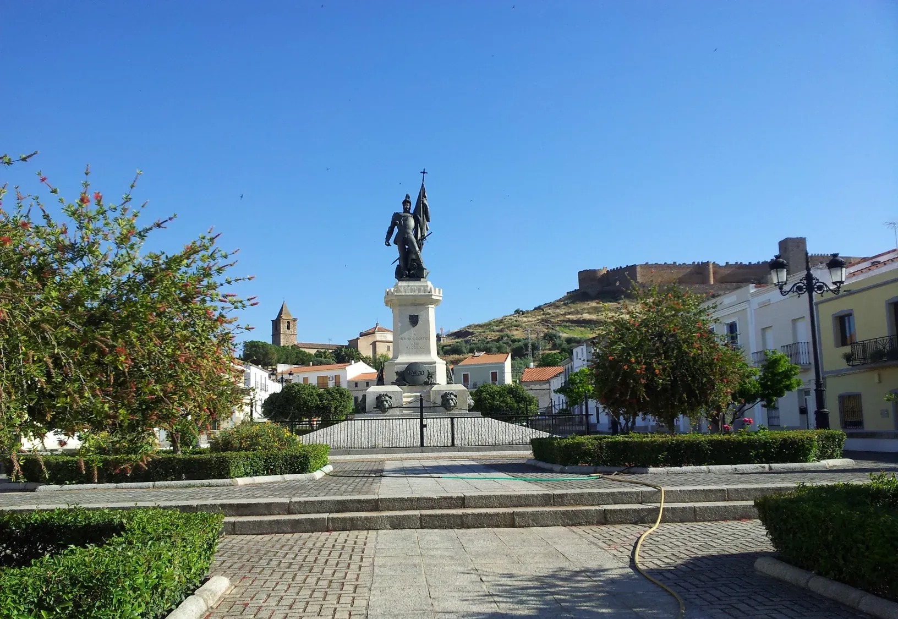

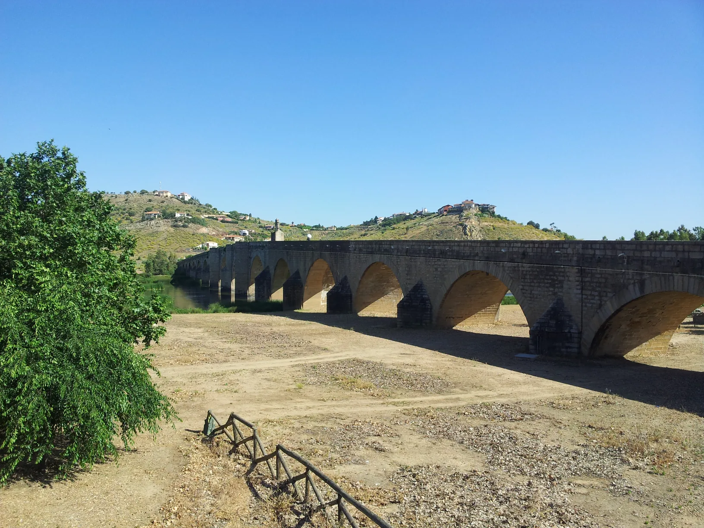

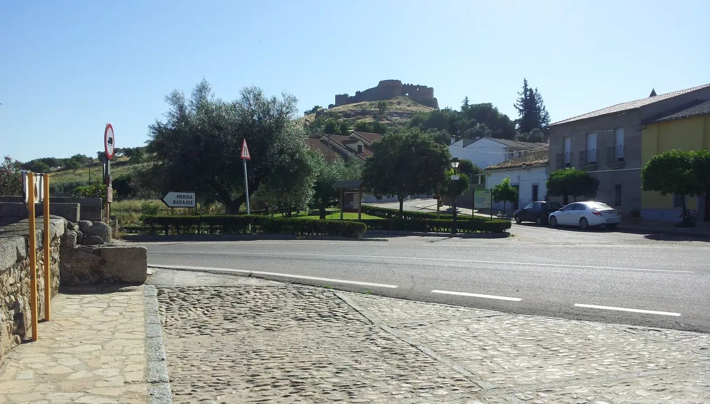

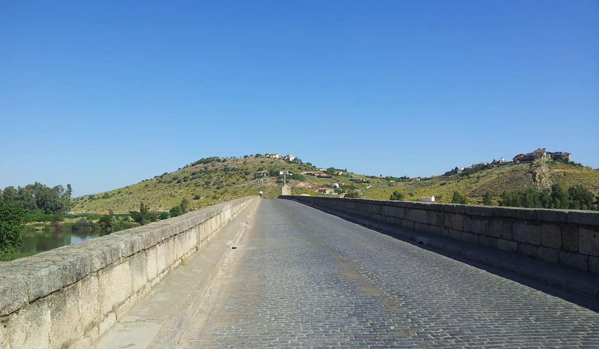

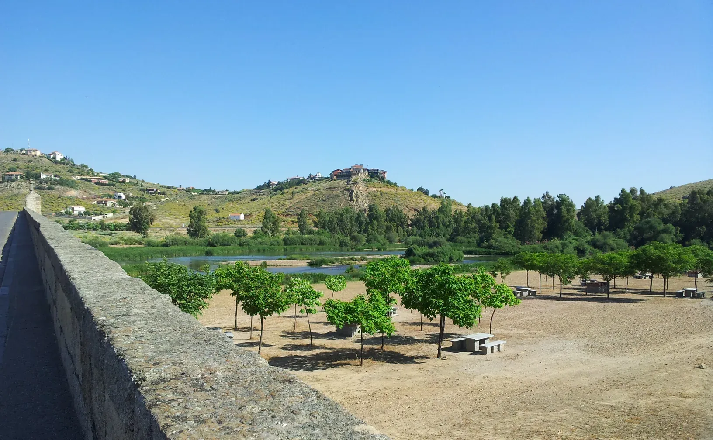

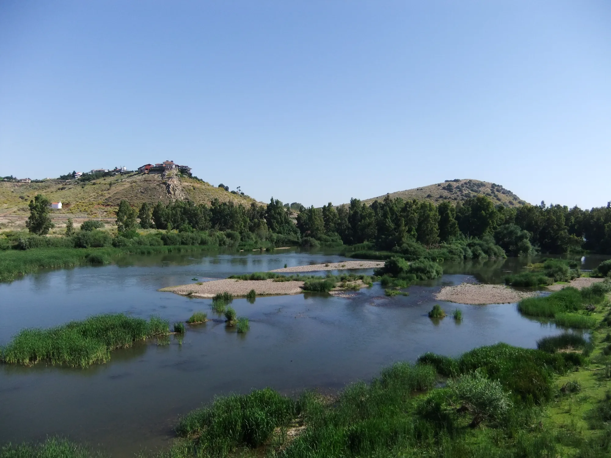

#### 🇩🇪 Auf dem Weg nach San Pedro de Mérida – auf der Brücke über den Guadiana

**Woher kam er eigentlich?**

Er hatte es mir auf Englisch gesagt, aber ich hatte es schon wieder vergessen. England? Belgien? Was mir im Gedächtnis geblieben war: Er arbeitete im Finanzbereich und war oder ist irgendwo in Luxemburg tätig. Während er auf seinem Weg nach Santiago durch Andalusien und die Extremadura wanderte, wartete seine Frau irgendwo an der Mittelmeerküste auf ihn.

Was mich allerdings am meisten interessierte, war die Frage, ob der „Regen-Sonnenschirm“ gerade dabei war, sich zu einem neuen Trend unter den Pilgern zu entwickeln, die auf ihrem Weg nach Santiago durch Andalusien wandern.

Denn schon zuvor, kurz vor Baena, war mir eine niederländische Pilgerin begegnet, die auf Ibiza lebt und mit einem Sonnenschirm durch die Olivenhaine wanderte. Damals hatte ich mir gedacht, dass dies entweder ihr ganz persönlicher Wanderstil war oder dass man es auf Ibiza eben so machte. Doch wenn zwei Pilger unterschiedlicher Herkunft auf dieselbe Idee kommen, muss es dafür wohl einen Grund geben.

Der Finanzfachmann aus dem Norden erklärte mir, dass ein Schirm vor der Sonneneinstrahlung schützt. Ich wandte ein, dass er zusätzliches Gewicht bedeutet und beim Transport eher unhandlich ist. Darauf entgegnete er, dass wir bei Hitze stärker schwitzen und deshalb mehr Wasser trinken müssen. Folglich müssen wir auch mehr Wasser mit uns tragen – und das bedeutet wiederum zusätzliches Gewicht.

> **Eine wirklich plausible, sachliche und vernünftige Erklärung.**

---
#### 🇵🇹 A caminho de San Pedro de Mérida, na ponte sobre o Guadiana

**Afinal, de onde é que ele vinha?**

Tinha-me dito em inglês, mas eu já me tinha esquecido. Inglaterra? Bélgica? O que me ficou na memória foi que trabalhava na área financeira e que trabalhava ou tinha trabalhado algures no Luxemburgo. Enquanto percorria a Andaluzia e a Extremadura a caminho de Santiago, a mulher esperava por ele algures na costa mediterrânica.

O que mais me interessava, porém, era saber se o «guarda-chuva-sol» estaria a tornar-se uma nova tendência entre os peregrinos que atravessam a Andaluzia a caminho de Santiago.

Isto porque, pouco antes, perto de Baena, já me tinha cruzado com uma peregrina neerlandesa que vive em Ibiza e caminhava pelos olivais com um guarda-sol. Na altura, pensei que fosse uma peculiaridade do seu estilo pessoal de caminhar ou que, em Ibiza, as pessoas simplesmente fizessem as coisas assim. Mas, quando dois peregrinos de origens diferentes têm a mesma ideia, deve haver alguma razão para isso.

O especialista financeiro do norte explicou-me então que o guarda-sol protege dos raios solares. Respondi-lhe que também representa peso adicional e que não é propriamente prático de transportar. Ele contrapôs que, com o calor, suamos mais e, por isso, precisamos de beber mais água. Consequentemente, temos de transportar mais água, o que significa ainda mais peso.

> **Uma explicação verdadeiramente plausível, objetiva e sensata.**

---
#### 🇪🇸 De camino a San Pedro de Mérida, en el puente sobre el Guadiana

¿De dónde era, en realidad?

Me lo había dicho en inglés, pero ya se me había olvidado. ¿Inglaterra? ¿Bélgica? Lo que sí recordaba era que trabajaba en el sector financiero y que trabajaba o había trabajado en algún lugar de Luxemburgo. Mientras recorría Andalucía y Extremadura camino de Santiago, su mujer lo esperaba en algún punto de la costa mediterránea.

Lo que más me interesaba, sin embargo, era saber si el «paraguas-parasol» estaba a punto de convertirse en una nueva tendencia entre los peregrinos que atraviesan Andalucía camino de Santiago.

Y es que, poco antes, cerca de Baena, ya me había encontrado con una peregrina neerlandesa que vive en Ibiza y caminaba entre los olivares con una sombrilla. Entonces pensé que se trataba de una peculiaridad de su estilo personal de caminar o que, sencillamente, en Ibiza se hacía así. Pero cuando dos peregrinos de procedencias distintas tienen la misma idea, por algo será.

El experto en finanzas del norte me explicó que la sombrilla protege de los rayos del sol. Yo le repliqué que también supone un peso adicional y que resulta algo incómoda de transportar. Él contraargumentó que, cuando hace calor, sudamos más y, por tanto, necesitamos beber más agua. Eso significa que también tenemos que cargar con más agua y, en consecuencia, con más peso.

> **Una explicación realmente plausible, objetiva y sensata.**

---
#### 🇬🇧 On the Way to San Pedro de Mérida, on the Bridge over the Guadiana

**Where was he actually from?**

He had told me in English, but I had already forgotten. England? Belgium? What had stayed with me was that he worked in finance and worked or had worked somewhere in Luxembourg. While he was making his way through Andalusia and Extremadura on his pilgrimage to Santiago, his wife was waiting for him somewhere along the Mediterranean coast.

What interested me most, though, was whether the “umbrella-sunshade” was about to become a new trend among pilgrims walking through Andalusia on their way to Santiago.

After all, shortly before that, near Baena, I had come across a Dutch pilgrim who lives in Ibiza and was walking through the olive groves with a parasol. At the time, I thought it was either her own personal walking style or simply the way people did things in Ibiza. But when two pilgrims from different backgrounds come up with the same idea, there must be a reason for it.

The finance professional from the north explained that a parasol protects you from the sun’s rays. I pointed out that it also adds extra weight and is somewhat awkward to carry. He countered that we sweat more in hot weather and therefore need to drink more water. Which means we have to carry more water, too – and that, in turn, means more weight.

**A genuinely plausible, objective, and sensible explanation.**

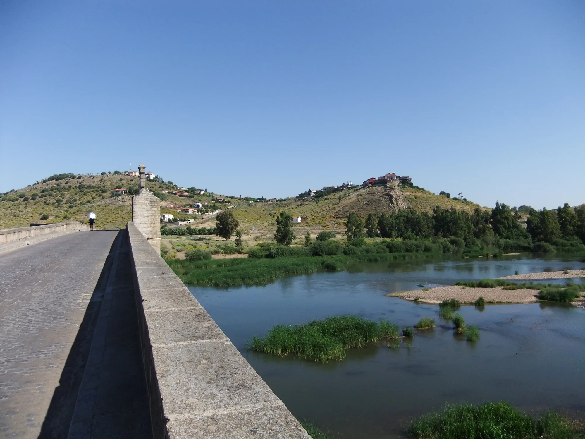

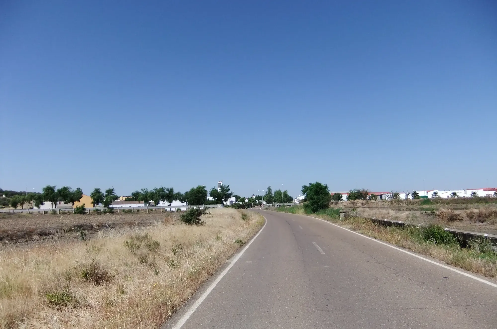

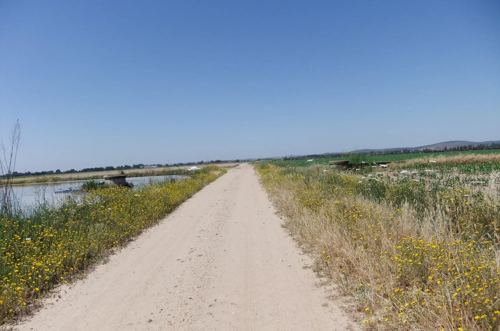

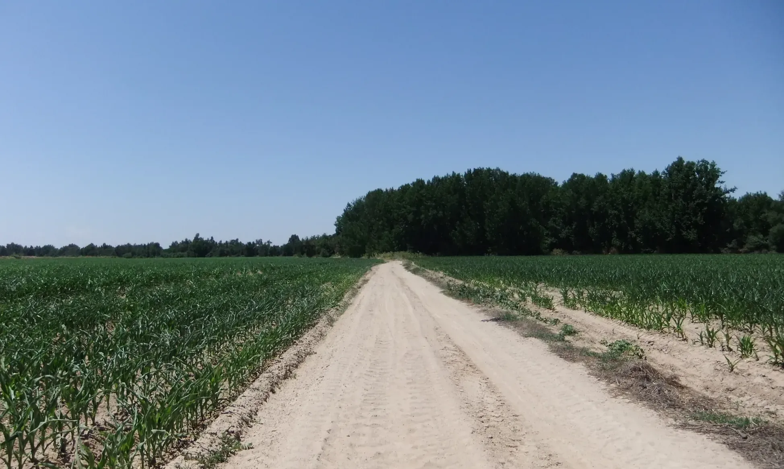

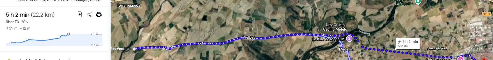

#### 🇩🇪  Alle Feldwege führen nach San Pedro de Mérida

**So machten es schon die Römer. Aber sie gingen noch einen Schritt weiter.**

> *Auch Dirk aus Remscheid ist über den längeren Umweg ein Stück weiter gegangen, aber ich glaube, das hat er später bereut.*

##### Die Flussüberquerung – Río Búrdalo

Als ich mir Google Maps im Satellitenmodus ansah, entdeckte ich einen Feldweg, der direkt nach San Pedro de Mérida führte. Allerdings musste ich dafür den Fluss überqueren. An der Furt war nicht zu erkennen, ob es dort eine Brücke gab – zu sehen war lediglich das Grün der Bäume entlang des Ufers. Trotzdem beschloss ich, keinen Umweg über die Brücke der Nationalstraße N-430 zu machen.

So sparte ich mir ein paar Kilometer. Und genau davon hatte ich immer geträumt: meinen Füßen bei dieser Hitze hin und wieder eine kleine Abkühlung zu gönnen.

Als ich mich entschloss, meinen Weg durch die Maisfelder fortzusetzen, kam mir ein Landwirt auf seinem riesigen Traktor entgegen. Er erklärte mir, dass ich den Fluss nicht überqueren könne, weil er Wasser führte.

Ich wusste allerdings, dass Landwirte mit ihren Maschinen den Fluss durchquerten. Solche Situationen kannte ich aus meinem Heimatdorf am Fluss Vouga in Portugal. Auch dort fuhren die Bauern im Sommer an bestimmten Stellen mit ihren Ochsenkarren durch den Fluss, selbst wenn er Wasser führte.

Also stellte ich mich neben den Vorderreifen des Traktors und fragte den Landwirt, wie tief das Rad im Wasser versank. Er antwortete, dass das Wasser ungefähr bis zur Hälfte des Rades reichte – etwa bis zu meiner Kniehöhe. Daraufhin erklärte ich ihm, dass das für meine Füße perfekt sei, und bedankte mich für die hilfreiche Auskunft.

Anschließend zog ich meine Stiefel und die Wanderhose aus, nahm meinen Ginsterwanderstock zur Hand und tastete mich vorsichtig durch das Wasser. Denn sollte ich stürzen, würde sich mein Rucksack mit Wasser füllen. Und das wäre alles andere als ideal.

**Hinweis:** Meiden Sie die Nationalstraße N-430.

Inzwischen kann man den reißenden Río Búrdalo über eine Fußgängerbrücke überqueren, die im April 2026 eingeweiht wurde.

---
#### 🇵🇹 Todos os caminhos rurais vão dar a San Pedro de Mérida

Já os Romanos faziam assim. Mas eles foram ainda mais longe.

>*O Dirk, de Remscheid, também foi um pouco mais longe pelo caminho mais longo, mas acho que depois se arrependeu.*

##### A travessia do rio – Río Búrdalo

Quando consultei o Google Maps no modo de satélite, descobri um caminho rural que levava diretamente a San Pedro de Mérida. Havia, porém, um obstáculo: era preciso atravessar o rio. Na zona da passagem a vau, não conseguia perceber se existia alguma ponte — só se via o verde das árvores ao longo das margens. Mesmo assim, decidi não fazer o desvio pela ponte da estrada nacional N-430.

Assim poupei alguns quilómetros. E era precisamente isso que sempre tinha desejado: poder refrescar os pés de vez em quando, sobretudo com aquele calor.

Quando decidi continuar o caminho pelos campos de milho, apareceu um agricultor num enorme trator, vindo na minha direção. Disse-me que não era possível atravessar o rio, porque este levava água.

Eu sabia, contudo, que os agricultores atravessavam o rio com as suas máquinas. Eram situações que conhecia bem da minha terra natal, junto ao rio Vouga, em Portugal. No verão, também os agricultores da minha região atravessavam o rio em determinados pontos com os seus carros de bois, mesmo quando o rio levava água.

Por isso, coloquei-me ao lado de uma das rodas dianteiras do trator e perguntei ao agricultor até que altura a roda ficava submersa. Ele respondeu que a água chegava aproximadamente a meio da roda, o que correspondia mais ou menos à altura dos meus joelhos. Respondi-lhe que isso era perfeito para os meus pés e agradeci-lhe a informação tão útil.

Depois, tirei as botas e as calças de caminhada, peguei no meu bastão de giesta e avancei com cuidado, tateando o fundo do rio. Afinal, se caísse, a mochila encher-se-ia de água. E isso não seria nada agradável.

**Informação:** Evite a estrada nacional N-430.

Atualmente, já é possível atravessar o impetuoso rio Búrdalo através de uma ponte pedonal, inaugurada em abril de 2026.

---
#### 🇪🇸 Todos los caminos rurales llevan a San Pedro de Mérida

Así lo hacían ya los romanos.  Pero fueron aún más lejos.

> *Dirk, de Remscheid, también fue un paso más allá por el camino más largo, pero creo que luego se arrepintió.*

##### El cruce del río – Río Búrdalo

Cuando consulté Google Maps en modo satélite, descubrí un camino rural que llevaba directamente a San Pedro de Mérida. Había, sin embargo, un inconveniente: tenía que cruzar el río. Desde el vado no se podía distinguir si había un puente; solo se veía el verde de los árboles a lo largo de la ribera. Aun así, decidí no dar el rodeo por el puente de la carretera nacional N-430.

De este modo me ahorré unos cuantos kilómetros. Y eso era precisamente lo que siempre había soñado: poder refrescarme los pies de vez en cuando, especialmente con aquel calor.

Cuando decidí continuar mi camino entre los campos de maíz, me encontré de frente con un agricultor que conducía un tractor enorme. Me dijo que no era posible cruzar el río porque llevaba agua.

Sin embargo, yo sabía que los agricultores cruzaban el río con sus máquinas. Eran situaciones que conocía bien de mi pueblo natal, junto al río Vouga, en Portugal. Allí, durante el verano, los campesinos también atravesaban el río por determinados puntos con sus carros de bueyes, incluso cuando llevaba agua.

Así que me coloqué junto a una de las ruedas delanteras del tractor y le pregunté al agricultor hasta dónde llegaba el agua en la rueda. Me respondió que aproximadamente hasta la mitad, lo que equivalía más o menos a la altura de mis rodillas. Le contesté que aquello era perfecto para mis pies y le di las gracias por la información tan útil.

Después me quité las botas y los pantalones de senderismo, agarré mi bastón de retama y avancé con cuidado, tanteando el fondo del río. Porque, si me caía, la mochila acabaría llena de agua. Y eso no habría sido nada bueno.

**Información:** Evite la carretera nacional N-430.

Ahora es posible cruzar el impetuoso río Búrdalo por una pasarela peatonal que se inauguró en abril de 2026.

-----
#### 🇬🇧 All Country Lanes Lead to San Pedro de Mérida

That is how the Romans did it, too. But they went a little further.

> *Dirk from Remscheid also went a bit further via the longer route, but I reckon he regretted it later.*

##### Crossing the River – Río Búrdalo

When I checked Google Maps in satellite mode, I spotted a country lane leading directly to San Pedro de Mérida. There was one obstacle, though: I would have to cross the river. From the ford, I couldn’t tell whether there was a bridge nearby; all I could see was the green canopy of trees along the riverbank. Even so, I decided against taking the detour to the bridge on the N-430 national road.

That saved me a few kilometres. And that was precisely what I had always dreamed of: giving my feet a chance to cool off every now and then, especially in that heat.

As I decided to continue along the track through the maize fields, a farmer driving an enormous tractor came towards me. He told me that crossing the river was impossible because there was water flowing through it.

However, I knew that farmers crossed the river with their machinery. I was familiar with such situations from my home village beside the River Vouga in Portugal. In summer, farmers there also drove their ox carts across the river at certain points, even when it was flowing.

So I stood beside one of the tractor’s front wheels and asked the farmer how far the wheel sank into the water. He told me the water came up to about halfway up the wheel, which was roughly knee-deep for me. I replied that this would be perfect for my feet and thanked him for the useful information.

Then I took off my boots and hiking trousers, grabbed my broom heather walking stick, and carefully felt my way across the riverbed. After all, if I fell, my backpack would fill with water. And that would be far from ideal.

**Information:** Avoid the N-430 national road.

It is now possible to cross the fast-flowing Río Búrdalo via a footbridge that was inaugurated in April 2026.

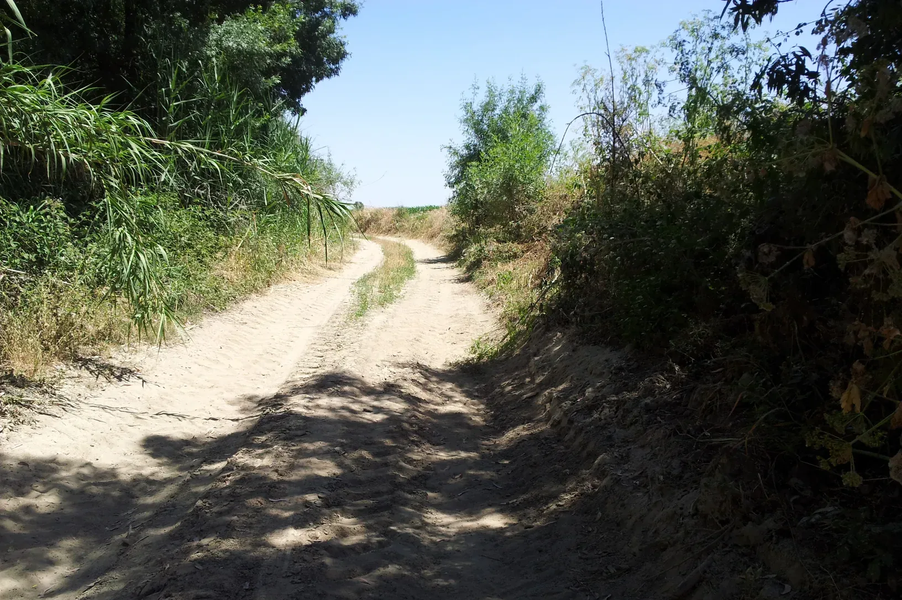

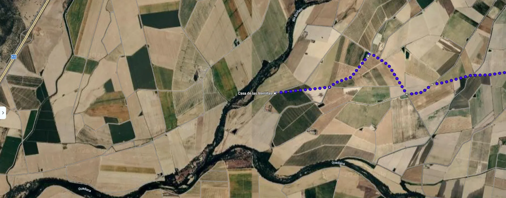

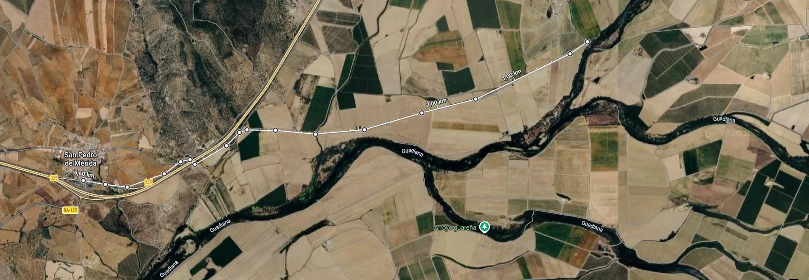

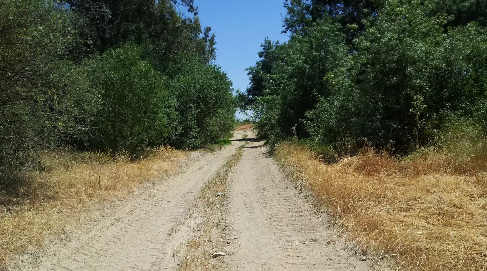
#### 🇩🇪 Tagesziel erreicht – und zum Abschluss ein richtiges Bier!

Das dachte ich zumindest. Doch ich hatte mich getäuscht. Es gab nur **Botellín** oder **Quinto** – oder hieß es vielleicht **Mini**?

Wer sich diese Bezeichnungen ausgedacht hat und welchen Sinn sie bei dieser Hitze und auf solch langen Etappen haben sollen, ist mir bis heute ein Rätsel.

Wie man so schön sagt, muss man dankbar sein für das, was der Weg einem bietet. Also bestellte ich mir eines dieser „Mini-Maße“.

Kaum hatte man mir das erste serviert, war der Inhalt dieser winzigen Flasche auch schon verschwunden. Als ich auf den Flaschenboden schaute, entdeckte ich daneben einen richtig ordentlichen Pintxo. Ich probierte ihn – und er schmeckte köstlich.

„Großartig!“, dachte ich. „Dann bestelle ich noch ein Mini-Maß und danach gleich noch eins.“ Ehe ich mich versah, war ich von diesen köstlichen Pintxos bereits satt. Genau das hatte Dirk aus Remscheid etwa zwei Stunden zuvor getan. Andernfalls hätte er die nächsten 15 Kilometer wohl kaum geschafft.

Doch woher wusste ich, dass Dirk aus Remscheid schon zwei Stunden zuvor hier gewesen war, obwohl er mich erst wenige Minuten später überholt hatte und sogar einen längeren Umweg gegangen war?

Das klingt widersprüchlich, lässt sich aber ganz einfach erklären.

Abseits des **Camino Francés** – zumindest war das 2014 so – begegnet man nur wenigen Pilgern. Wenn man in einer Bar sitzt, fragt man sich gegenseitig, wie viele Pilger an diesem oder in den vergangenen Tagen vorbeigekommen sind und ob noch weitere unterwegs sind. So erfährt man immer wieder, ob die Pilger, denen man an diesem Tag begegnet ist, bereits vorausgegangen sind oder ob man ihnen noch begegnen wird.

Am Morgen brechen manche früh auf, während andere erst einmal in Ruhe einen Kaffee oder Tee trinken. Unterwegs legt man kurze oder längere Pausen ein. Und so kam es, dass Dirk mich überholte, während ich gerade eine kleine Pause machte.

Aber wie konnte es sein, dass er bereits zwei Stunden vor mir in San Pedro de Mérida angekommen war, obwohl er eine etwa fünf bis sechs Kilometer längere Strecke zurückgelegt hatte?

Dafür gibt es zwei einfache Erklärungen.

Die erste: Man legt unterwegs entweder mehr kurze Zwischenstopps ein oder gönnt sich längere Pausen.

Die zweite hat eine mathematische Grundlage. Auf meinen Etappen hatte ich unter normalen Bedingungen durch eigene Beobachtungen ermittelt, dass ich durchschnittlich etwa vier bis viereinhalb Kilometer pro Stunde zurücklegte. Bei Dirk hingegen, einem erfahrenen Pilger, stellte ich fest, dass er ungefähr fünf, manchmal sogar fünfeinhalb Kilometer pro Stunde schaffte.

Bei einer Strecke von 35 Kilometern bedeutet ein Tempo von fünf Kilometern pro Stunde beispielsweise sieben Stunden reine Gehzeit. Wer langsamer geht, braucht entsprechend länger. Zusammen mit den unterschiedlichen Pausen und den zusätzlichen Kilometern  ist es daher keineswegs ungewöhnlich, dass am Ende ein Zeitunterschied von zwei Stunden entsteht.

„Noch etwas fiel mir unterwegs auf: Sobald ich stehen blieb, um Fotos zu machen, waren die anderen Pilger schon mehr als hundert Meter voraus. Auch solche kleinen Unterbrechungen summieren sich im Laufe einer langen Etappe.“

Formulierung: Denn auf dem Camino geht es nicht nur darum, Kilometer zurückzulegen. Manchmal möchte man auch etwas festhalten, das man unterwegs entdeckt – und dafür muss man bereit sein, ein wenig zurückzufallen.

##### Km/h

Ich begann, meine Gehgeschwindigkeit zu berechnen, weil ich wissen wollte, ob mir noch genügend Zeit blieb, um einen bestimmten Punkt innerhalb eines vorgegebenen Zeitraums zu erreichen. Schließlich darf man nicht vergessen, dass ich persönlich ab einer Strecke von etwa 20 Kilometern oft keine vier Kilometer pro Stunde mehr schaffe. Ab 30 Kilometern bin ich schon froh, wenn ich noch einen Durchschnitt von drei Kilometern pro Stunde erreiche.

> **Kurz vor dem Stausee von Alcántara gelang es mir schließlich, eine ganze Etappe lang mit Dirks Tempo mitzuhalten.**

Aber das ist eine andere Geschichte.

---
#### 🇵🇹 Objetivo do dia cumprido – e, para terminar, uma cerveja a sério!

Pelo menos, era o que eu pensava. Mas estava enganado. Só havia **botellín** ou **quinto** — ou seria **mini**?

Até hoje não sei quem inventou estas designações nem para que servem, sobretudo com aquele calor e em etapas tão longas.

Como se costuma dizer, temos de agradecer aquilo que o Caminho nos oferece. Por isso, pedi uma daquelas cervejas em «miniatura».

Mal me serviram a primeira, o conteúdo daquela garrafinha desapareceu num instante. Quando olhei para o fundo da garrafa, reparei que, ao lado, estava um pintxo bem composto. Provei-o e estava delicioso.

«Excelente!», pensei. «Vou pedir mais uma mini e depois outra.» Num instante, já estava satisfeito com aqueles pintxos deliciosos. Foi exatamente isso que Dirk, de Remscheid, tinha feito cerca de duas horas antes. Caso contrário, dificilmente teria conseguido percorrer os 15 quilómetros seguintes.

Mas como é que eu sabia que Dirk, de Remscheid, já tinha passado por ali duas horas antes, se só me ultrapassou alguns minutos depois e ainda por cima tinha feito um desvio maior?

Parece contraditório, mas a explicação é bastante simples.

Fora do **Caminho Francês** — pelo menos, era assim em 2014 —, o número de peregrinos é reduzido. Quando nos sentamos num bar, perguntamos uns aos outros quantos peregrinos passaram por ali naquele dia ou nos dias anteriores e se ainda há mais alguém a caminho. Assim, vamos descobrindo se os peregrinos com quem nos cruzámos nesse dia já passaram por nós ou se ainda estão para aparecer.

De manhã, há quem parta cedo e quem prefira tomar primeiro um café ou um chá com calma. Pelo caminho, fazemos pequenas pausas ou paragens mais demoradas. Foi assim que Dirk me ultrapassou enquanto eu fazia uma pequena pausa.

Mas como conseguiu chegar a San Pedro de Mérida duas horas antes de mim, apesar de ter percorrido um trajeto cerca de cinco a seis quilómetros mais longo?

Há duas explicações simples.

A primeira é que, durante o percurso, fazemos mais paragens curtas ou pausas mais prolongadas.

A segunda tem uma base matemática. Em condições normais, fui calculando empiricamente o meu ritmo nas várias etapas e concluí que percorria, em média, cerca de quatro a quatro quilómetros e meio por hora. No caso de Dirk, um peregrino experiente, constatei que conseguia manter um ritmo de cerca de cinco quilómetros por hora, chegando mesmo, por vezes, aos cinco quilómetros e meio.

Num percurso de 35 quilómetros, por exemplo, caminhar a cinco quilómetros por hora significa sete horas de marcha efetiva. Quem caminha mais devagar precisa, naturalmente, de mais tempo. Se juntarmos as diferenças nas pausas e os quilómetros adicionais, não é nada estranho que surja uma diferença de duas horas à chegada.

Houve ainda outra coisa que notei ao longo do Caminho: bastava parar para tirar fotografias para os outros peregrinos já estarem mais de cem metros à minha frente. Mesmo estas pequenas interrupções vão-se acumulando ao longo de uma etapa longa.

Afinal, no Caminho, não se trata apenas de percorrer quilómetros. Por vezes, queremos também registar algo que descobrimos pelo caminho — e, para isso, temos de estar dispostos a ficar um pouco para trás.

##### km/h

Comecei a calcular a minha velocidade porque era importante saber se ainda tinha tempo suficiente para chegar a determinado ponto dentro de um prazo específico. Afinal, não nos podemos esquecer de que, no meu caso, a partir dos 20 quilómetros, muitas vezes já não consigo manter um ritmo de quatro quilómetros por hora. E, a partir dos 30 quilómetros, já fico satisfeito se conseguir uma média de três quilómetros por hora.

> **Pouco antes da albufeira de Alcántara, consegui finalmente acompanhar o ritmo de Dirk durante uma etapa inteira.**

Mas essa é outra história.

---

#### 🇪🇸 ¡Objetivo del día cumplido y, para terminar, una cerveza de verdad!

Eso pensaba yo, al menos. Pero estaba equivocado. Solo había **botellín** o **quinto**… ¿o quizá lo llamaban **mini**?

Hasta hoy no sé quién inventó estos nombres ni qué sentido tienen, sobre todo con aquel calor y en etapas tan largas.

Como suele decirse, hay que agradecer lo que el Camino nos ofrece. Así que pedí una de aquellas cervezas en «formato mini».

En cuanto me sirvieron la primera, el contenido de aquella diminuta botella desapareció en un instante. Al mirar el fondo de la botella, descubrí que, al lado, había un pintxo bastante generoso. Lo probé y estaba delicioso.

«¡Estupendo!», pensé. «Pediré otra mini y después otra más». En un abrir y cerrar de ojos, ya estaba lleno de aquellos deliciosos pintxos. Eso mismo había hecho Dirk, de Remscheid, unas dos horas antes. De lo contrario, difícilmente habría podido recorrer los siguientes 15 kilómetros.

Pero ¿cómo sabía yo que Dirk, de Remscheid, había estado allí dos horas antes, si me adelantó apenas unos minutos después y, además, había recorrido un desvío más largo?

Parece contradictorio, pero la explicación es muy sencilla.

Fuera del **Camino Francés** —al menos, así era en 2014—, hay pocos peregrinos. Cuando nos sentamos en un bar, solemos preguntarnos cuántos peregrinos han pasado por allí ese día o durante los días anteriores y si todavía queda alguien en camino. Así vamos descubriendo si los peregrinos con los que nos hemos cruzado ese día ya han pasado por delante de nosotros o si todavía están por llegar.

Por la mañana, algunos salen temprano, mientras que otros prefieren tomarse un café o un té tranquilamente antes de ponerse en marcha. Durante el recorrido hacemos pequeñas paradas o descansos más largos. Y así fue como Dirk me adelantó mientras yo hacía una pequeña pausa.

Pero ¿cómo pudo llegar a San Pedro de Mérida dos horas antes que yo, a pesar de haber recorrido un trayecto entre cinco y seis kilómetros más largo?

Hay dos explicaciones sencillas.

La primera es que, durante el camino, hacemos más paradas breves o descansos más prolongados.

La segunda tiene una base matemática. En condiciones normales, fui calculando empíricamente mi ritmo en las distintas etapas y comprobé que recorría, de media, entre cuatro y cuatro kilómetros y medio por hora. En el caso de Dirk, un peregrino experimentado, observé que avanzaba a unos cinco kilómetros por hora e incluso llegaba, en ocasiones, a los cinco kilómetros y medio.

En un recorrido de 35 kilómetros, por ejemplo, caminar a cinco kilómetros por hora supone siete horas de marcha efectiva. Quien camina más despacio necesita más tiempo. Si a eso añadimos las diferencias en las pausas y los kilómetros adicionales, no resulta extraño que al final haya una diferencia de dos horas.

Hubo otra cosa que observé durante el Camino: en cuanto me detenía para hacer fotos, los demás peregrinos ya estaban más de cien metros por delante de mí. Incluso estas pequeñas interrupciones se van acumulando a lo largo de una etapa larga.

Porque en el Camino no se trata solo de recorrer kilómetros. A veces también queremos captar algo que descubrimos durante el recorrido, y para ello hay que estar dispuesto a quedarse un poco atrás.

##### Km/h

Empecé a calcular mi velocidad porque era importante saber si todavía disponía de tiempo suficiente para llegar a un punto determinado dentro de un plazo concreto. No hay que olvidar que, en mi caso, a partir de los 20 kilómetros, muchas veces ya no consigo mantener un ritmo de cuatro kilómetros por hora. Y, a partir de los 30 kilómetros, ya me doy por satisfecho si consigo una media de tres kilómetros por hora.

> **Poco antes del embalse de Alcántara, finalmente conseguí mantener el ritmo de Dirk durante una etapa entera.**

Pero esa es otra historia.

---
#### 🇬🇧 Daily target reached – and a proper beer to finish the day!

At least, that was what I thought. But I was mistaken. They only had **botellín** or **quinto** – or was it called **mini**?

I still have no idea who came up with these names or what purpose they serve, especially in that heat and on such long stages.

As the saying goes, we should be grateful for whatever the Camino offers us. So I ordered one of those “mini-sized” beers.

The moment the first one arrived, the contents of that tiny bottle were gone in no time. When I looked at the bottom of the bottle, I noticed a substantial pintxo sitting beside it. I tried it, and it was delicious.

“Brilliant!” I thought. “I’ll order another mini, and then another one.” Before I knew it, I was already full from those delicious pintxos. That was exactly what Dirk from Remscheid had done about two hours earlier. Otherwise, he would hardly have managed the next 15 kilometres.

But how did I know that Dirk from Remscheid had been there two hours before me, when he overtook me only a few minutes later and had actually taken a longer detour?

It sounds contradictory, but the explanation is quite simple.

Away from the **Camino Francés** – at least, that was how things were in 2014 – there are relatively few pilgrims. When we sit down in a bar, we ask one another how many pilgrims have passed through that day or in the preceding days, and whether anyone else is still on the way. From time to time, this helps us work out whether the pilgrims we have encountered that day have already gone ahead of us or are still to come.

In the morning, some people set off early, while others prefer to enjoy a coffee or tea before starting out. Along the way, we take short breaks or longer rests. And that was how Dirk overtook me while I was taking a short break.

But how had he managed to reach San Pedro de Mérida two hours before me, despite covering a route that was around five to six kilometres longer?

There are two simple explanations.

The first is that we either make more short stops along the way or take longer breaks.

The second is mathematical. Under normal conditions, I had worked out my pace empirically over several stages and found that I covered around four to four and a half kilometres per hour on average. Dirk, on the other hand, was an experienced pilgrim, and I noticed that he managed around five kilometres per hour, sometimes even five and a half.

On a 35-kilometre route, for example, walking at five kilometres per hour means seven hours of actual walking time. Someone walking more slowly will naturally take longer. Add the differences in breaks and the extra kilometres, and a two-hour difference by the time we reach our destination is hardly surprising.

There was something else I noticed along the way: as soon as I stopped to take photos, the other pilgrims were already more than a hundred metres ahead of me. Even these little interruptions add up over the course of a long stage.

Because the Camino is not just about covering kilometres. Sometimes you also want to capture something you discover along the way – and for that, you have to be willing to fall a little behind.

##### Km/h

I started calculating my walking speed because it was important to know whether I still had enough time to reach a particular point within a given time frame. After all, in my case, once I have covered around 20 kilometres, I often can no longer maintain a pace of four kilometres per hour. And after 30 kilometres, I am already happy if I can manage an average of three kilometres per hour.

> **Shortly before reaching the Alcántara Reservoir, I finally managed to keep up with Dirk’s pace for an entire stage.**

But that is another story.

---

  

 🇬🇧 🇪🇸 🇵🇹 🇩🇪 🥾

---

↪ [Etappe-22_San-Pedro-de-Merida_Merida](Etappe-22_San-Pedro-de-Merida_Merida.md)

 🔁  [Camino_Mozarabe_Etapas](Camino_Mozarabe_Etapas.md)
 
 ...→