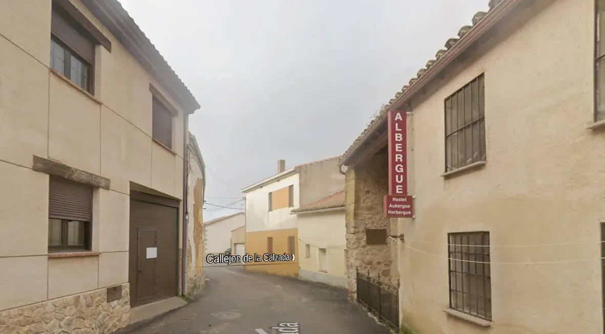

## Camino Mozárabe 2014 

### Etappe-32: Calzada de Valdunciel  → Villanueva de Campeán (33,9 Km)
28 de Maio 2014 👣

#### 🇩🇪 Villanueva de Campeán

Gleich am Ortseingang gab es eine Pilgerherberge, in der noch viele Betten frei waren. An diesem Abend waren eine australische Pilgerin und ich die einzigen Gäste.

Später trafen wir eine weitere Pilgerin, die in der anderen Herberge des Ortes untergekommen war. Sie erzählte uns, dass sie ihre Geldbörse verloren hatte und ihr ein anderer Pilger 50 Euro geliehen hatte, damit sie bis nach Zamora gelangen und dort ihre finanzielle Situation klären konnte. In der Herberge, in der sie übernachtete, waren ebenfalls noch Plätze frei.

Die meisten Pilger planen, die Nacht in Zamora zu verbringen. Deshalb ist die dortige Pilgerherberge häufig schnell ausgebucht.

**Info:** Villanueva de Campeán verfügt über mehrere Übernachtungsmöglichkeiten, die jedoch mit dem Angebot in Zamora konkurrieren. Dennoch sind die Herbergen des kleinen Ortes eine gute Alternative für alle, die nicht bis Zamora weitergehen und lieber hier übernachten möchten.

---

#### 🇵🇹 Villanueva de Campeán

Logo à entrada da localidade, havia um albergue de peregrinos com muitas camas ainda disponíveis. Naquela noite, uma peregrina australiana e eu éramos os únicos hóspedes.

Mais tarde, encontrámos outra peregrina, que estava alojada no outro albergue da localidade. Contou-nos que tinha perdido a carteira e que outro peregrino lhe tinha emprestado 50 euros, para que pudesse chegar a Zamora e resolver lá a sua situação financeira. No albergue onde estava hospedada, também ainda havia camas disponíveis.

A maioria dos peregrinos planeia passar a noite em Zamora. Por isso, o albergue de peregrinos de Zamora costuma ficar rapidamente lotado.

**Info:** Villanueva de Campeán dispõe de várias opções de alojamento, que, no entanto, concorrem com a oferta de Zamora. Ainda assim, os albergues desta pequena localidade são uma boa alternativa para quem prefere pernoitar aqui, em vez de continuar até Zamora.

---

####  🇪🇸 Villanueva de Campeán

Justo a la entrada del pueblo había un albergue de peregrinos en el que todavía quedaban muchas camas libres. Aquella noche, una peregrina australiana y yo éramos los únicos huéspedes.

Más tarde, nos encontramos con otra peregrina que se alojaba en el otro albergue del pueblo. Nos contó que había perdido la cartera y que otro peregrino le había prestado 50 euros para que pudiera llegar hasta Zamora y resolver allí su situación económica. En el albergue donde se hospedaba también quedaban plazas libres.

La mayoría de los peregrinos tiene previsto pasar la noche en Zamora. Por eso, el albergue de peregrinos de Zamora suele llenarse rápidamente.

**Info:** Villanueva de Campeán cuenta con varias opciones de alojamiento que, sin embargo, compiten con la oferta de Zamora. Aun así, los albergues de esta pequeña localidad son una buena alternativa para quienes prefieren pasar la noche aquí en lugar de continuar hasta Zamora.

---

#### 🇬🇧 Villanueva de Campeán

Right at the entrance to the village, there was a pilgrims’ hostel with plenty of beds still available. That evening, an Australian pilgrim and I were the only guests.

Later, we met another pilgrim who was staying at the village’s other hostel. She told us that she had lost her wallet and that another pilgrim had lent her 50 euros so she could make it to Zamora and sort out her financial situation there. There were still beds available at the hostel where she was staying, too.

Most pilgrims plan to spend the night in Zamora, which is why the pilgrims’ hostel there often fills up quickly.

**Info:** Villanueva de Campeán offers several accommodation options, although they compete with the wider range of options in Zamora. Nevertheless, the hostels in this small village are a good alternative for pilgrims who prefer to spend the night here rather than continue to Zamora.

↓ Google Maps Foto ↓ 

Gronze.com:   ⚠️ Vorübergehend geschlossen  (Oktober 2026)

„Albergue privado Villanueva de Campeán“ ist vorübergehend geschlossen. 

---

  

 🇬🇧 🇪🇸 🇵🇹 🇩🇪 🥾

⚠️

---

↪ [Etappe-33_Villanueva-de-Campean_Montamarta](Etappe-33_Villanueva-de-Campean_Montamarta.md)

 🔁  [Camino_Mozarabe_Etapas](Camino_Mozarabe_Etapas.md)
 
 ...→