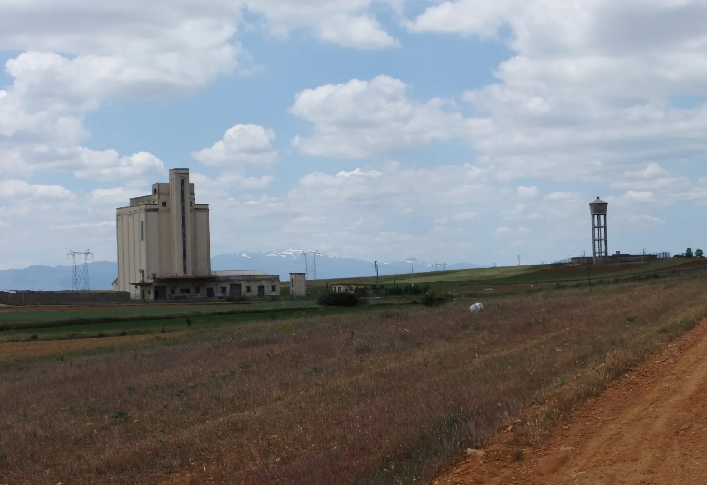
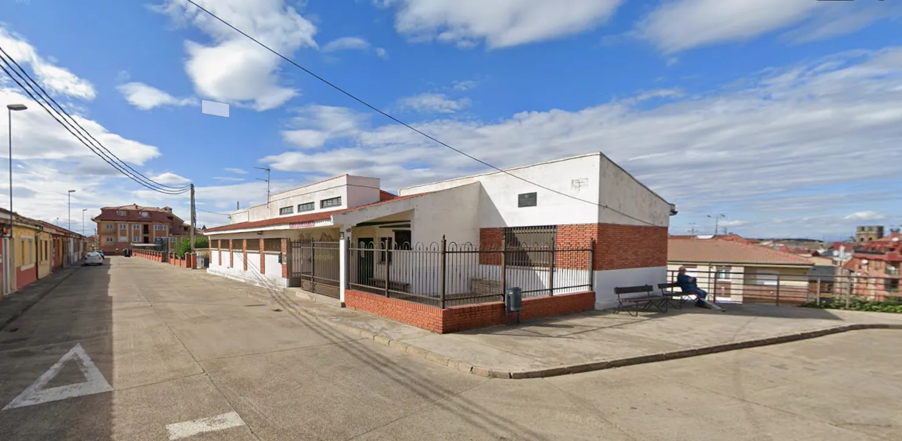

## Camino Mozárabe 2014 

### Etappe-36: Villabrázaro → La Bañeza ( 35,7 Km)
01 de Junho 2014 👣

Albergue Monte Urba

↑ Google Maps Foto ↑

### 🇵🇹 Alojamento para peregrinos em La Bañeza.

Um antigo hospital ou enfermaria, muitas camas vagas – apenas dois peregrinos franceses de bicicleta e eu. Foi a primeira vez –no caminho– que dormi numa cama onde outrora se cuidavam doentes.  

> *A segunda vez que dormi numa cama dessas foi numa praça de touros no Caminho Levante. Era lá, que os toureiros eram atendidos após um confronto com um touro.*

---
### 🇩🇪 Pilgerunterkunft in La Bañeza.

Ein ehemaliges Krankenhaus oder Lazarett, viele freie Betten – nur zwei französische Radpilger und ich. Das war das erste Mal –unterwegs–, dass ich in einem Bett schlief, in dem früher Kranke gepflegt wurden  

> *Das zweite Mal, dass ich in einem solchen Bett schlief, war in einem Stierkampfarena auf dem Caminho Levante. Dort wurden die Stierkämpfer nach einer Auseinandersetzung mit einem Stier versorgt.*

---
### 🇪🇸 Alojamiento para peregrinos en La Bañeza.

Un antiguo hospital o enfermería, muchas camas libres: solo dos peregrinos franceses en bicicleta y yo. Era la primera vez –en el camino– que dormía en una cama en la que antes se había atendido a enfermos. 

> *La segunda vez que dormí en una cama así fue en una plaza de toros del Caminho Levante. Allí atendían a los toreros tras un enfrentamiento con un toro.*

---
#### 🇬🇧  Pilgrims’ accommodation in La Bañeza.

A former hospital or military infirmary, plenty of empty beds – just two French cycling pilgrims and me. It was the first time –on the way–  I’d slept in a bed where sick people had once been cared for. 

> *The second time I slept in a bed like that was in a bullring on the Caminho Levante. That’s where the bullfighters were treated after a bout with a bull.* 

---

  

 🇬🇧 🇪🇸 🇵🇹 🇩🇪 🥾

---

↪ [Etappe-37_La-Baneza_Muria-de-Rechivaldo](Etappe-37_La-Baneza_Muria-de-Rechivaldo.md)

 🔁  [Camino_Mozarabe_Etapas](Camino_Mozarabe_Etapas.md)
 
 ...→