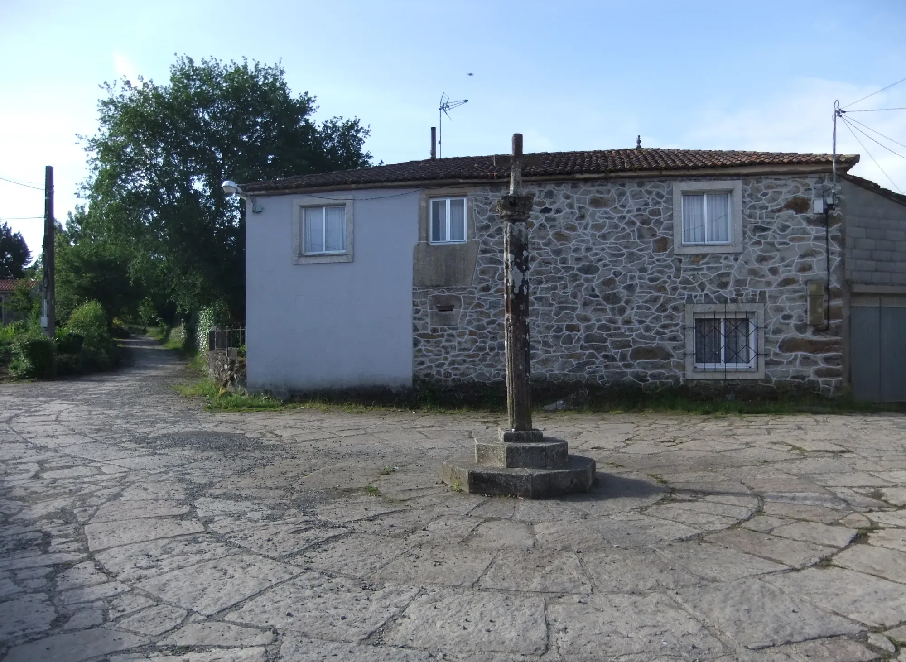
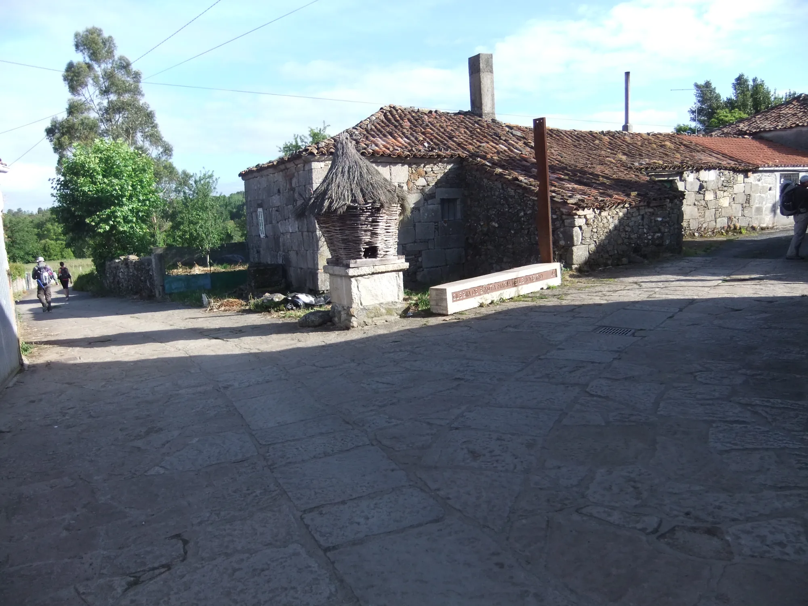
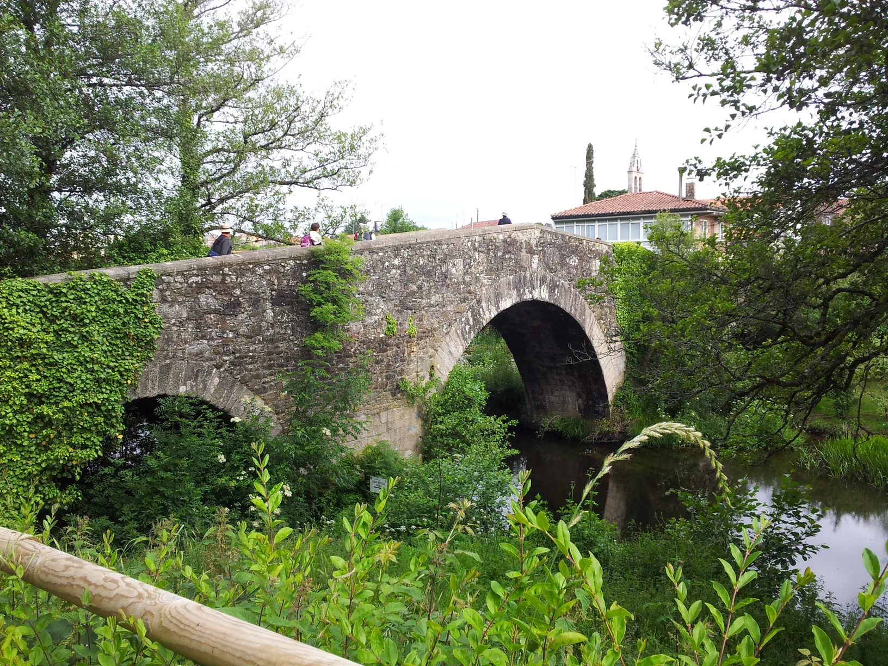
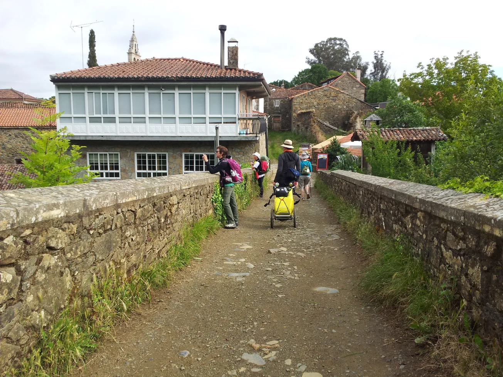
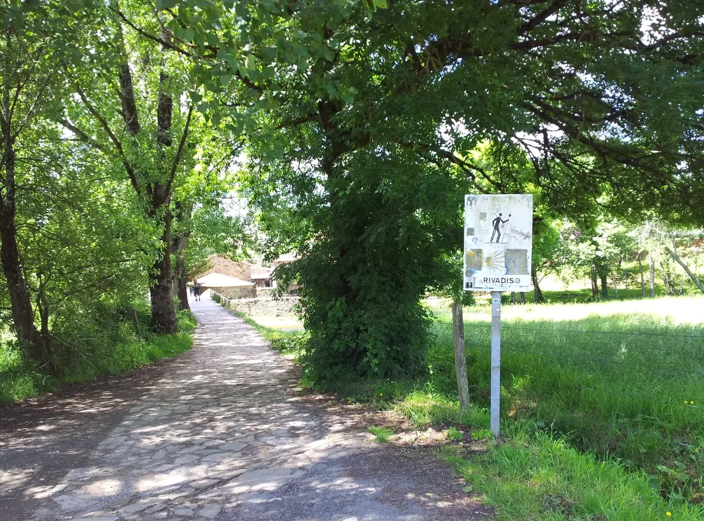
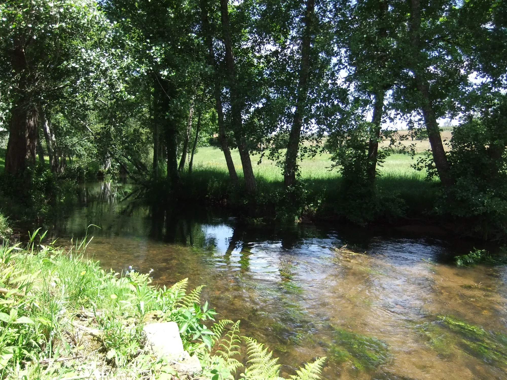
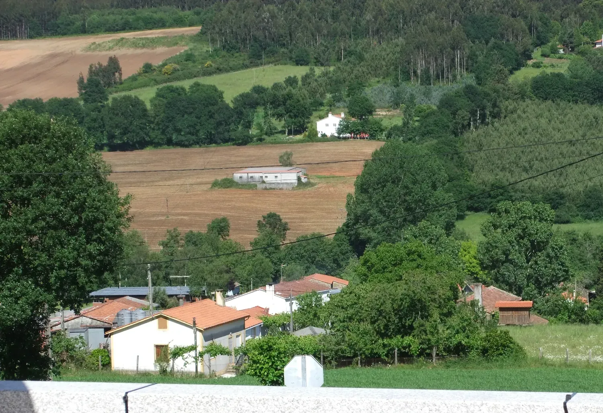

## Camino Mozárabe 2014 

### Etappe-45: Palas de Rei → Ribadiso de Baixo (25,4 Km)
10 de Junho 2014 👣

- Albergue de peregrinos de Ribadiso de Baixo

"Rio Iso" Lugar de lazer da Albergue de Ribadiso de Baixo 

---
??? Foto von 10 Juni 2015 und laut Metadaten wurde dieses Foto um 17h48 aufgenommen

**17h48m49s- ???**

---

  

 🇬🇧 🇪🇸 🇵🇹 🇩🇪 🥾

---

↪ [Etappe-46_Ribadiso-de-Baixo_Monte-do-Gozo](Etappe-46_Ribadiso-de-Baixo_Monte-do-Gozo.md)

 🔁  [Camino_Mozarabe_Etapas](Camino_Mozarabe_Etapas.md)
 
 ...→