## Camino Mozárabe 2014 

### Etappe-46: Ribadisio de Baixo → Monte do Gozo  (37,4 Km)
11 de Junho 2014 👣

19,3 + 3,1 + 15

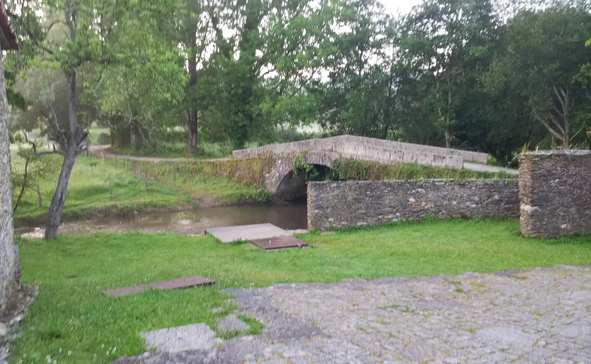

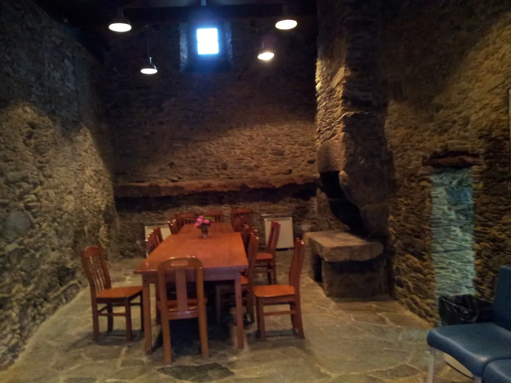

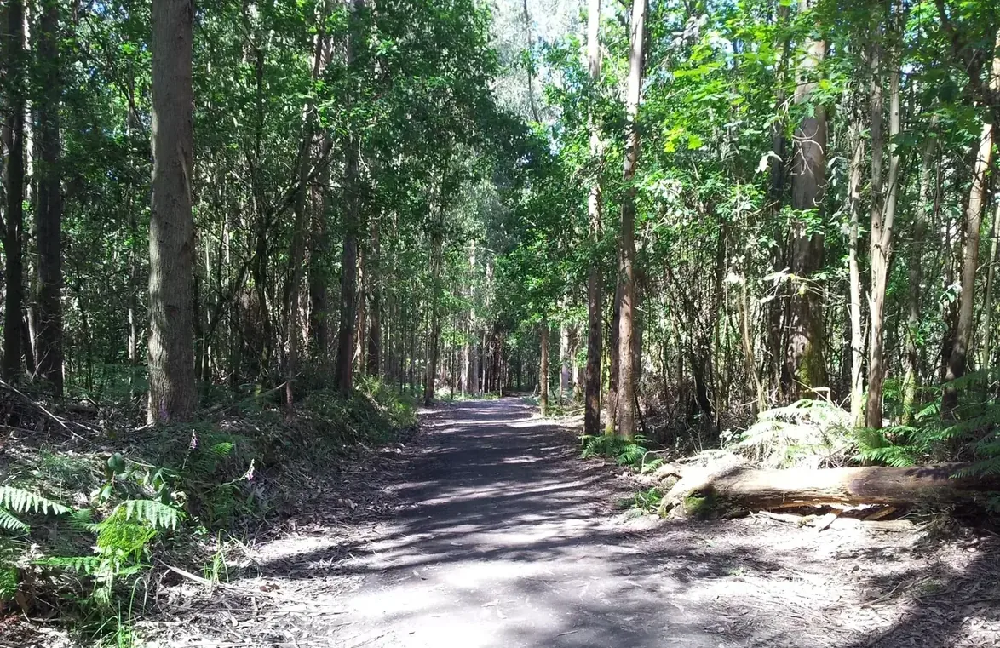

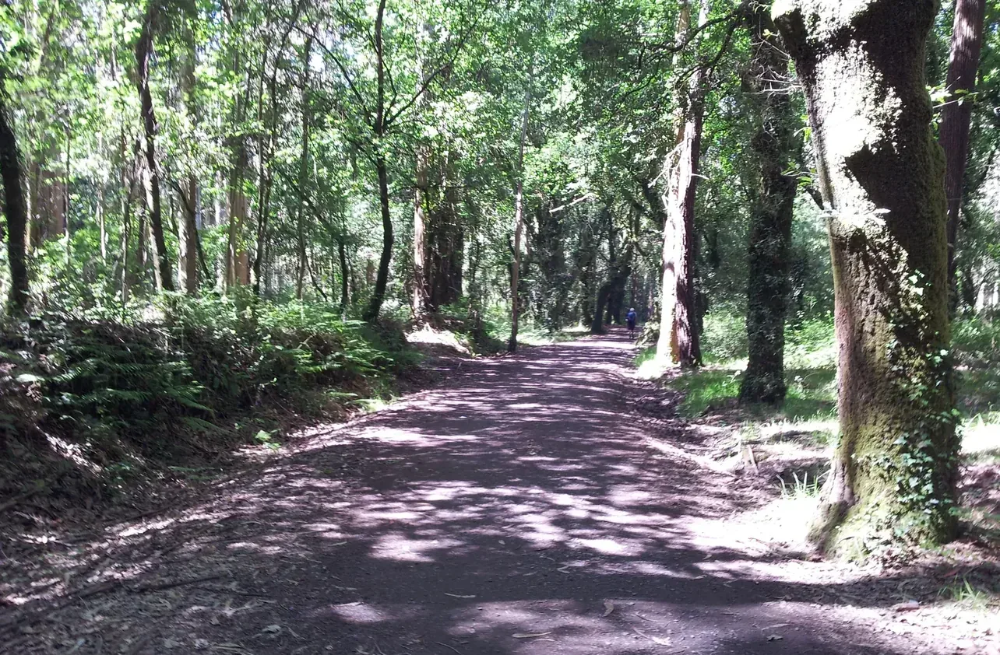

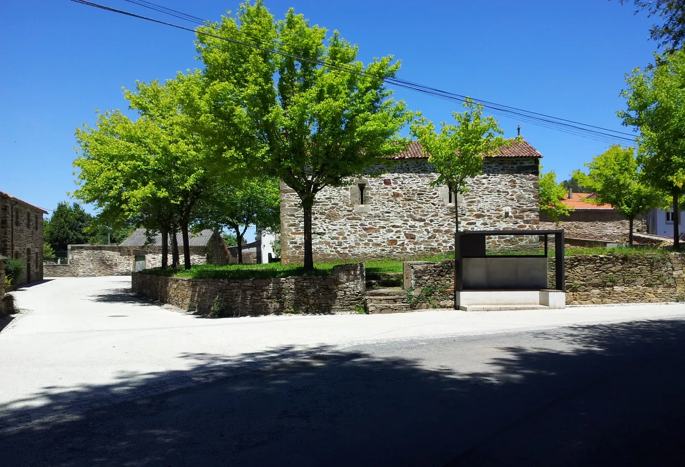

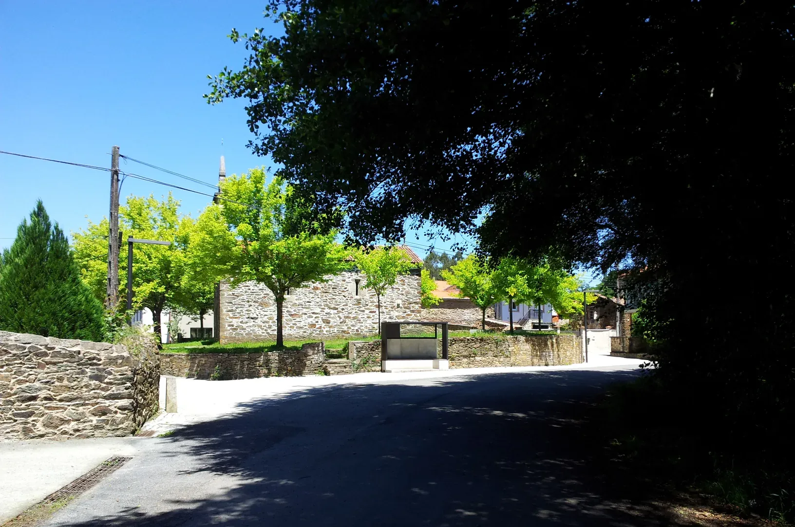

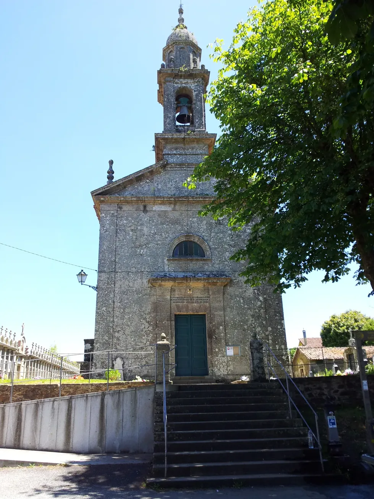

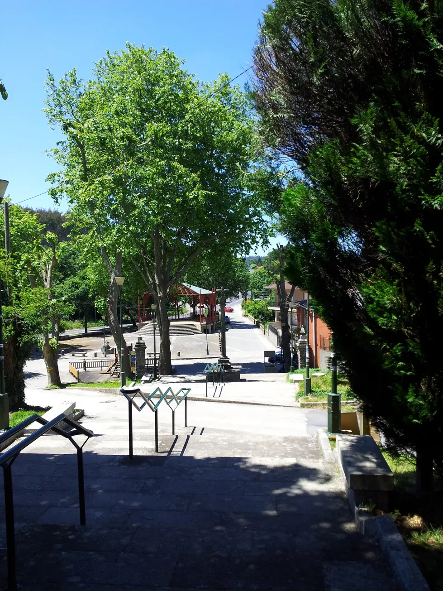

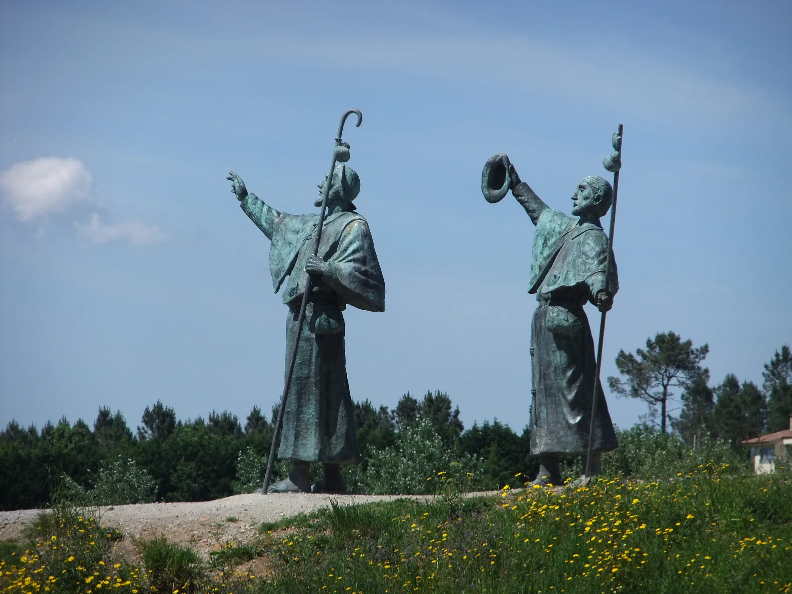

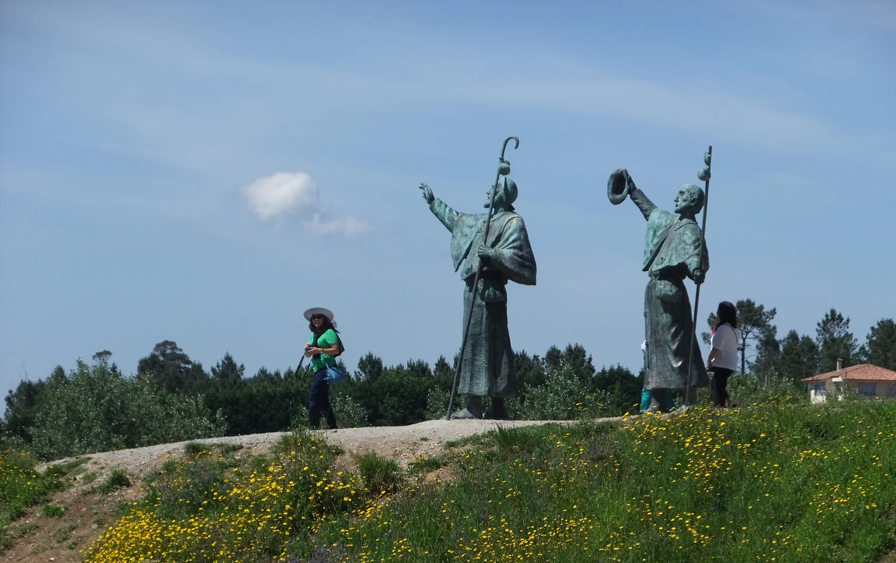

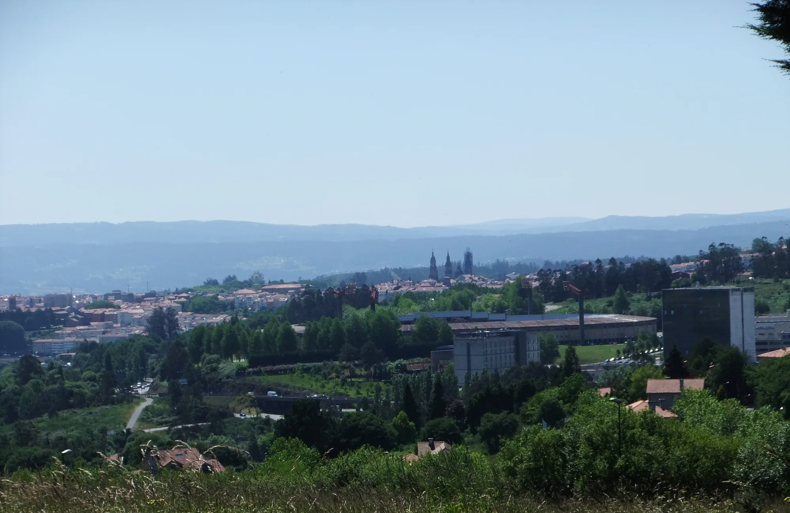

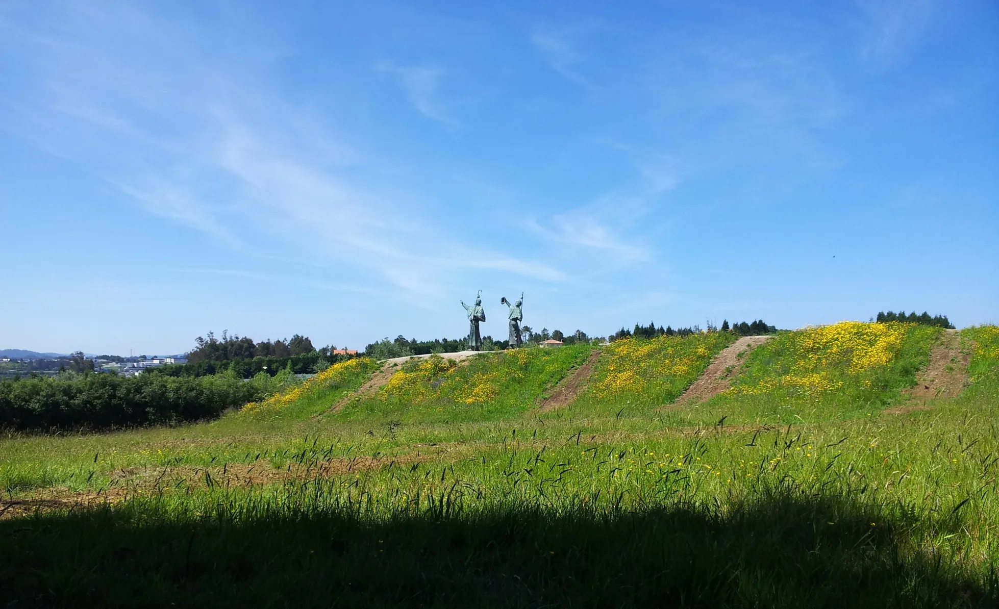

**Monto Gonzo**
Na recepção quem me atendeu foi uma Jovem-Voluntária da Polónia

---

  

 🇬🇧 🇪🇸 🇵🇹 🇩🇪 🥾

---

↪ [Etappe-47_Monte-do-Gozo_Santiago-de-Compostela](Etappe-47_Monte-do-Gozo_Santiago-de-Compostela.md)

 🔁  [Camino_Mozarabe_Etapas](Camino_Mozarabe_Etapas.md)
 
 ...→