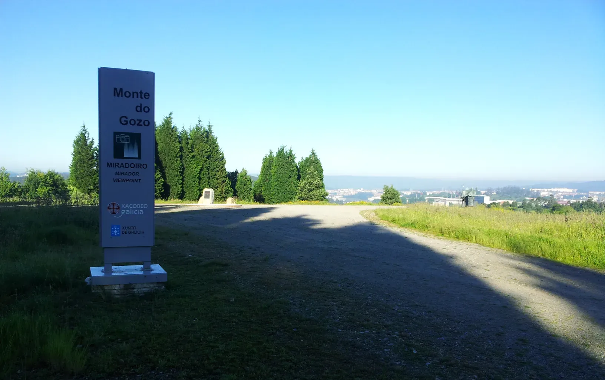
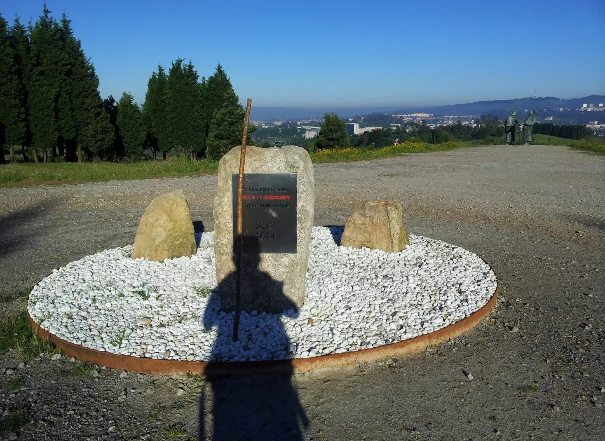
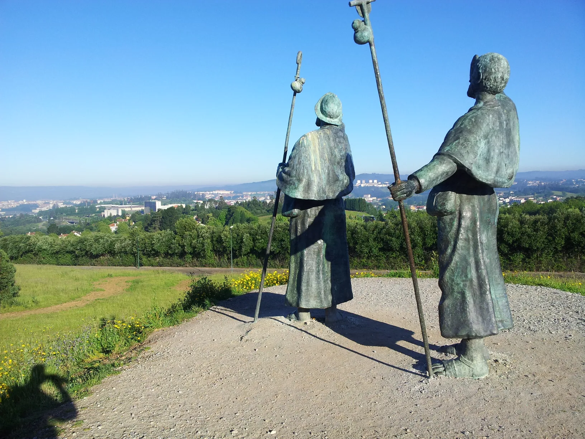
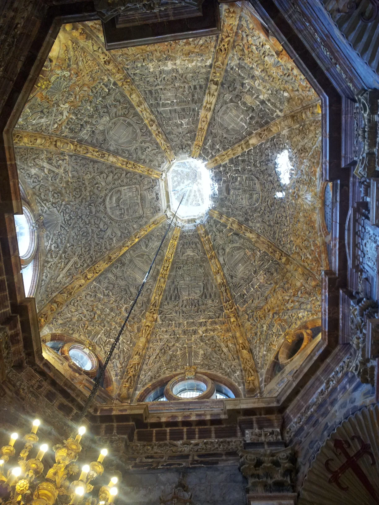
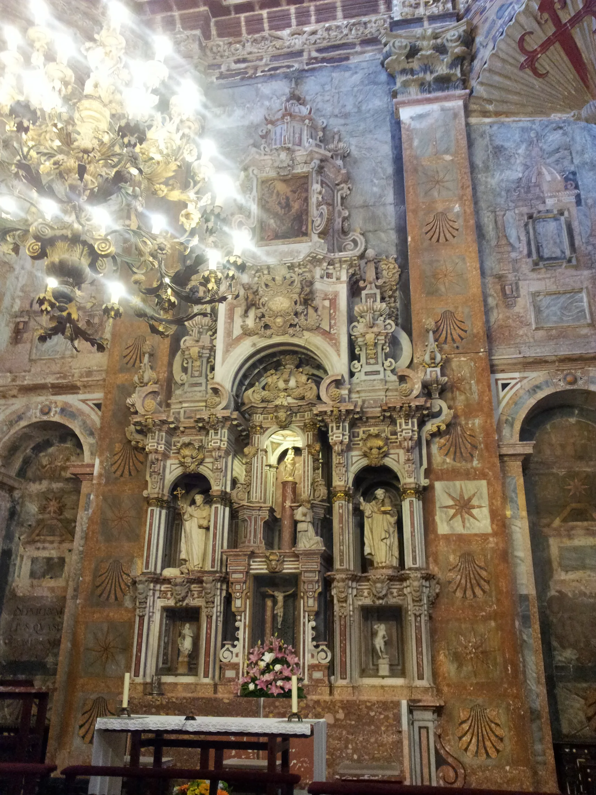
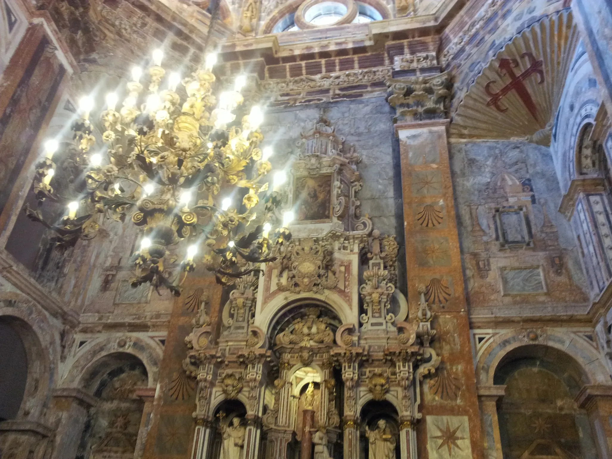
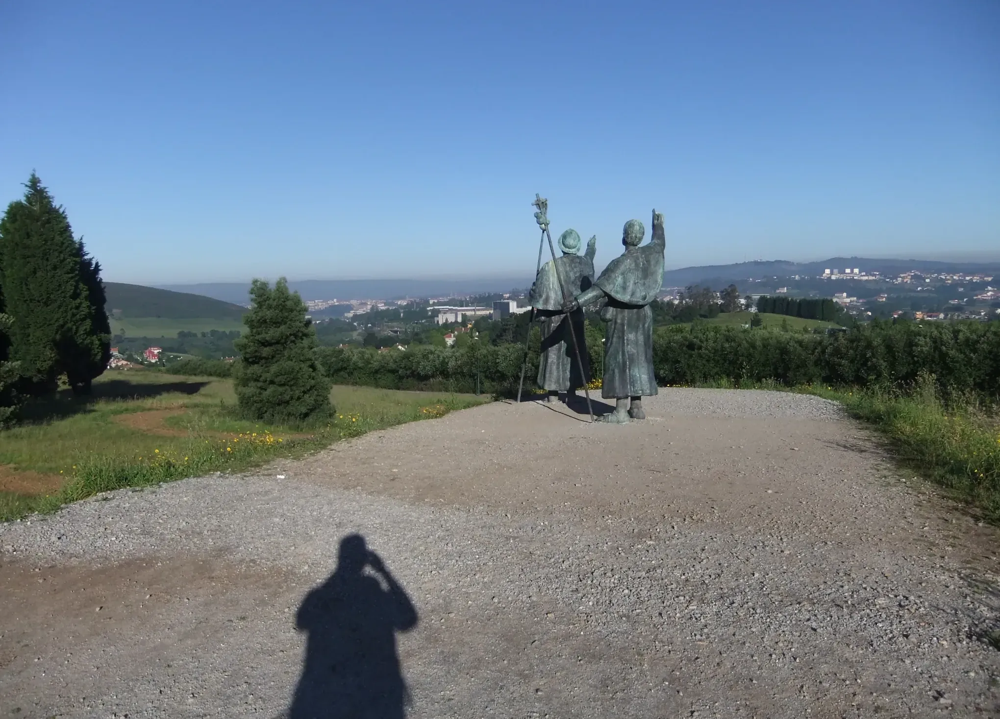

## Camino Mozárabe 2014 

### Etappe-47: Monte do Gozo  →  Santiago de Compostela ( Km)
12 de Junho 2014 👣

####  Mein Ginster-Pilgerstab

 

🇩🇪 Mein treuer Begleiter, ich werde dich am Eingangstor von „Santiago Apóstolo“ zurücklassen, in der Hoffnung, dass jemand in dir eine Stütze findet, so wie du es für mich während der gesamten Pilgerreise warst.

🇪🇸 Mi fiel compañero, te dejaré junto a la puerta de entrada de «Santiago Apóstol», con la esperanza de que alguien encuentre en ti un apoyo, tal y como tú lo has sido para mí durante toda la peregrinación.

🇬🇧  My faithful companion, I will leave you at the “Santiago Apostolo” entrance gate, hoping that someone will find solace in you, just as you did for me throughout the entire pilgrimage.

🇵🇹 Meu fiel companheiro, vou deixar-te junto ao portão de entrada de «Santiago Apóstolo», na esperança de que alguém encontre em ti um apoio, tal como tu foste para mim durante toda a peregrinação.

---

  

 🇬🇧 🇪🇸 🇵🇹 🇩🇪 🥾

---
↪ [Etappe-01_Almeria_Alboloduy](Etappe-01_Almeria_Alboloduy.md)

↪ 

 🔁  [Camino_Mozarabe_Etapas](Camino_Mozarabe_Etapas.md)
 
...