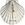

## Camino Mozárabe 2014 

### Etappe-48: Santiago de Compostela 
13 de Junho 2014 👣

 

🇵🇹 Santiago Apóstolo

*Santiago Apóstolo  (no português tradicional, **São Tiago Maior**) foi um dos doze apóstolos originais de Jesus Cristo, irmão do evangelista São João e filho de Zebedeu e Salomé. Ele é uma das figuras mais marcantes do cristianismo primitivo, célebre por ter sido o **primeiro dos apóstolos a sofrer o martírio** (decapitado no ano 44 d.C. em Jerusalém por ordem de Herodes Agripa I). Ele é o padroeiro oficial de Espanha e Portuga

Vida e Caráter

No Novo Testamento, Santiago fazia parte do "círculo íntimo" de Jesus, ao lado de Pedro e João, testemunhando milagres exclusivos como a Transfiguração e a agonia no Horto das Oliveiras. Devido ao seu temperamento forte e impetuoso, Jesus apelidou-o (junto a seu irmão) de _Boanerges_, que significa **"Filhos do Trovão"**

A Lenda na Península Ibérica

Segundo a tradição católica, após a ressurreição de Cristo, Santiago viajou para os confins do Império Romano — a região da Hispânia (atual Galiza, Espanha) — para pregar o Evangelho. Desanimado pelas dificuldades em converter a população local, ele terá recebido uma aparição de Nossa Senhora sobre um pilar de mármore em Saragoça (dando origem à forte devoção a **Nossa Senhora do Pilar** antes de regressar à Judeia, onde foi executado

O Túmulo e o Caminho de Santiago

Após a sua morte, os seus discípulos transportaram secretamente o seu corpo de volta à Galiza. No século IX, as suas relíquias foram milagrosamente descobertas no "Campo de Estrelas" (_Campus Stellae_), facto que deu nome à atual cidade de **Santiago de Compostela**

Esta descoberta impulsionou a criação da monumental Catedral de Santiago de Compostela e do famoso Caminho de Santiago, a rota de peregrinação que há mais de mil anos atrai milhões de pessoas de todo o mundo por motivos de fé, espiritualidade ou autoconhecimento. A sua festa litúrgica é celebrada anualmente a 25 de julho.

---

🇩🇪 Das Leben davor 

Bevor er Jesus nachfolgte, arbeitete Santiago (Jakobus der Ältere) zusammen mit seinem Bruder Johannes als Fischer am See Genesareth (Galiläa)

**Der Familienbetrieb:** Die beiden Brüder betrieben das Handwerk gemeinsam mit ihrem Vater Zebedäus. Die Familie besaß eigene Boote und beschäftigte sogar Tagelöhner, was auf ein damals durchaus solides und etabliertes Familienunternehmen hindeutet.

**Die Partnerschaft:** Sie arbeiteten in enger geschäftlicher Partnerschaft mit einem anderen Brüderpaar zusammen, das später ebenfalls weltberühmt werden sollte: Simon Petrus und Andreas.

Laut den Berichten der Evangelien im Neuen Testament (z. B. im Markusevangelium oder Matthäusevangelium) rief Jesus die Brüder direkt bei ihrer Arbeit am Ufer auf, ihm zu folgen. Sie verließen daraufhin sofort ihre Netze, ihr Boot und ihren Vater, um sich ihm anzuschließen. Jesus versprach ihnen, sie stattdessen zu „Menschenfischern“ zu machen.

### Santiago de Compostela  → Tordesillas

- Alsa-Bus 10:45              →  18:15   Comfort
- **Alsa-Bus 21:45              →   04:15  Comfort** 

**Info:** Um 4 Uhr morgens weht ein kalte Wind.

---

 

##  Camino Mozárabe 2014 

### Almeria → Mérida (ca. 615 bis 630 Km) 
**Start:**  27 de Abril  **Ende:**  17 de Maio 2014**
- "Gronze.com Angaben"

### Almeria → Mérida = 601 Km 
    *Alle Etappen addiert*

----

##  Vía de la Plata  2014

### Mérida → Astorga (ca. 515 bis 520 Km)
18 Maio - 02 Juni 2014 
- "Gronze.com Angaben"

### Mérida → Astorga= 495 Km 
   *Alle Etappen addiert*

---

##  Camino Francés 2014

###  Astorga → Santiago de Compostela (255 bis 270 Km)
02- 12 Juni 2014 
- "Gronze.com Angaben"

### Astorga → Santiago de Compostela = 258,4 Km 
    *Alle Etappen addiert*

---

##  ... 👣 Almeria → Santiago de Compostela = 1354,6 km

⚠️ Es fehlen 
- Minimum: etwa **31 Km**  (1385-1354) 
- Maximum: etwa **66 Km**  (1385-1354) 

***Eine Diskrepanz, die 1 bis 2 Etappen entspricht.***

#### 🥾 **1395 km :** Offizielle Entfernungskilometern-Angaben über "Puebla de Sanabria" und Ourense

---

 🇬🇧 🇪🇸 🇵🇹 🇩🇪 🥾

---

### Etappe-01 : Almeria  →  Albodoloduy (37,7Km)

### Etappe-02 : Alboloduy  →  Fiñana (36,1 Km)

### Etappe-03 : Fiñana  →  Huéneja ( 12 Km)

### Etappe-04 : Huéneja → Guadix  (41,2 Km)

### Etappe-05 : Guadix  → Quéntar   ( 40-42 Km "39,6-Google Km" )

### Etappe-06 : Quéntar → Pinos Puente ( ca. 34 Km )

### Etappe-07 : Pinos Puente  →  Alcalá la Real  ( 38, 6 Km )

### Etappe-08 : Alcála-la-Real  → Alcaudete ( 23,3 Km)

### Etappe-09 : Alcaudete  →  Baena ( 26,6 Km)

### Etappe-10 : Baena  →  Castro del Rio ( 20, 4 Km)

### Etappe-11 : Castro del Rio → Santa-Cruz  ( 23 Km)

### Etappe-12: Santa Cruz →  Córdoba ( 25, 7 Km)

### Etappe-13: Córdoba → Los Patios de  Córdoba ( ca. 2,x Km)

### Etappe-14: Los Patios de Córdoba  →  Villaharta (38.3 Km)

### Etappe-15: Villaharta → Alcaracejos (33,7 Km)

### Etappe-16: Alcaracejos → Hinojosa del Duque (21,6 Km)

### Etappe-17: Hinojosa-del-Duque → Monterrubio-de-la-Serena ( 33,8 Km)

### Etappe-18: Monterrubio-de-la-Serena →  ( ca. 200-500 m)

### Etappe-19: Monterrubio de la Serena → Campanario (38,8Km)

### Etappe-20: Campanario → Don Benito (29,1 Km)

### Etappe-21: Don Benito → San Pedro de Mérida ( 28,8 "35,4" Km)

### Etappe-22:  San Pedro de Mérida → Mérida (18,5 Km)

---

## Almeria  → Mérida   601,2 Km

----

### Etappe-23: Mérida →Alcuéscar  (35,9 Km)

### Etappe-24: Alcuéscar  →  Cáceres ( 37,4 Km)

### Etappe-25: Cáceres → Embalse de Alcántara (34,5 Km)

### Etappe-26: Embalse de Alcántara →San Gil  (ca. 38 Km)

### Etappe-27: San-Gil → Aldeanueva del Camino (48,1 km "10h39" )

### Etappe-28: Aldeanueva del Camino  →  La Calzada de Béjar (21,8 Km)

### Etappe-29: La Calzada de Béjar →  Fuenterroble de Salvatierra ( 20,2 Km)

### Etappe-30: Fuenterroble de Salvatierra → Morille  ( 29,4 Km)

### Etappe-31: Morille → Calzada de Valdunciel ( 35,3 Km)

### Etappe-32: Calzada de Valdunciel  → Villanueva de Campeán (33,9 Km)

### Etappe-33: Villanueva de Campeán →Montamarta (37,6 Km)

### Etappe-34: Montamarta →  Granja de Moreruela  (22,6 Km)

### Etappe-35: Granja de Moreruela → Villabrázaro (34,1 Km)

### Etappe-36: Villabrázaro → La Bañeza ( 35,7 Km)

### Etappe-37:  La Bañeza  →  Murias de Rechivaldo ( 30, 5 Km)

---

 ## Mérida → (Astorga)  Murias de Rechivaldo 495 Km

----

### Etappe-38: Murias de Rechivaldo → Molinaseca  ( 40,2 Km)

### Etappe-39: Molinaseca → Villafranca del Bierzo  (30,9 Km)

### Etappe-40: Villafranca-del-Bierzo → O Cebreiro ( 27,8 Km)

### Etappe-41: O Cebreiro → Tricastela (20,6 Km

### Etappe-42: Tricastela → Sarria (24,7 Km)

### Etappe-43: Sarria → Portomarín (22,2Km)

### Etappe-44: Portomarín → Palas de Rei (24,8 Km)

### Etappe-45: Palas de Rei → Ribadiso de Baixo (25,4 Km)

### Etappe-46: Ribadisio de Baixo → Monte do Gozo  (37,4 Km)

### Etappe-47: Monte do Gozo  →  Santiago de Compostela (4,4 Km)

---

 ## (Astorga)  Murias de Rechivaldo  →  Santiago de Compostela 258,4 Km

---

---
↪ [Etappe-01_Almeria_Alboloduy](Etappe-01_Almeria_Alboloduy.md)

↪ [Etappe-49_Santiago-de-Compostela_Tordesillas](Etappe-49_Santiago-de-Compostela_Tordesillas.md)

 🔁  [Camino_Mozarabe_Etapas](Camino_Mozarabe_Etapas.md)
 
 