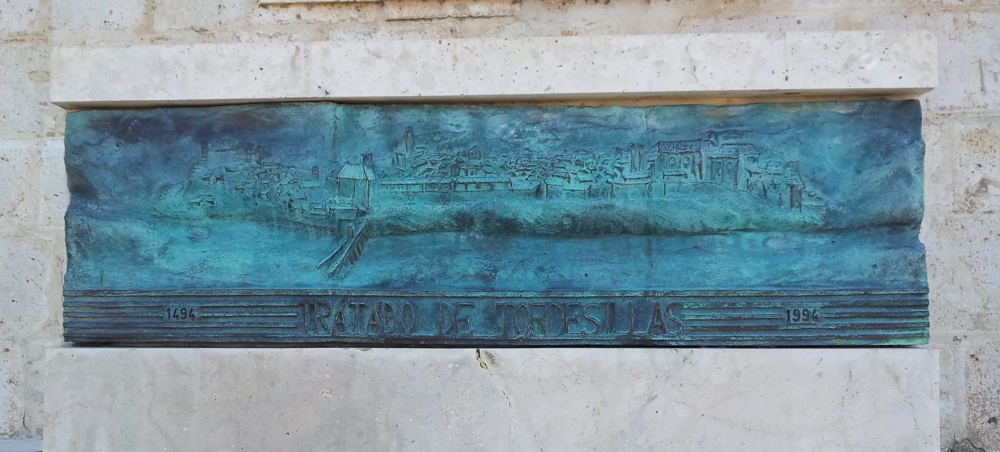
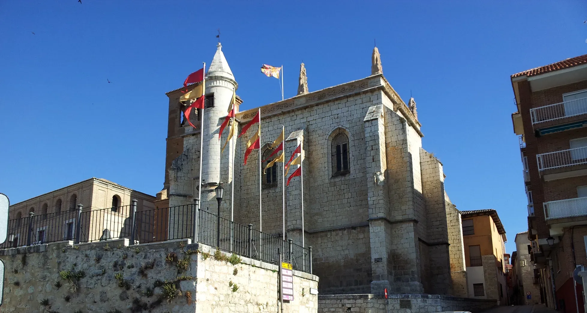
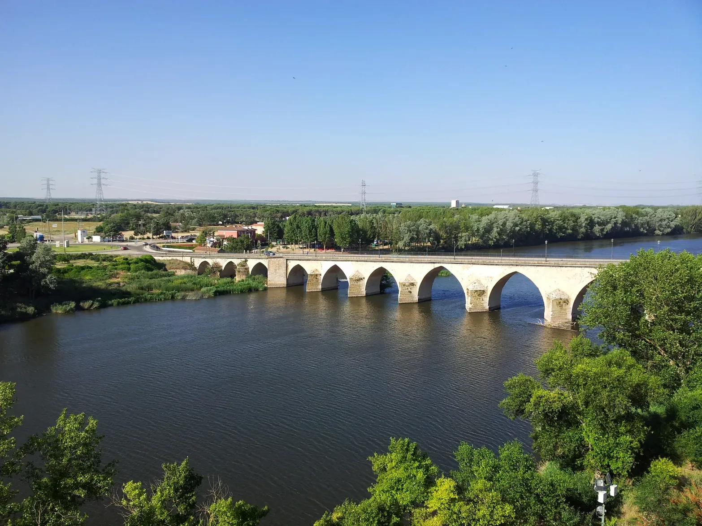
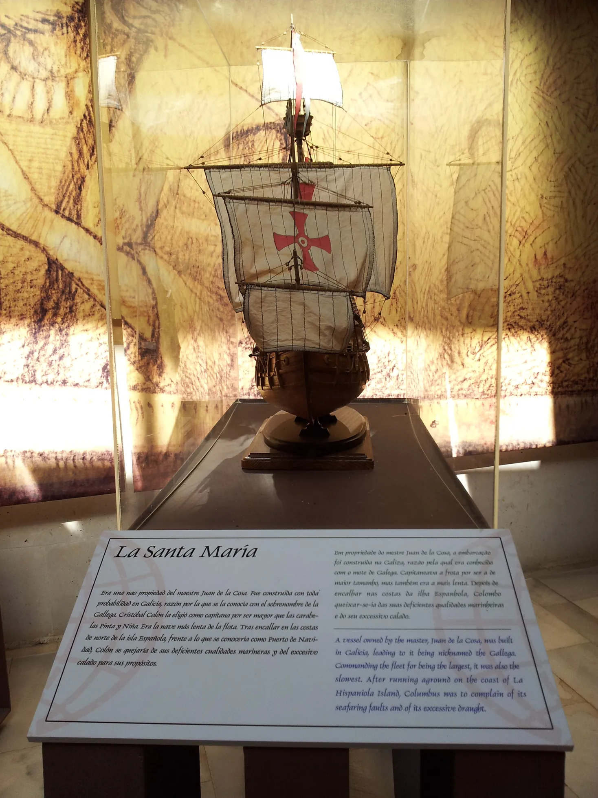
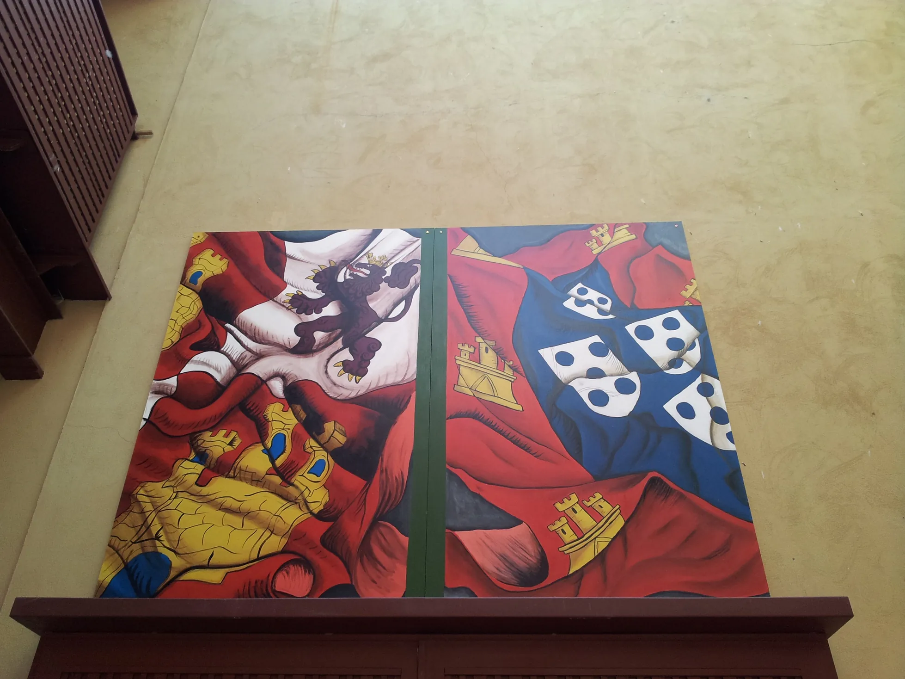

## Camino Mozárabe 2014 

### Etappe-48: Santiago de Compostela → Tordesillas
14 de Maio2014 👣

-  **Alsa-Bus :** 13 de Junho de 2014 21:45    →  14 de Maio de 2014  04:15

The cold nights on the Meseta with D. Trump,  a likeable bloke

**04:00** 🇩🇪  Die kalten Nächte auf der Meseta.

– Deshalb musste ich mein Biwaksack zu dieser Uhrzeit (um 4:00 Uhr) am Busbahnhof von Tordesillas auspacken, was ich bis jetzt nur einmal im Jahr 2014 getan hatte und das ich 2012 gekauft hatte. – Nur um zu sehen, wo der Vertrag unterzeichnet worden war. 

Wenn ich heute daran denke, was ich alles durchmachen musste, um diesem historischen **"Ort"** so nahe zu sein, dann muss ich ehrlich sagen … 

Und wenn man an diesen historischen Vertrag denkt, muss man zugeben, dass D. Trump ein sympathischer Typ ist. Er will nur eine Insel, auf der die Nächte noch unerbittlicher sind.

---

**04:00** 🇵🇹 As noites frias na Meseta.

– Foi por isso que tive de desembalar o meu saco-biwak àquela hora (às 4h00) na estação rodoviária de Tordesillas, algo que até agora só fizera uma vez, em 2014, e que tinha comprado em 2012. – Só para ver onde o tratado tinha sido assinado. 

Quando hoje penso em tudo o que tive de passar para estar tão perto daquele **"lugar"** histórico, a verdade é que… 

E quando se pensa nesse tratado histórico, é preciso reconhecer que o D. Trump é um tipo simpático. Ele só quer uma ilha onde as noites são ainda mais implacáveis.

---

**04:00** 🇪🇸 Las frías noches en la Meseta.

– Por eso tuve que desembalar mi saco-biwak a esa hora (las 4:00) en la estación de autobuses de Tordesillas, algo que hasta ahora solo había hecho una vez en 2014 y que había comprado en 2012. – Solo para ver dónde se había firmado el tratado. 

Cuando hoy pienso en todo lo que tuve que pasar para estar tan cerca de ese **"lugar"** histórico, la verdad es que… 

Y cuando uno piensa en ese tratado histórico, hay que reconocer que D. Trump es un tipo simpático. Solo quiere una isla en la que las noches sean aún más implacables.

---
**04:00** 🇬🇧 The cold nights on the Meseta.

– That’s why I had to unpack my bivouac-bag at that time (4.00 am) at the Tordesillas coach station – something I’d only done once before, back in 2014, and which I’d bought in 2012. – Just to see where the treaty had been signed. 

When I think today about everything I had to go through to be so close to that historic **"place"**, the truth is that… 

And when you think about that historic treaty, you have to admit that Trump is a likeable bloke. He just wants an island where the nights are even more unforgiving.

#### 🇵🇹 A Terra não é uma esfera

Em 1982, descobri que, algures, existia um lugar chamado Tordesilhas.
33 anos depois, consegui finalmente descobri-lo.
Felizmente, os reis daquela época — a cavalo e sem GPS — não se perderam e não demoraram tanto tempo.

>- **E se:** Se tivessem demorado tanto tempo como eu, ou se se tivessem perdido a caminho daqui — será que a Terra seria um lugar melhor se fosse plana?

---
#### 🇩🇪 Die Erde ist keine Kugel

1982 erfuhr ich, dass es irgendwo einen Ort namens Tordesillas gab.
33 Jahre später gelang es mir endlich, ihn zu entdecken.
Zum Glück haben sich die Könige damals – zu Pferd und ohne GPS – nicht verirrt und haben nicht so lange gebraucht.

>- **Was wäre, wenn:** Wenn sie genauso lange gebraucht hätten wie ich oder wenn sie sich auf dem Weg hierher verlaufen hätten – wäre die Erde ein besserer Ort, wenn sie flach wäre?

---
#### 🇪🇸 La Tierra no es una esfera

En 1982 me enteré de que en algún lugar existía un lugar llamado Tordesillas.
33 años después, por fin conseguí descubrirlo.
Por suerte, los reyes de aquella época —a caballo y sin GPS— no se perdieron y no tardaron tanto.

>- **¿Y si...?** Si hubieran tardado tanto como yo, o si se hubieran perdido de camino hasta aquí... ¿sería la Tierra un lugar mejor si fuera plana?

---
#### 🇬🇧 The Earth is not a sphere

In 1982, I learnt that there was a place somewhere called Tordesillas.
33 years later, I finally managed to find it.
Fortunately, the kings back then – travelling on horseback and without GPS – didn’t get lost and didn’t take quite so long.

>- **What if:**  If they had taken just as long as I did, or if they had gotten lost on their way here—would the Earth be a better place if it were flat?

---

  

 🇬🇧 🇪🇸 🇵🇹 🇩🇪 🥾

---

↪ 

 🔁  [Camino_Mozarabe_Etapas](Camino_Mozarabe_Etapas.md)

**←** 🔁 [ Os Caminhos](https://github.com/GomesDeSa-JA/Camino-del-Salvador_2023-2025/blob/main/Os_Caminhos.md)

 ...→