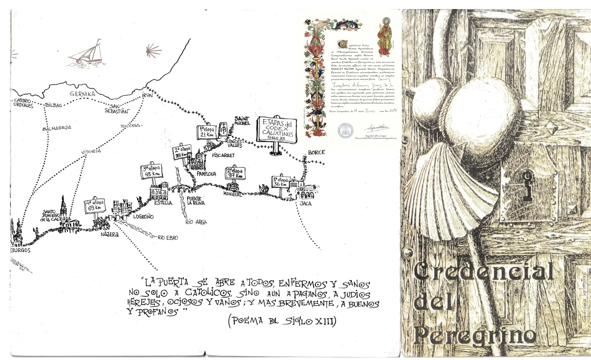
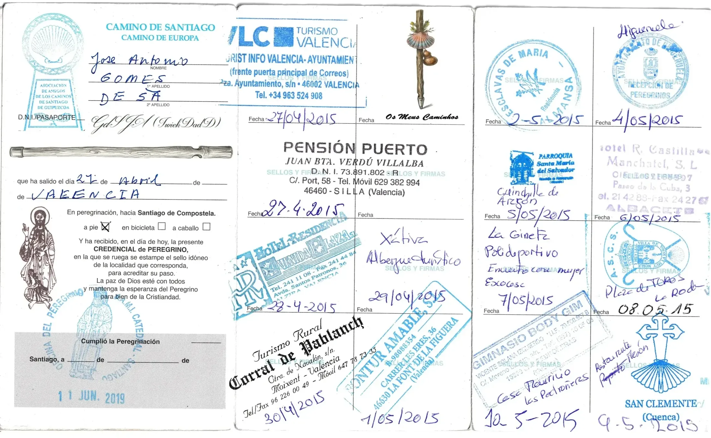
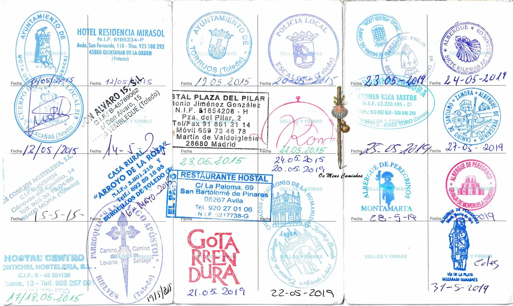
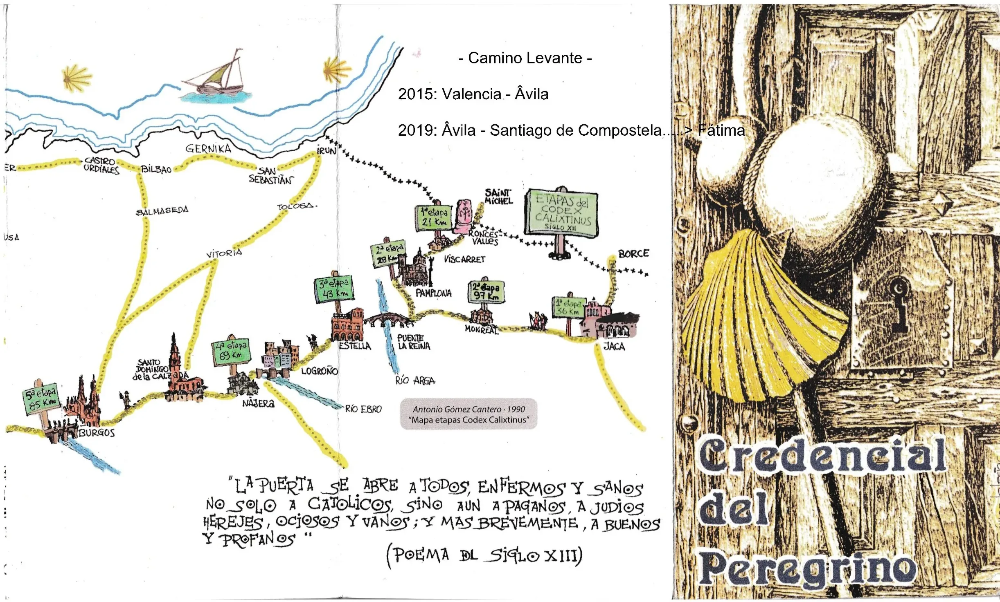
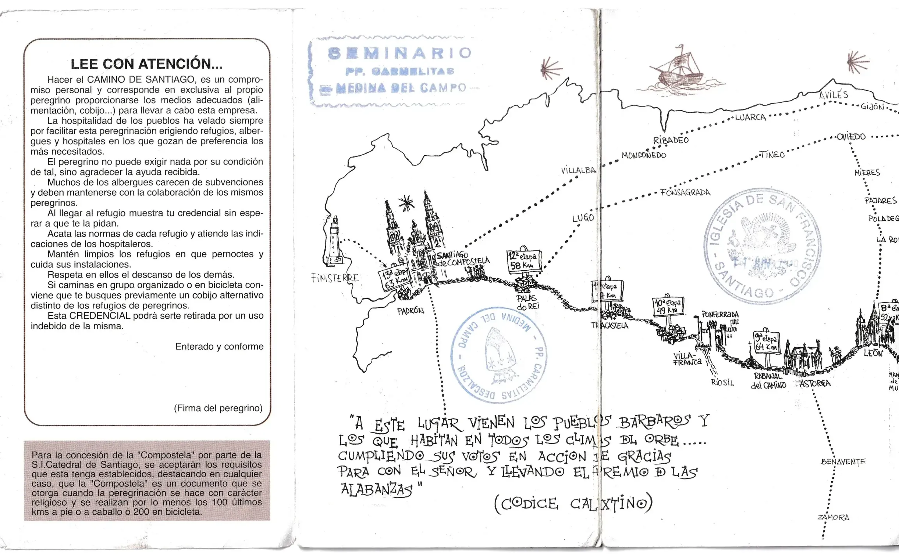
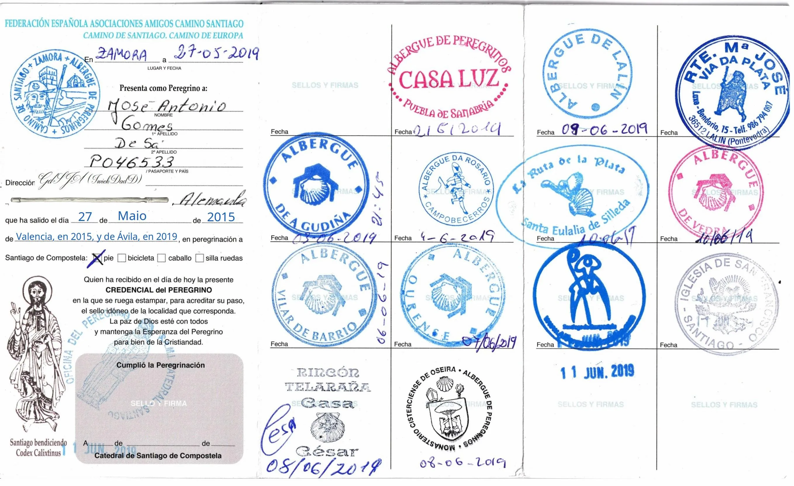
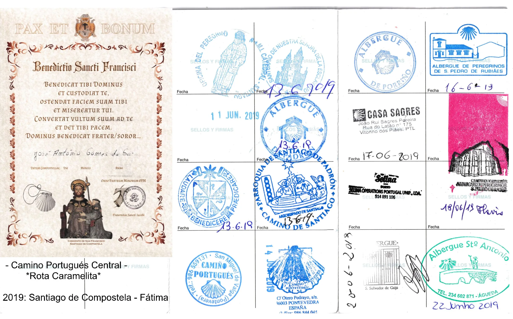
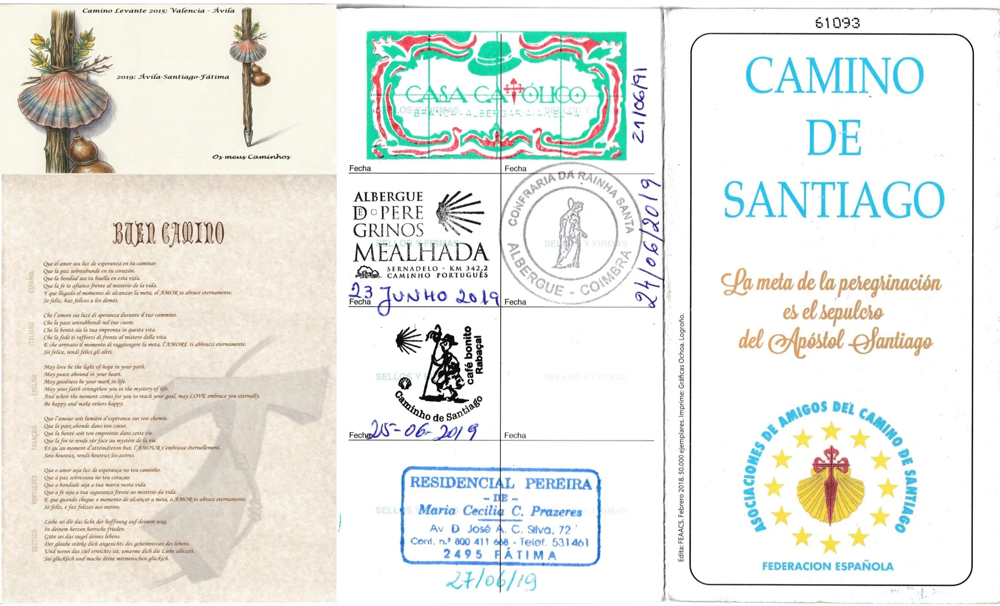
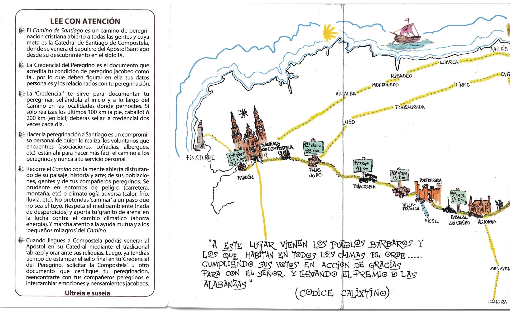

## Camino de Levante 2015  **∵**  2019  

### Credencial del Peregrino, de  mis Caminos

  

> ### 2015: Valencia → Ávila
> **Start: 27 April 2015** 

**Ankunft in Ávila:  24 Mai 2015**
*Den Jakobsweg – Camino de Levante – begann ich am 27. April 2015 in Valencia, kam am 24. Mai 2015 in Ávila an und setzte meine Pilgerreise am 21. Mai 2019  fort.*
### 2019: Ávila  → Santiago de Compostela 
> **Fortsetzung des Pilgerwegs:** 21 Mai 2019 

>   

 >  
 
🇩🇪 In Zamora holte ich mir einen zusätzlichen „Pilgerausweis“ ab.

> Der Hospitalero der mich empfangen hat, war Brasilianer, und wie so oft habe ich seinen Namen vergessen. 

Ich vermute, dass sich an diesem Tag mehr Pilger an diesen Ort  versammelt hatten als zu dieser Zeit auf dem gesamten Camino de Levante unterwegs waren. 

---

🇪🇸 Adquirí una «Credencial del Peregrino» adicional en Zamora.

> El hospitalero que me recibió era brasileño y, como suele ocurrir, se me ha olvidado su nombre.

Supongo que ese día se habían reunido en este lugar más peregrinos que los que recorrían en ese momento todo el Camino de Levante.

---

🇬🇧  I acquired an additional ‘Pilgrim’s Pass’ in Zamora.

> The hospitalero who welcomed me was Brazilian, and as is so often the case, I’ve forgotten his name.

I suspect that more pilgrims had gathered at this spot on that day than were travelling along the entire Camino de Levante at that time.

---

🇵🇹 Adquiri uma «Credencial do Peregrino» adicional em Zamora.

> O hospitalero que me recebeu era brasileiro e, como acontece tantas vezes, esqueci-me do nome dele.

Suponho que, nesse dia, se tivessem reunido mais peregrinos neste local do que os que, naquela altura, se encontravam a percorrer todo o Caminho de Levante.

Übersetzung: **"deepl.com"** 

- **Ankunft in Santiago de Compostela:  11 Juni 2019**

---
### Santiago de Compostela → Fátima (xx Km)
- **Start:**  13 Juni  2019

- **Ankunft in Fátima:  27 Jun 2019**

---

  

🇬🇧
🇪🇸
🇵🇹
🇩🇪 

---
 
↪ [Etappe-01_Valencia_Silla](Etappe-01_Valencia_Silla.md)

 🔁  [Camino-de-Levante_Etapas](Camino-de-Levante_Etapas.md)

 
 ...→