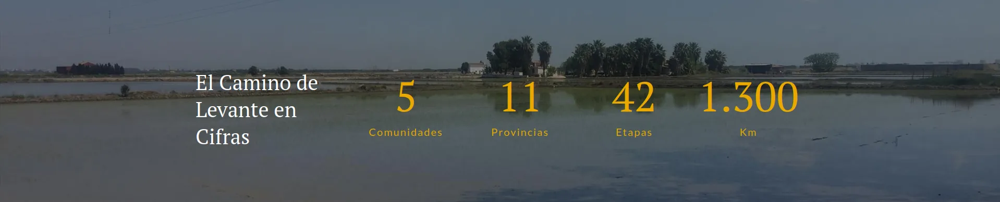
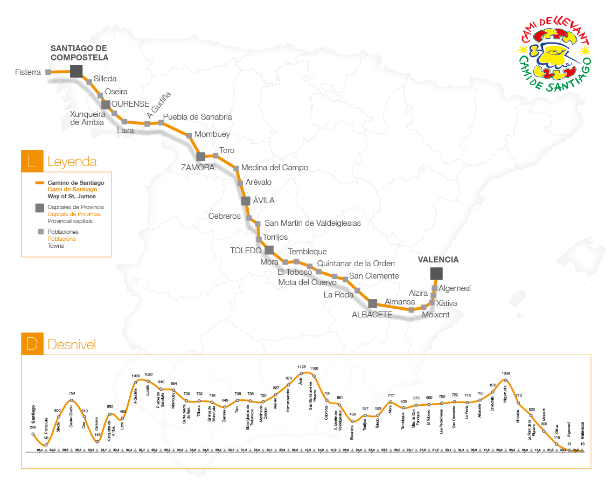
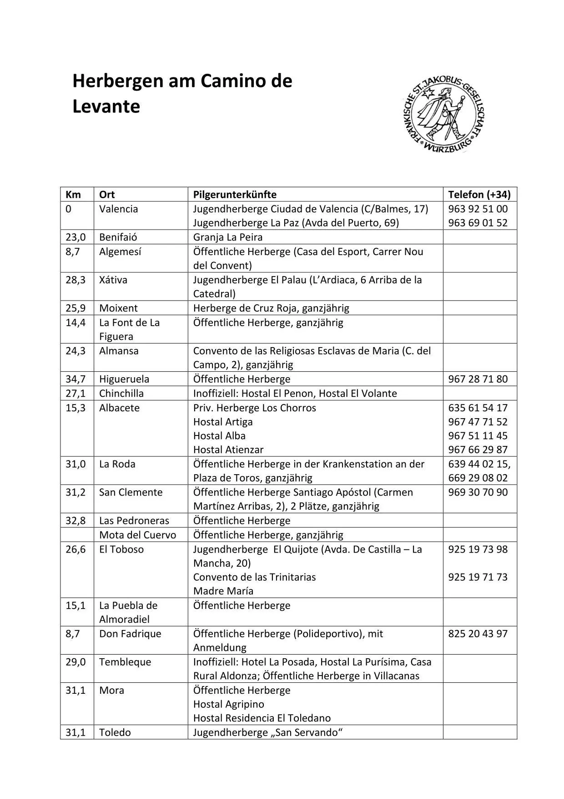
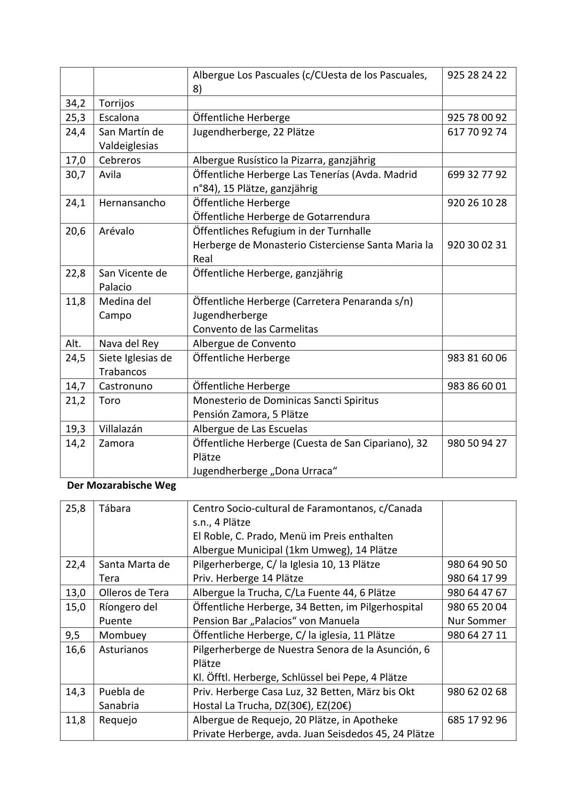
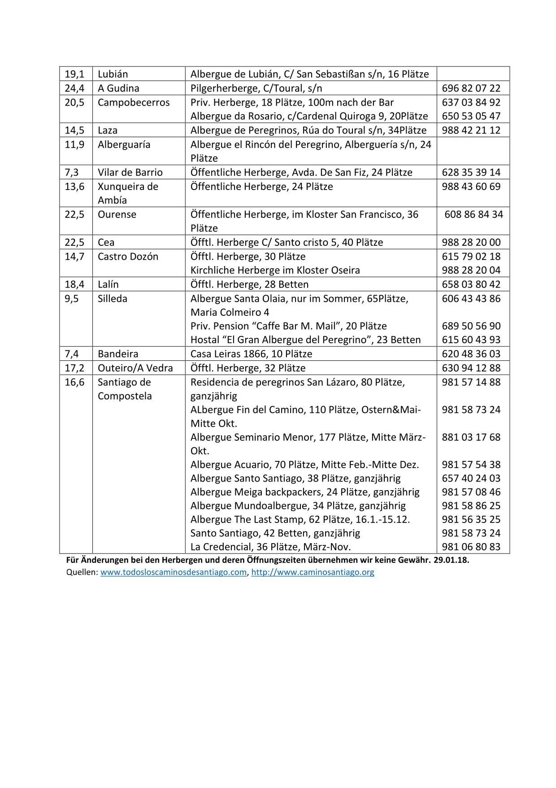
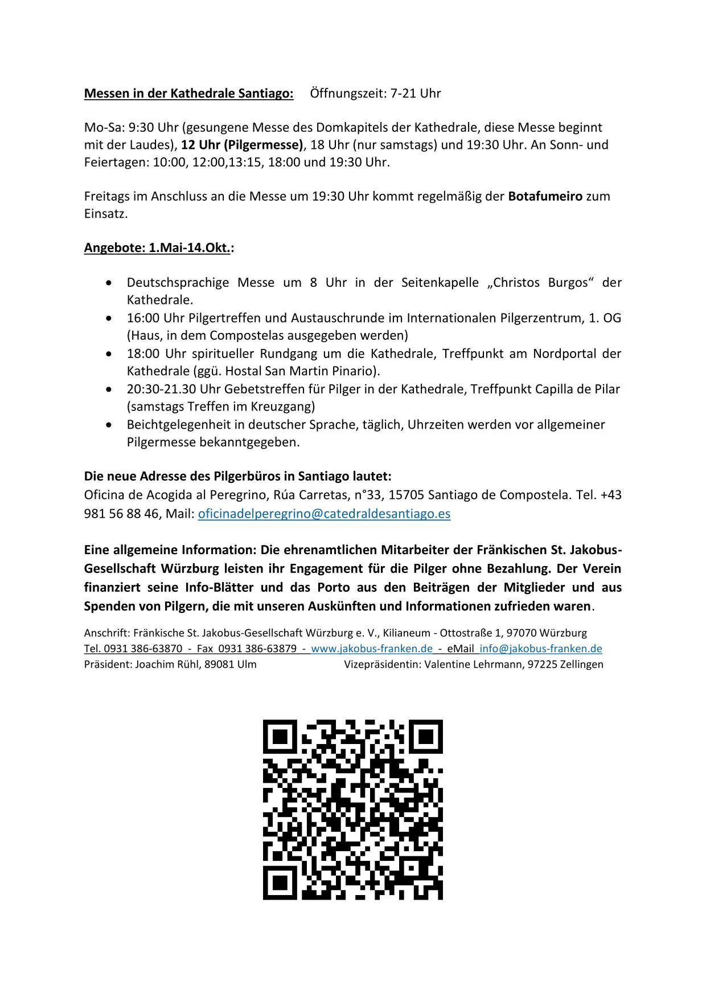

## Camino de Levante  2015  **∵**  2019 

#### Camino de Levante  → Vía de la Plata → Camino Sanabrés 

 
  

- **42 Etappen bei etwa 30 Km pro Etappe**
- **51 Etappen bei etwa 25 Km pro Etappe**

**Fotos ↑ von | Fotos ↑ de ** : https://vieiragrino.com/

### Wuppertal  → Franfurt Hahn  →  Valencia 
**26  April 2015**

###  Valencia → Ávila (xx Km)
**Start:**  27 de April  **Ende:**  24  Mai 2015**

🇬🇧  

----
 🇪🇸 

---
🇵🇹  

---
🇩🇪 

---

### Camino de Levante  2015

### Start

#### [Etappe-00](Etappe-00.md)
26 de April 2015

---
#### [Etappe-01_Valencia_Silla](Etappe-01_Valencia_Silla.md)
27 de Abril 2015

---
#### [Etappe-02-Silla-Alzira](Etappe-02-Silla-Alzira.md)
28 de Abril 2015

---
#### [Etappe-03_Alzira_Xativa](Etappe-03_Alzira_Xativa.md)
29 de Abril 2015

---
#### [Etappe-04_Xativa_](Etappe-04_Xativa_.md)
30 de Abril 2015

---
#### [Etappe-05](Etappe-05.md)
01 de Maio 2015

---
#### [Etappe-06](Etappe-06.md)
02 de Maio 2015

---
#### [Etappe-07](Etappe-07.md)
03 de Maio 2015

---
#### [Etappe-08](Etappe-08.md)
04 de Maio 2015

---
#### [Etappe-09](Etappe-09.md)
05 de Maio 2015

---
#### [Etappe-10](Etappe-10.md)
06 de Maio 2015

---
#### [Etappe-11](Etappe-11.md)
07 de Maio 2015

---
#### [Etappe-12](Etappe-12.md)
08 de Maio 2015

---
#### [Etappe-13](Etappe-13.md)
09 de Maio 2015

---
#### [Etappe-14](Etappe-14.md)
10 de Maio 2015

---
#### [Etappe-15](Etappe-15.md)
11 de Maio 2015

---
#### [Etappe-16](Etappe-16.md)
12 de Maio 2015

---
#### [Etappe-17](Etappe-17.md)
13 de Maio 2015

---
#### [Etappe-18](Etappe-18.md)
14 de Maio 2015

---
#### [Etappe-19](Jakobswege/03_Camino-Levante_2015_2019/Etappe-19.md)
15 de Maio 2015

---
#### [Etappe-20](Etappe-20.md)
16 de Maio 2015

---
#### [Etappe-21](Etappe-21.md)
17 de Maio 2015

---
#### [Etappe-22](Etappe-22.md)
18 de Maio 2015

---
#### [Etappe-23](Etappe-23.md)
19 de Maio 2015

---
#### [Etappe-24](Etappe-24.md)
20 de Maio 2015

---
#### [Etappe-25](Etappe-25.md)
21 de Maio 2015

---
#### [Etappe-26](Etappe-26.md)
22 de Maio 2015

---
#### [Etappe-27](Etappe-27.md)
23 de Maio 2015

---

#### [Etappe-28](Etappe-28.md)
24 de Maio 2015

 

**🇩🇪 Ankunft in Ávila**
-  → Fortsetzung des Jakobswegs am 20. Mai 2019

**🇬🇧 Arrival in Ávila**
- → Continuation of the Camino de Santiago on 20 May 2019

**🇪🇸  Llegada a Ávila**
- → Continuación del Camino de Santiago el 20 de mayo de 2019

**🇵🇹 Chegada a Ávila**
- → Continuação do Caminho de Santiago, a 20 de maio de 2019

## Camino de Levante  2019

###  Ávila → Zamora (xx Km)
**Start:**  20 de Mai  **Ende:**  27  Mai 2019**

---
#### [Etappe-29](Etappe-29.md)
20 de Maio 2019

---
#### 
21 de Maio 2019

---
#### 
22 de Maio 2019

---
#### 
23 de Maio 2019

---
#### 
24 de Maio 2019

---

###  Vía de la Plata  2019

###   Zamora → Granja de Moruela (xx Km)
20 Mai -  Mai 2019 

🇵🇹 

---
🇪🇸 

---
🇬🇧 

---
🇩🇪 

🗺️ 

#### 
xx de Mai 2019

---
#### 
xx de Maio 2019

---
###  Camino Sanabrés  2019

###   Granja de Moruela → Santiago de Compostela (255 bis 270 Km)
xx - xx Juni 2019 

 

🇬🇧 

---
🇪🇸 

---
🇵🇹 

---
🇩🇪 

---

#### 
xx de Mai 2019

---
#### 
xx de Maio 2019

🏠 Unterkunft / Albergues

---

  

🇬🇧 🇪🇸 🇵🇹 🇩🇪 

---

↪ 

↪ [Camino-de-Levante_Credencial-del-Peregrino](Camino-de-Levante_Credencial-del-Peregrino.md)

**←** 🔁 [Readme](https://github.com/GomesDeSa-JA/Camino-del-Salvador_2023-2025/blob/main/Readme.md)

**←** 🔁 [ Os Caminhos](https://github.com/GomesDeSa-JA/Camino-del-Salvador_2023-2025/blob/main/Os_Caminhos.md)

 ...→
