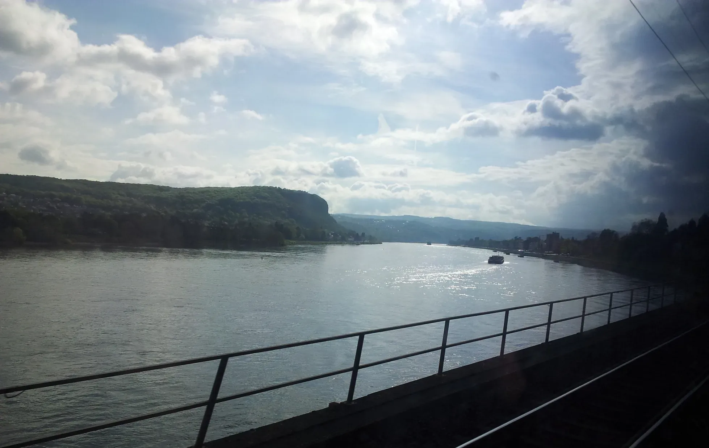
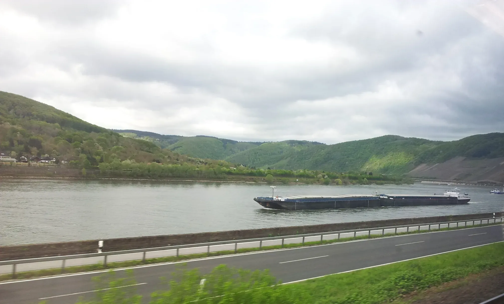
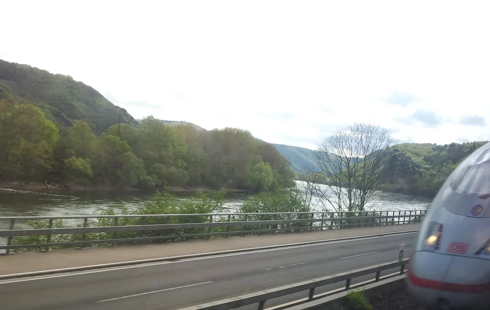
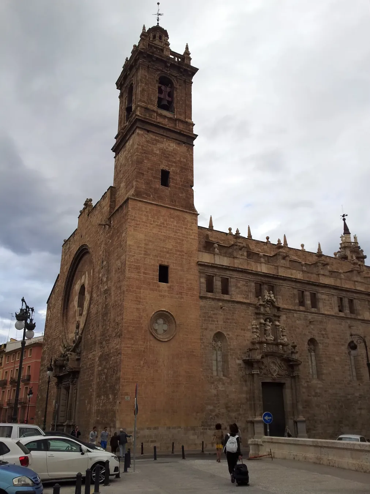

## Camino de Levante 2015 

26 de Abril 2015: Wuppertal  ✈️ Valencia 

### Etappe-00: Wuppertal 🚆 → Koblenz   🚌 →  Hahn Airport  (Lautzenhausen)  → Valencia 
26 de Abril 2015 

---
### Etappe-0 1: Valencia  → Silla  (13,7 Km)
27 de Abril 2015 👣

Foto von: 20150426_201202

**Etapa-01**:  [1. Etapa ](https://www.caminosantiago.org/cpperegrino/caminos/etapa.asp?kCamino=ES08a01a&EtapaId=196&CaminoId=14)

#### As fotos?

"**Acho**" que tirei uma ou duas fotos desta etapa.

**Etapa-01**:  Valencia → Algemesí (40km)  

Ao contrário da etapa 01 do Caminho Mozárabe, seria impossível percorrer esta etapa de 38 km no primeiro dia, pois, ao contrário do percurso Almería–Alboloduy, onde o terreno era melhor e reinava a tranquilidade ao longo de todo o caminho, aqui falta tranquilidade devido ao trânsito urbano, o que, por si só, já é bastante cansativo.

achar 

### **achar:**

- **Pensar, crer ou emitir uma opinião:** É usado para expressar o que você julga, supõe ou acredita sobre algo ou alguém (por exemplo: _"Eu acho que vai chover"_, _"Achei o filme muito interessante"_). Exprime uma crença ou ponto de vista que não representa uma certeza absoluta. 
- **Encontrar (localizar):** Significa achar ou deparar-se com algo ou alguém, seja após uma busca intencional ou por acaso (por exemplo: _"Achei minhas chaves perdidas"_ ou _"Achei uma nota de dinheiro na rua"_)

---
#### Die Fotos?

**Ich glaube,** ich habe ein oder zwei Fotos von dieser Etappe gemacht.

**Etapa-01**:  Valencia → Algemesí (40km)  

Im Gegensatz zur Etappe 01 des Mozarabischen Weges wäre diese 38 km lange Etappe am ersten Tag unmöglich zu bewältigen, denn anders als auf der Strecke Almería–Alboloduy, wo der Untergrund besser war und auf dem gesamten Weg Ruhe herrschte, fehlt es hier aufgrund des Stadtverkehrs an Ruhe, was an sich schon ziemlich anstrengend ist.

glauben

#### **glauben:**

1. Vermuten oder annehmen (alltäglicher Sinn)

- **Bedeutung:** Etwas für möglich oder wahrscheinlich halten, ohne sich völlig sicher zu sein (lässt die Möglichkeit eines Irrtums offen). 

**Beispiele:**
    - _„Ich glaube, dass morgen die Sonne scheinen wird.“_
    - _„Ich glaube, wir sind auf dem richtigen Weg_

**Synonyme:** Vermuten, meinen, annehmen, schätzen

2. Jemandem vertrauen (mit Dativ-Ergänzung: _jemandem glauben_)

- **Bedeutung:** Einer Person glauben schenken, ihre Aussagen für wahr halten oder auf sie vertrauen

**Beispiele:**

- _„Ich glaube dir kein Wort.“_
- _„Du kannst mir glauben, das ist die Wahrheit.“_
3. Eine religiöse oder innere Überzeugung haben (mit Präposition: _an jemanden / etwas glauben_)

- **Bedeutung:** Von der Existenz einer höheren Macht, einer Idee oder eines Wertes überzeugt sein (z. B. an Gott, an das Gute oder an sich selbst).

**Beispiele:**

- _„Sie glaubt an Gott.“_
- _„Glaubst du an die Liebe?_

---
#### ¿Las fotos?

**Creo** que hice una o dos fotos de esta etapa.

**Etapa-01**:  Valencia → Algemesí (40km)  

A diferencia de la etapa 01 del Camino Mozárabe, esta etapa de 38 km sería imposible de recorrer el primer día, ya que, a diferencia del tramo Almería–Alboloduy, donde el terreno era mejor y reinaba la tranquilidad a lo largo de todo el recorrido, aquí falta tranquilidad debido al tráfico urbano, lo que de por sí ya resulta bastante agotador.

Creer 

#### Creer

El **sentido de creer** radica en dar por cierta una realidad, posibilidad o valor sin la necesidad de una prueba directa o absoluta, cumpliendo funciones fundamentales para el ser humano

**Sostén psicológico y emocional:** Otorga seguridad, calma epoca certidumbre ante lo desconocido, el sufrimiento o el futuro (como ocurre con la **fe** y la confianza personal)

**Motor de la acción y la creación:** Creer no es un estado pasivo; compromete a la persona con una idea hasta que organiza su vida, moviliza la voluntad y transforma el pensamiento en actos (como dice la máxima _"crear a partir de creer"_)

**Construcción social y cultural:** Permite compartir ficciones, valores, normas y proyectos colectivos (desde la ciencia y la historia hasta la religión o las metas comunitarias) en los que aún no existen pruebas físicas totales, pero que se vuelven reales a través de la cooperación humana.

**Relación y confianza:** En su raíz etimológica (_credere_, del indoeuropeo _kerd-_ o corazón), creer está íntimamente ligado a **poner el corazón** y confiar en la palabra o la verdad que nos comunica otro.

---
#### The photos?

**I think** I took one or two photos of this stage.

**Etapa-01**:  Valencia → Algemesí (40km)  

Unlike Stage 01 of the Mozarabic Way, this 38-kilometre stage would be impossible to complete on the first day, because unlike the Almería–Alboloduy route, where the terrain was better and the whole route was peaceful, here there is no peace and quiet due to the city traffic, which in itself is quite exhausting.

To think 

#### To think:

Core Meanings

- **Using the Mind / Reasoning:** To exercise your brain to solve problems, judge situations, or process thoughts.
    - _Example:_ "He acted without thinking."

**Having an Opinion or Belief:** To believe or feel that something is true or a certain way.

- _Example:_ "I think this is the right address.

**Having an Opinion or Belief:** To believe or feel that something is true or a certain way.

- _Example:_ "I think this is the right address."

**Considering or Pondering:** To reflect on an idea, plan, or option over time.

- _Example:_ "I'm thinking about buying a new car.

**Remembering or Imagining:** To call something or someone to mind.

- _Example:_ "I was just thinking about you."
**

---

  

🗺️

 🇬🇧 🇪🇸 🇵🇹 🇩🇪 🥾

---

↪[Etappe-02-Silla-Alzira](Etappe-02-Silla-Alzira.md)

 🔁  [Camino-de-Levante_Etapas](Camino-de-Levante_Etapas.md)

 ...→