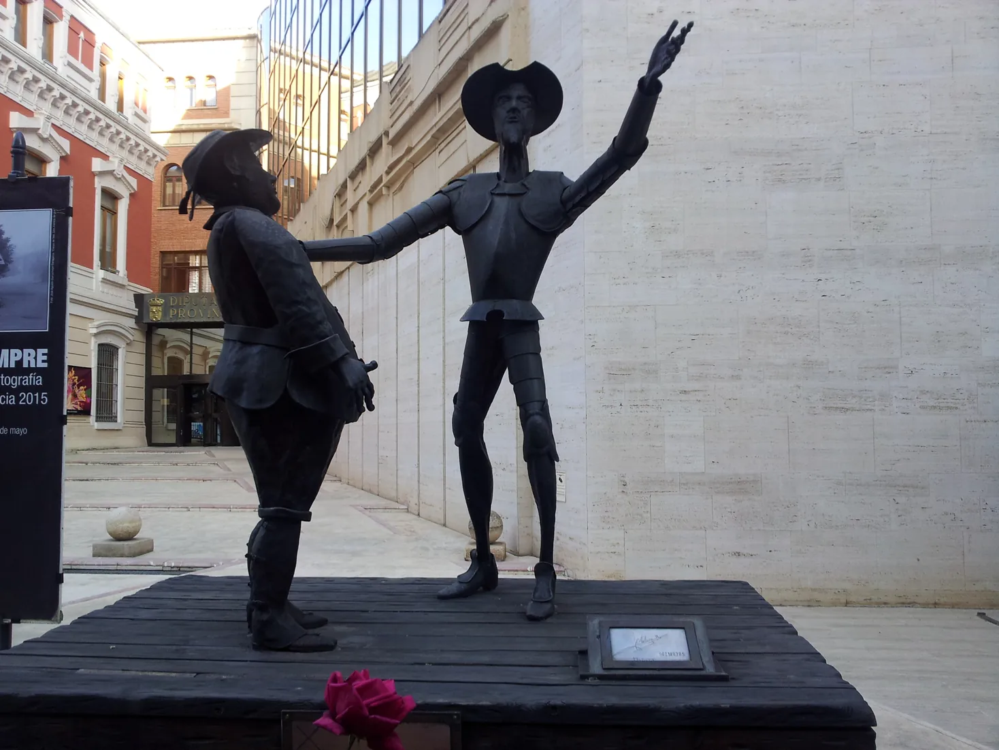
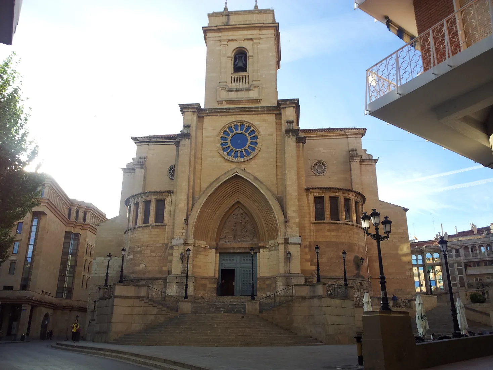
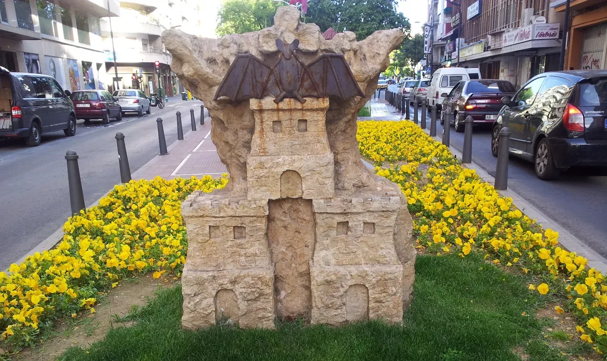
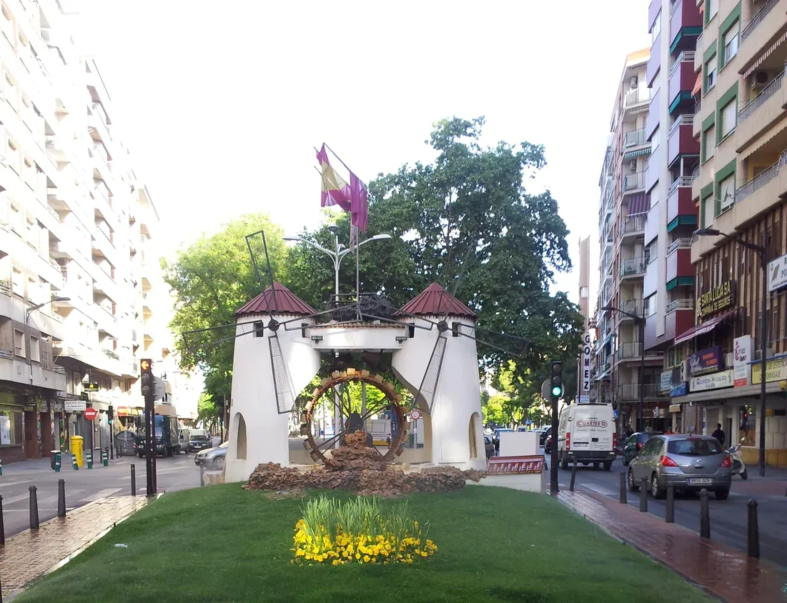
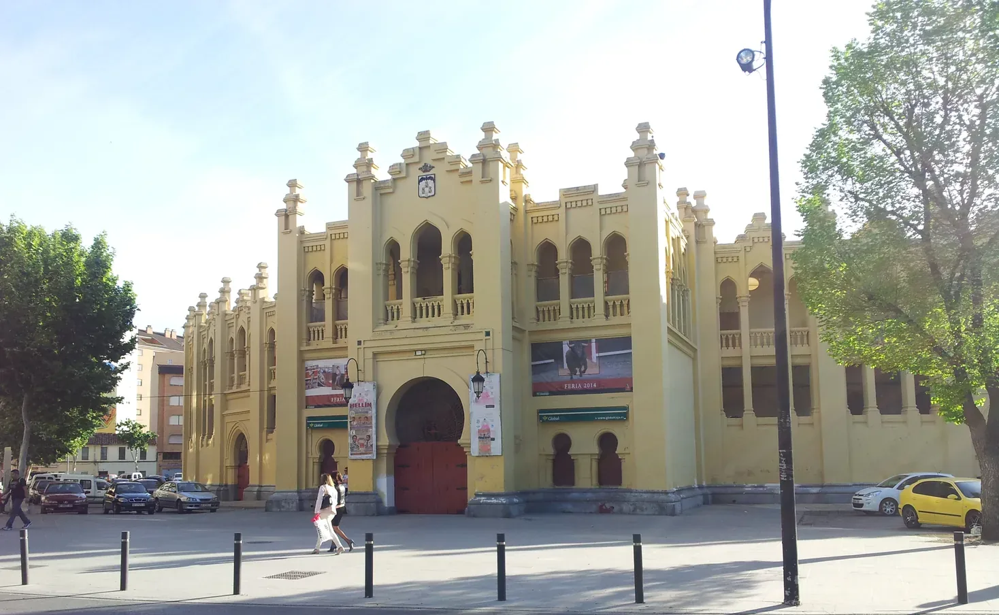
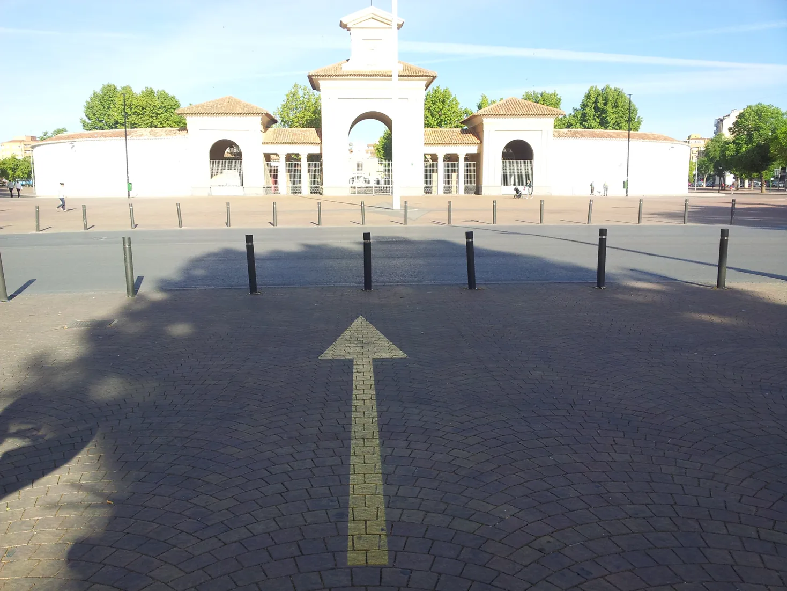
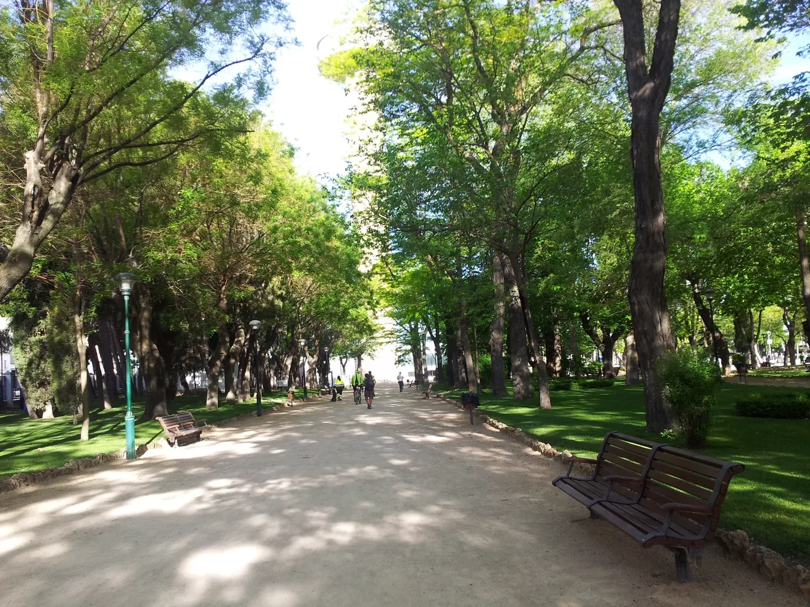
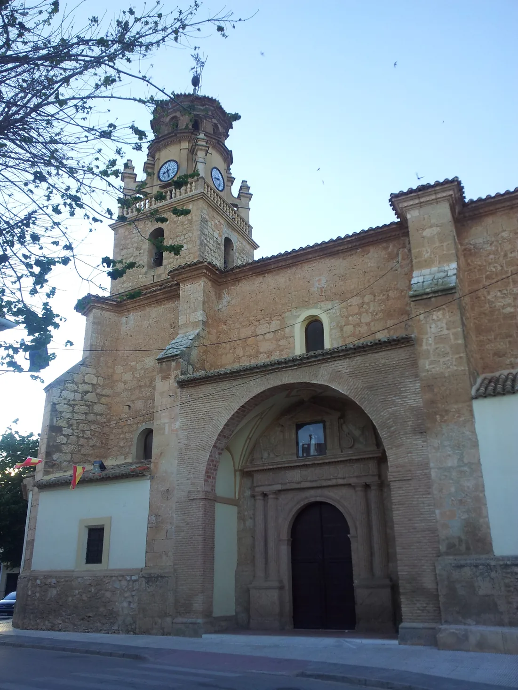

## Camino de Levante 2015 

### Etappe-11: Albacete  →  La Gineta (18 Km)
07 de Maio 2015 👣

Don Quijote y Sancho Pansa

  

“Encontro con la Senhora da Escócia”

- Acho que ela vive na Andaluzia, «algures na costa do Mediterrâneo» …, … . O filho dela tinha problemas com drogas …, … . Nas suas palavras: «Só o posso ajudar se ele me deixar.» Dava para perceber, pelo seu estado de espírito, que ela estava a travar uma batalha que não conseguia vencer sozinha.

- I think she lives in Andalusia, ‘somewhere on the Mediterranean coast’ …, … . Her son had drug problems …, … . Her words: ‘I can only help him if he lets me.’ You could tell from her demeanour that she was fighting a battle she couldn’t win on her own

---

  

🗺️

 🇬🇧 🇪🇸 🇵🇹 🇩🇪 🥾

---

↪ [Etappe-12_La-Gineta_La-Roda](Etappe-12_La-Gineta_La-Roda.md)

 🔁  [Camino-de-Levante_Etapas](Camino-de-Levante_Etapas.md)

 ...→