## Camino de Levante 2015 

### Etappe-25:   →   ( Km)
21 de Maio 2015 👣

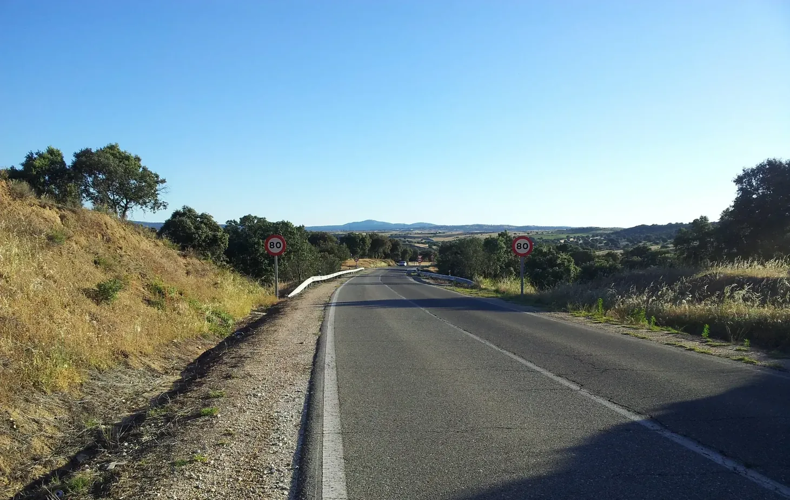

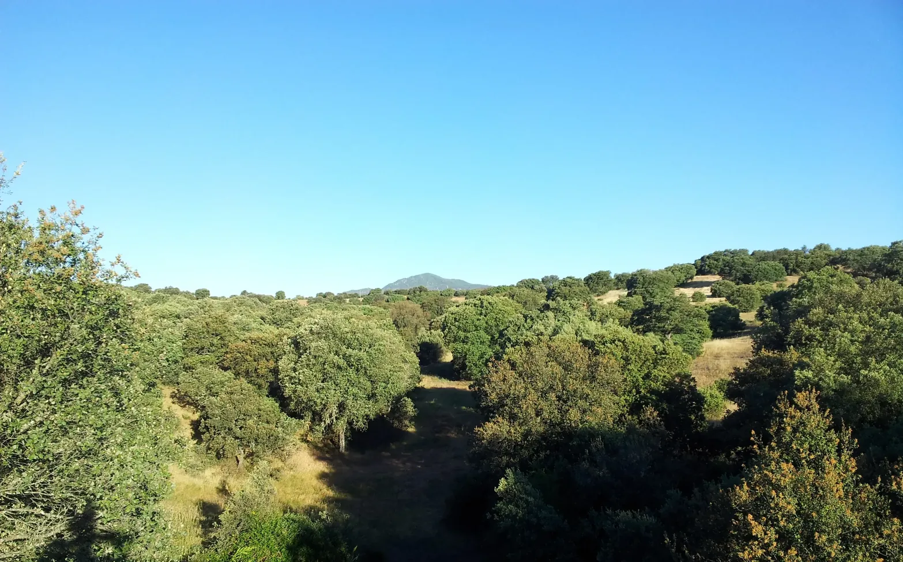

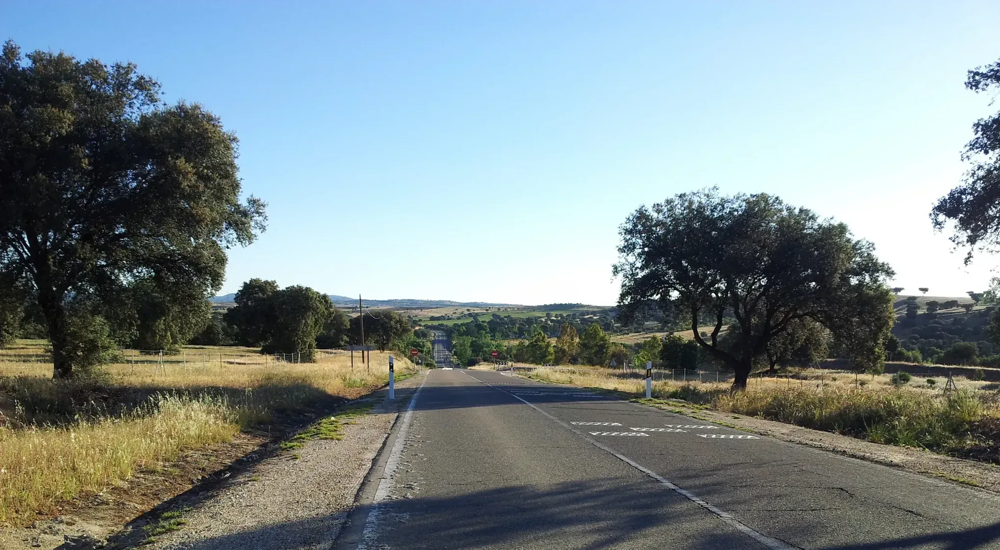

Als der Wind wehte, war es morgens kalt.

Cuando soplaba el viento, por las mañanas hacía frío.

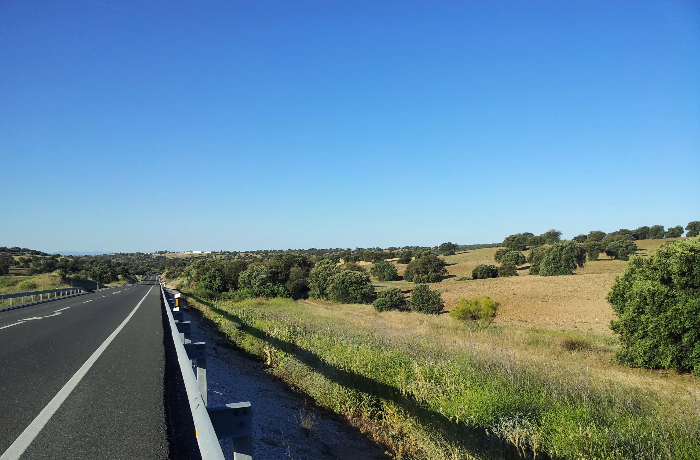

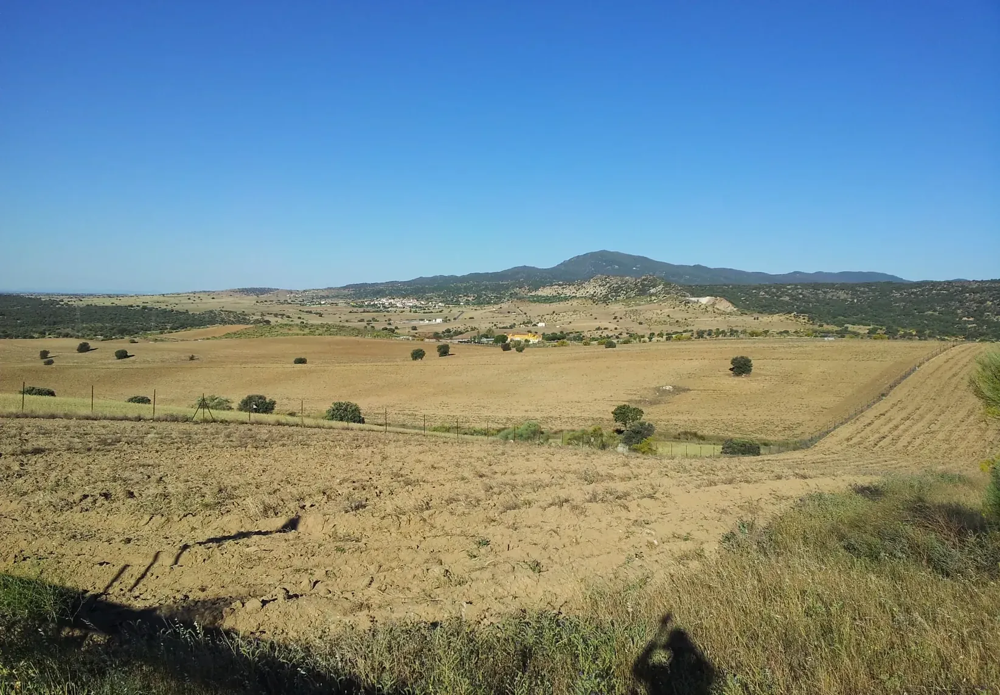

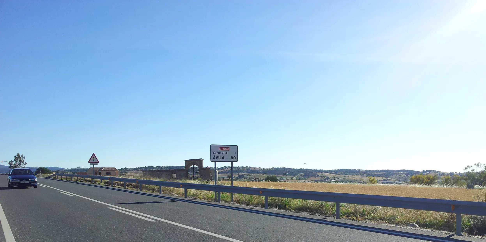

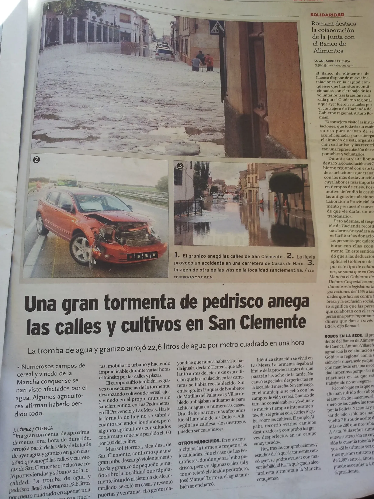

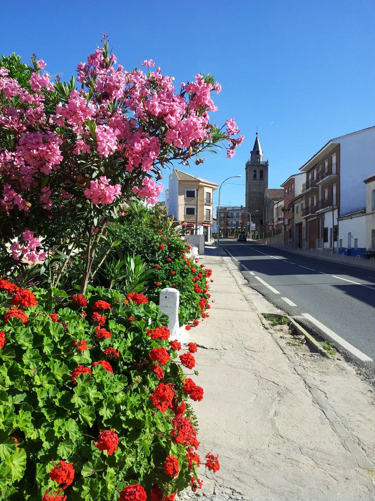

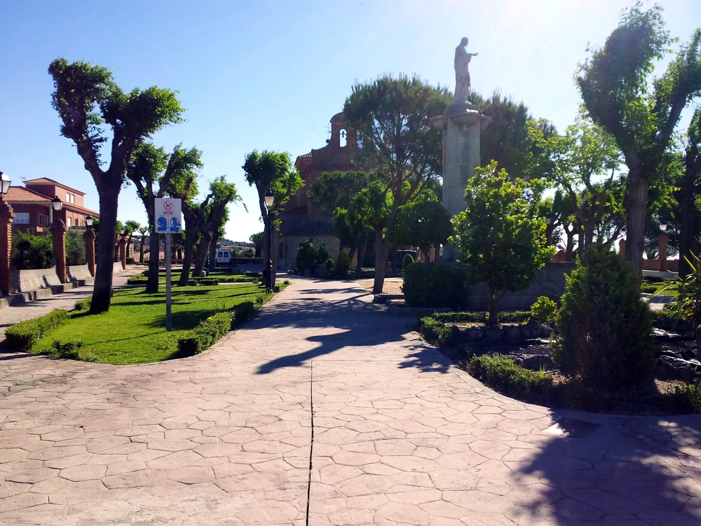

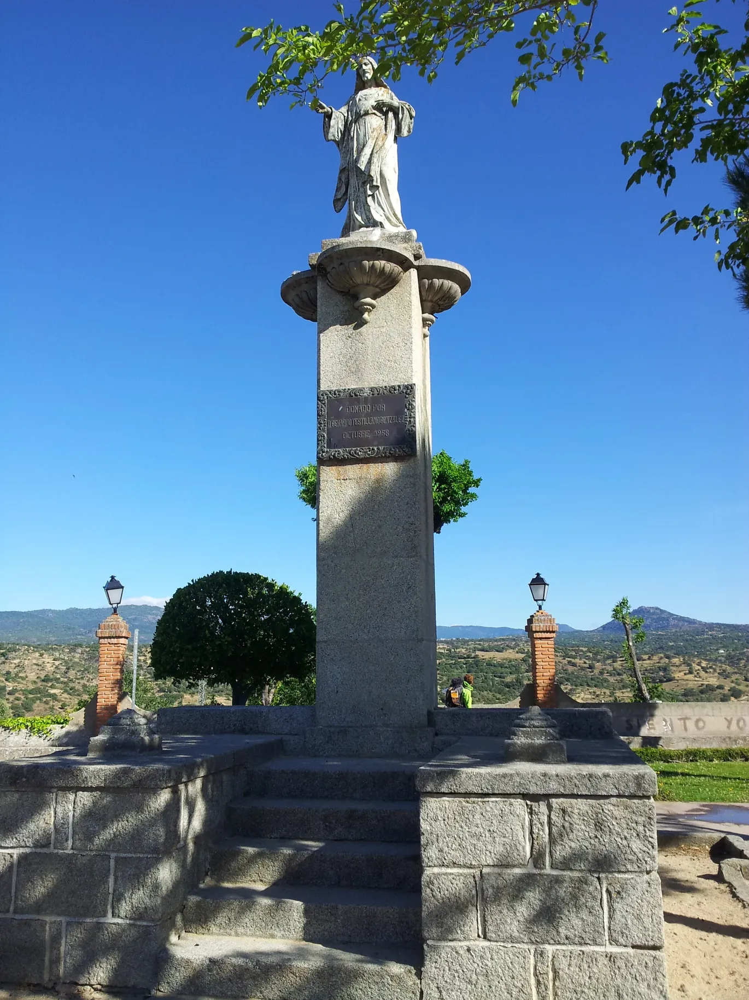

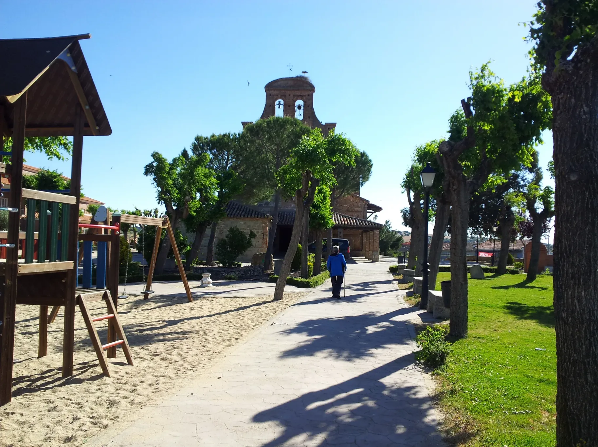

---

  

🗺️

 🇬🇧 🇪🇸 🇵🇹 🇩🇪 🥾

---

↪ [Etappe-26](Etappe-26.md)

 🔁  [Camino-de-Levante_Etapas](Camino-de-Levante_Etapas.md)

 ...→