## Camino de Levante 2015 

### Etappe-2: Escalona  →  San Martín de Valdeiglesias ( 30,6 Km)
21 de Maio 2015 👣

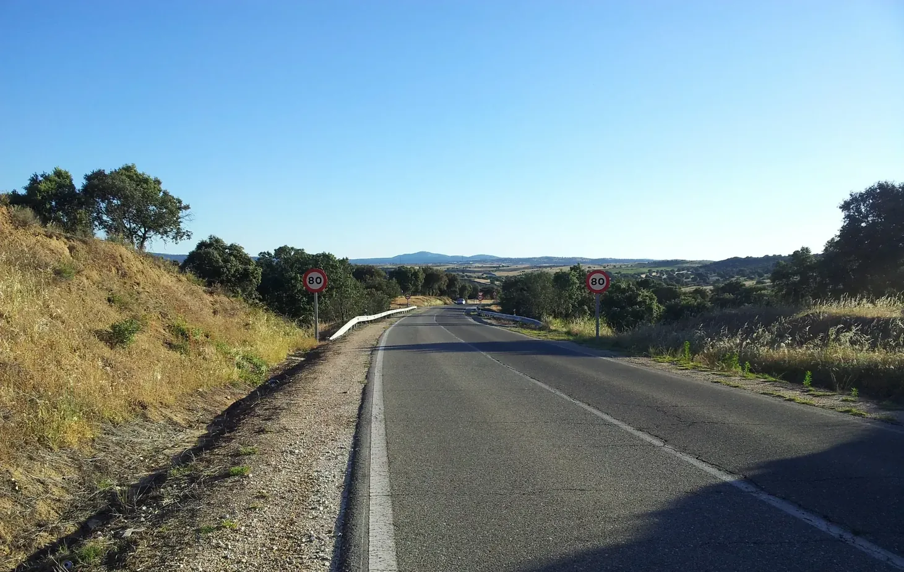

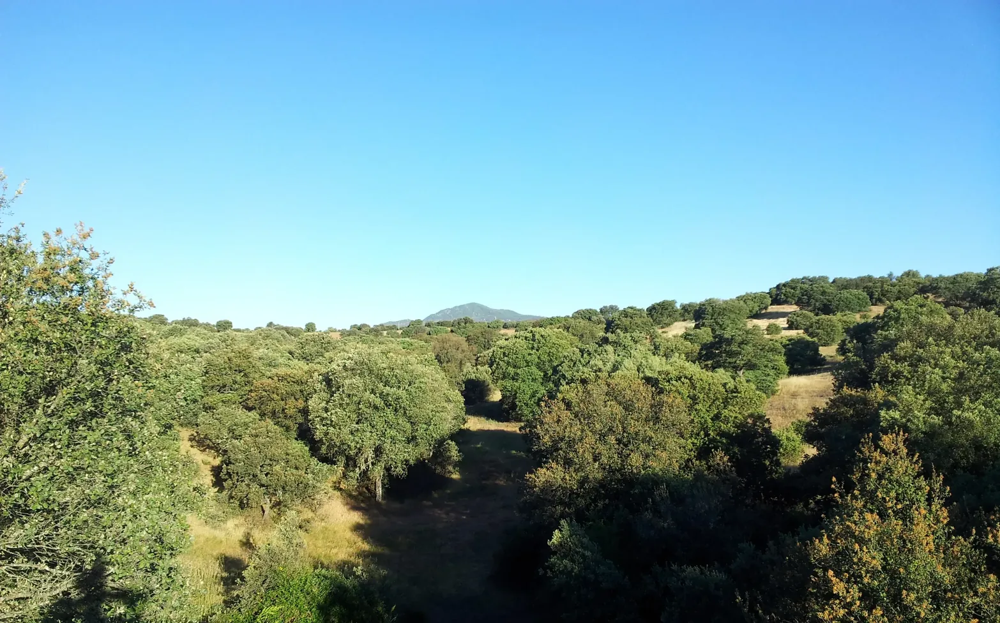

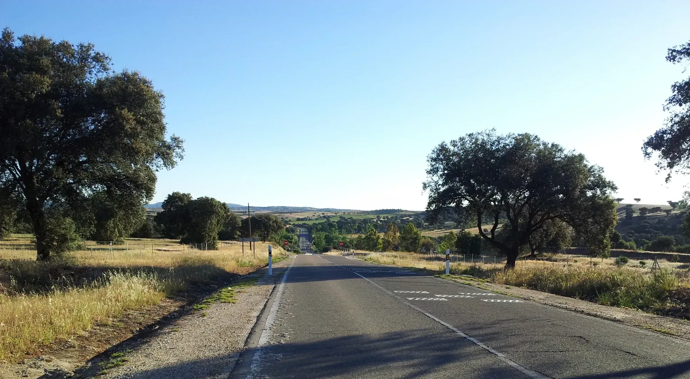

Als der Wind wehte, war es morgens kalt.

Cuando soplaba el viento, por las mañanas hacía frío.

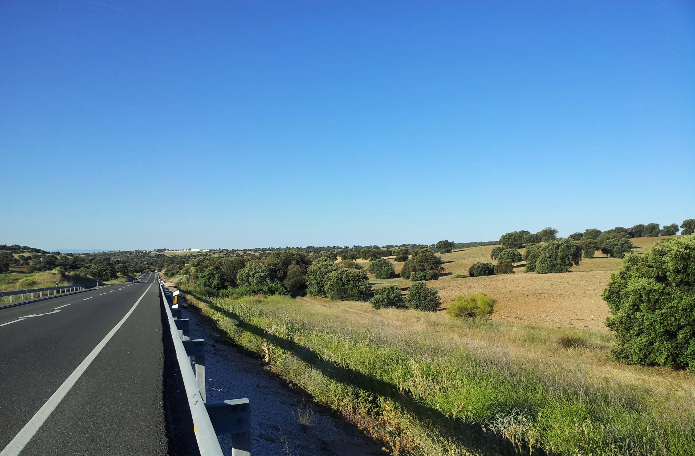

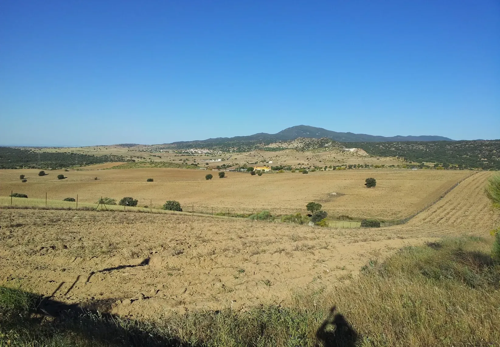

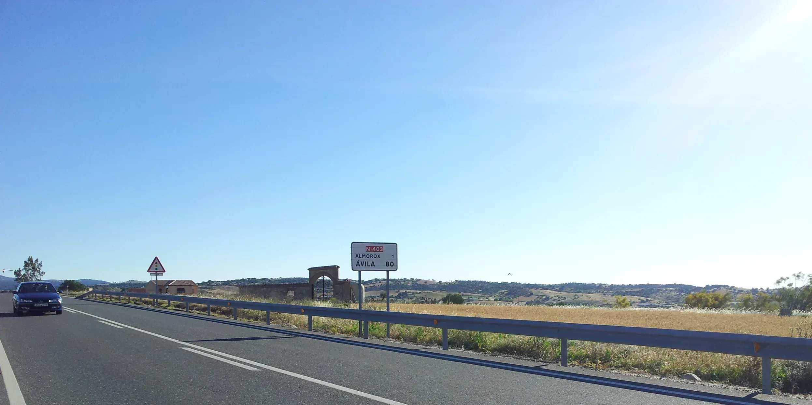

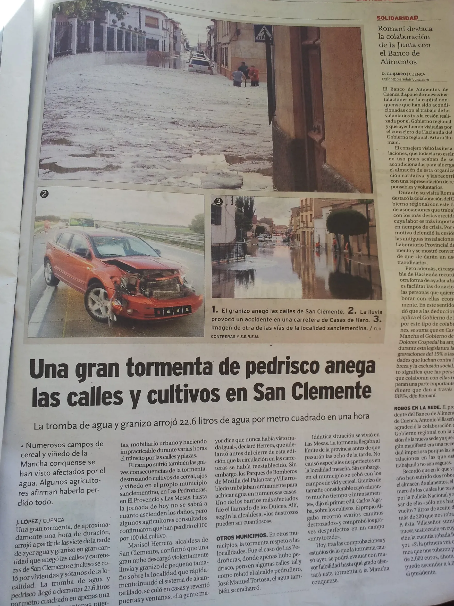

Am 9. Mai kam ich müde, aber gelassen in San Clemente an; am 10. Mai verließ ich San Clemente gestärkt und gut gelaunt, und nichts beunruhigte mich, doch wenn ich diese Nachrichten sehe, scheinen sie aus einer fernen Welt zu stammen, und es ist fast unvorstellbar, dass ich dort durch diese Gassen geschlendert bin und diesen angenehmen Abend genossen habe.

No dia 9 de maio, cheguei a San Clemente cansado, mas sereno; no dia 10 de maio, parti de San Clemente revigorado  e bem disposto, e nada me inquietava, mas quando vejo estas notícias, parecem vir de um mundo distante, e é quase inimaginável que eu tenha passeado por estas ruelas e desfrutado daquela agradável noite ali.

El 9 de mayo llegué a San Clemente cansado, pero tranquilo; el 10 de mayo partí de San Clemente revitalizado y de buen humor, y nada me inquietaba, pero cuando veo estas noticias, parecen proceder de un mundo lejano, y me resulta casi inimaginable haber paseado por estas callejuelas y haber disfrutado de aquella agradable noche allí.

On 9 May, I arrived in San Clemente tired but at peace; on 10 May, I left San Clemente feeling refreshed and in good spirits, and nothing troubled me, but when I see these news reports, they seem to come from a distant world, and it is almost unimaginable that I should have strolled through these narrow streets and enjoyed that pleasant evening there.

[Etappe-13_La-Roda_San-Clemente](Etappe-13_La-Roda_San-Clemente.md)

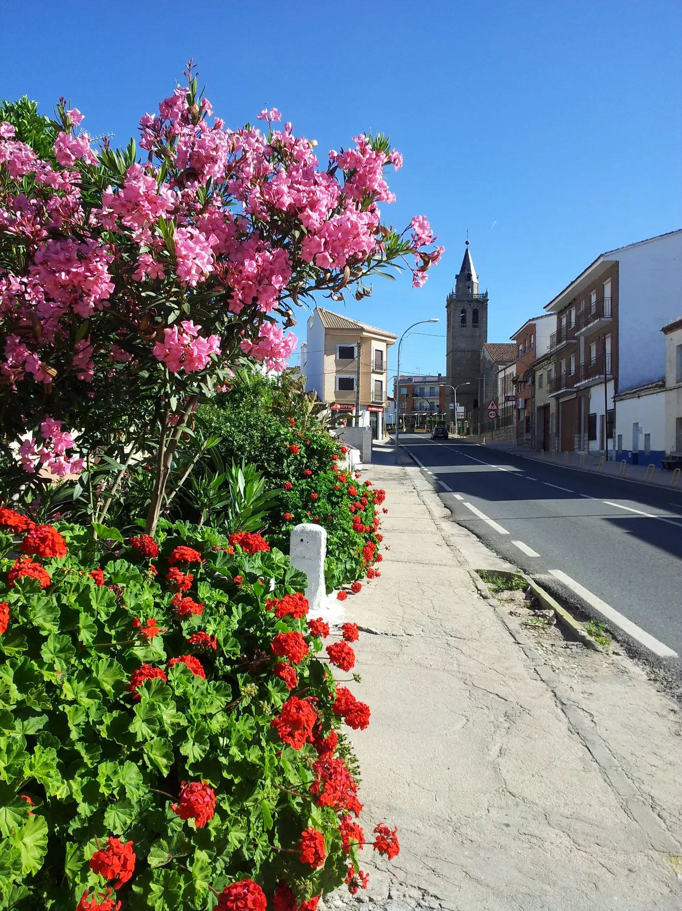

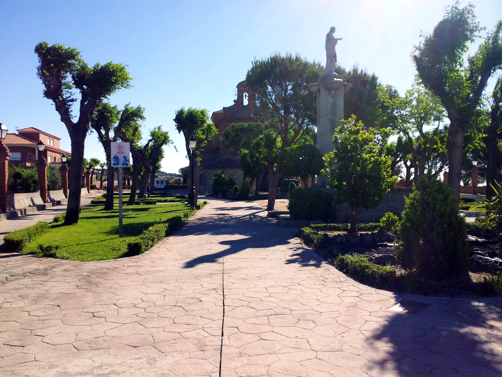

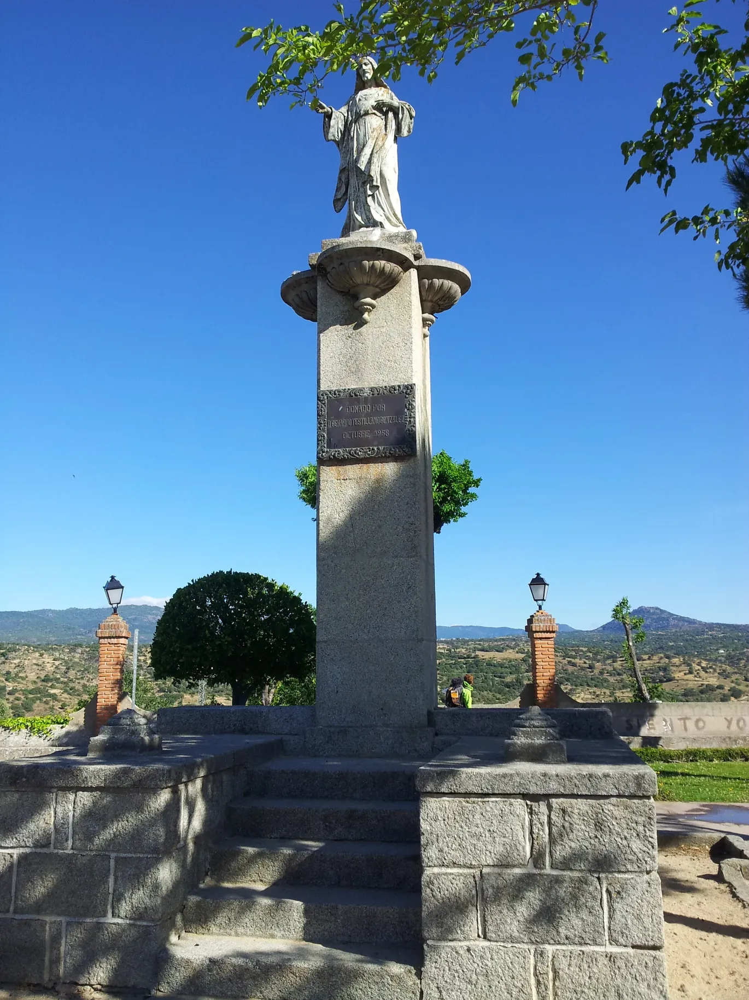

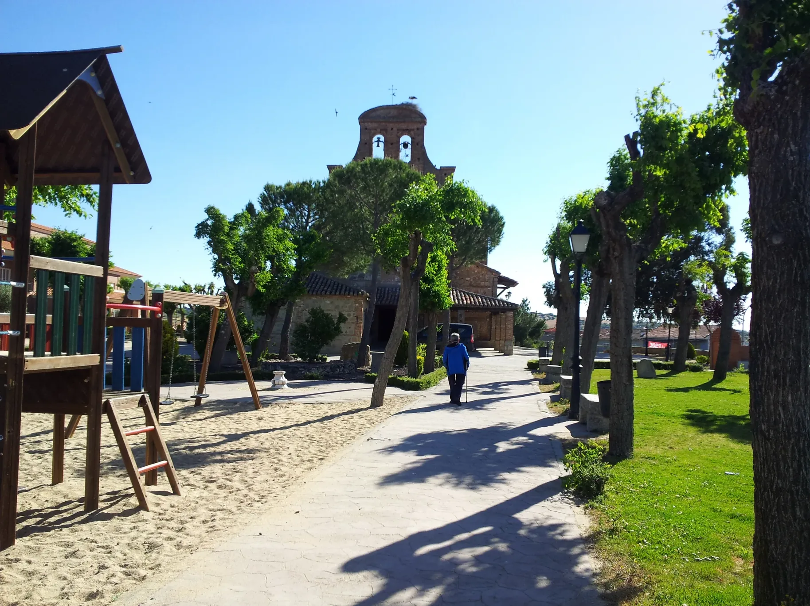

---

  

🗺️

 🇬🇧 🇪🇸 🇵🇹 🇩🇪 🥾

---

↪ [Etappe-26_San-Martin-de-Valdeiglesias_Cebreros](Etappe-26_San-Martin-de-Valdeiglesias_Cebreros.md)

 🔁  [Camino-de-Levante_Etapas](Camino-de-Levante_Etapas.md)

 ...→