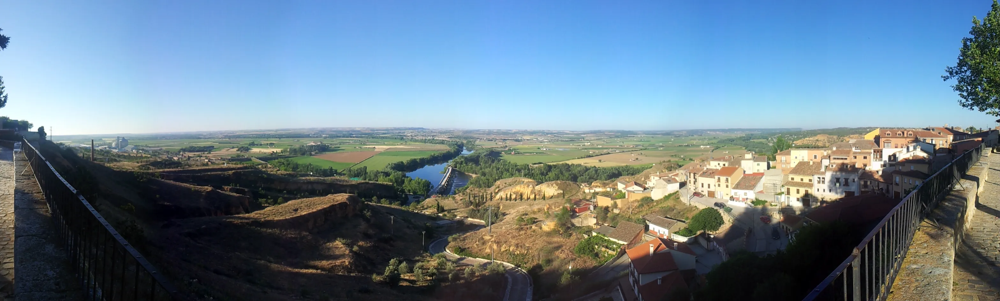
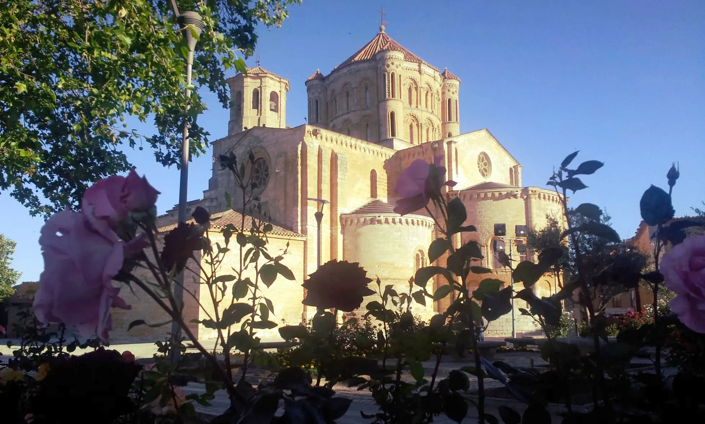
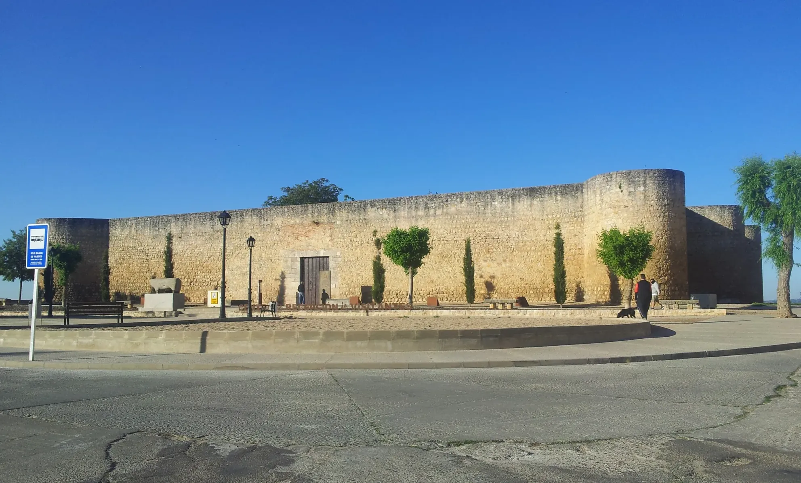
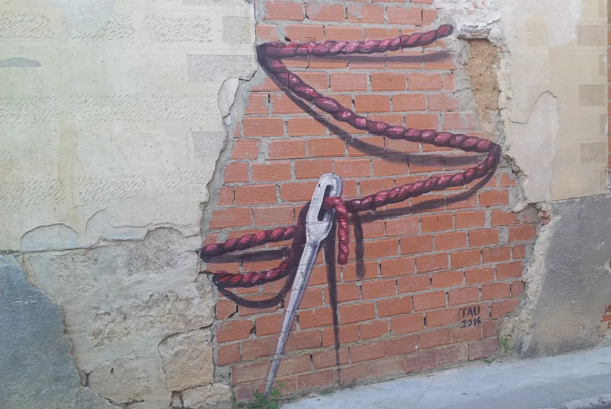
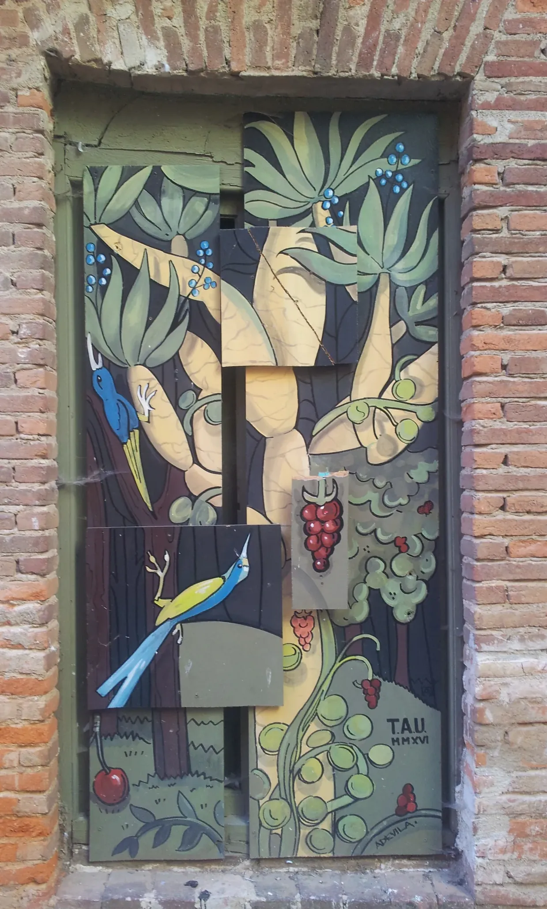
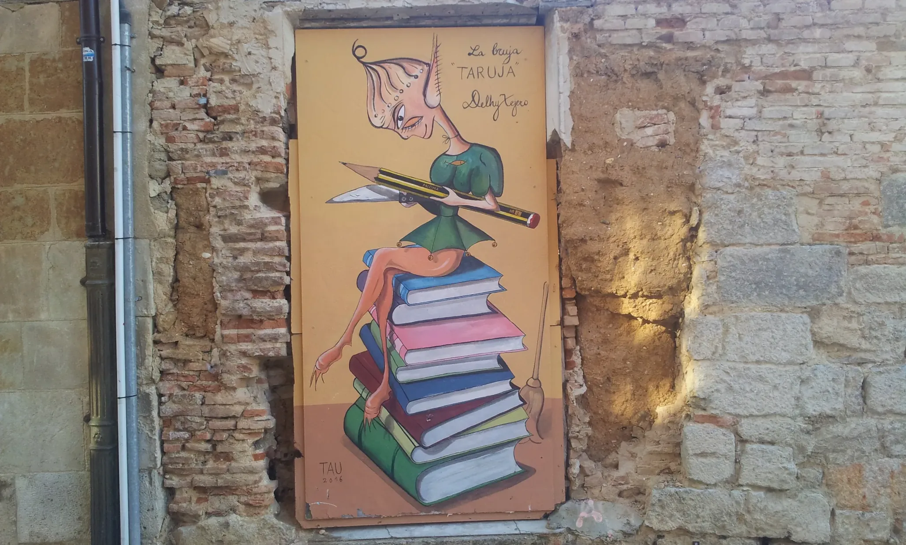
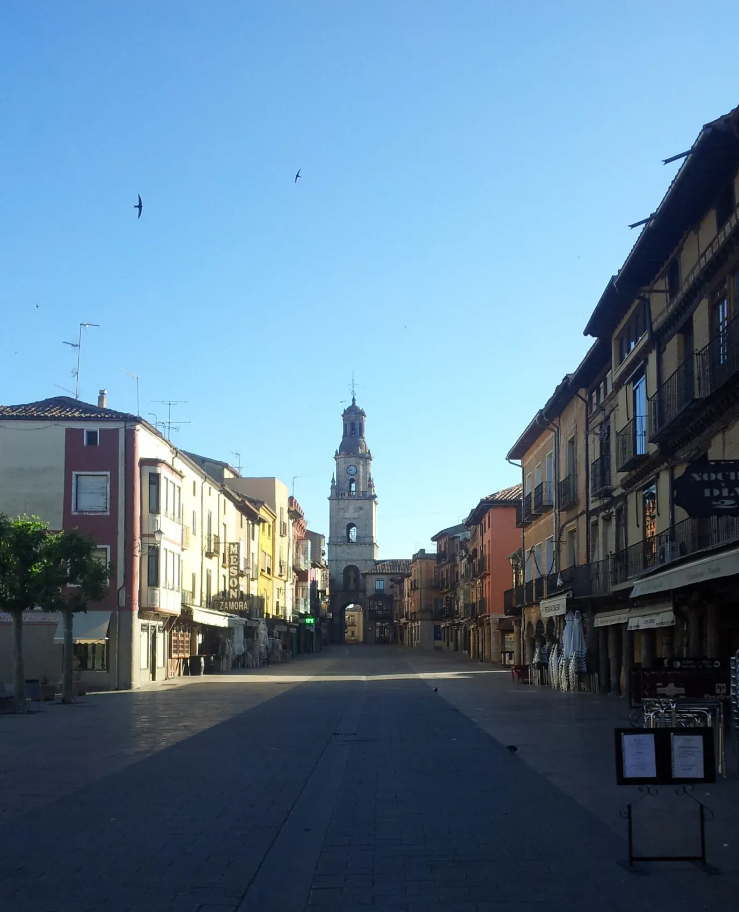
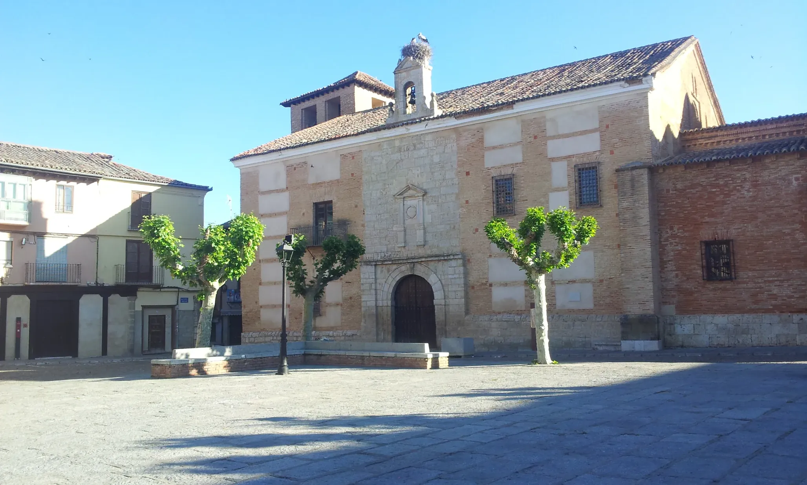
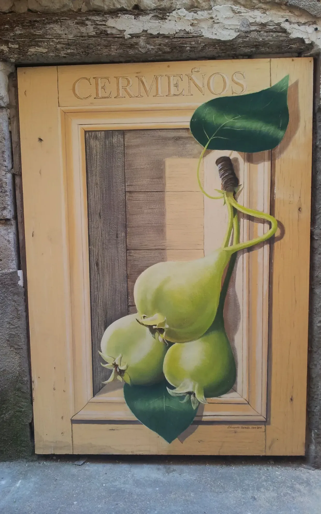
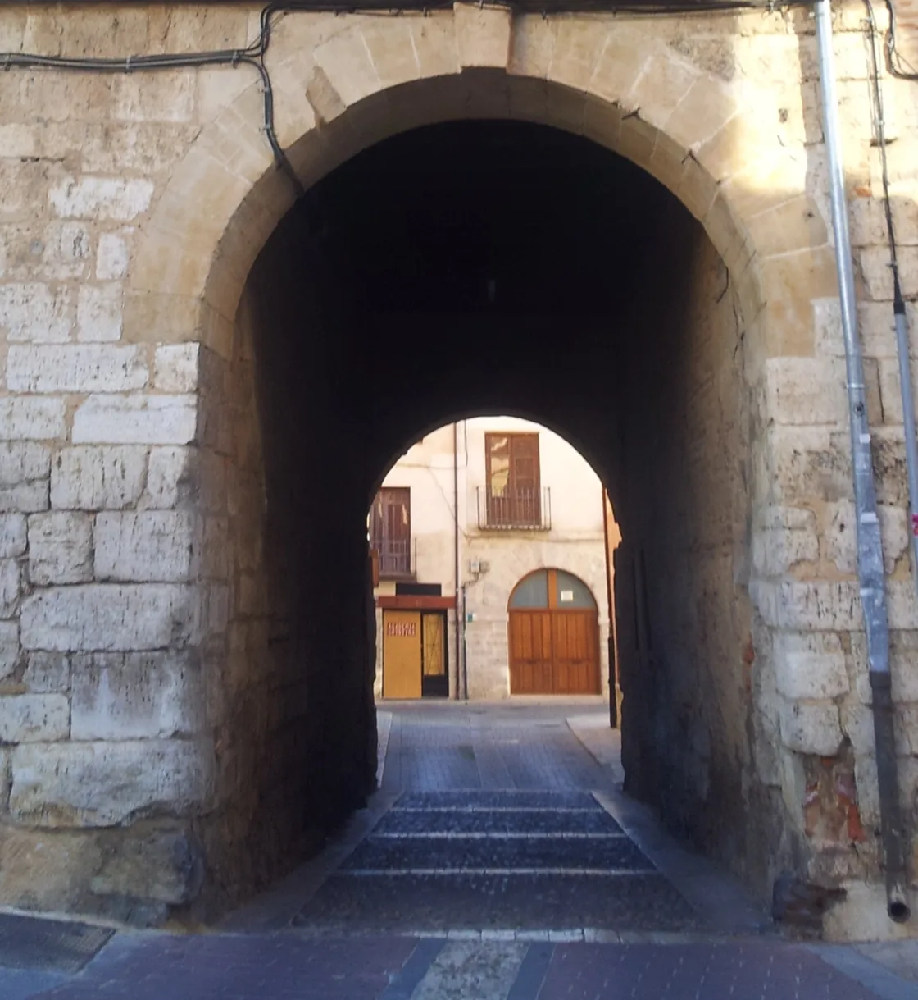

## Camino de Levante 2019

### Etappe-34: Ávila Toro → Ruhetag  ( xx m)
**26 Mai 2019** 👣  

---

  

🗺️

 🇬🇧 🇪🇸 🇵🇹 🇩🇪 🥾

---

↪ [Etappe-35_Toro_Zamora](Etappe-35_Toro_Zamora.md)

🔁  [Camino-de-Levante_Etapas](../03_Camino-Levante_2015_2019/Camino-de-Levante_Etapas.md)

 ...→