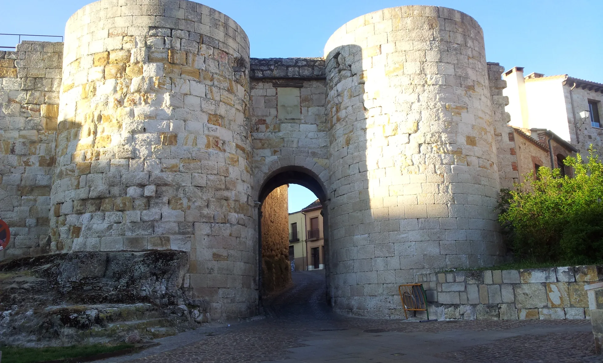
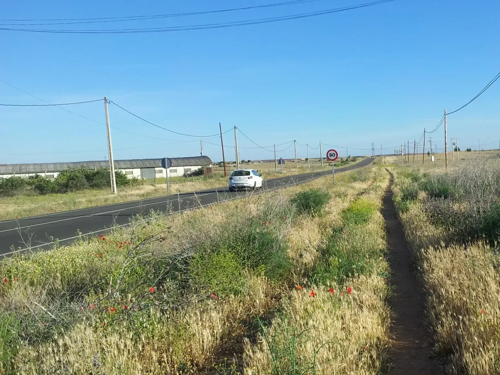
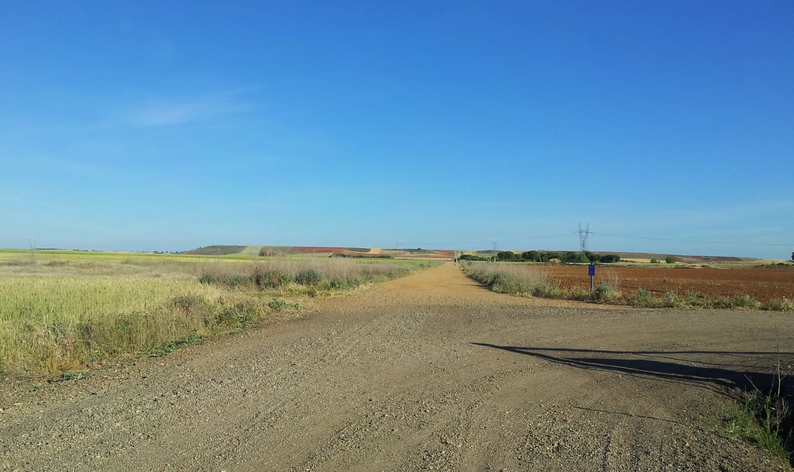
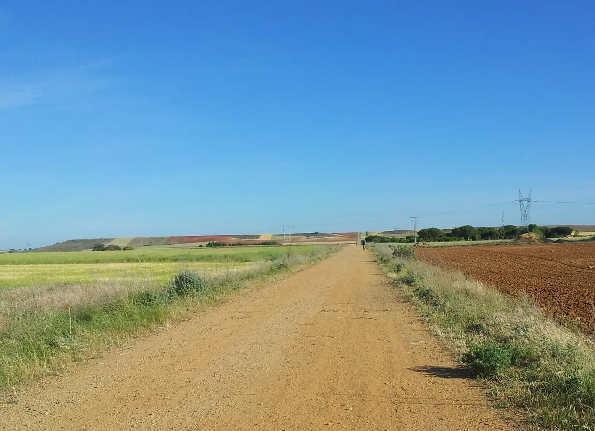
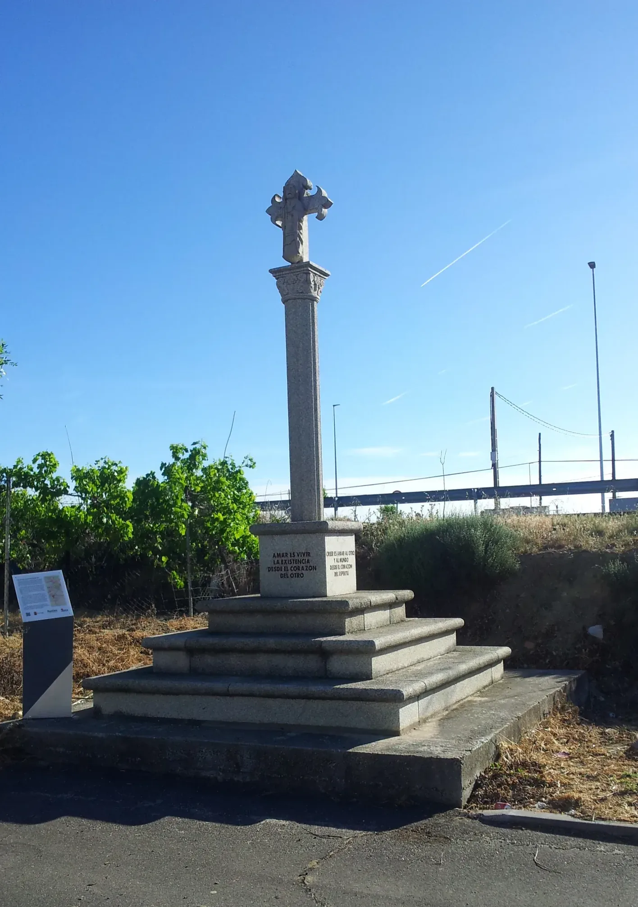
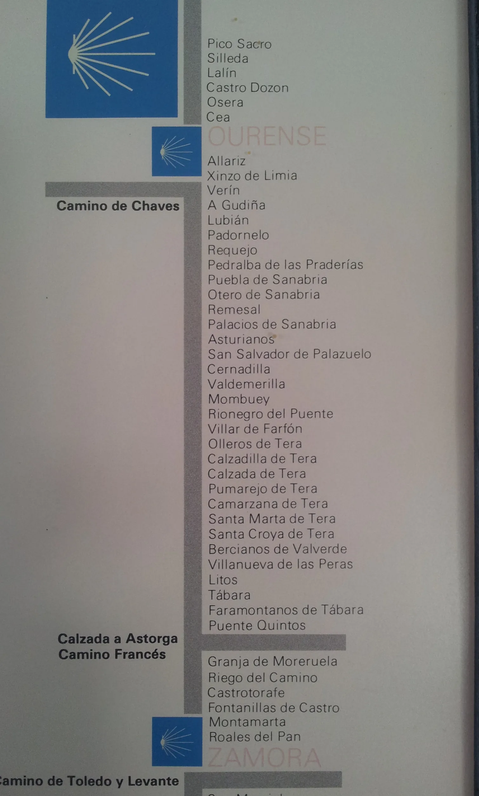
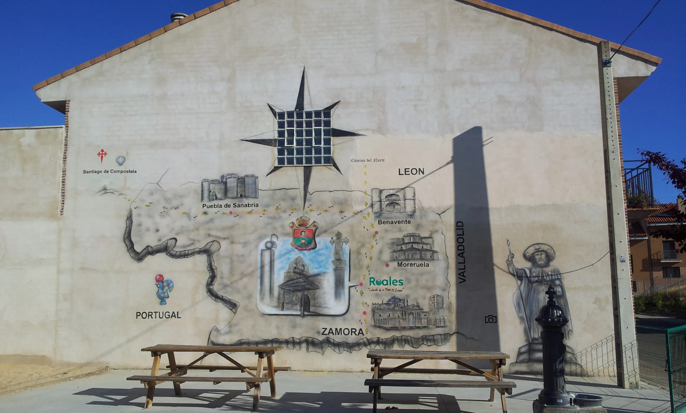
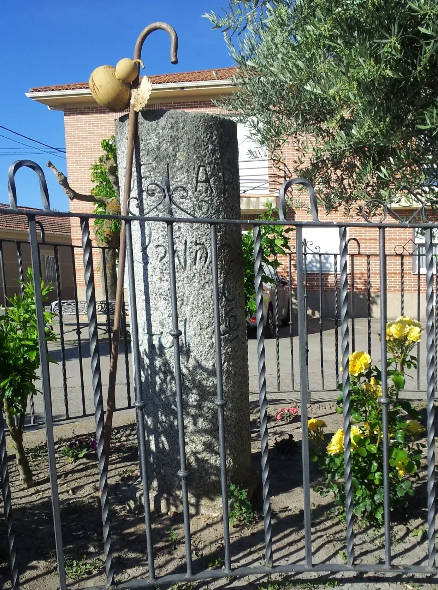
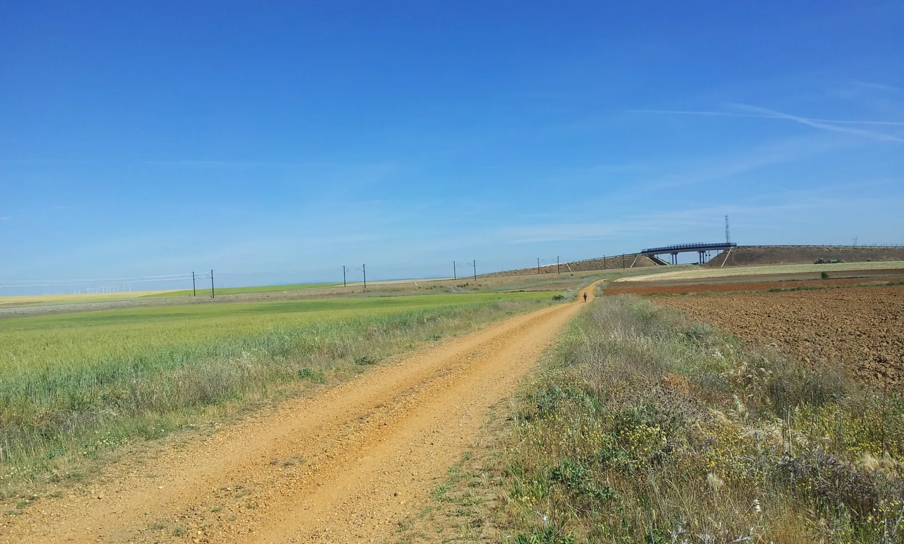
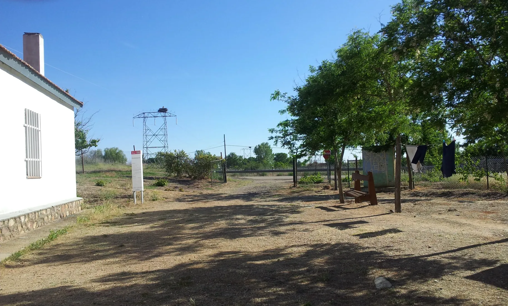

## Camino de Levante 2019

### Etappe-36: Zamora  →  Montamarta ( 19,2 Km)
**28 Mai 2019** 👣  

---

  

🗺️

 🇬🇧 🇪🇸 🇵🇹 🇩🇪 🥾

---

↪ [Etappe-37_Montamarta_Granja-de-Moreruela](Etappe-37_Montamarta_Granja-de-Moreruela.md)

🔁  [Camino-de-Levante_Etapas](../03_Camino-Levante_2015_2019/Camino-de-Levante_Etapas.md)

 ...→