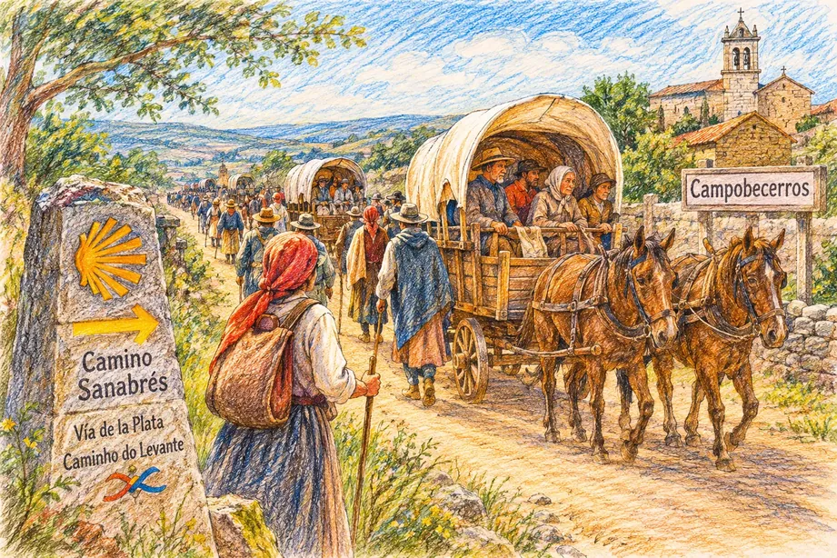

## Camino de Levante 2019

### Etappe-44: Campobecerros →  Ruhetag
**05 Juni 2019** 👣  

#### 🇩🇪 Aus einer fernen Welt

**Es geschah auf dem Camino Sanabrés, dort, wo die Pfade der Vía de la Plata und des Caminho do Levante ineinanderfließen und die Sehnsucht des Südens auf den Aufbruch des Ostens trifft.** 

Vor über fünfzig Jahren zog hier ein mächtiger Tross von mehr als 100 Pilgern vorbei. Sie stammten aus Andalusien und hatten bereits die staubige Unendlichkeit der _Cañada Real_ hinter sich gelassen. Wie eine lebendige Karawane aus einer anderen Zeit zogen sie mit ihren Pferdewagen durch Campobecerros nach Nordwesten, dem Sehnsuchtsort Santiago entgegen. Es war eine eingeschworene Gemeinschaft auf Rädern und Hufeisen: Wer alt war oder wessen Kräfte schwanden, fand Zuflucht auf den hölzernen Wagen, getragen vom Rhythmus der Pferde, bis der Körper sich erholte und der Wille weiterzuziehen zurückkehrte. Diese Szene brannte sich tief in das Leben einer Frau aus Campobecerros ein. Bewegt von der stillen Wucht dieses Augenblicks, schloss sie sich ihnen an und begleitete den Zug aus tiefer Verbundenheit über 16 Kilometer hinweg durch die galicische Landschaft."

---
#### 🇪🇸 De un mundo lejano

**Ocurrió en el Camino Sanabrés, justo allí donde se funden los pasos de la Vía de la Plata y del Caminho do Levante, donde el alma del sur se abraza con el rumbo del este.** 

Hace más de cincuenta años, una imponente comitiva de más de 100 peregrinos cruzó este paisaje. Venían desde Andalucía, con el cansancio sagrado y el polvo de la _Cañada Real_ aún en sus botas. Como una caravana eterna suspendida en el tiempo, avanzaban con sus carros de caballos a través de Campobecerros, empujados por el viento del noroeste hacia Santiago. Era una comunidad unida por el camino: los ancianos y aquellos cuyos cuerpos flaqueaban encontraban cobijo en el interior de los carros, acunados por el trote de los caballos, hasta que el alma recuperaba las fuerzas para volver a andar. Aquel instante transformó para siempre la vida de una vecina de Campobecerros. Conmovida por la magia callada de la caravana, decidió unirse a ellos y, si la memoria no me falla, caminó a su lado, compartiendo el mismo latido, a lo largo de 16 kilómetros. 

#### 🇵🇹 De um mundo longínquo

**Aconteceu no Caminho Sanabrés, precisamente onde se cruzam os passos da Vía de la Plata e do Caminho do Levante, ligando a alma do sul ao pulsar do leste.** 

Há mais de cinquenta anos, uma impressionante comitiva de mais de 100 peregrinos passou por aqui. Vinham do sul profundo, da Andaluzia, trazendo consigo a poeira e a imensidão da _Cañada Real_. Como uma caravana mística saída de outra época, avançavam com as suas carroças puxadas a cavalos por Campobecerros, rumo ao noroeste, em direção a Santiago. Formavam uma verdadeira comunidade sobre rodas: os mais idosos e aqueles que se sentiam desfalecer encontravam refúgio e descanso nas carroças, embalados pelo ritmo dos cavalos, até recuperarem as forças para voltar a pisar a terra. Este momento tocou profundamente a vida de uma senhora de Campobecerros. Tocada pela beleza daquela união, ela decidiu juntar-se ao cortejo e, se bem me lembro, acompanhou-os lado a lado durante 16 quilômetros.

🇬🇧 From a far away world

**It happened on the Camino Sanabrés, at the very confluence where the paths of the Vía de la Plata and the Caminho do Levante weave together, uniting the spirit of the south with the journey of the east.

** More than fifty years ago, a powerful convoy of over 100 pilgrims passed through here. Hailing from Andalusia, they carried with them the dust and endurance of the ancient _Cañada Real_. Like a living caravan detached from time, they journeyed with their horse-drawn carriages through Campobecerros, driven toward the northwest, heading for Santiago. They were a sanctuary on the move: the elderly and those whose bodies were failing found refuge in the wooden carriages, cradled by the rhythm of the horses until their strength returned and their spirits cleared. This poignant moment etched itself forever into the soul of a lady from Campobecerros. Moved by the quiet grandeur of the procession, she stepped into their rhythm and, if I remember correctly, walked by their side for 16 kilometers through the Galician hills. 

---

  

🗺️

 🇬🇧 🇪🇸 🇵🇹 🇩🇪 🥾

---

↪ [Etappe-45_Campobecerros_Vilar-de-Barrio](Etappe-45_Campobecerros_Vilar-de-Barrio.md)

🔁  [Camino-de-Levante_Etapas](../03_Camino-Levante_2015_2019/Camino-de-Levante_Etapas.md)

 ...→