## Camino de Levante 2019

### Etappe-50: Ávila  →   ( Km)
**11 Juni 2019** 👣  

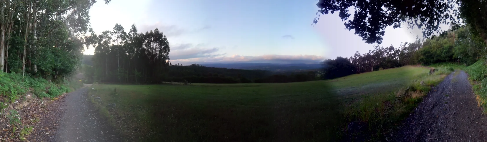

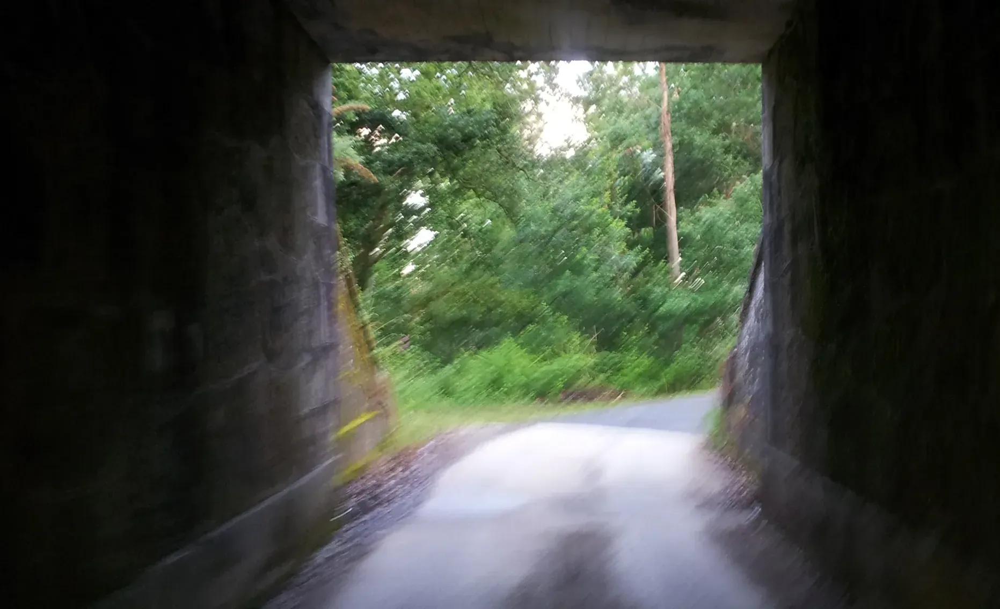

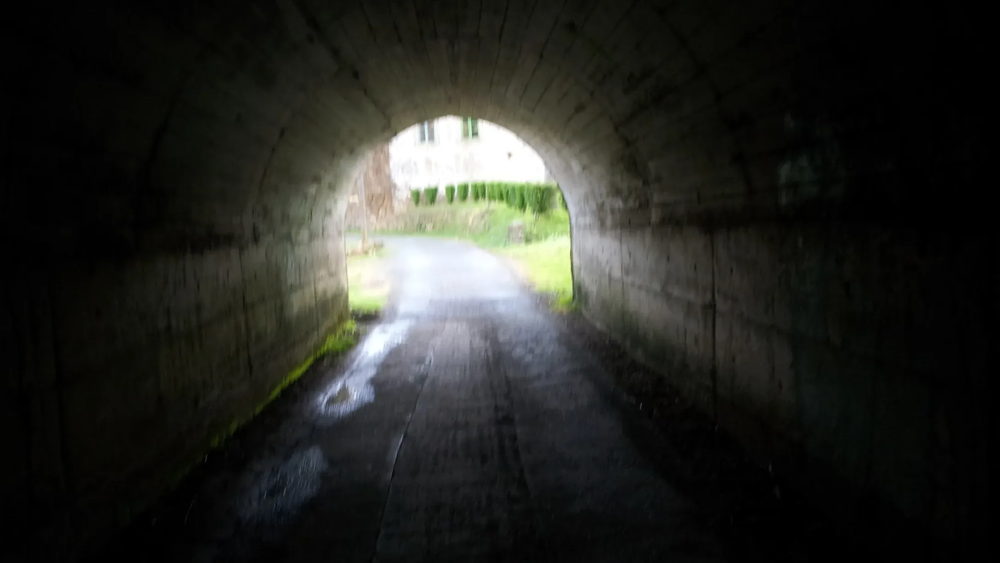

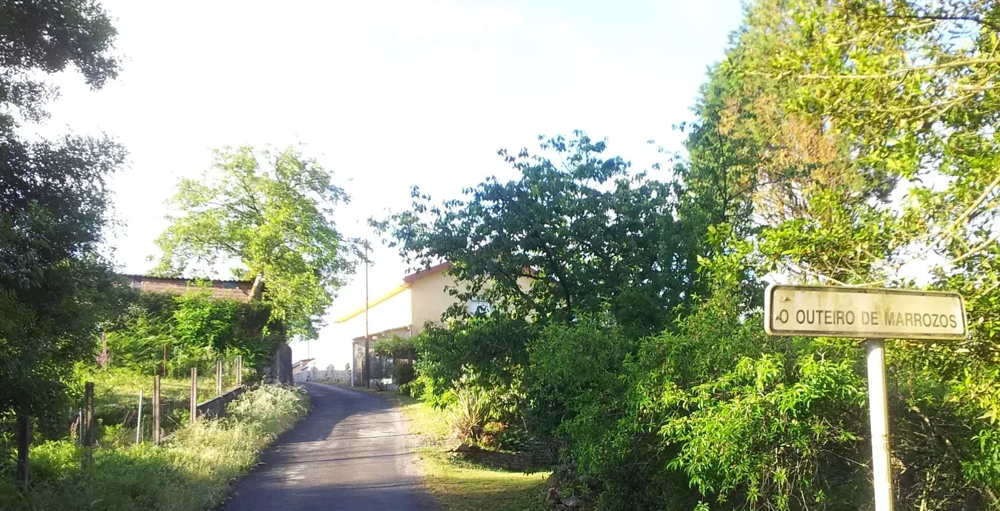

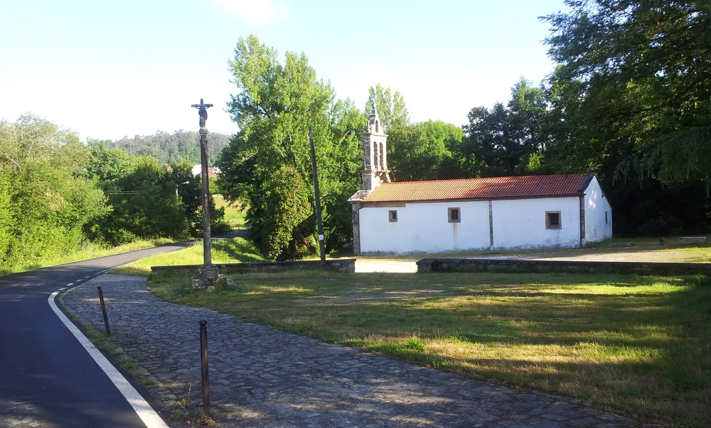

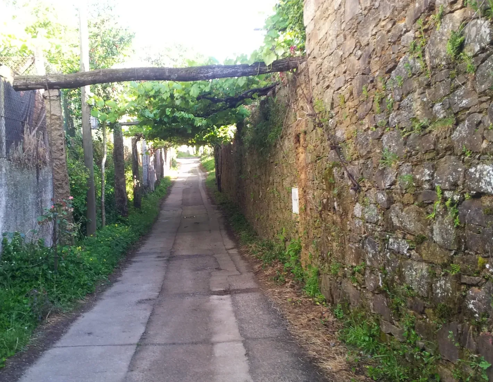

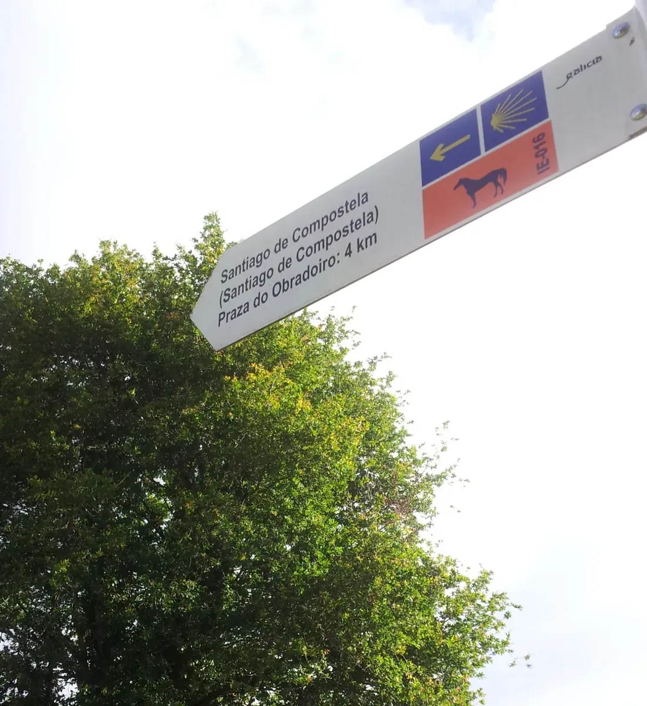

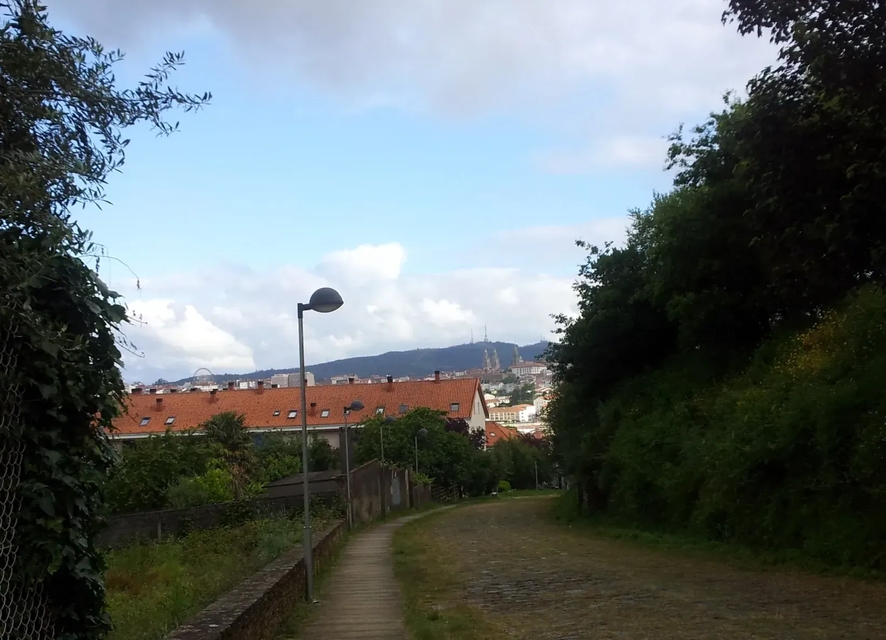

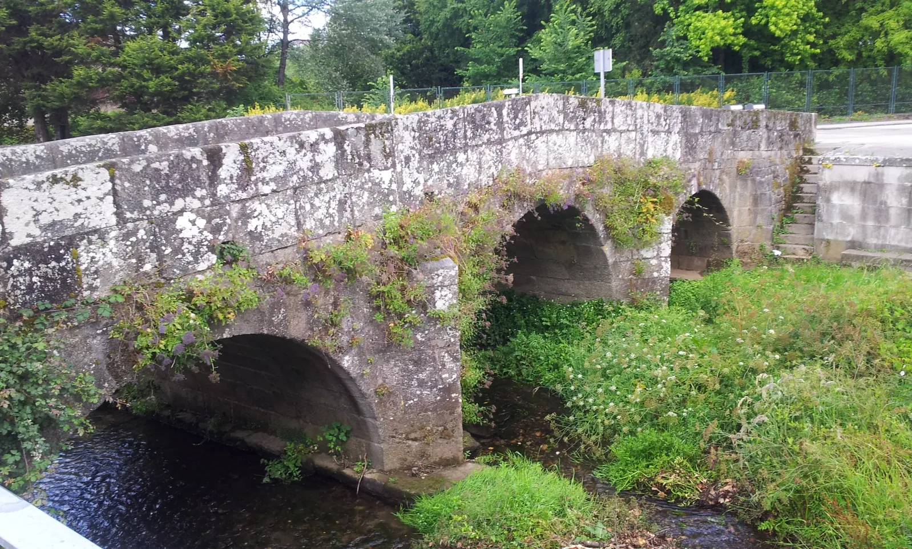

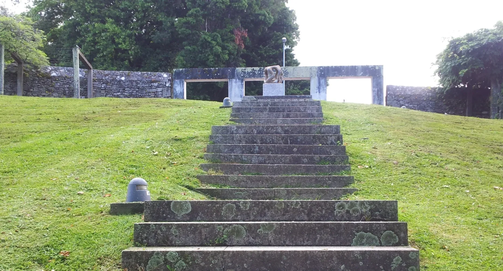

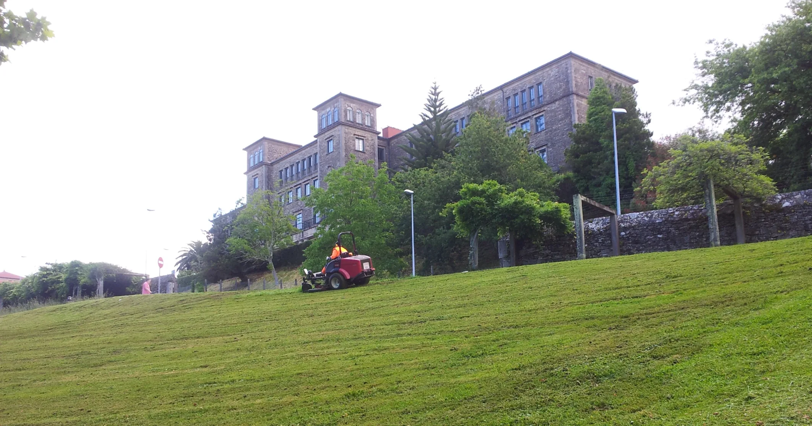

---

  

🗺️

 🇬🇧 🇪🇸 🇵🇹 🇩🇪 🥾

---

↪ [Etappe-51_Santiago-de-Compostela_San-Francisco](Etappe-51_Santiago-de-Compostela_San-Francisco.md)

🔁  [Camino-de-Levante_Etapas](Camino-de-Levante_Etapas.md)

 ...→