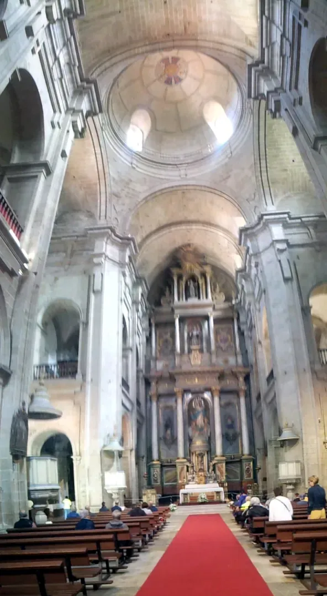
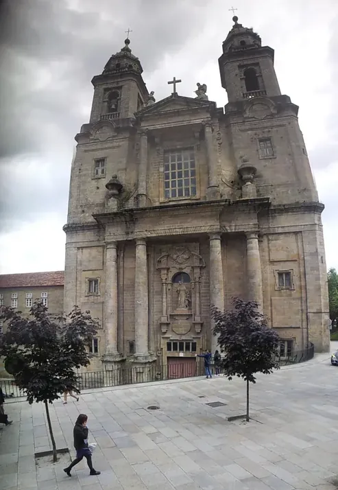
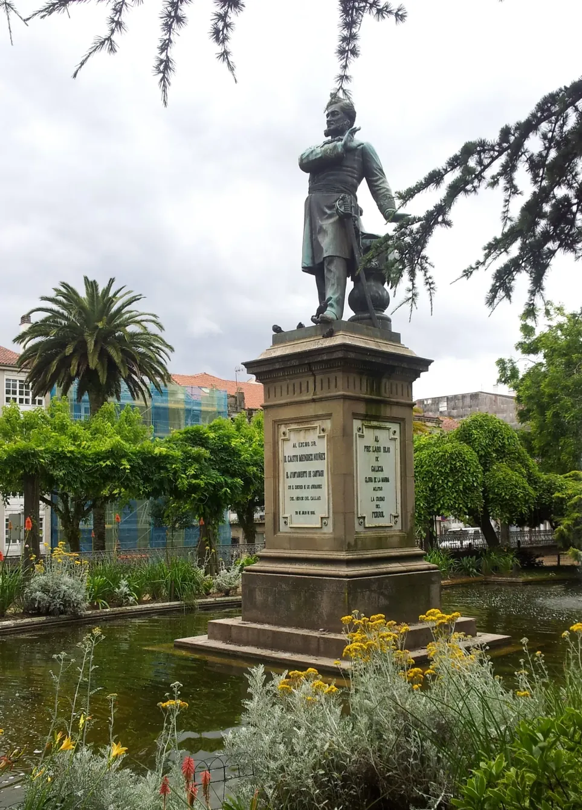
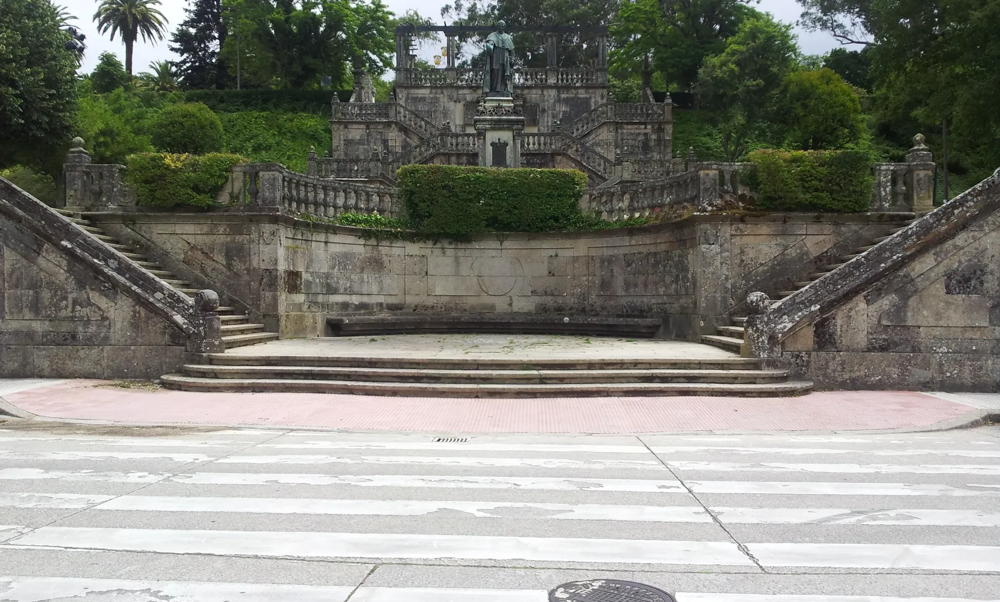
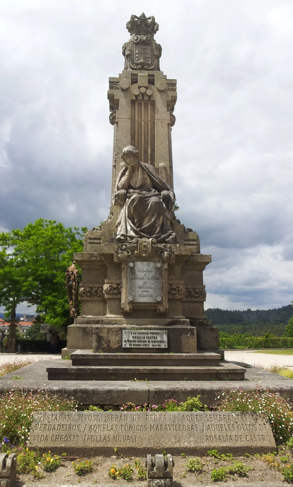
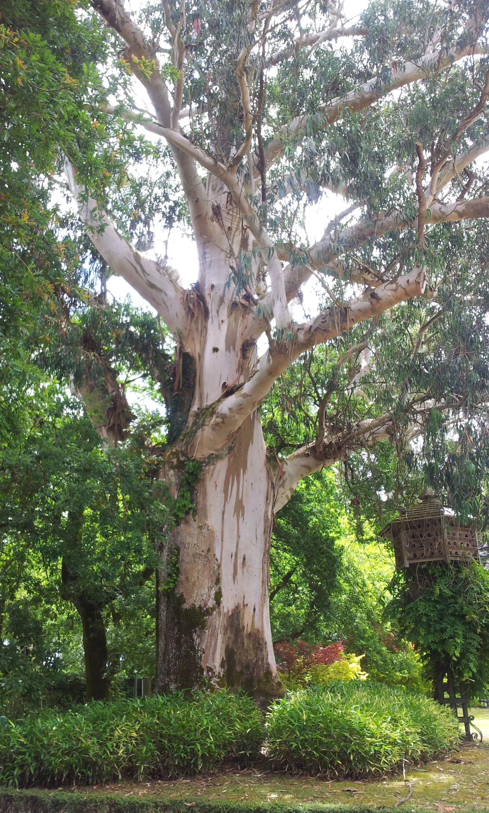

## Camino de Levante 2019

### Etappe-51: Santiago de Compostela →  San-Francisco (ca  xx m)
**12 Juni 2019** 👣  

- 🇩🇪 Das Foto wurde mit der Panoramafunktion der Kamera aufgenommen, da ich nicht weit genug zurücktreten konnte, um die gesamte Kirche einzufangen. Heute würde ich mit meinem neuen Handy einfach den 0,5-fach-Zoom verwenden.  

- 🇬🇧  The photo was taken using the camera’s panorama function, as I couldn’t step back far enough to capture the whole church. Today, I’d simply use the 0.5x zoom on my new mobile phone. 

- 🇵🇹 A fotografia foi tirada com a função panorâmica da câmara, uma vez que não consegui recuar o suficiente para captar toda a igreja. Hoje, com o meu novo telemóvel, bastaria usar o zoom de 0,5x. 

- 🇪🇸  La foto se tomó con la función panorámica de la cámara, ya que no podía alejarme lo suficiente para capturar toda la iglesia. Hoy en día, con mi nuevo móvil, simplemente utilizaría el zoom de 0,5x.  

---

  

🗺️

 🇬🇧 🇪🇸 🇵🇹 🇩🇪 🥾

---

↪ [Etappe-01_Valencia_Silla](../03_Camino-Levante_2015_2019/Etappe-01_Valencia_Silla.md)

🔁  [Camino-de-Levante_Etapas](../03_Camino-Levante_2015_2019/Camino-de-Levante_Etapas.md)

**←** 🔁  [Etapas – Santiago de Compostela→Fátima]( https://github.com/GomesDeSa-JA/Camino-del-Salvador_2023-2025/blob/main/Caminhos-de-Fatima/2_Santiago_Fatima_2019/Caminho-de-Fatima_Etapas.md)

**←** 🔁 [ Os Caminhos](https://github.com/GomesDeSa-JA/Camino-del-Salvador_2023-2025/blob/main/Os_Caminhos.md)

 ...→