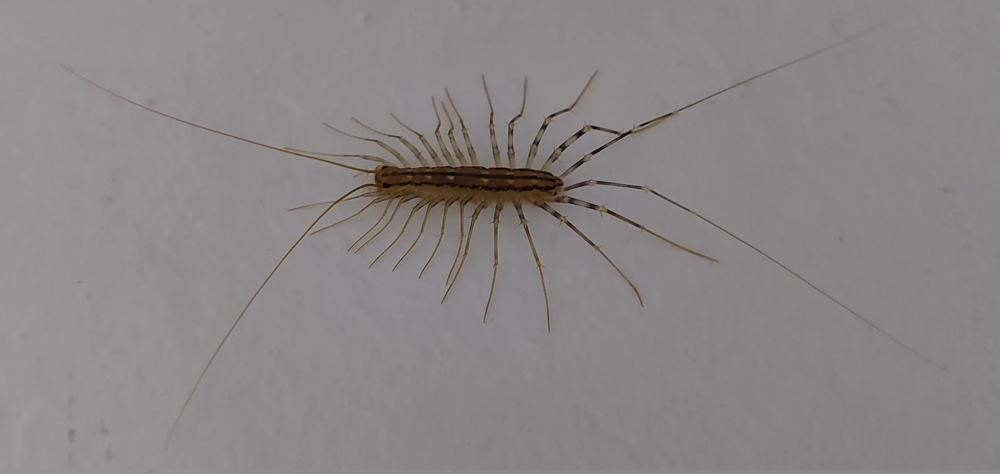

Wie heißt das Insekt oder Kriechtier, das 26 Beine hat – 13 rechts und 13 links –, 4 Fühler,2 hinten und 2 vorne?

Ich habe es in Ruhe gelassen. Welche Farbe hat es: Die Beine sind halbtransparent braun und weisen entlang des gesamten Körpers auf der Rückseite einige etwas dunklere Streifen auf.

Mit dieser genauen Beschreibung ist die Bestimmung eindeutig: Es handelt sich um einen **Spinnenläufer** (_Scutigera coleoptrata_).

Alle deine Beobachtungen passen exakt auf dieses Tier:

- **Längsstreifen auf dem Rücken:** Der Spinnenläufer hat eine gelblich-graue bis bräunliche Grundfarbe und drei charakteristische **dunkle Längsstreifen** entlang des Rückens.
- **Halbtransparente Beine:** Seine sehr langen, dünnen Beine sind hellbraun bis gelblich, leicht durchscheinend und oft **dunkel geringelt**.
- **26 Beine (plus „Fühler“):** Ausgewachsene Spinnenläufer besitzen **15 Beinpaare** (30 Beine). Davon nutzt das Tier 13 Paare (also exakt **26 Beine**) aktiv zum Laufen. Das vorderste Beinpaar ist zu nach vorne gerichteten Kieferfüßen umgewandelt (was zusammen mit den zwei langen Antennen vorne nach mehreren Fühlern aussieht), und das hinterste, extrem lange Beinpaar wird waagerecht nach hinten gestreckt – das wirkt exakt wie **zwei Fühler am Hinterteil**. (Alternativ kann es auch ein fast ausgewachsenes Jungtier mit 13 Beinpaaren sein).

Gut zu wissen über deinen Mitbewohner

Dass du ihn in Ruhe gelassen hast, war genau richtig. Der Spinnenläufer ist ein **reiner Nützling** in der Wohnung:

- **Schädlingsbekämpfer:** Er jagt nachts blitzschnell Silberfischchen, Motten, Fliegen, Kakerlaken und kleine Spinnen.
- **Völlig harmlos:** Er zerstört keine Möbel, geht nicht an Lebensmittel und vermehrt sich in normalen, trockenen Wohnräumen kaum. Für Menschen ist er ungefährlich (er kann zwar theoretisch leicht kneifen, falls man ihn fest in der Hand drückt, flieht aber normalerweise sofort).

Zur Beruhigung noch ein kurzes Wort dazu:

- **Kein Interesse am Menschen:** Spinnenläufer sind reine Jäger kleiner Insekten und stechen oder beißen Menschen nicht zur Nahrungsaufnahme.
- **Extrem seltene Bisse:** Ein Biss kommt praktisch nur vor, wenn man das Tier versehentlich einklemmt oder mit bloßer Hand fest packt. Selbst dann durchdringen die Kieferklauen die menschliche Haut kaum.

- **Milde Wirkung:** Falls es doch einmal zu einem Biss kommt, fühlt er sich höchstens wie ein leichter Mücken- oder Bienenstich an und klingt meist nach wenigen Stunden ab. Echte allergische Reaktionen sind extrem selten.

